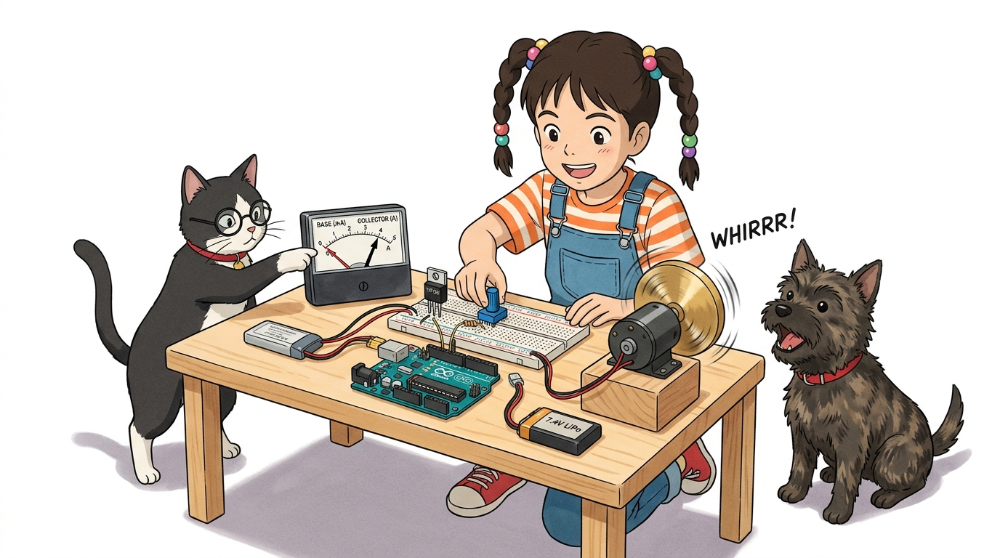
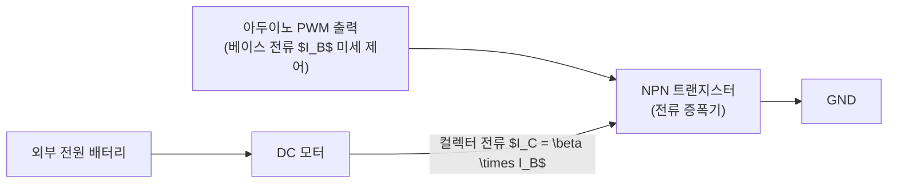

# 096_DC모터전류제어_토크 💪⚡



**도로시와 지니가 함께하는 트랜지스터(Transistor)의 전류 증폭과 PWM 속도 밸브 조절 마법**
* 👧 **도로시**: "지니야! 릴레이는 전원을 켜거나 끄는 것만 되잖아! 미니카 바퀴 속도를 부드럽게 올리거나 힘을 조절하려면 전기를 수도꼭지처럼 조금씩 더 많이 틀어줄 순 없을까?"
* 🐱 **지니**: "아주 날카로운 생각이야! 그럴 때 사용하는 전자식 수도꼭지가 바로 **트랜지스터(Transistor)** 란다! 아두이노의 작은 제어 신호로 거대한 전류의 수문을 활짝 열어줄 수 있지!"
* 🐶 **토토**: "바우! 가변저항 손잡이를 돌려 자동차 액셀러레이터를 밟아보자 멍!"
* 📖 **상세 강의 교재**: [index.md](./index.md)


> 여러분 안녕하세요! 이번 시간에는 '096. DC모터전류제어 토크 💪⚡'을 주제로 함께 흥미진진한 탐험을 떠나보겠습니다. 오늘 강의에서는 특히 도로시와 지니가 함께하는 트랜지스터(Transistor)의 전류 증폭과 PWM 속도 밸브 조절 마법, 👧 도로시: "지니야! 릴레이는 전원을 켜거나 끄는 것만 되잖아! 미니카 바퀴 속도를 부드럽게 올리거나 힘을 조절하려면 전기를 수도꼭지처럼 조금씩 더 많이 틀어줄 순 없을까?"를 중심으로 핵심 원리와 응용 방법을 차근차근 배워보겠습니다. 마법 멘토 지니와 호기심 많은 탐험가 도로시, 그리고 귀여운 토토와 함께 신나는 아두이노 모험을 힘차게 시작해 봅시다. 준비되셨나요?

---

## 1. 도로시의 궁금증: 수도꼭지처럼 전류를 조절할 수 없을까?


* **전류 증폭률 ($\beta$ 또는 $h_{FE}$)**:
* 트랜지스터는 베이스(B)에 흐르는 작은 전류를 수십~수백 배로 뻥튀기하여 컬렉터-에미터(C-E) 사이에 흐르게 합니다.
* 달링턴 트랜지스터(TIP120 등)는 $\beta$ 값이 1000 이상에 달해, 아두이노의 수 mA 신호로 수 암페어(A)의 모터 전류를 거뜬히 통제합니다.

### 🚰 온/오프 스위칭을 넘어 연속적인 전류 가변으로
릴레이는 기계식 접점이 붙거나 떨어지는 단순 2진(ON/OFF) 동작만 가능합니다. 하지만 DC 모터의 회전력(토크)과 속도는 코일에 흐르는 전류의 양에 비례하므로, 전류량을 부드럽게 증감시킬 수 있는 반도체 소자가 필요합니다.



> 자, 이번 슬라이드의 질문을 함께 보시겠습니다. 바로 '1. 도로시의 궁금증: 수도꼭지처럼 전류를 조절할 수 없을까?'라는 아주 흥미로운 질문입니다. 우리가 일상에서 흔히 접하는 전류 증폭률 ($\beta$ 또는 $h{FE}$) 현상을 떠올려보면 왜 이런 의문이 생기는지 쉽게 공감할 수 있습니다. 이 질문 속에 숨겨진 전자 회로와 컴퓨팅의 핵심 원리를 지금부터 차근차근 하나씩 파헤쳐 보겠습니다.

---

## 2. 전자 밸브: 트랜지스터의 3단자 동작 원리


* [!NOTE]
* 베이스 저항(1kΩ)을 반드시 달아야 하는 이유:
* 베이스-에미터 접합부는 다이오드 구조이므로 저항 없이 아두이노 핀을 직결하면 쇼트 상태가 되어 핀에 과전류가 흘러 아두이노가 손상될 수 있습니다.

| 트랜지스터 단자 | 영어 명칭 및 약칭 | 수도 시스템 비유 | 회로 연결 가이드 |
| :--- | :--- | :--- | :--- |
| **베이스** | **Base (B)** | 수도꼭지 손잡이 (미세 힘) | 아두이노 **디지털 9번 PWM 핀** (1kΩ 보호 저항 연결) |
| **컬렉터** | **Collector (C)** | 물이 모여드는 유입관 | **DC 모터의 (-) 출력선** |
| **에미터** | **Emitter (E)** | 물이 빠져나가는 배수관 | **전원 접지 (GND)** |

### 🔍 베이스, 컬렉터, 에미터의 역할 분담
NPN 바이폴라 트랜지스터(BJT)의 세 단자는 수도 시스템과 완벽히 대응됩니다.

> 이번에 살펴볼 내용은 '2. 전자 밸브: 트랜지스터의 3단자 동작 원리'입니다. 슬라이드에 정리된 표를 통해 각 항목의 특징과 수치, 차이점을 한눈에 비교해 보실 수 있습니다. 이 기본 개념을 확실히 잡아두셔야 실제 부품을 브레드보드에 꽂고 코딩할 때 실수 없이 완성할 수 있습니다.

---

## 3. 브레드보드 회로 구성 및 부품 연결


1. 브레드보드에 NPN 파워 트랜지스터(TIP120 또는 2N2222)를 꽂습니다.
2. 아두이노 **디지털 9번(PWM) 핀**에서 **1kΩ 저항**을 거쳐 트랜지스터 **베이스(B)** 로 연결합니다.
3. DC 모터의 한쪽 선을 **5V(또는 외장 배터리 +)** 에 연결하고, 다른 쪽 선을 트랜지스터 **컬렉터(C)** 에 연결합니다.
4. 트랜지스터 **에미터(E)** 를 아두이노 **GND**에 연결합니다.
5. **[필수] 모터 양단에 플라이백 다이오드(1N4007)를 역방향으로 병렬 장착**합니다. (은색 띠가 모터 (+) 방향)
6. 아날로그 **A0 핀**에 가변저항의 중앙 신호선을 연결합니다.

### 🛠️ 안전한 모터 제어를 위한 5단계 배선

> 이번에 살펴볼 내용은 '3. 브레드보드 회로 구성 및 부품 연결'입니다. 화면의 회로도와 부품 사진을 보면서 각 핀과 배선이 어떻게 구성되어 있는지 눈으로 직접 따라와 주시기 바랍니다. 첫째로 브레드보드에 NPN 파워 트랜지스터(TIP120 또는 2N2222)를 꽂습니다.에 유의해야 하며, 둘째로 아두이노 디지털 9번(PWM) 핀에서 1kΩ 저항을 거쳐 트랜지스터 베이스(B) 로 연결합니다.라는 점이 핵심입니다. 이 기본 개념을 확실히 잡아두셔야 실제 부품을 브레드보드에 꽂고 코딩할 때 실수 없이 완성할 수 있습니다.

---

## 4. 실습 코드: 가변저항으로 실시간 속도 조절하기 (Speed Controller)


### 💻 가변저항의 0~1023 입력을 PWM 0~255로 매핑하여 모터 구동

```cpp
const int motorPin = 9; // 트랜지스터 제어용 PWM 핀 (~9)
const int potPin = A0;   // 가변저항 아날로그 입력 핀

void setup() {
  pinMode(motorPin, OUTPUT);
  Serial.begin(9600);
  Serial.println("가변저항 DC 모터 스피드 컨트롤러 가동!");
}

void loop() {
  int potValue = analogRead(potPin); // 가변저항 아날로그 값 읽기 (0 ~ 1023)
  
  // map(입력값, 최소, 최대, 목표최소, 목표최대)
  int motorSpeed = map(potValue, 0, 1023, 0, 255); // PWM 듀티비(0 ~ 255)로 변환
  
  analogWrite(motorPin, motorSpeed); // 트랜지스터 베이스로 PWM 신호 공급!
  
  // 시리얼 모니터로 속도 상태 확인
  Serial.print("가변저항: "); Serial.print(potValue);
  Serial.print(" -> 모터 PWM 출력: "); Serial.println(motorSpeed);
  
  delay(20); // 안정적인 아날로그 샘플링 딜레이
}
```

> 이번 슬라이드에서는 '4. 실습 코드: 가변저항으로 실시간 속도 조절하기 (Speed Controller)'에 대한 실제 동작 코드를 분석해 보겠습니다. 화면의 코드를 살펴보시면, 컴퓨터가 아두이노 하드웨어에 단계별로 명령을 내리는 흐름을 명확하게 확인할 수 있습니다. 각 함수의 역할과 괄호 안의 매개변수가 하드웨어 핀과 어떤 관계를 맺고 동작하는지 주의 깊게 살펴보시기 바랍니다.

---

## 🌟 도로시와 지니의 핵심 요약 노트!


* 👧 **도로시**: "가변저항을 돌릴 때마다 트랜지스터가 수도꼭지처럼 모터에 전기를 조금씩 더 흘려주어서, 자동차 액셀을 밟듯 속도가 붕~ 하고 올라가는구나!"
* 🐱 **지니**: "맞아! 트랜지스터와 아두이노의 PWM 신호가 만나면 거대한 모터 전류도 손가락 하나로 섬세하게 주무를 수 있단다."
* 🐶 **토토**: "바우! 이제 모터의 속도뿐만 아니라 방향까지 앞뒤로 뒤집어주는 **인버터와 H-브리지**를 정복하러 가자 멍!"

> 오늘 배운 '🌟 도로시와 지니의 핵심 요약 노트!'의 핵심 내용을 모두 정리해 보았습니다. 오늘 다룬 내용 중에서도 👧 도로시: "가변저항을 돌릴 때마다 트랜지스터가 수도꼭지처럼 모터에 전기를 조금씩 더 흘려주어서, 자동차 액셀을 밟듯 속도가 붕~ 하고 올라가는구나!" 부분은 앞으로의 아두이노 실습과 프로젝트에서 계속 사용되는 매우 중요한 기초 지식입니다. 오늘 배운 내용을 꼭 다시 한번 복습해 보시고, 다음 강의에서 더욱 신나고 유익한 모험으로 다시 만나겠습니다. 모두 수고 많으셨습니다!