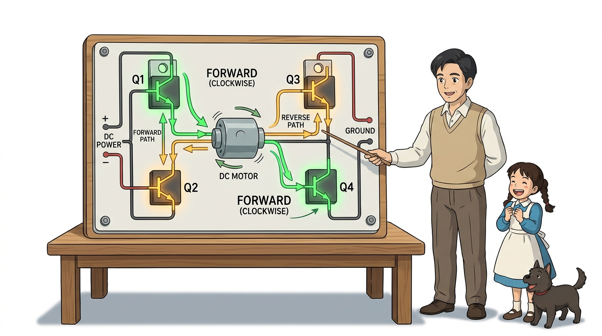
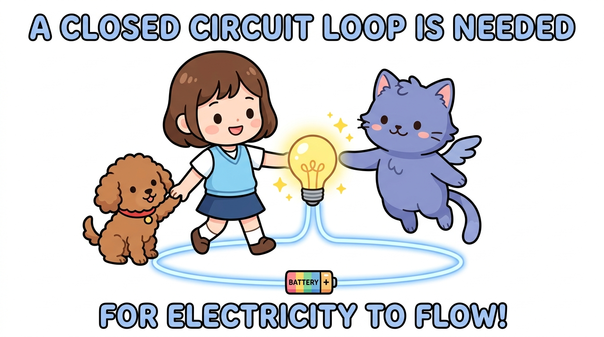
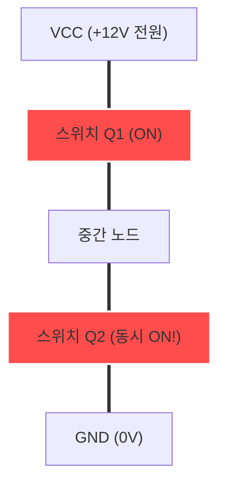

# 097_인버터제어_H브리지원리 🔄🔀

**도로시와 지니가 함께하는 전류의 방향을 180도 뒤집어 모터를 정회전·역회전시키는 H-브리지 인버터 원리**

* 👧 **도로시**: "지니야! 단일 트랜지스터로는 모터 속도만 조절할 수 있고, 방향을 뒤집으려면 손으로 전선을 뽑아 반대로 꽂아야 해! 달리던 자동차가 명령 한 번으로 스스로 후진하게 만들 수는 없을까?"
* 🐱 **지니**: "그럴 때 바로 전류의 흐름 방향을 자유자재로 뒤집어주는 **인버터(Inverter, 극성 반전기)** 회로가 필요한 거야! 전자 스위치 4개를 조합하면 전선을 손대지 않고도 즉시 후진 기어를 넣을 수 있단다!"
* 🐶 **토토**: "바우! 전진과 후진, 급브레이크까지 자유자재로 움직이는 무선 조종차가 눈앞에 보인다 멍!"

* 🖥️ **강의 슬라이드**: [slides.md](./slides.md)

---

## 1. 도로시의 고민: 단방향 구동에서 양방향 제어로의 진화

### 🔄 양방향 회전이 필요한 로보틱스 시스템

선풍기나 헤어드라이어는 한쪽 방향으로만 돌면 충분하지만, 자동차 바퀴, 엘리베이터, 드론, 로봇 팔 관절 등은 필연적으로 **정방향(CW, 전진)** 과 **역방향(CCW, 후진)** 을 모두 지원해야 합니다.

* **단방향 구동 (1개 트랜지스터)**:
  * 모터의 한쪽 단자가 전원(VCC)에 고정되어 있으므로 오직 속도 제어만 가능합니다.
* **양방향 구동 (인버터 / H-브리지)**:
  * 모터 양단의 전압 극성을 (+/-)에서 (-/+)로 번개처럼 교체할 수 있어 즉각적인 방향 전환이 가능합니다.

---

## 2. 인버터(Inverter)란 무엇일까요?

### ⚡ 직류(DC)의 흐름을 양방향으로 스위칭하는 전력 전자 시스템

본래 인버터는 직류(DC)를 교류(AC)로 변환하는 장치를 의미하지만, 모터 제어 분야에서는 **부하에 걸리는 전압 극성을 능동적으로 뒤집어주는 양방향 전력 스위칭 회로**를 통칭합니다.

---

## 3. H-브리지의 4대 스위치 동작 모드 완전 분석

### 🔀 4개의 트랜지스터(Q1, Q2, Q3, Q4)가 만드는 4가지 물리적 상태

모터를 중심에 두고 좌측 상하(Q1, Q2), 우측 상하(Q3, Q4)로 배치된 스위치는 다음과 같은 모드로 작동합니다.

| 제어 모드 | 활성화 스위치 (ON) | 차단 스위치 (OFF) | 모터 양단 전류 경로 | 실제 기계 동작 |
| :--- | :---: | :---: | :--- | :--- |
| **정회전 (Forward)** | **Q1, Q4** | Q2, Q3 | VCC ➡️ Q1 ➡️ 모터(좌 $\to$ 우) ➡️ Q4 ➡️ GND | **시계 방향 전진 주행** |
| **역회전 (Reverse)** | **Q2, Q3** | Q1, Q4 | VCC ➡️ Q3 ➡️ 모터(우 $\to$ 좌) ➡️ Q2 ➡️ GND | **반시계 방향 후진 주행** |
| **급제동 (Brake)** | **Q2, Q4 (하단)** | Q1, Q3 | 모터 양단이 GND로 단락 (발전기 폐루프 형성) | **역기전력 발전 제동 (급정지)** |
| **자유 회전 (Coast)** | **모두 OFF** | 전체 | 모터 양단이 완전히 개방됨 (전류 0) | 관성에 의해 서서히 감속 |

---

## 4. 치명적인 위험: 직통 단락(Shoot-Through) 현상

### 🚨 전원과 접지가 직결되는 폭발적인 합선을 막아라!

H-브리지 회로를 직접 설계할 때 가장 주의해야 할 치명적인 버그가 바로 **직통 단락(Shoot-Through)** 입니다.

* **원인**:
  * 같은 쪽 세로 라인의 **Q1과 Q2(또는 Q3과 Q4)가 아주 잠깐이라도 동시에 ON** 되면, 모터를 거치지 않고 전원(VCC)에서 접지(GND)로 수십 암페어의 단락 전류가 폭포수처럼 쏟아집니다.
* **결과**:
  * 트랜지스터가 0.01초 만에 폭발하거나 배터리가 부풀어 오르고 불이 납니다!
* **방지 대책: 데드타임(Dead Time)**:
  * 방향을 전환할 때는 반드시 이전 스위치를 완전히 끄고 **수 마이크로초(µs) 이상의 휴식 시간(Dead Time)** 을 둔 뒤 반대편 스위치를 켜야 안전합니다.

---

## 🌟 도로시와 지니의 핵심 요약 노트!

* 👧 **도로시**: "H자 모양으로 트랜지스터 4개를 배치하고 대각선(Q1-Q4, Q2-Q3)으로 번갈아 켜면 전선을 바꾸지 않고도 전진과 후진을 자유자재로 바꿀 수 있구나!"
* 🐱 **지니**: "맞아! 그리고 같은 라인의 위아래 스위치를 동시에 켜면 폭발적인 합선(Shoot-Through)이 일어나니 항상 조심해야 한단다."
* 🐶 **토토**: "바우! 이제 이 복잡한 H-브리지 회로를 칩 하나에 완벽하게 패키징한 국민 드라이버 **L298N**을 정복하러 가자 멍!"
