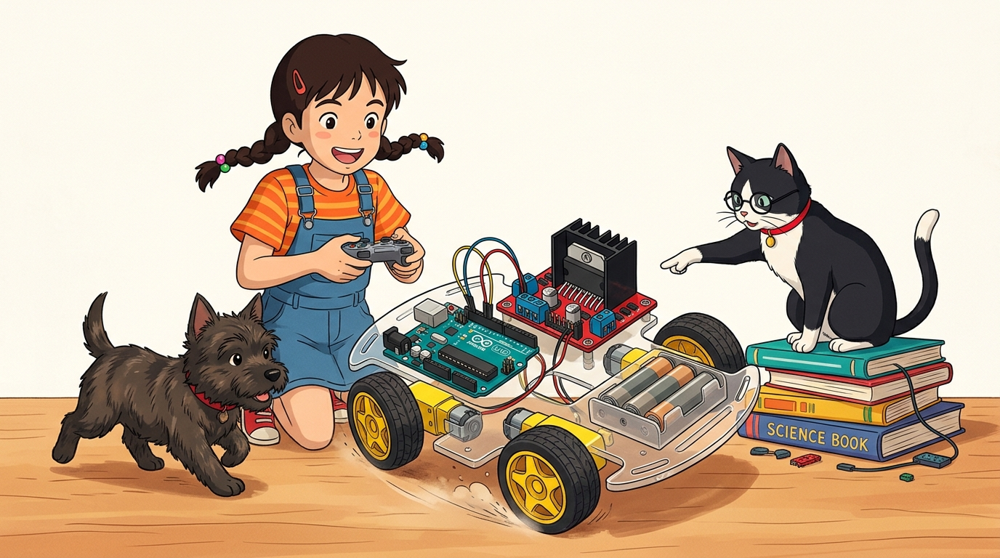
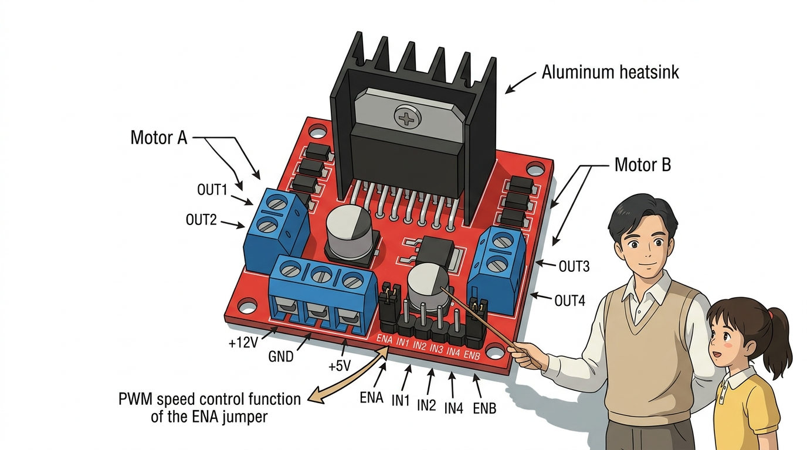
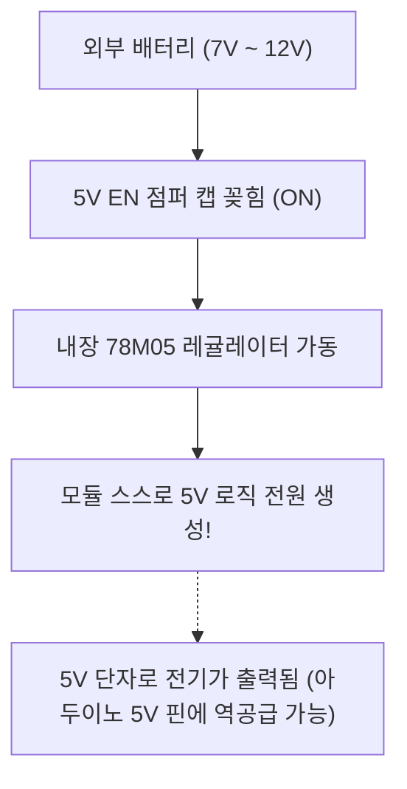

# 098_L298N_듀얼모터드라이버 🦾🏎️

**도로시와 지니가 함께하는 자율주행 로봇카의 핵심 심장, L298N 듀얼 H-브리지 모듈 완전 정복**
* 👧 **도로시**: "지니야! 아두이노 로봇 자동차 조립 키트를 열었더니 빨간색 네모난 기판 위에 커다랗고 까만 쇠 빗살(방열판)이 우뚝 서 있어! 이건 무슨 부품이야?"
* 🐱 **지니**: "이게 바로 전 세계 모든 메이커들의 스마트 로봇카를 지휘하는 **L298N 듀얼 H-브리지 모터 드라이버 모듈**이야! 왼쪽 바퀴와 오른쪽 바퀴 2개의 모터를 각각 독립적으로 전진, 후진, 급정지, 속도 조절까지 완벽하게 처리해 주는 든든한 근육맨이란다!"
* 🐶 **토토**: "바우! 왼쪽 바퀴는 뒤로, 오른쪽 바퀴는 앞으로 돌리면 제자리에서 팽이처럼 턴(스핀턴)도 할 수 있다 멍!"
* 📖 **상세 강의 교재**: [index.md](./index.md)

> 여러분 안녕하세요! 이번 시간에는 '098. L298N 듀얼모터드라이버 🦾🏎️'을 주제로 함께 흥미진진한 탐험을 떠나보겠습니다. 오늘 강의에서는 특히 도로시와 지니가 함께하는 자율주행 로봇카의 핵심 심장, L298N 듀얼 H-브리지 모듈 완전 정복, 👧 도로시: "지니야! 아두이노 로봇 자동차 조립 키트를 열었더니 빨간색 네모난 기판 위에 커다랗고 까만 쇠 빗살(방열판)이 우뚝 서 있어! 이건 무슨 부품이야?"를 중심으로 핵심 원리와 응용 방법을 차근차근 배워보겠습니다. 마법 멘토 지니와 호기심 많은 탐험가 도로시, 그리고 귀여운 토토와 함께 신나는 아두이노 모험을 힘차게 시작해 봅시다. 준비되셨나요?

---

## 1. 도로시의 눈길: 검은 방열판이 달린 빨간 기판의 정체

* **직접 회로 구현의 한계**:
* 트랜지스터 8개와 다이오드 8개, 보호 저항들을 브레드보드에 직접 꽂으면 배선이 엉망이 되고 쉽게 고장 납니다.
* **L298N 통합 모듈의 강점**:
* STMicroelectronics 사의 고전력 **L298N 칩**을 중심으로 8개의 고속 쇼트키 다이오드, 5V 전압 레귤레이터, 대형 알루미늄 방열판, 나사 단자대가 모두 일체형으로 실장되어 있어 연결이 극도로 간편합니다.

### 🏎️ 2채널 모터 독립 제어의 표준 솔루션
RC카나 2륜 차동 구동(Differential Drive) 모바일 로봇은 좌측 바퀴와 우측 바퀴의 속도 차이를 이용해 방향을 전환합니다.

> 이번 슬라이드에서는 '1. 도로시의 눈길: 검은 방열판이 달린 빨간 기판의 정체'에 대해 자세히 살펴보겠습니다. 화면의 다이어그램과 사진을 함께 참고해 주시기 바랍니다. 첫 번째 핵심은 직접 회로 구현의 한계이며, 두 번째로는 트랜지스터 8개와 다이오드 8개, 보호 저항들을 브레드보드에 직접 꽂으면 배선이 엉망이 되고 쉽게 고장 납니다.입니다. 여기에 덧붙여 L298N 통합 모듈의 강점 내용까지 함께 이해해 두시면 완벽합니다. 이 원리는 아두이노 시스템 전체를 관통하는 핵심 논리이므로 머릿속에 꼭 정리해 두시기 바랍니다.

---

## 2. L298N 모듈의 핵심 하드웨어 스펙

| 기술 사양 항목 | 규격 및 파라미터 | 엔지니어링 해설 |
| :--- | :--- | :--- |
| **드라이버 칩셋** | **L298N Dual H-Bridge IC** | 2개의 독립된 모터를 양방향 동시 제어 |
| **구동 전압 ($V_S$)** | **DC 5V ~ 35V** (권장 7V ~ 12V) | 리튬이온 배터리 2~3셀(7.4V~11.1V)에 최적화 |
| **채널당 연속 전류** | **2.0 A (피크 3.0A)** | 노란색 기어드 DC 모터 2개를 여유롭게 구동 |
| **로직 제어 전압 ($V_{SS}$)**| **DC 5V** (표준 TTL 로직) | 아두이노 5V 신호와 100% 호환 |
| **최대 소비 전력** | **25 W** (내부 온도 75℃ 기준) | 고부하 연속 주행 시 방열판 필수 |
| **내장 보호 기능** | 8개 역기전력 방지 다이오드 | 모터 역서지 전압으로부터 칩 영구 보호 |

### 🦸‍♂️ 거대한 전압과 전류를 견디는 파워 일체형 드라이버
L298N은 바이폴라 트랜지스터 기반의 듀얼 풀 브리지(Dual Full-Bridge) 드라이버로 중소형 DC 모터와 2상 스텝모터를 모두 구동할 수 있습니다.

> 이번에 살펴볼 내용은 '2. L298N 모듈의 핵심 하드웨어 스펙'입니다. 슬라이드에 정리된 표를 통해 각 항목의 특징과 수치, 차이점을 한눈에 비교해 보실 수 있습니다. 이 기본 개념을 확실히 잡아두셔야 실제 부품을 브레드보드에 꽂고 코딩할 때 실수 없이 완성할 수 있습니다.

---

## 3. L298N 나사 단자대와 전원 핀 완벽 해부

* **모터 출력 단자 (파란색 2핀 터미널 2개)**:
* **OUT1, OUT2**: 왼쪽 모터 (Motor A)의 두 전선 연결
* **OUT3, OUT4**: 오른쪽 모터 (Motor B)의 두 전선 연결
* **전원 입력 단자대 (가운데 3핀 파란색 블록)**:
* **12V (VCC)**: 모터를 돌릴 외부 배터리 (+)극 연결 (7V ~ 12V)
* **GND**: 배터리 (-)극과 **아두이노의 GND**를 반드시 공통 연결!
* **5V**: 내부 레귤레이터 전원 핀 (아래 점퍼 캡 설명 참조)

### 🔌 전원 3핀 단자대와 모터 출력 터미널
모듈 기판 둘레에 배치된 파란색 스크루 터미널 블록의 배선법입니다.

> 이번에 살펴볼 내용은 '3. L298N 나사 단자대와 전원 핀 완벽 해부'입니다. 화면의 회로도와 부품 사진을 보면서 각 핀과 배선이 어떻게 구성되어 있는지 눈으로 직접 따라와 주시기 바랍니다. 첫째로 모터 출력 단자 (파란색 2핀 터미널 2개)에 유의해야 하며, 둘째로 OUT1, OUT2: 왼쪽 모터 (Motor A)의 두 전선 연결라는 점이 핵심입니다. 이 기본 개념을 확실히 잡아두셔야 실제 부품을 브레드보드에 꽂고 코딩할 때 실수 없이 완성할 수 있습니다.

---

## 4. 내장 5V 레귤레이터와 '5V EN' 점퍼 캡의 비밀

* **배터리 전압이 7V ~ 12V일 때 (권장)**:
* 점퍼 캡을 꽂아둡니다. 내장 레귤레이터가 12V를 5V로 낮추어 칩을 구동하며, 심지어 5V 단자에서 전기가 흘러나와 아두이노 보드에 전원을 공급할 수도 있습니다.
* **배터리 전압이 12V를 초과할 때 (예: 24V 산업용)**:
* 점퍼 캡을 반드시 뽑아야 합니다! 레귤레이터가 과열로 타버리므로, 아두이노의 5V 핀에서 드라이버의 5V 단자로 외부 로직 전원을 따로 넣어주어야 합니다.

### ⚠️ 배터리 전압에 따라 달라지는 점퍼 캡 사용법
L298N 기판 위 3핀 전원 단자대 바로 뒤에는 작은 검정 점퍼 캡(5V Enable)이 꽂혀 있습니다.

> 이번 슬라이드에서는 '4. 내장 5V 레귤레이터와 '5V EN' 점퍼 캡의 비밀'에 대한 실제 동작 코드를 분석해 보겠습니다. 화면의 코드를 살펴보시면, 컴퓨터가 아두이노 하드웨어에 단계별로 명령을 내리는 흐름을 명확하게 확인할 수 있습니다. 여기서 핵심은 배터리 전압이 7V ~ 12V일 때 (권장)입니다. 각 함수의 역할과 괄호 안의 매개변수가 하드웨어 핀과 어떤 관계를 맺고 동작하는지 주의 깊게 살펴보시기 바랍니다.

---

## 5. 아두이노와 대화하는 6개의 로직 제어 핀

* [!TIP]
* ENA, ENB에 검은 점퍼 캡이 꽂혀 있으면 모터가 항상 100% 최고 속도로만 돕니다. 부드러운 속도 조절을 하려면 점퍼 캡을 뽑고 아두이노 PWM 핀에 전선으로 연결하세요!

| 제어 핀 | 연결 대상 모터 | 핵심 기능 | 아두이노 권장 핀 | 점퍼 캡 주의 사항 |
| :---: | :---: | :--- | :---: | :--- |
| **ENA** | Motor A (좌측) | 모터 A 속도 제어 (PWM) | **D5 (~PWM)** | **점퍼 캡을 뽑아야 PWM 제어 가능!** |
| **IN1** | Motor A (좌측) | 모터 A 정회전 / 역회전 | **D6** | 0 또는 1 디지털 신호 |
| **IN2** | Motor A (좌측) | 모터 A 정회전 / 역회전 | **D7** | 0 또는 1 디지털 신호 |
| **IN3** | Motor B (우측) | 모터 B 정회전 / 역회전 | **D8** | 0 또는 1 디지털 신호 |
| **IN4** | Motor B (우측) | 모터 B 정회전 / 역회전 | **D9** | 0 또는 1 디지털 신호 |
| **ENB** | Motor B (우측) | 모터 B 속도 제어 (PWM) | **D10 (~PWM)**| **점퍼 캡을 뽑아야 PWM 제어 가능!** |

### 🕹️ 방향 결정선(IN) 4개와 속도 조절선(EN) 2개
기판 하단에 나란히 배치된 핀 헤더들은 아두이노 디지털 핀과 1:1 연결됩니다.

> 이번에 살펴볼 내용은 '5. 아두이노와 대화하는 6개의 로직 제어 핀'입니다. 슬라이드에 정리된 표를 통해 각 항목의 특징과 수치, 차이점을 한눈에 비교해 보실 수 있습니다. 이 기본 개념을 확실히 잡아두셔야 실제 부품을 브레드보드에 꽂고 코딩할 때 실수 없이 완성할 수 있습니다.

---

## 6. 절대 잊어서는 안 될 공통 접지(Common GND) 원칙

* **기준 전위(0V) 일치의 법칙**:
* 아두이노가 보낸 5V 신호가 L298N 드라이버에게 제대로 전달되려면, 양쪽의 0V(접지) 기준이 같아야 합니다.
* **아두이노의 GND 핀과 배터리의 (-) 단자를 L298N의 GND 단자에 함께 묶어 연결**하지 않으면 모터가 제멋대로 오작동하거나 전혀 돌지 않습니다!

### 🔌 서로 다른 전원을 하나로 묶어주는 기준 전위선
아두이노(컴퓨터 USB 전원)와 L298N(12V 외장 배터리)은 서로 다른 전원 공급원을 사용합니다.

> 이번 슬라이드에서는 '6. 절대 잊어서는 안 될 공통 접지(Common GND) 원칙'에 대해 자세히 살펴보겠습니다. 화면의 다이어그램과 사진을 함께 참고해 주시기 바랍니다. 첫 번째 핵심은 기준 전위(0V) 일치의 법칙이며, 두 번째로는 아두이노가 보낸 5V 신호가 L298N 드라이버에게 제대로 전달되려면, 양쪽의 0V(접지) 기준이 같아야 합니다.입니다. 여기에 덧붙여 아두이노의 GND 핀과 배터리의 (-) 단자를 L298N의 GND 단자에 함께 묶어 연결하지 않으면 모터가 제멋대로 오작동하거나 전혀 돌지 않습니다! 내용까지 함께 이해해 두시면 완벽합니다. 이 원리는 아두이노 시스템 전체를 관통하는 핵심 논리이므로 머릿속에 꼭 정리해 두시기 바랍니다.

---

## 🌟 도로시와 지니의 핵심 요약 노트!

* 👧 **도로시**: "L298N은 모터 2개를 동시에 전진, 후진, 급정지시킬 수 있고, ENA와 ENB의 점퍼 캡을 뽑고 PWM 핀에 꽂으면 속도까지 자유자재로 바꿀 수 있구나!"
* 🐱 **지니**: "완벽해! 그리고 외부 배터리의 (-)와 아두이노 GND를 공통으로 묶어주는 것이 모터 제어의 황금률이란다."
* 🐶 **토토**: "바우! 이제 전진, 후진, 좌회전, 우회전 주행 함수를 직접 코딩해서 로봇카를 달리게 해보자 멍!"

> 오늘 배운 '🌟 도로시와 지니의 핵심 요약 노트!'의 핵심 내용을 모두 정리해 보았습니다. 오늘 다룬 내용 중에서도 👧 도로시: "L298N은 모터 2개를 동시에 전진, 후진, 급정지시킬 수 있고, ENA와 ENB의 점퍼 캡을 뽑고 PWM 핀에 꽂으면 속도까지 자유자재로 바꿀 수 있구나!" 부분은 앞으로의 아두이노 실습과 프로젝트에서 계속 사용되는 매우 중요한 기초 지식입니다. 오늘 배운 내용을 꼭 다시 한번 복습해 보시고, 다음 강의에서 더욱 신나고 유익한 모험으로 다시 만나겠습니다. 모두 수고 많으셨습니다!