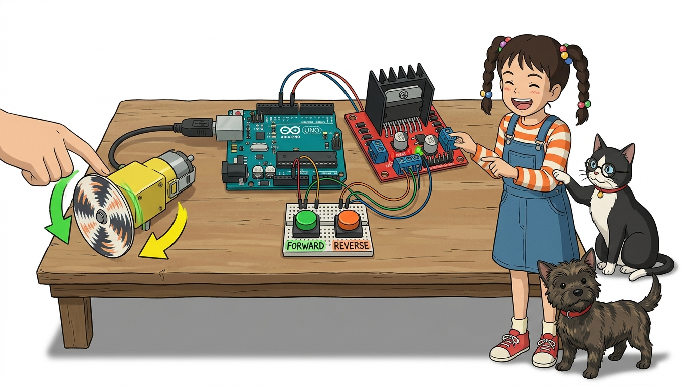
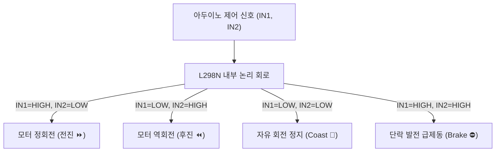

# 099_DC모터_정역회전제어 🔁🔄



**도로시와 지니가 함께하는 IN1과 IN2 디지털 로직 조합으로 전진, 정지, 후진, 급제동 완벽 지휘**

* 👧 **도로시**: "지니야! L298N 모터 드라이버에 DC 모터를 연결했어! 이제 아두이노 코드로 '앞으로 달려!', '잠깐 멈춰!', '뒤로 후진해!' 하고 명령을 내리려면 어떻게 해야 해?"
* 🐱 **지니**: "아주 직관적이고 쉬워! **IN1과 IN2**라는 2개의 제어 핀에 디지털 신호(HIGH/LOW)를 어떻게 조합해 주느냐에 따라 모터의 회전 방향과 정지 모드가 순식간에 결정된단다!"
* 🐶 **토토**: "바우! 전진! 후진! 멈춰! 신나는 무선 조종 주행 테스트를 시작하자 멍!"

* 🖥️ **강의 슬라이드**: [slides.md](./slides.md)

---

## 1. 도로시의 명령: 내 차를 앞으로 뒤로 마음대로 움직이기


### ⏩⏪ 2개의 디지털 신호선으로 4가지 물리적 상태를 연출

아두이노의 디지털 핀 2개(IN1, IN2)는 L298N 내부 H-브리지의 좌우 하프 브리지를 통제하는 지휘봉 역할을 합니다.



---

## 2. IN1과 IN2 로직 신호 조합의 비밀 사전


### 🚦 모터 제어 엔지니어의 핵심 상태 매트릭스

| IN1 신호 | IN2 신호 | 모터 내부 전압 상태 | 회전 방향 | 로봇카 주행 동작 | 기계적 특성 |
| :---: | :---: | :---: | :---: | :---: | :--- |
| **HIGH** | **LOW** | OUT1(+), OUT2(-) | **시계 방향 (CW)** | **전진! (Forward)** ⏩ | 정상 추진력 발생 |
| **LOW** | **HIGH** | OUT1(-), OUT2(+) | **반시계 방향 (CCW)** | **후진! (Reverse)** ⏪ | 정상 후진력 발생 |
| **LOW** | **LOW** | 양단 모두 0V (개방) | **전류 차단 (OFF)** | **서서히 멈춤 (Coast)** 🛑 | 관성으로 미끄러지며 정지 |
| **HIGH** | **HIGH** | 양단 모두 5V (단락) | **발전 제동 (Brake)** | **강력 브레이크 (Brake)** ⛔ | 모터가 발전기가 되어 즉시 급정지 |

> [!TIP]
> **Coast vs Brake의 차이점**:
> * `LOW-LOW`는 회로 전원을 끄는 것이라 모터가 관성에 의해 조금 더 굴러가다 멈춥니다.
> * `HIGH-HIGH`는 모터 양단을 묶어버리는 것이라 회전 관성에 의해 유도된 기전력이 모터를 스스로 옥죄며 즉각적인 록(Lock) 브레이크가 걸립니다!

---

## 3. 회로 배선 가이드 및 핀 연결도


### 🔌 아두이노 우노와 L298N의 결선 표준

* **아두이노 ➡️ L298N 제어 신호**:
  * 아두이노 **디지털 8번 핀 ➡️ L298N IN1**
  * 아두이노 **디지털 9번 핀 ➡️ L298N IN2**
  * L298N **ENA 단자**: 검정 점퍼 캡을 꽂아둠 (100% 최고 속도 모드)
* **모터 및 전원 결선**:
  * L298N **OUT1, OUT2 ➡️ DC 기어 모터 단자 2선**
  * L298N **12V 단자 ➡️ 외부 배터리 (+)**
  * L298N **GND 단자 ➡️ 외부 배터리 (-) 및 아두이노 GND 공통 접지!**

---

## 4. 실습 코드: 2초 전진 ➡️ 2초 정지 ➡️ 2초 후진 ➡️ 2초 급제동


### 💻 4단계 주행 시퀀스를 무한 반복하는 스케치

```cpp
// L298N 방향 제어 핀 정의
const int IN1 = 8;
const int IN2 = 9;

void setup() {
  pinMode(IN1, OUTPUT);
  pinMode(IN2, OUTPUT);
  
  Serial.begin(9600);
  Serial.println("DC 모터 정역회전 및 제동 테스트 시작!");
}

void loop() {
  // 1. 앞으로 2초간 씽씽 전진! (HIGH, LOW)
  Serial.println(">>> 1. 전진 (Forward)");
  digitalWrite(IN1, HIGH);
  digitalWrite(IN2, LOW);
  delay(2000);

  // 2. 2초간 부드럽게 정지 (LOW, LOW)
  Serial.println("--- 2. 자연 정지 (Coast)");
  digitalWrite(IN1, LOW);
  digitalWrite(IN2, LOW);
  delay(2000);

  // 3. 뒤로 2초간 씽씽 후진! (LOW, HIGH)
  Serial.println("<<< 3. 후진 (Reverse)");
  digitalWrite(IN1, LOW);
  digitalWrite(IN2, HIGH);
  delay(2000);

  // 4. 강력한 급제동 브레이크! (HIGH, HIGH)
  Serial.println("=== 4. 강력 급제동 (Brake)");
  digitalWrite(IN1, HIGH);
  digitalWrite(IN2, HIGH);
  delay(2000);
}
```

---

## 🌟 도로시와 지니의 핵심 요약 노트!


* 👧 **도로시**: "IN1과 IN2가 서로 다르면(HIGH-LOW 또는 LOW-HIGH) 전진과 후진을 하고, 둘 다 같으면(LOW-LOW 또는 HIGH-HIGH) 서서히 멈추거나 급브레이크가 걸리는구나!"
* 🐱 **지니**: "정답이야! 방향 전환의 원리를 완벽하게 익혔으니, 이제 다음 시간에는 점퍼 캡을 뽑고 **ENA 핀에 PWM 신호를 넣어 속도까지 부드럽게 조절**해 보자!"
* 🐶 **토토**: "바우! 이제 진짜 레이싱 카의 가속 페달을 밟아보자 멍!"
