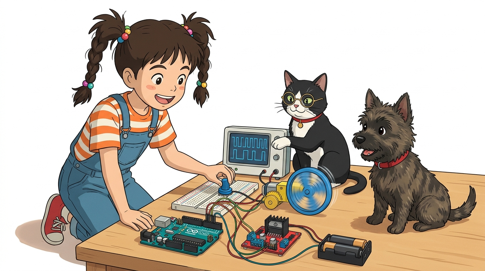
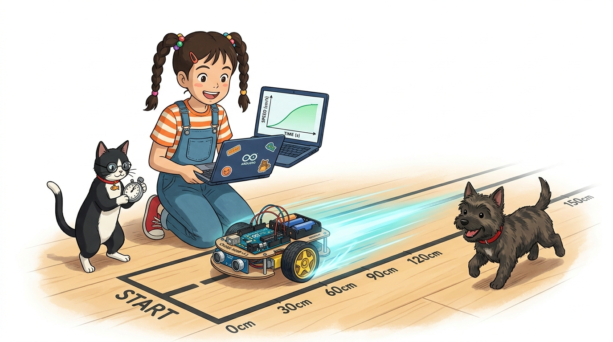
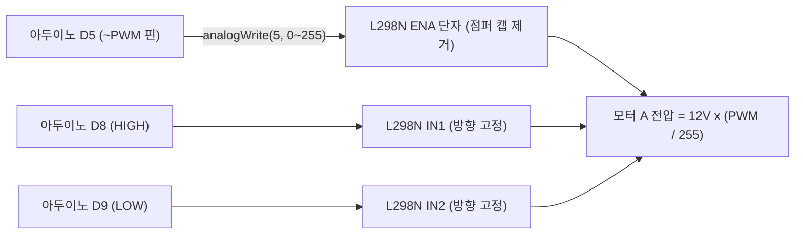

# 100_DC모터_PWM속도제어 🏎️💨



**도로시와 지니가 함께하는 ENA 핀과 PWM 아날로그 신호로 완성하는 부드러운 가감속 크루즈 컨트롤**

* 👧 **도로시**: "지니야! 코드를 실행하자마자 모터가 100% 최고 속도로 튀어나가서 로봇카가 벽에 쾅 부딪혀버렸어! 실제 자동차처럼 슬슬 부드럽게 출발해서 서서히 멈추게 할 수는 없을까?"
* 🐱 **지니**: "당연히 가능하지! L298N의 **ENA(모터 A 활성화 및 속도 제어) 핀**에 우리가 배운 **PWM `analogWrite()`** 신호를 넣어주면 0부터 255까지 듀티비를 실시간으로 조절해 전기차처럼 우아한 속도 제어를 완성할 수 있단다!"
* 🐶 **토토**: "바우! 급발진 없는 안전하고 편안한 승차감을 만들어보자 멍!"

* 🖥️ **강의 슬라이드**: [slides.md](./slides.md)

---

## 1. 도로시의 고민: 모터의 급출발(Jerking)과 기계적 충격



### 🏎️ 왜 소프트웨어적 가속(Ramp-Up)이 필수적일까?

모터에 정지 상태에서 갑자기 12V 풀 전압을 가하면 회전자의 관성 때문에 정지 마찰력을 이기는 과정에서 다음과 같은 문제들이 발생합니다.

* **피크 기동 전류 폭증**:
  * 모터가 돌지 못한 찰나의 순간 스톨(Stall) 전류가 흘러 배터리가 급격히 소모되고 드라이버 칩이 뜨거워집니다.
* **기어박스 파손 위험**:
  * 급격한 충격 토크가 플라스틱 기어 톱니를 마모시키거나 깨뜨릴 수 있습니다.
* **로봇카 차체 슬립(Slip)**:
  * 바퀴가 헛돌면서 주행 궤적이 틀어집니다.
* **해결책**:
  * PWM 값을 70 $\to$ 100 $\to$ 150 $\to$ 200 $\to$ 255로 단계적으로 올려주는 **가속 프로파일(Acceleration Profile)** 을 적용합니다.

---

## 2. ENA 핀과 하드웨어 PWM 속도 제어 원리


### 🌊 점퍼 캡을 뽑고 아두이노 물결표(~) PWM 핀과 직결!

L298N 모듈 출고 시 ENA 핀에는 5V 전원과 쇼트시켜 놓은 검정색 점퍼 캡이 꽂혀 있습니다. 이 점퍼 캡을 뽑아야 외부에서 PWM 신호를 공급할 수 있습니다.



| `analogWrite(ENA, 값)` | 듀티 사이클 (%) | 12V 배터리 기준 평균 전압 | 모터 동작 상태 |
| :---: | :---: | :---: | :--- |
| **0** | **0%** | **0.0 V** | 완전 정지 (모터 전원 차단) |
| **70 ~ 90** | 약 30% | **약 3.6 V** | **최소 기동 속도 (정지 마찰력 극복)** |
| **120 ~ 150** | 약 50% | **약 6.0 V** | 안정적인 실내 주행 속도 |
| **200 ~ 220** | 약 80% | **약 9.6 V** | 시원하고 빠른 고속 주행 |
| **255** | **100%** | **12.0 V** | 최대 토크 & 최고 속도 전력 질주! |

> [!WARNING]
> **불감대 (Dead Zone) 현상**:
> 모터 내부의 기어 마찰력 때문에 PWM 값이 0~60 수준으로 너무 낮으면 모터가 돌지 못하고 '삐이-' 하는 고주파 노이즈만 울립니다. 코드 작성 시 시작 속도는 최소 70 이상으로 설정해야 안전하게 출발합니다.

---

## 3. 실습 코드: 부드러운 가속(크루즈 가속)과 감속 제동


### 💻 `for` 반복문으로 모터 회전수를 우아하게 제어하는 스케치

```cpp
// 핀 번호 정의 (ENA는 반드시 PWM 지원 핀이어야 함!)
const int ENA = 5; // 아두이노 D5 (~PWM 핀)
const int IN1 = 8; // 방향 핀 1
const int IN2 = 9; // 방향 핀 2

void setup() {
  pinMode(ENA, OUTPUT);
  pinMode(IN1, OUTPUT);
  pinMode(IN2, OUTPUT);

  // 1. 주행 방향을 '전진(Forward)'으로 먼저 설정
  digitalWrite(IN1, HIGH);
  digitalWrite(IN2, LOW);
  
  Serial.begin(9600);
  Serial.println("부드러운 DC 모터 가감속 주행 실습 시작!");
}

void loop() {
  Serial.println(">>> 부드럽게 가속 중 (속도 70 -> 255)...");
  // 1. 불감대를 지나 70부터 255까지 5씩 속도를 올림
  for (int spd = 70; spd <= 255; spd += 5) {
    analogWrite(ENA, spd); // 모터에 인가되는 PWM 듀티비 갱신
    delay(40);             // 가속 체감을 위한 40ms 간격
  }
  
  Serial.println("=== 최고 속도 100% 순항 중 (1.5초간) ===");
  delay(1500); // 최고 속도로 안정 주행

  Serial.println("<<< 서서히 감속 중 (속도 255 -> 70)...");
  // 2. 최고 속도에서 서서히 70까지 감속
  for (int spd = 255; spd >= 70; spd -= 5) {
    analogWrite(ENA, spd);
    delay(40);
  }
  
  Serial.println("--- 완전 정지 (속도 0) ---");
  analogWrite(ENA, 0); // 0을 출력하여 완전 정지
  delay(2000);         // 2초간 정지 후 다시 가속 주기 반복
}
```

---

## 4. 자율주행 로봇카를 위한 속도 제어 팁

1. **코너링 시 바퀴 속도 분배**:
   * 직진: 좌측(ENA) = 180, 우측(ENB) = 180
   * 완만한 좌회전: 좌측(ENA) = **120**, 우측(ENB) = **200** (외측 바퀴를 빠르게!)
   * 제자리 스핀턴: 좌측은 후진(IN1=L, IN2=H), 우측은 전진(IN3=H, IN4=L)
2. **배터리 잔량에 따른 보정**:
   * 배터리 전압이 12V에서 10V로 떨어지면 같은 PWM 150이라도 실제 바퀴 속도가 느려지므로, 뒤에서 배울 **엔코더 센서**로 실제 바퀴 회전 속도를 측정하여 피드백 보정하는 것이 정석입니다.

---

## 🌟 도로시와 지니의 핵심 요약 노트!


* 👧 **도로시**: "ENA 핀의 점퍼 캡을 뽑고 아두이노 PWM 핀에 꽂은 뒤 `analogWrite(ENA, 값)`을 주면 모터의 출발과 정지가 전기차처럼 정말 부드러워지는구나!"
* 🐱 **지니**: "완벽해! 이제 모터의 방향과 속도를 완전히 장악했단다."
* 🐶 **토토**: "바우! 이제 모터가 회전할 때 바퀴 회전수를 광속으로 세어주는 **인터럽트(Interrupt)** 와 **엔코더(Encoder)** 의 세계로 출발하자 멍!"
