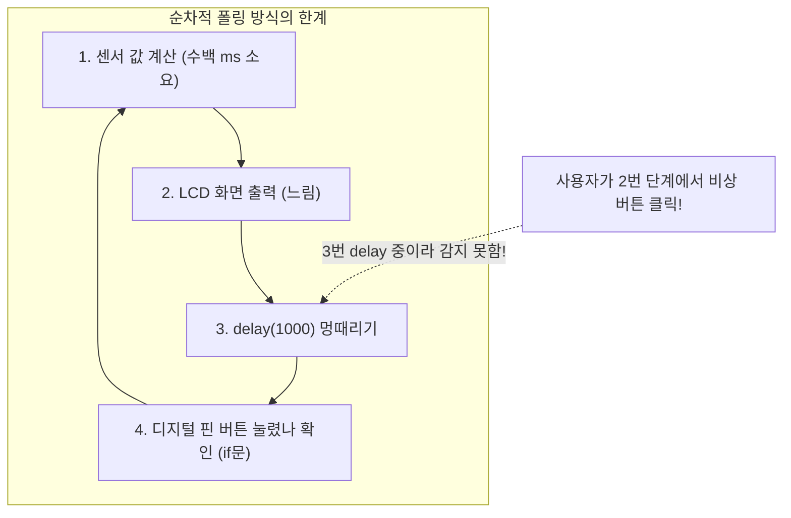
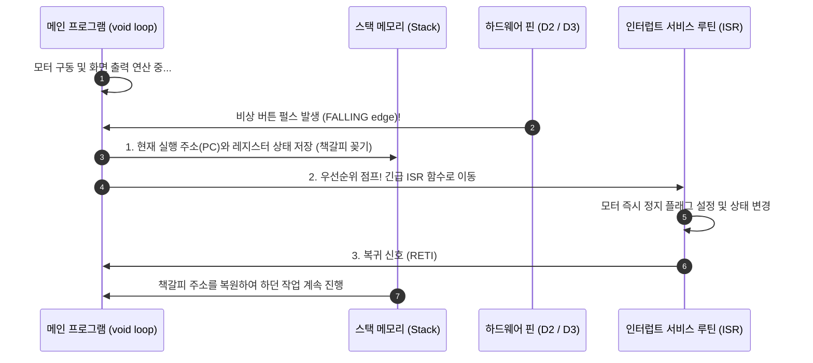

# 101_인터럽트란_비상전화호출 🚨📞

**도로시와 지니가 함께하는 하던 일을 잠시 멈추고 1마이크로초 만에 긴급 처리하는 CPU의 비서 시스템**
* 👧 **도로시**: "지니야! 아두이노 코드가 `delay(2000)`로 쉬고 있을 때 비상 정지 버튼을 눌렀는데, 아두이노가 2초 동안 멍때리느라 버튼 신호를 완전히 무시하고 지나가 버렸어! 로봇이 벽에 부딪힐 뻔했잖아!"
* 🐱 **지니**: "그게 바로 반복문에서 일일이 상태를 확인하는 '폴링(Polling)'의 치명적인 한계야! 그럴 때 아두이노가 무슨 일을 하고 있든 즉시 하던 일을 낚아채서 긴급 명령을 실행하게 만드는 마법이 바로 **인터럽트(Interrupt, 가로채기)** 란다!"
* 🐶 **토토**: "바우! 공부하다가 중요한 전화가 오면 책갈피를 꽂아두고 전화부터 받는 거다 멍!"
* 📖 **상세 강의 교재**: [index.md](./index.md)

> 여러분 안녕하세요! 이번 시간에는 '101. 인터럽트란 비상전화호출 🚨📞'을 주제로 함께 흥미진진한 탐험을 떠나보겠습니다. 오늘 강의에서는 특히 도로시와 지니가 함께하는 하던 일을 잠시 멈추고 1마이크로초 만에 긴급 처리하는 CPU의 비서 시스템, 👧 도로시: "지니야! 아두이노 코드가 delay(2000)로 쉬고 있을 때 비상 정지 버튼을 눌렀는데, 아두이노가 2초 동안 멍때리느라 버튼 신호를 완전히 무시하고 지나가 버렸어! 로봇이 벽에 부딪힐 뻔했잖아!"를 중심으로 핵심 원리와 응용 방법을 차근차근 배워보겠습니다. 마법 멘토 지니와 호기심 많은 탐험가 도로시, 그리고 귀여운 토토와 함께 신나는 아두이노 모험을 힘차게 시작해 봅시다. 준비되셨나요?

---

## 1. 도로시의 고민: 폴링(Polling)의 한계와 긴급 상황 무시

* **폴링(Polling)** 방식에서는 루프 도중 `delay()`나 복잡한 계산이 실행 중일 때 스위치를 누르면 아두이노가 그 신호를 감지하지 못하고 허공으로 날려버립니다.
* 산업용 로봇이나 자율주행차에서는 범퍼 충돌 스위치나 비상 정지 버튼이 0.001초라도 씹히면 대형 사고로 이어집니다.

### 🚨 메인 루프가 바쁠 때 발생하는 이벤트 누락(Missed Event)
일반적인 아두이노 스케치는 `void loop()` 함수를 위에서 아래로 순차 실행합니다.

> 이번 슬라이드에서는 '1. 도로시의 고민: 폴링(Polling)의 한계와 긴급 상황 무시'에 대한 실제 동작 코드를 분석해 보겠습니다. 화면의 코드를 살펴보시면, 컴퓨터가 아두이노 하드웨어에 단계별로 명령을 내리는 흐름을 명확하게 확인할 수 있습니다. 여기서 핵심은 폴링(Polling) 방식에서는 루프 도중 delay()나 복잡한 계산이 실행 중일 때 스위치를 누르면 아두이노가 그 신호를 감지하지 못하고 허공으로 날려버립니다.입니다. 각 함수의 역할과 괄호 안의 매개변수가 하드웨어 핀과 어떤 관계를 맺고 동작하는지 주의 깊게 살펴보시기 바랍니다.

---

## 2. 폴링(Polling) vs 인터럽트(Interrupt) 비교

| 비교 항목 | 폴링 (Polling) | 인터럽트 (Interrupt) |
| :--- | :--- | :--- |
| **비유** | 손님이 왔나 1분마다 문 열어보기 | **손님이 초인종(Ding-Dong)을 누르면 즉시 문 열기** |
| **CPU 자원 낭비** | 아무 일도 없는데 계속 핀 상태를 검사함 | **평소엔 메인 연산에 100% 집중 (낭비 제로)** |
| **반응 속도** | 루프 한 바퀴를 다 돌 때까지 지연됨 | **신호 발생 즉시 (1마이크로초 이내) 반응!** |
| **이벤트 누락** | `delay()` 중에 버튼을 뗐다 누르면 놓침 | **초고속 펄스도 하드웨어가 절대 놓치지 않음** |
| **주요 사용처** | 온습도 센서 주기적 측정 | **비상 정지 버튼, 엔코더 바퀴 회전수 계수** |

### 🚪 주기적으로 문을 열어보기 vs 초인종 벨소리에 즉시 반응하기

> 이번에 살펴볼 내용은 '2. 폴링(Polling) vs 인터럽트(Interrupt) 비교'입니다. 슬라이드에 정리된 표를 통해 각 항목의 특징과 수치, 차이점을 한눈에 비교해 보실 수 있습니다. 이 기본 개념을 확실히 잡아두셔야 실제 부품을 브레드보드에 꽂고 코딩할 때 실수 없이 완성할 수 있습니다.

---

## 3. 인터럽트 동작의 3단계 흐름: 책갈피와 복귀

1. **책갈피 꽂기 (Context Save)**:
* CPU가 실행 중이던 프로그램 카운터(PC)와 상태 레지스터(SREG) 값을 스택(Stack) 메모리에 안전하게 백업합니다.
2. **비상 출동! ISR (Interrupt Service Routine)**:
* 미리 등록해 둔 전용 인터럽트 처리 함수(`emergencyStop()`)로 즉시 건너뛰어 초고속으로 처리합니다.
3. **제자리로 복귀 (Resume)**:
* ISR 함수가 끝나면 스택에서 책갈피를 꺼내와, 인터럽트가 걸렸던 바로 그 다음 줄부터 아무 일도 없었다는 듯 메인 코드를 이어갑니다.

### 📖 Context Save ➡️ ISR 실행 ➡️ Resume의 매끄러운 사이클
하드웨어 인터럽트 신호가 들어왔을 때 ATmega328P 마이크로컨트롤러 내부에서는 다음과 같은 기계적 전환이 발생합니다.

> 이번 슬라이드에서는 '3. 인터럽트 동작의 3단계 흐름: 책갈피와 복귀'에 대한 실제 동작 코드를 분석해 보겠습니다. 화면의 코드를 살펴보시면, 컴퓨터가 아두이노 하드웨어에 단계별로 명령을 내리는 흐름을 명확하게 확인할 수 있습니다. 여기서 핵심은 책갈피 꽂기 (Context Save)입니다. 각 함수의 역할과 괄호 안의 매개변수가 하드웨어 핀과 어떤 관계를 맺고 동작하는지 주의 깊게 살펴보시기 바랍니다.

---

## 4. 인터럽트의 2가지 주요 분류

* **1. 외부 인터럽트 (External Hardware Interrupt)**:
* 물리적인 전선 핀에 걸리는 전압이 HIGH에서 LOW로 떨어지거나(FALLING) 전압이 바뀔 때 발동합니다.
* 아두이노 우노(UNO)는 **디지털 2번 핀(INT0)** 과 **디지털 3번 핀(INT1)** 단 2개만 지원합니다!
* **2. 내부 인터럽트 (Internal Software / Timer Interrupt)**:
* 칩 내부의 하드웨어 타이머 카운터가 오버플로우되거나, UART 시리얼 수신 버퍼에 새 글자가 도착했을 때 자동으로 발동합니다.

### 🌐 외부 하드웨어 핀 인터럽트 vs 내부 시스템 인터럽트

> 이번 슬라이드에서는 '4. 인터럽트의 2가지 주요 분류'에 대해 자세히 살펴보겠습니다. 화면의 다이어그램과 사진을 함께 참고해 주시기 바랍니다. 첫 번째 핵심은 외부 인터럽트 (External Hardware Interrupt)이며, 두 번째로는 물리적인 전선 핀에 걸리는 전압이 HIGH에서 LOW로 떨어지거나(FALLING) 전압이 바뀔 때 발동합니다.입니다. 여기에 덧붙여 아두이노 우노(UNO)는 디지털 2번 핀(INT0) 과 디지털 3번 핀(INT1) 단 2개만 지원합니다! 내용까지 함께 이해해 두시면 완벽합니다. 이 원리는 아두이노 시스템 전체를 관통하는 핵심 논리이므로 머릿속에 꼭 정리해 두시기 바랍니다.

---
## 5. ISR(인터럽트 함수) 작성 시 3대 절대 규칙

1. **짧고 굵게 끝내라 (Short & Fast)**:
* ISR 내부에서는 화면에 글자를 출력(`Serial.println`)하거나 오래 기다리는 `delay()` 함수를 절대 사용하면 안 됩니다 (`delay()`는 타이머 인터럽트를 쓰므로 ISR 안에서 영원히 멈춥니다).
2. **`volatile` 키워드 필수**:
* ISR 내부에서 값을 바꾸고 메인 `loop()`에서도 읽는 전역 변수는 반드시 앞에 `volatile int count = 0;` 처럼 `volatile`을 붙여 컴파일러 최적화에 의한 변수 캐싱 오류를 방지해야 합니다.
3. **플래그(Flag) 전달 기법**:
* ISR 안에서는 `isStopped = true;` 처럼 깃발(플래그)만 꽂아두고, 실제 무거운 작업은 `loop()` 함수가 처리하도록 설계하는 것이 정석입니다.

> 이번 슬라이드에서는 '5. ISR(인터럽트 함수) 작성 시 3대 절대 규칙'에 대해 자세히 살펴보겠습니다. 첫 번째 핵심은 짧고 굵게 끝내라 (Short & Fast)이며, 두 번째로는 ISR 내부에서는 화면에 글자를 출력(Serial.println)하거나 오래 기다리는 delay() 함수를 절대 사용하면 안 됩니다 (delay()는 타이머 인터럽트를 쓰므로 ISR 안에서 영원히 멈춥니다).입니다. 여기에 덧붙여 volatile 키워드 필수 내용까지 함께 이해해 두시면 완벽합니다. 이 원리는 아두이노 시스템 전체를 관통하는 핵심 논리이므로 머릿속에 꼭 정리해 두시기 바랍니다.
---

## 🌟 도로시와 지니의 핵심 요약 노트!

* 👧 **도로시**: "인터럽트는 아두이노가 `delay()`로 아무리 깊은 잠에 빠져 있어도 1마이크로초 만에 즉시 깨워주는 초인종 비상벨이구나!"
* 🐱 **지니**: "맞아! ISR 함수는 번개처럼 짧게 실행되어야 하며, 공유 변수에는 `volatile`을 선언한다는 규칙을 꼭 기억하렴."
* 🐶 **토토**: "바우! 이제 아두이노 2번 핀에 버튼을 달고 **외부 인터럽트(`attachInterrupt`)** 코드를 직접 만들어보자 멍!"

> 오늘 배운 '🌟 도로시와 지니의 핵심 요약 노트!'의 핵심 내용을 모두 정리해 보았습니다. 오늘 다룬 내용 중에서도 👧 도로시: "인터럽트는 아두이노가 delay()로 아무리 깊은 잠에 빠져 있어도 1마이크로초 만에 즉시 깨워주는 초인종 비상벨이구나!" 부분은 앞으로의 아두이노 실습과 프로젝트에서 계속 사용되는 매우 중요한 기초 지식입니다. 오늘 배운 내용을 꼭 다시 한번 복습해 보시고, 다음 강의에서 더욱 신나고 유익한 모험으로 다시 만나겠습니다. 모두 수고 많으셨습니다!