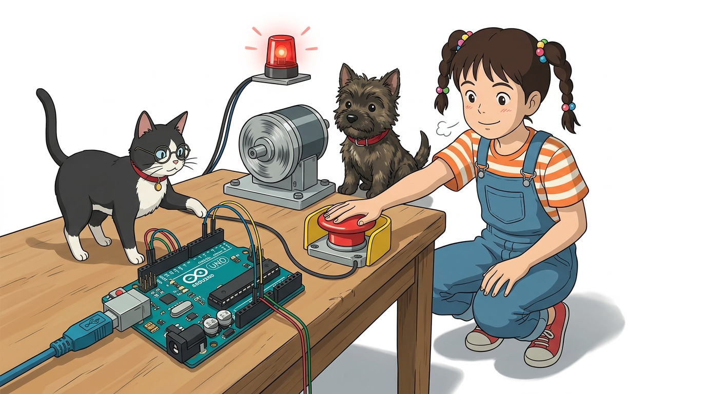

# 102_외부인터럽트_실시간감지 ⚡🎯


**도로시와 지니가 함께하는 `attachInterrupt()`로 1마이크로초 만에 반응하는 비상 정지 시스템 구축**

* 👧 **도로시**: "지니야! 아두이노 우노에 디지털 핀이 14개나 있는데, 아무 핀에나 비상 버튼을 달고 인터럽트를 걸어달라고 명령하면 돼?"
* 🐱 **지니**: "아쉽지만 모든 핀이 외부 인터럽트를 지원하는 건 아니야! 아두이노 우노에서 하드웨어 외부 인터럽트를 번개처럼 처리할 수 있는 전용 VIP 창구는 딱 **2번 핀(INT0)** 과 **3번 핀(INT1)** 두 개뿐이란다!"
* 🐶 **토토**: "바우! 2번과 3번 핀이 바로 아두이노의 전용 비상구 핀이다 멍!"

* 🖥️ **강의 슬라이드**: [slides.md](./slides.md)

---

## 1. 도로시의 궁금증: 아두이노 우노의 외부 인터럽트 전용 핀



### 🎟️ 하드웨어 벡터 테이블(Vector Table)과 직결된 VIP 핀

일반 핀은 CPU가 코드로 읽어야 하지만, 2번과 3번 핀은 마이크로컨트롤러 내부의 인터럽트 컨트롤러 하드웨어와 물리적으로 직결되어 있습니다.

| 아두이노 우노 보드 핀 | AVR 하드웨어 인터럽트 번호 | 아두이노 공식 함수 표기법 (표준 권장) |
| :---: | :---: | :--- |
| **디지털 2번 핀 (D2)** | **INT 0** | **`digitalPinToInterrupt(2)`** |
| **디지털 3번 핀 (D3)** | **INT 1** | **`digitalPinToInterrupt(3)`** |

> [!IMPORTANT]
> **왜 `0` 대신 `digitalPinToInterrupt(2)`를 쓸까?**:
> 아두이노 메가(Mega 2560)는 2번 핀이 INT4이고 21번 핀이 INT0입니다! 보드마다 하드웨어 핀과 인터럽트 번호 매핑이 완전히 다르기 때문에, 어떤 보드에서도 완벽하게 호환되도록 공식 매크로 함수인 `digitalPinToInterrupt(핀번호)`를 사용하는 것이 정석입니다.

---

## 2. `attachInterrupt()` 함수의 매개변수와 4가지 감지 모드


### 📝 인터럽트 등록의 표준 문법

```cpp
attachInterrupt(digitalPinToInterrupt(핀번호), 실행할_ISR_함수명, 감지_모드);
```

| 트리거 감지 모드 | 신호 변화 타이밍 | 물리적 스위치 상황 | 주 활용 분야 |
| :--- | :--- | :--- | :--- |
| **`FALLING`** | **HIGH (5V) ➡️ LOW (0V)** 하강 에지 | **내부 풀업 버튼을 '딸깍' 누르는 순간** | **비상 정지 버튼 (가장 널리 쓰임!)** |
| **`RISING`** | **LOW (0V) ➡️ HIGH (5V)** 상승 에지 | 풀다운 버튼을 누르거나 풀업 버튼을 놓는 순간 | 신호 활성화 감지 |
| **`CHANGE`** | **전압 레벨이 바뀌는 모든 순간 (양방향)** | HIGH든 LOW든 신호가 토글될 때마다 | **엔코더 바퀴 회전 펄스 계수 (2배수 측정)** |
| **`LOW`** | **핀이 LOW(0V) 전압을 유지하고 있는 동안** | 버튼이 계속 눌려있는 내내 무한 연속 발동 | 특수 저전력 슬립 모드 해제 |

---

## 3. ISR (인터럽트 서비스 루틴) 작성의 3대 황금률


### 🚨 인터럽트 함수를 짤 때 반드시 지켜야 할 엄격한 규칙

1. **`delay()` 함수 절대 금지!**:
   * 아두이노의 `delay()`와 `millis()`는 하드웨어 타이머 인터럽트에 의해 시간을 셉니다. 하지만 ISR이 실행되는 동안에는 모든 인터럽트가 잠정 중단되므로, ISR 안에서 `delay()`를 부르면 시간이 영원히 멈추어 시스템이 락(Lock)에 걸립니다!
2. **`Serial.print()` 사용 자제**:
   * 시리얼 통신 또한 인터럽트 버퍼를 사용하므로, 무거운 문자열을 출력하려다 시스템 충돌이 일어납니다.
3. **`volatile` 키워드 필수 선언**:
   * ISR 안에서 값을 바꾸고 메인 `loop()`에서 읽는 모든 전역 변수는 `volatile bool ledState = false;` 처럼 선언해야 합니다. 그렇지 않으면 컴파일러가 "루프 안에서 이 변수를 바꾸는 코드가 없네?" 하고 변수를 레지스터에 캐싱하여 최신 값을 읽지 못하는 치명적인 버그가 생깁니다.

---

## 4. 실습 코드: 5초 동안 멍때려도 즉시 켜지는 비상등


### 💻 `delay(5000)`의 긴 잠을 0.000001초 만에 깨우는 실습

```cpp
const int buttonPin = 2; // 2번 핀 (INT0 외부 인터럽트 전용 핀)
const int ledPin = 13;    // 아두이노 내장 13번 LED

// ISR과 메인 루프가 공유하는 변수는 반드시 volatile 선언!
volatile bool ledState = false;

// 인터럽트 발생 시 1마이크로초 만에 실행되는 특수 함수 (ISR)
void toggleLED() {
  ledState = !ledState; // 0.000001초 만에 불린 상태만 뒤집고 초고속 탈출!
}

void setup() {
  pinMode(ledPin, OUTPUT);
  // 내부 풀업 저항 활성화 (평소 HIGH, 버튼 누르면 LOW)
  pinMode(buttonPin, INPUT_PULLUP);
  
  // 2번 핀에서 전압이 떨어지는(FALLING) 순간 toggleLED 함수를 긴급 호출!
  attachInterrupt(digitalPinToInterrupt(buttonPin), toggleLED, FALLING);
  
  Serial.begin(9600);
  Serial.println("외부 인터럽트 감시 시스템 가동!");
}

void loop() {
  digitalWrite(ledPin, ledState); // 현재 상태 반영
  
  Serial.println("메인 루프가 5초 동안 깊은 잠(delay)에 빠집니다...");
  // 메인 프로그램이 5초 동안 멈춰 있어도, 버튼을 누르는 순간
  // 하드웨어 인터럽트가 발생하여 0.000001초 만에 LED가 토글됩니다!
  delay(5000);
}
```

---

## 5. 실습 점검 체크리스트 & 채터링(Debouncing) 주의점

* **버튼을 한 번 눌렀는데 LED가 빠르게 두세 번 켜졌다 꺼져요**:
  * 기계식 푸시버튼 내부 금속판이 부딪힐 때 1ms 동안 수십 번 바운싱되는 **채터링(Chattering)** 현상 때문입니다.
  * 해결책: ISR 안에서 이전 인터럽트 발생 시간(`micros()`)과 비교하여 **150ms 이내에 들어오는 연타 신호를 무시하는 소프트웨어 디바운싱**을 추가합니다.

---

## 🌟 도로시와 지니의 핵심 요약 노트!


* 👧 **도로시**: "우노의 2번과 3번 핀에 버튼을 달고 `attachInterrupt(digitalPinToInterrupt(2), 함수, FALLING)`을 선언하면 메인 코드가 5초 동안 쉬고 있어도 0초 만에 번개처럼 반응하는구나!"
* 🐱 **지니**: "완벽해! 이 강력한 외부 인터럽트 기능이 바로 모터 바퀴가 초당 수천 번 회전할 때 펄스를 단 하나도 놓치지 않고 세어주는 **엔코더(Encoder)** 의 핵심 기반이란다."
* 🐶 **토토**: "바우! 이제 모든 핀에서 인터럽트를 지원하는 핀체인지 인터럽트와 엔코더로 출발하자 멍!"
