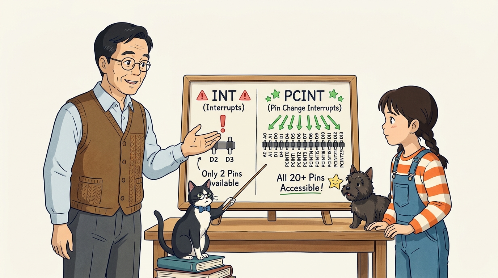

# 103_핀변화인터럽트_PCINT 🎛️⚡


**도로시와 지니가 함께하는 2번, 3번 핀 부족을 해결하는 ATmega328P의 전 핀 인터럽트(PCINT) 기술**
* 👧 **도로시**: "지니야! 4륜 구동 스마트카를 만드는데, 바퀴 4개마다 회전수 엔코더를 달고 싶어! 그런데 아두이노 우노의 외부 인터럽트 핀은 2번, 3번 딱 2개뿐이잖아! 나머지 2개 바퀴는 펄스를 어떻게 세지?"
* 🐱 **지니**: "걱정 마! 아두이노 메인 칩 속에는 사실 **거의 모든 핀(디지털 0~13번, 아날로그 A0~A5번)에서 신호 변화를 낚아채는 PCINT(Pin Change Interrupt, 핀 변화 인터럽트)** 라는 비장의 무기가 숨겨져 있단다!"
* 🐶 **토토**: "바우! 20개가 넘는 모든 핀이 초고속 비상벨로 변신할 수 있다 멍!"
* 📖 **상세 강의 교재**: [index.md](./index.md)


> 여러분 안녕하세요! 이번 시간에는 '103. 핀변화인터럽트 PCINT 🎛️⚡'을 주제로 함께 흥미진진한 탐험을 떠나보겠습니다. 오늘 강의에서는 특히 도로시와 지니가 함께하는 2번, 3번 핀 부족을 해결하는 ATmega328P의 전 핀 인터럽트(PCINT) 기술, 👧 도로시: "지니야! 4륜 구동 스마트카를 만드는데, 바퀴 4개마다 회전수 엔코더를 달고 싶어! 그런데 아두이노 우노의 외부 인터럽트 핀은 2번, 3번 딱 2개뿐이잖아! 나머지 2개 바퀴는 펄스를 어떻게 세지?"를 중심으로 핵심 원리와 응용 방법을 차근차근 배워보겠습니다. 마법 멘토 지니와 호기심 많은 탐험가 도로시, 그리고 귀여운 토토와 함께 신나는 아두이노 모험을 힘차게 시작해 봅시다. 준비되셨나요?

---

## 1. 도로시의 SOS: 바퀴가 4개인데 인터럽트 핀이 부족해요!


* **외부 인터럽트 (External Interrupt, INT)**:
* 핀마다 독립된 전용 인터럽트 벡터가 있어 극도로 빠르지만 핀 수가 매우 적음 (우노 기준 2개).
* **핀 변화 인터럽트 (Pin Change Interrupt, PCINT)**:
* 포트 단위(8개 핀)로 인터럽트 벡터를 묶어 처리하므로, **아두이노 우노의 거의 모든 핀(총 24개 핀)** 에서 인터럽트 감지가 가능합니다!

### 🏎️ 다축 모터 로봇과 다채널 센서의 한계 돌파
외부 인터럽트(INT0, INT1)는 하드웨어 핀이 단 2개로 한정되어 있어, 바퀴가 2개를 넘어가거나 리미트 스위치, 로터리 엔코더, 초음파 에코 핀 등을 동시에 감시할 때 곧바로 핀 고갈 문제에 직면합니다.

> 이번에 살펴볼 내용은 '1. 도로시의 SOS: 바퀴가 4개인데 인터럽트 핀이 부족해요!'입니다. 화면의 회로도와 부품 사진을 보면서 각 핀과 배선이 어떻게 구성되어 있는지 눈으로 직접 따라와 주시기 바랍니다. 첫째로 외부 인터럽트 (External Interrupt, INT)에 유의해야 하며, 둘째로 핀마다 독립된 전용 인터럽트 벡터가 있어 극도로 빠르지만 핀 수가 매우 적음 (우노 기준 2개).라는 점이 핵심입니다. 이 기본 개념을 확실히 잡아두셔야 실제 부품을 브레드보드에 꽂고 코딩할 때 실수 없이 완성할 수 있습니다.

---

## 2. ATmega328P의 3대 PCINT 포트 뱅크 구조


* 어떤 핀이든 전압이 HIGH $\leftrightarrow$ LOW로 바뀌면 해당 포트 그룹의 인터럽트가 즉시 걸립니다.

| 인터럽트 그룹 | 담당 핀 범위 | 하드웨어 핀 번호 | 아두이노 보드 대응 핀 |
| :---: | :--- | :--- | :--- |
| **PCINT0 (Port B)** | PCINT[7:0] | PB0 ~ PB7 | **디지털 8번 ~ 13번 핀** |
| **PCINT1 (Port C)** | PCINT[14:8] | PC0 ~ PC6 | **아날로그 A0번 ~ A5번 핀** |
| **PCINT2 (Port D)** | PCINT[23:16] | PD0 ~ PD7 | **디지털 0번 ~ 7번 핀** |

### 🏛️ 포트 B, C, D로 나뉘는 3개의 인터럽트 그룹
AVR 마이크로컨트롤러는 핀들을 3개의 하드웨어 포트 그룹으로 묶어 PCINT를 관리합니다.

> 이번에 살펴볼 내용은 '2. ATmega328P의 3대 PCINT 포트 뱅크 구조'입니다. 슬라이드에 정리된 표를 통해 각 항목의 특징과 수치, 차이점을 한눈에 비교해 보실 수 있습니다. 특히 어떤 핀이든 전압이 HIGH $\leftrightarrow$ LOW로 바뀌면 해당 포트 그룹의 인터럽트가 즉시 걸립니다. 항목은 실제 실습 시 오작동이나 쇼트를 방지하기 위해 꼭 기억해 두셔야 합니다. 이 기본 개념을 확실히 잡아두셔야 실제 부품을 브레드보드에 꽂고 코딩할 때 실수 없이 완성할 수 있습니다.

---

## 3. 손쉬운 라이브러리: `PinChangeInterrupt` 설치 및 API


1. **라이브러리 설치**:
* 아두이노 IDE 메뉴: [스케치] $\to$ [라이브러리 포함하기] $\to$ [라이브러리 관리...]
* 검색창에 `PinChangeInterrupt` 입력 후 최신 버전 설치
2. **표준 사용법**:
3. **감지 모드**:
* `FALLING`: HIGH ➡️ LOW (버튼 누를 때)
* `RISING`: LOW ➡️ HIGH
* `CHANGE`: 전압이 바뀔 때마다 (양방향)

### 📚 복잡한 레지스터(PCMSK, PCICR) 조작을 함수 한 줄로!
초보자가 복잡한 8비트 레지스터를 직접 건드리지 않아도 되도록 NicoHood 제작의 **`PinChangeInterrupt`** 표준 라이브러리가 널리 사용됩니다.

   ```cpp
   #include <PinChangeInterrupt.h>
   
   // digitalPinToPCINT(핀번호) 매크로를 사용하여 등록!
   attachPCINT(digitalPinToPCINT(핀번호), 실행할_함수_이름, 감지_모드);
   ```

> 이번 슬라이드에서는 '3. 손쉬운 라이브러리: PinChangeInterrupt 설치 및 API'에 대한 실제 동작 코드를 분석해 보겠습니다. 화면의 코드를 살펴보시면, 컴퓨터가 아두이노 하드웨어에 단계별로 명령을 내리는 흐름을 명확하게 확인할 수 있습니다. 여기서 핵심은 라이브러리 설치입니다. 각 함수의 역할과 괄호 안의 매개변수가 하드웨어 핀과 어떤 관계를 맺고 동작하는지 주의 깊게 살펴보시기 바랍니다.

---

## 4. 실습 코드: 평범한 7번 핀을 비상 인터럽트 핀으로 변신!


### 💻 2번, 3번 핀이 아닌 일반 디지털 7번 핀에서 즉각 반응하는 스케치

```cpp
#include <PinChangeInterrupt.h> // 핀 변화 인터럽트 공식 라이브러리

const int buttonPin = 7; // 외부 인터럽트가 지원되지 않는 평범한 7번 핀!
const int ledPin = 13;    // 아두이노 보드 내장 LED
volatile bool ledState = false;

// 7번 핀 신호가 바뀔 때 1마이크로초 만에 실행되는 ISR 함수
void buttonISR() {
  ledState = !ledState; // LED 상태 반전
}

void setup() {
  pinMode(ledPin, OUTPUT);
  pinMode(buttonPin, INPUT_PULLUP); // 내부 풀업 저항 활성화
  
  // 7번 핀에 핀 변화 인터럽트 등록 (버튼 누를 때 FALLING 감지)
  attachPCINT(digitalPinToPCINT(buttonPin), buttonISR, FALLING);
  
  Serial.begin(9600);
  Serial.println("7번 핀 PCINT 인터럽트 시스템 가동!");
}

void loop() {
  digitalWrite(ledPin, ledState);
  
  // 메인 프로그램이 긴 시간 동안 지연되고 있어도,
  // 7번 핀의 버튼이 눌리는 순간 즉시 반응하여 LED가 켜집니다!
  delay(1000);
}
```

> 이번 슬라이드에서는 '4. 실습 코드: 평범한 7번 핀을 비상 인터럽트 핀으로 변신!'에 대한 실제 동작 코드를 분석해 보겠습니다. 화면의 코드를 살펴보시면, 컴퓨터가 아두이노 하드웨어에 단계별로 명령을 내리는 흐름을 명확하게 확인할 수 있습니다. 각 함수의 역할과 괄호 안의 매개변수가 하드웨어 핀과 어떤 관계를 맺고 동작하는지 주의 깊게 살펴보시기 바랍니다.

---
## 5. 외부 인터럽트(INT) vs 핀 변화 인터럽트(PCINT) 비교




| 비교 항목 | 외부 인터럽트 (External INT) | 핀 변화 인터럽트 (PCINT) |
| :--- | :--- | :--- |
| **사용 가능 핀 수** | 아두이노 우노 기준 **2개 (D2, D3)** | **거의 모든 핀 (D0~D13, A0~A5 총 20+개)** |
| **인터럽트 벡터** | 핀 1개당 독립된 개별 벡터 | **8개 핀이 포트 단위 벡터 공유** |
| **감지 모드** | LOW, CHANGE, FALLING, RISING | **CHANGE, FALLING, RISING** |
| **하드웨어 속도** | 극도로 빠름 (최상위 우선순위) | 매우 빠름 (포트 검사 오버헤드 미세 존재) |
| **주요 활용처** | 최우선 비상 정지 버튼 | **다륜 로봇 엔코더 펄스 계수, 다중 리미트 스위치** |

> 이번에 살펴볼 내용은 '5. 외부 인터럽트(INT) vs 핀 변화 인터럽트(PCINT) 비교'입니다. 슬라이드에 정리된 표를 통해 각 항목의 특징과 수치, 차이점을 한눈에 비교해 보실 수 있습니다. 이 기본 개념을 확실히 잡아두셔야 실제 부품을 브레드보드에 꽂고 코딩할 때 실수 없이 완성할 수 있습니다.
---

## 🌟 도로시와 지니의 핵심 요약 노트!


* 👧 **도로시**: "2번, 3번 핀이 꽉 차서 고민이었는데, `PinChangeInterrupt` 라이브러리를 쓰면 7번 핀도, A0 핀도 얼마든지 초고속 인터럽트 핀으로 쓸 수 있구나!"
* 🐱 **지니**: "맞아! 이제 바퀴가 4개든 6개든 모든 바퀴에 엔코더를 달아 완벽한 자율주행 오도메트리(Odometry)를 구현할 수 있단다."
* 🐶 **토토**: "바우! 이제 모터 바퀴에 장착해 회전 속도와 이동 거리를 측정하는 **DC 모터 엔코더**를 직접 만나보자 멍!"

> 오늘 배운 '🌟 도로시와 지니의 핵심 요약 노트!'의 핵심 내용을 모두 정리해 보았습니다. 오늘 다룬 내용 중에서도 👧 도로시: "2번, 3번 핀이 꽉 차서 고민이었는데, PinChangeInterrupt 라이브러리를 쓰면 7번 핀도, A0 핀도 얼마든지 초고속 인터럽트 핀으로 쓸 수 있구나!" 부분은 앞으로의 아두이노 실습과 프로젝트에서 계속 사용되는 매우 중요한 기초 지식입니다. 오늘 배운 내용을 꼭 다시 한번 복습해 보시고, 다음 강의에서 더욱 신나고 유익한 모험으로 다시 만나겠습니다. 모두 수고 많으셨습니다!