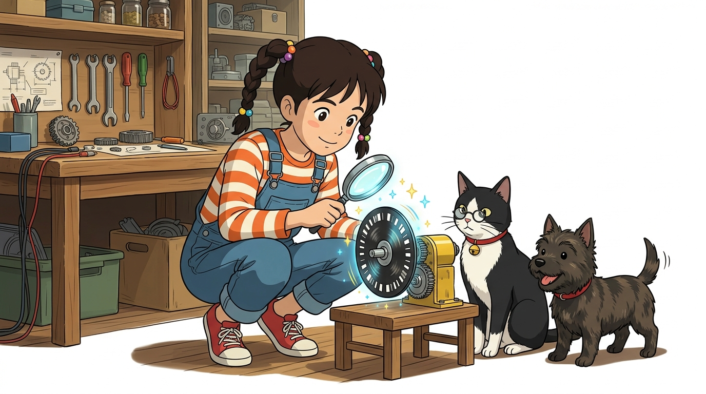
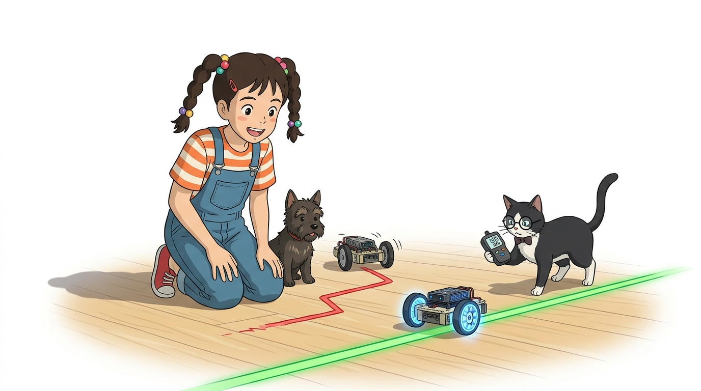
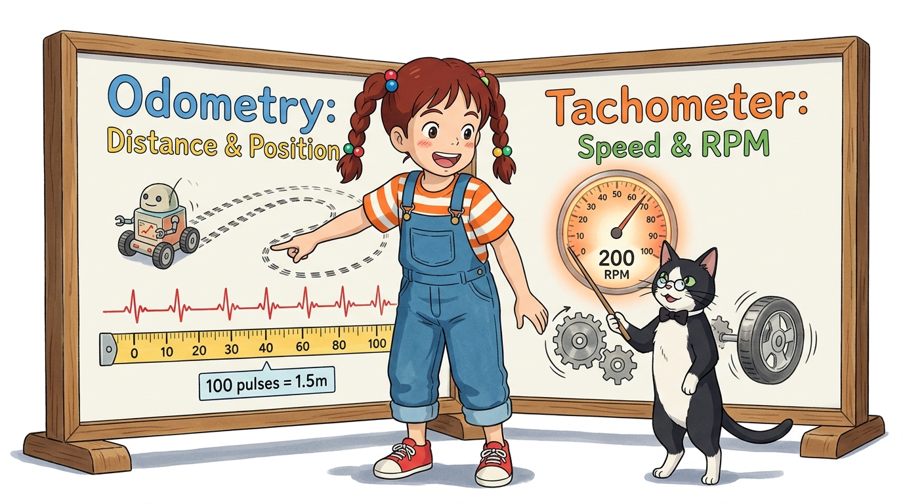
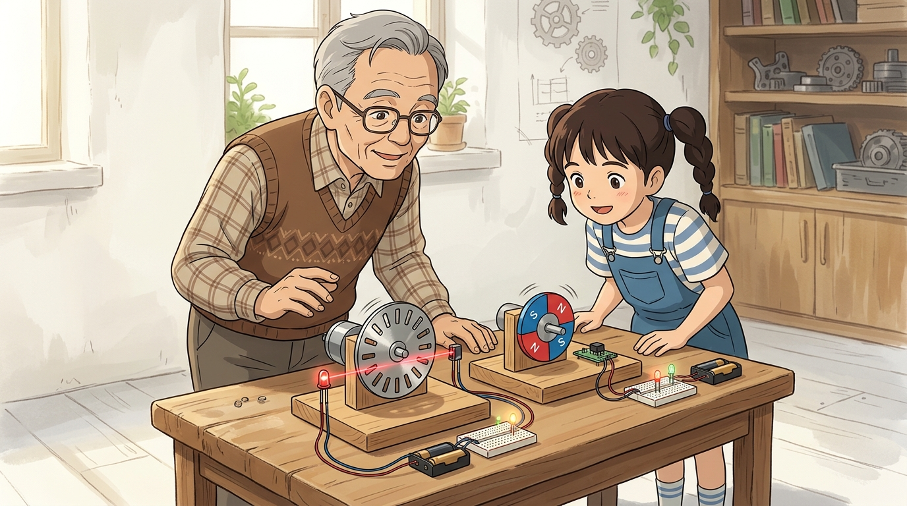
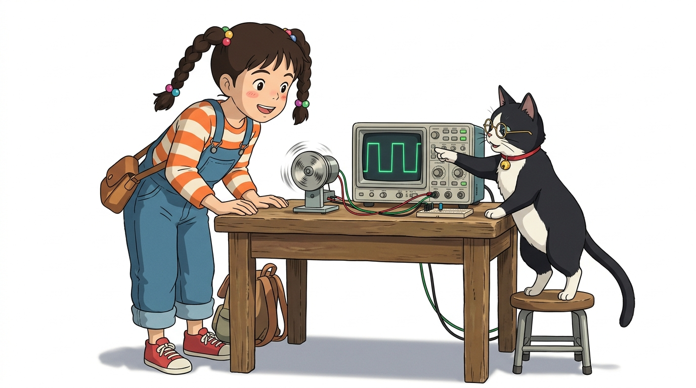
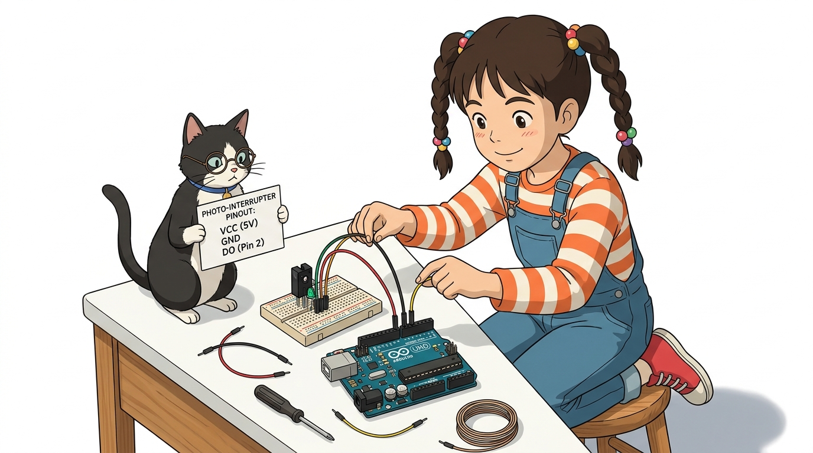

# 104_DC엔코더_회전측정 🚲📊

**도로시와 지니가 함께하는 바퀴가 몇 바퀴 돌았는지, 얼마나 빠른지 알려주는 로터리 엔코더(Rotary Encoder) 기초 탐험**

* 👧 **도로시**: "지니야! DC 모터는 쌩쌩 잘 도는데, 바퀴가 정확히 몇 바퀴 돌았는지, 로봇카가 지금 시속 몇 km로 달리는지 아두이노가 알 수 있어?"
* 🐱 **지니**: "그 비밀을 풀어주는 로봇의 디지털 눈이 바로 **로터리 엔코더(Rotary Encoder, 회전 검출기)** 란다! 바퀴 회전축에 구멍 뚫린 원판이나 자석을 달아 회전할 때마다 전기 펄스를 퐁퐁 뿜어내어 위치와 속도를 측정하지!"
* 🐶 **토토**: "바우! 자전거 바퀴에 달린 디지털 속도계(오도미터)랑 똑같은 원리다 멍!"

* 🖥️ **강의 슬라이드**: [slides.md](./slides.md)

---

## 1. 도로시의 물음: 차가 얼마나 달렸고 얼마나 빠른지 어떻게 알까?

### 🏎️ 개루프 구동에서 폐루프 피드백 제어로의 전환

엔코더가 없는 일반 DC 모터는 배터리가 닳거나 언덕길을 만났을 때 속도가 느려져도 아두이노가 이를 전혀 알지 못합니다.

* **개루프(Open-Loop)의 문제점**:
  * 똑같이 `analogWrite(150)`을 주어도 좌우 바퀴의 미세한 마찰력 차이 때문에 로봇카가 똑바로 직진하지 못하고 한쪽으로 휘어집니다.
* **엔코더를 통한 폐루프(Closed-Loop) 해결책**:
  * 좌우 바퀴의 실제 회전수를 실시간으로 비교하여, 느린 바퀴의 출력을 올려줌으로써 한 치의 오차도 없는 완벽한 직선 주행을 달성합니다.

---

## 2. 엔코더(Encoder)의 2대 핵심 기능: 오도메트리와 속도계

### 📏 위치 제어(거리 측정)와 속도 제어(RPM 연산)

1. **위치 제어 (Odometry / 주행 거리 측정)**:
   * 펄스 1개당 바퀴가 전진하는 거리($\Delta d$)를 미리 계산해두면, 누적된 펄스 수를 세어 "정확히 1.5미터 주행 후 정지!" 명령을 내릴 수 있습니다.
   $$\text{주행 거리} = \text{누적 펄스 수} \times \left( \frac{\text{바퀴 둘레}}{\text{1회전당 총 펄스 수}} \right)$$
2. **속도 제어 (Tachometer / RPM 측정)**:
   * 일정 시간(예: 100ms) 동안 들어온 펄스 개수를 측정하여 현재 모터의 분당 회전수(**RPM, Revolutions Per Minute**)를 계산합니다.

---

## 3. 엔코더의 2가지 물리적 감지 방식 비교

### 🔍 빛으로 읽는 광학식 vs 자석으로 읽는 자기식

| 비교 항목 | 광학식 엔코더 (Optical Encoder) | 자기식 엔코더 (Magnetic Encoder) |
| :--- | :--- | :--- |
| **감지 소자** | 적외선 발광 다이오드(LED) + 포토트랜지스터 | **영구자석 + 홀 센서 (Hall Effect Sensor)** |
| **작동 원리** | 슬릿 원판의 틈새로 빛이 통과/차단됨 | 자석이 회전하며 N/S극 자계 변화 감지 |
| **환경 내구성** | 먼지나 흙탕물이 슬릿을 막으면 오작동 위험 | **먼지, 기름때, 습기에 매우 강함 (산업용)** |
| **교육용 키트** | **노란색 TT 기어드 모터 바퀴 슬릿 휠** | 고성능 메탈 기어드 엔코더 모터 |

---

## 4. 스마트 로봇카 바퀴의 광학식 슬릿 엔코더 구조

### ⚙️ 20개 구멍 원판과 ㄷ자형 포토 인터럽터 센서

아두이노 스마트카 키트에 가장 널리 쓰이는 표준 광학식 엔코더 구조입니다.

* **20 슬릿 휠 (20-Slit Wheel)**:
  * 모터 감속 기어박스 안쪽의 고속 회전축에 장착된 검은 플라스틱 원판으로, 18도 간격으로 20개의 직사각형 구멍이 뚫려 있습니다.
* **ㄷ자형 포토 인터럽터 (Photo-interrupter Module)**:
  * 마주 보고 있는 한쪽에서는 적외선을 쏘고, 반대쪽에서는 빛을 받습니다.
  * 살(검은 플라스틱)이 빛을 가리면 **HIGH(5V)**, 구멍으로 빛이 통과하면 **LOW(0V)** 디지털 신호가 출력됩니다.
  * 바퀴가 1바퀴 돌면 정확히 **20개의 펄스(에지 40개)** 가 퐁퐁 뿜어져 나옵니다!

---

## 5. 엔코더 펄스 신호 파형과 분해능 (Resolution)

### ⚡ 구형파(Square Wave) 펄스와 CPR (Counts Per Revolution)

바퀴가 일정 속도로 회전할 때 엔코더의 신호선(DO, Digital Output)에서는 완벽한 디지털 구형파가 발생합니다.

* **CPR (Counts Per Revolution)**: 모터가 1회전할 때 발생하는 펄스의 총개수.
* **주파수와 속도의 관계**:
  * 바퀴가 빨리 돌수록 펄스의 폭이 좁아지고 주파수($f$)가 높아집니다.
  * 아두이노는 이 고속 펄스를 놓치지 않기 위해 루프 검사가 아닌 **외부 하드웨어 인터럽트**를 통해 펄스를 셉니다.

---

## 6. 포토 인터럽터 센서 모듈의 핀 구성

### 🔌 아두이노와 연결하는 3핀 인터페이스

* **VCC**: 아두이노 5V 전원 연결
* **GND**: 아두이노 GND 연결
* **DO (Digital Output)**: 아두이노의 **디지털 2번 핀 (INT0)** 에 연결하여 펄스를 인터럽트로 수신!

---

## 🌟 도로시와 지니의 핵심 요약 노트!

* 👧 **도로시**: "엔코더는 바퀴가 돌 때마다 펄스를 뿜어내어 내가 정확히 몇 바퀴 돌았는지, 속도가 얼마나 빠른지 알려주는 로봇의 속도계 센서구나!"
* 🐱 **지니**: "정답이야! 1바퀴에 20개 구멍이 있으니 펄스 20개를 세면 바퀴가 1회전한 것을 1mm의 오차도 없이 알 수 있단다."
* 🐶 **토토**: "바우! 다음 시간에는 바퀴가 앞으로 가는지 뒤로 후진하는지 방향까지 알아내는 **위상 구분(A상/B상)** 을 배워보자 멍!"
