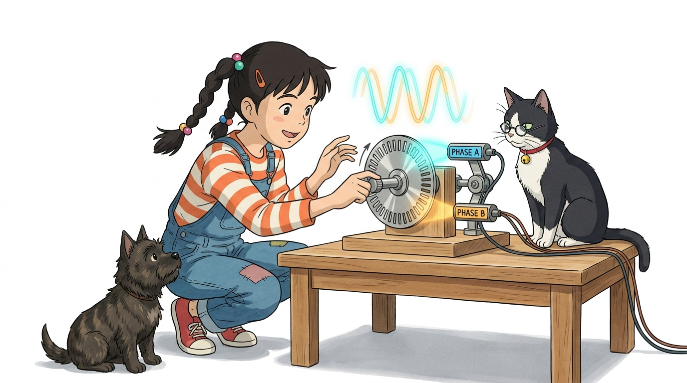
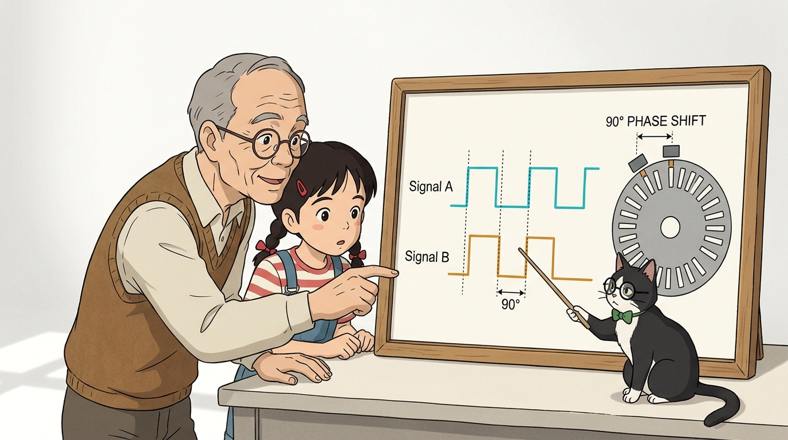
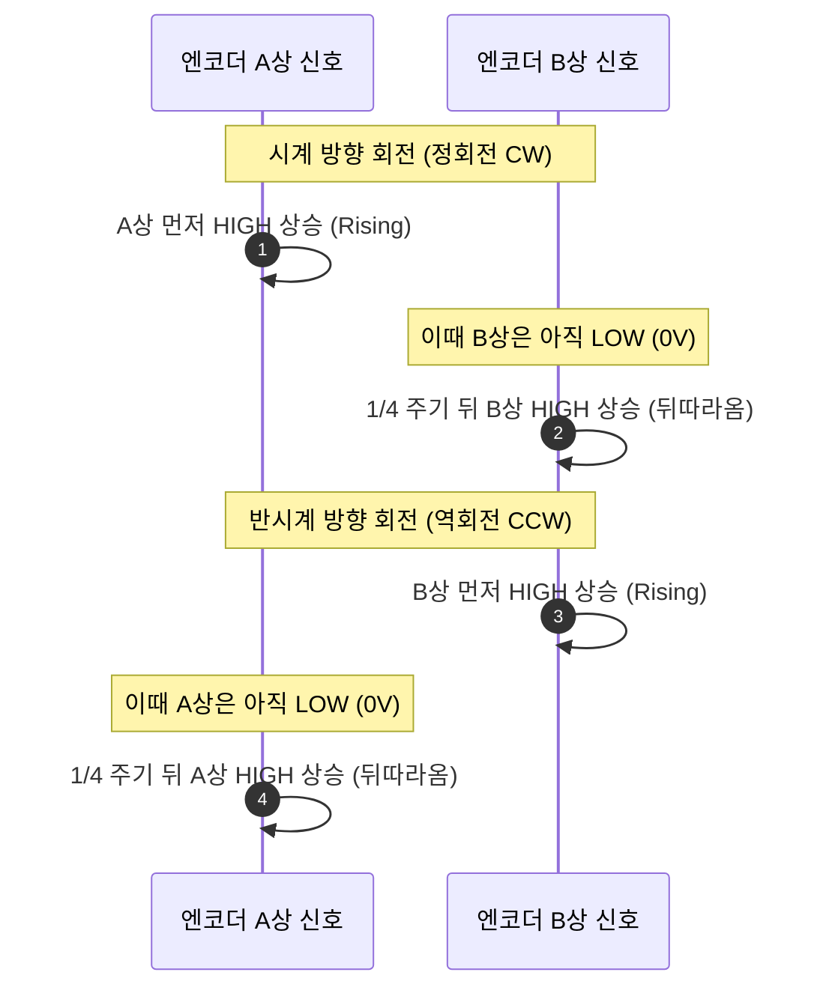
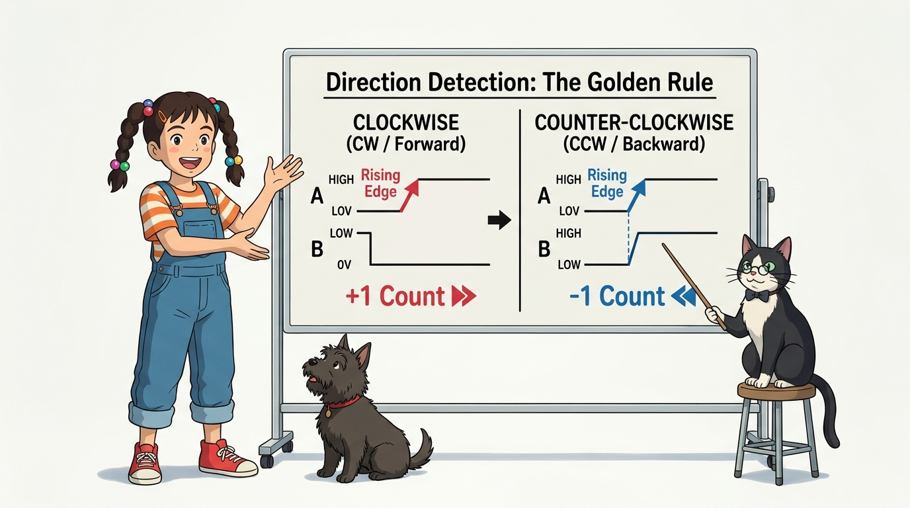
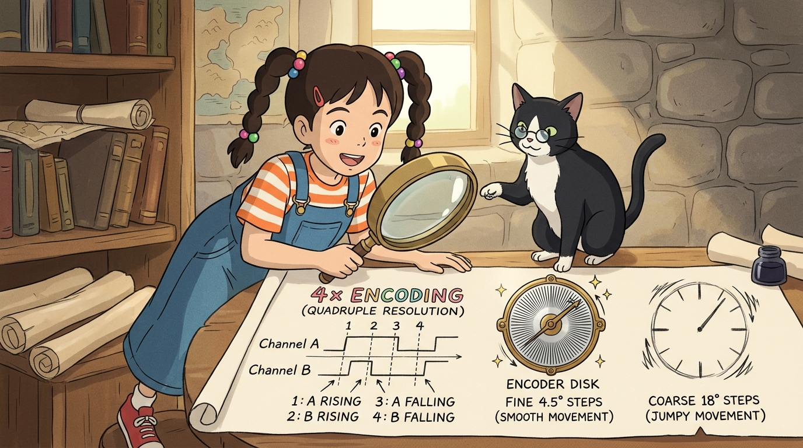
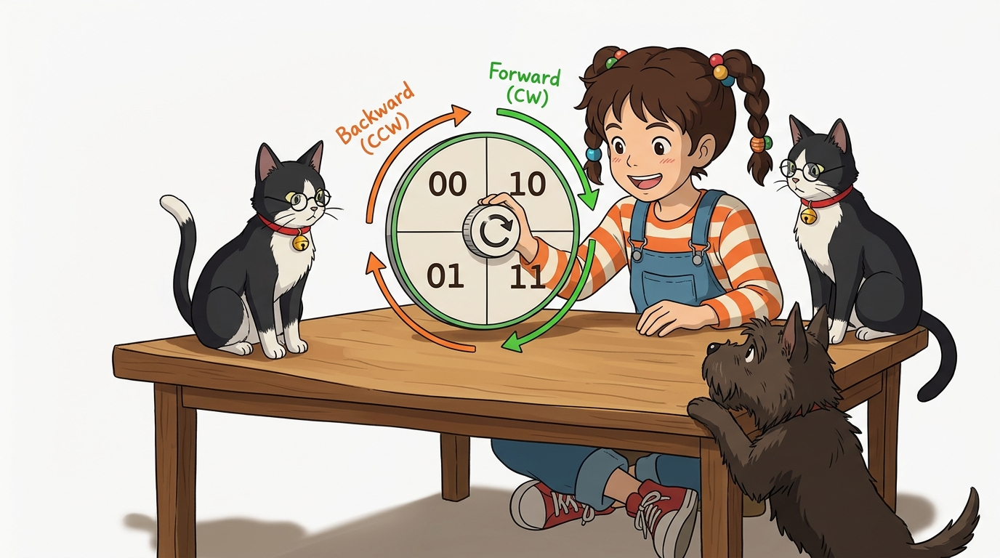

# 105_2상엔코더_방향감별 🧭🔄



**도로시와 지니가 함께하는 A상과 B상의 90도 직각 위상차(Phase Shift)를 이용한 회전 방향 판별과 4체배 해상도 마법**
* 👧 **도로시**: "지니야! 펄스를 내보내는 센서가 1개만 있으면, 펄스가 10개 찍혔을 때 앞으로 10걸음 간 건지 뒤로 10걸음 후진한 건지 아두이노가 구분을 못 하잖아!"
* 🐱 **지니**: "정말 예리한 통찰이야 도로시! 그래서 진짜 로봇이나 정밀 모터에는 센서 2개를 90도($1/4$ 주기) 엇갈리게 배치한 **2상 직각 위상 엔코더(Quadrature Encoder, 쿼드러처 엔코더)** 를 쓴단다!"
* 🐶 **토토**: "바우! 눈이 2개라서 A가 먼저 보냐, B가 먼저 보냐로 전진과 후진을 단박에 알아챈다 멍!"
* 📖 **상세 강의 교재**: [index.md](./index.md)


> 여러분 안녕하세요! 이번 시간에는 '105. 2상엔코더 방향감별 🧭🔄'을 주제로 함께 흥미진진한 탐험을 떠나보겠습니다. 오늘 강의에서는 특히 도로시와 지니가 함께하는 A상과 B상의 90도 직각 위상차(Phase Shift)를 이용한 회전 방향 판별과 4체배 해상도 마법, 👧 도로시: "지니야! 펄스를 내보내는 센서가 1개만 있으면, 펄스가 10개 찍혔을 때 앞으로 10걸음 간 건지 뒤로 10걸음 후진한 건지 아두이노가 구분을 못 하잖아!"를 중심으로 핵심 원리와 응용 방법을 차근차근 배워보겠습니다. 마법 멘토 지니와 호기심 많은 탐험가 도로시, 그리고 귀여운 토토와 함께 신나는 아두이노 모험을 힘차게 시작해 봅시다. 준비되셨나요?

---

## 1. 도로시의 궁금증: 단일 상(Single-Phase) 엔코더의 한계


* **발생하는 문제**:
* 언덕길에서 로봇카가 힘이 달려 뒤로 미끄러져 내려가도, 단상 엔코더는 펄스가 나오므로 "앞으로 잘 달리고 있구나!" 하고 착각하게 됩니다.
* **해결책**:
* 2개의 신호 채널(**Channel A, Channel B**)을 둔 **2상(Quadrature) 엔코더**를 사용하여 위상의 선행/지연을 비교합니다.

### ❓ 펄스 개수만으로는 회전 방향을 알 수 없다
센서가 1개뿐인 단상 엔코더는 펄스의 빈도(속도)와 개수(이동량)만 알려줄 뿐, 바퀴가 시계 방향(CW)으로 도는지 반시계 방향(CCW)으로 도는지 알 수 없습니다.

> 이번 슬라이드에서는 '1. 도로시의 궁금증: 단일 상(Single-Phase) 엔코더의 한계'에 대해 자세히 살펴보겠습니다. 화면의 다이어그램과 사진을 함께 참고해 주시기 바랍니다. 첫 번째 핵심은 발생하는 문제이며, 두 번째로는 언덕길에서 로봇카가 힘이 달려 뒤로 미끄러져 내려가도, 단상 엔코더는 펄스가 나오므로 "앞으로 잘 달리고 있구나!" 하고 착각하게 됩니다.입니다. 여기에 덧붙여 개의 신호 채널(Channel A, Channel B)을 둔 2상(Quadrature) 엔코더를 사용하여 위상의 선행/지연을 비교합니다. 내용까지 함께 이해해 두시면 완벽합니다. 이 원리는 아두이노 시스템 전체를 관통하는 핵심 논리이므로 머릿속에 꼭 정리해 두시기 바랍니다.

---

## 2. 90도($1/4$ 주기) 엇갈린 두 파형: A상과 B상의 위상차



### 📐 직각 위상(Quadrature)의 물리적 배치 원리
원판의 슬릿 틈새를 바라보는 2개의 센서를 슬릿 폭의 절반($1/4$ 피치, 기계적 각도 90도)만큼 간격을 두고 배치합니다.



> 이번 슬라이드에서는 '2. 90도($1/4$ 주기) 엇갈린 두 파형: A상과 B상의 위상차'에 대한 실제 동작 코드를 분석해 보겠습니다. 화면의 코드를 살펴보시면, 컴퓨터가 아두이노 하드웨어에 단계별로 명령을 내리는 흐름을 명확하게 확인할 수 있습니다. 각 함수의 역할과 괄호 안의 매개변수가 하드웨어 핀과 어떤 관계를 맺고 동작하는지 주의 깊게 살펴보시기 바랍니다.

---

## 3. 회전 방향 판별의 황금 룰 (Direction Detection Rule)



| 모터 회전 방향 | A상 인터럽트 순간 (RISING) | B상 핀의 전압 상태 | 회전 카운트 연산 | 판별 결과 |
| :---: | :---: | :---: | :---: | :---: |
| **정회전 (CW / 전진)** | LOW ➡️ HIGH (상승) | **LOW (0V)** | **`count++` (+1)** | **앞으로 주행 중!** ⏩ |
| **역회전 (CCW / 후진)** | LOW ➡️ HIGH (상승) | **HIGH (5V)** | **`count--` (-1)** | **뒤로 후진 중!** ⏪ |

### 🧭 "A상이 0V에서 5V로 치솟는(RISING) 순간, B상의 전압을 확인하라!"
아두이노 외부 인터럽트를 A상 핀의 `RISING` 모드로 걸어두면 방향 판별이 마법처럼 단순해집니다.

```cpp
void encoderISR() {
  // A상이 0V -> 5V로 올라온 바로 그 순간, B상의 상태를 읽음!
  if (digitalRead(pinB) == LOW) {
    encoderCount++; // 정회전 (전진 카운트 증가)
  } else {
    encoderCount--; // 역회전 (후진 카운트 감소)
  }
}
```

> 이번 슬라이드에서는 '3. 회전 방향 판별의 황금 룰 (Direction Detection Rule)'에 대한 실제 동작 코드를 분석해 보겠습니다. 화면의 코드를 살펴보시면, 컴퓨터가 아두이노 하드웨어에 단계별로 명령을 내리는 흐름을 명확하게 확인할 수 있습니다. 각 함수의 역할과 괄호 안의 매개변수가 하드웨어 핀과 어떤 관계를 맺고 동작하는지 주의 깊게 살펴보시기 바랍니다.

---

## 4. 해상도를 4배로 뻥튀기하는 마법: 4체배(4x Encoding)



* **1체배 (1x)**: A상 상승 에지만 측정 ➡️ 20 CPR
* **2체배 (2x)**: A상 상승/하강 에지 모두 측정 ➡️ 40 CPR
* **4체배 (4x)**: **A상과 B상의 모든 상승/하강 에지 측정 ➡️ 80 CPR!**
* 20개 구멍 슬릿 원판으로도 80단계의 초정밀 각도 분해능(스텝당 $4.5^\circ$)을 얻을 수 있습니다.

### 🔬 1주기 안의 4개 에지를 모두 활용하여 분해능 극대화
A상과 B상의 상승 에지, 하강 에지를 모두 카운팅하면 물리적 슬릿 수를 늘리지 않고도 소프트웨어적으로 정밀도를 4배 높일 수 있습니다.

```mermaid
graph TD
    subgraph 1 주기(360도 전기각) 내의 4개 순간
        E1["에지 1: A상 상승 (Rising)"]
        E2["에지 2: B상 상승 (Rising)"]
        E3["에지 3: A상 하강 (Falling)"]
        E4["에지 4: B상 하강 (Falling)"]
    end
    E1 & E2 & E3 & E4 --> Count["1주기당 4번의 카운트 발생! (4체배)"]
```

> 이번 슬라이드에서는 '4. 해상도를 4배로 뻥튀기하는 마법: 4체배(4x Encoding)'에 대한 실제 동작 코드를 분석해 보겠습니다. 화면의 코드를 살펴보시면, 컴퓨터가 아두이노 하드웨어에 단계별로 명령을 내리는 흐름을 명확하게 확인할 수 있습니다. 여기서 핵심은 체배 (1x): A상 상승 에지만 측정 ➡️ 20 CPR입니다. 각 함수의 역할과 괄호 안의 매개변수가 하드웨어 핀과 어떤 관계를 맺고 동작하는지 주의 깊게 살펴보시기 바랍니다.

---

## 5. 그레이 코드(Gray Code)와 상태 전이 매트릭스



* **정회전 패턴**: `00` $\to$ `10` $\to$ `11` $\to$ `01` $\to$ `00` (순환)
* **역회전 패턴**: `00` $\to$ `01` $\to$ `11` $\to$ `10` $\to$ `00` (역순환)
* 인접한 상태 간에 오직 1개의 비트만 바뀌는 **그레이 코드(Gray Code)** 특성 덕분에, 신호 노이즈로 인한 판별 오류가 원천 방지됩니다.

### 📊 2비트 2진수 상태 변화 (00 ➡️ 01 ➡️ 11 ➡️ 10)
엔코더의 A상과 B상 신호를 묶으면 [A, B] 2비트 상태가 됩니다.

> 이번 슬라이드에서는 '5. 그레이 코드(Gray Code)와 상태 전이 매트릭스'에 대해 자세히 살펴보겠습니다. 화면의 다이어그램과 사진을 함께 참고해 주시기 바랍니다. 첫 번째 핵심은 정회전 패턴: 00 $\to$ 10 $\to$ 11 $\to$ 01 $\to$ 00 (순환)이며, 두 번째로는 역회전 패턴: 00 $\to$ 01 $\to$ 11 $\to$ 10 $\to$ 00 (역순환)입니다. 여기에 덧붙여 인접한 상태 간에 오직 1개의 비트만 바뀌는 그레이 코드(Gray Code) 특성 덕분에, 신호 노이즈로 인한 판별 오류가 원천 방지됩니다. 내용까지 함께 이해해 두시면 완벽합니다. 이 원리는 아두이노 시스템 전체를 관통하는 핵심 논리이므로 머릿속에 꼭 정리해 두시기 바랍니다.

---

## 🌟 도로시와 지니의 핵심 요약 노트!


* 👧 **도로시**: "A상과 B상이 90도 시차를 두고 떨어져 있어서, A가 올라올 때 B가 0인지 1인지만 보면 앞으로 도는지 뒤로 도는지 완벽하게 구별할 수 있구나!"
* 🐱 **지니**: "맞아! 게다가 4개의 에지를 모두 세면 해상도가 4배로 정밀해져서 로봇 팔과 자율주행차의 오도메트리에 기본으로 쓰인단다."
* 🐶 **토토**: "바우! 이제 아두이노 외부 인터럽트 코드로 바퀴 회전수와 RPM을 직접 측정하는 **인코더 인터럽트 실습**을 해보자 멍!"

> 오늘 배운 '🌟 도로시와 지니의 핵심 요약 노트!'의 핵심 내용을 모두 정리해 보았습니다. 오늘 다룬 내용 중에서도 👧 도로시: "A상과 B상이 90도 시차를 두고 떨어져 있어서, A가 올라올 때 B가 0인지 1인지만 보면 앞으로 도는지 뒤로 도는지 완벽하게 구별할 수 있구나!" 부분은 앞으로의 아두이노 실습과 프로젝트에서 계속 사용되는 매우 중요한 기초 지식입니다. 오늘 배운 내용을 꼭 다시 한번 복습해 보시고, 다음 강의에서 더욱 신나고 유익한 모험으로 다시 만나겠습니다. 모두 수고 많으셨습니다!