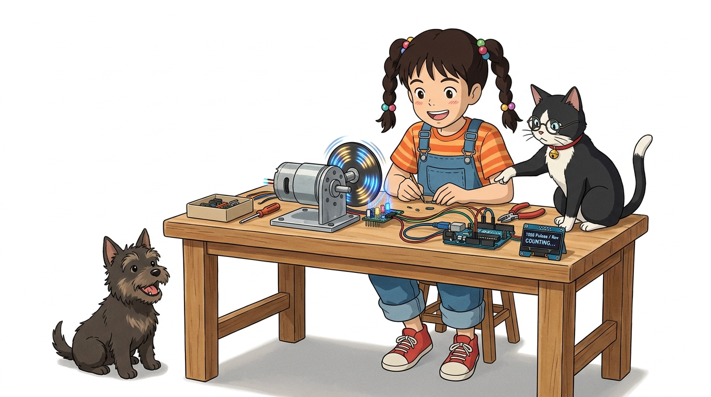
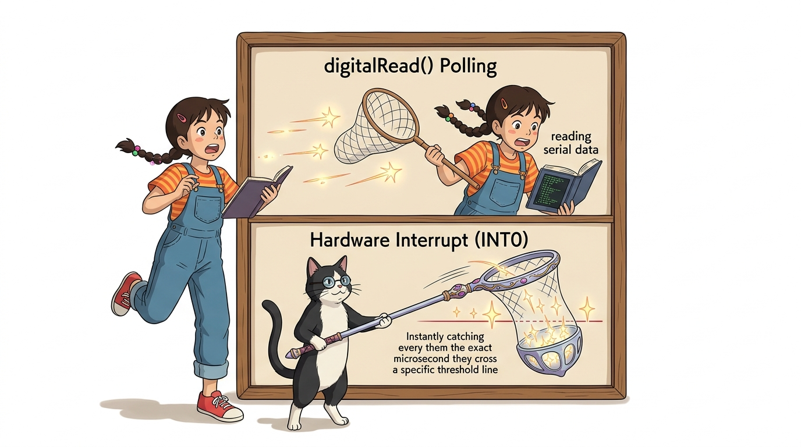
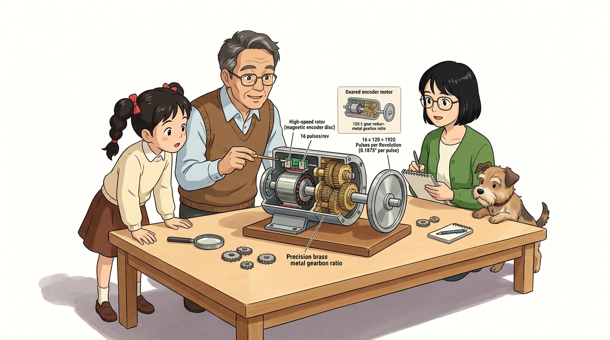
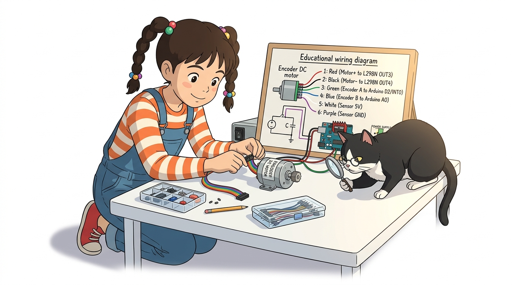
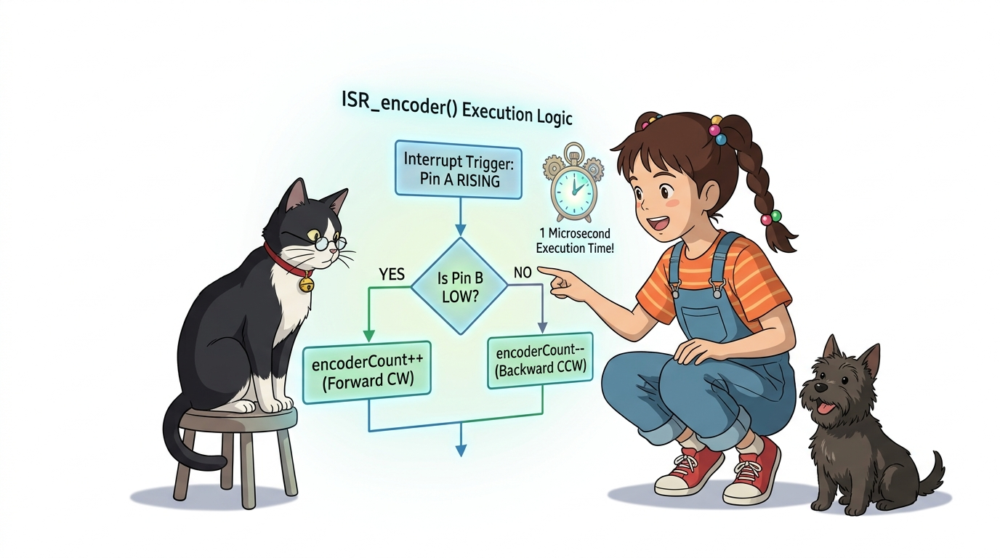

# 106_엔코더인터럽트_펄스카운트 ⏱️🔢



**도로시와 지니가 함께하는 1바퀴당 1920펄스를 놓치지 않고 계수하는 고속 인터럽트 주행 시스템 구축**
* 👧 **도로시**: "지니야! 모터가 쌩쌩 도니까 엔코더 펄스가 1초에 수백 번 넘게 번쩍거리며 쏟아져 나와! 메인 루프에서 `digitalRead()`로 세다간 숫자를 절반도 못 세고 다 놓쳐버릴 것 같아!"
* 🐱 **지니**: "그래서 바로 **외부 하드웨어 인터럽트**가 출동하는 거야! 펄스가 튀는 0.000001초(1마이크로초)마다 CPU가 하던 일을 즉시 멈추고 숫자를 카운트하니까, 모터가 아무리 빠르게 돌아도 단 1개의 펄스도 놓치지 않는단다!"
* 🐶 **토토**: "바우! 바퀴 회전수를 광속으로 세어서 완벽한 자전거 속도계를 만들어보자 멍!"
* 📖 **상세 강의 교재**: [index.md](./index.md)


> 여러분 안녕하세요! 이번 시간에는 '106. 엔코더인터럽트 펄스카운트 ⏱️🔢'을 주제로 함께 흥미진진한 탐험을 떠나보겠습니다. 오늘 강의에서는 특히 도로시와 지니가 함께하는 1바퀴당 1920펄스를 놓치지 않고 계수하는 고속 인터럽트 주행 시스템 구축, 👧 도로시: "지니야! 모터가 쌩쌩 도니까 엔코더 펄스가 1초에 수백 번 넘게 번쩍거리며 쏟아져 나와! 메인 루프에서 digitalRead()로 세다간 숫자를 절반도 못 세고 다 놓쳐버릴 것 같아!"를 중심으로 핵심 원리와 응용 방법을 차근차근 배워보겠습니다. 마법 멘토 지니와 호기심 많은 탐험가 도로시, 그리고 귀여운 토토와 함께 신나는 아두이노 모험을 힘차게 시작해 봅시다. 준비되셨나요?

---

## 1. 도로시의 놀라움: 1초에 수백 개씩 쏟아지는 고속 펄스



* **루프 기반 검사의 실패**:
* 아두이노가 시리얼 통신을 하거나 센서 값을 읽는 데 10ms만 소요되어도, 그사이에 수십 개의 펄스가 지나가 버려 거리 계산이 완전히 엉망이 됩니다.
* **하드웨어 인터럽트의 완벽함**:
* 아두이노가 다른 계산에 열중하고 있어도, 2번 핀(INT0)에 펄스 에지가 도달하는 순간 즉시 인터럽트 서비스 루틴(ISR)이 호출되어 변수를 카운트하므로 **100% 무결점 계수**를 보장합니다.

### ⚡ 초고속 펄스(KHz) 환경에서 인터럽트가 필수적인 이유
기어드 DC 모터의 내부 모터 축은 분당 수천 회전(RPM)을 수행합니다.

> 이번 슬라이드에서는 '1. 도로시의 놀라움: 1초에 수백 개씩 쏟아지는 고속 펄스'에 대해 자세히 살펴보겠습니다. 화면의 다이어그램과 사진을 함께 참고해 주시기 바랍니다. 첫 번째 핵심은 루프 기반 검사의 실패이며, 두 번째로는 아두이노가 시리얼 통신을 하거나 센서 값을 읽는 데 10ms만 소요되어도, 그사이에 수십 개의 펄스가 지나가 버려 거리 계산이 완전히 엉망이 됩니다.입니다. 여기에 덧붙여 하드웨어 인터럽트의 완벽함 내용까지 함께 이해해 두시면 완벽합니다. 이 원리는 아두이노 시스템 전체를 관통하는 핵심 논리이므로 머릿속에 꼭 정리해 두시기 바랍니다.

---

## 2. 감속 기어 내장 엔코더 모터의 분해능 수학



* **모터 축 분해능**: 1회전당 16펄스 (A/B상 4체배 시 64 카운트)
* **내부 기어비**: **120 : 1** (기어박스를 거치며 회전각이 120배 정밀해짐)
* **최종 출력축 분해능**:
* 바퀴가 1바퀴($360^\circ$) 돌 때 아두이노는 1920번의 펄스를 카운팅하므로, 회전각 분해능은 $360^\circ / 1920 \approx \mathbf{0.1875^\circ}$에 달합니다!

### 📐 1바퀴당 1920펄스(CPR)의 초정밀 계산법
실습에 사용되는 메탈 기어드 엔코더 모터는 모터 축 뒤편에 마그네틱 엔코더가 장착되어 있습니다.
$$16 \text{ pulses} \times 120 = \mathbf{1920 \text{ CPR (Counts Per Revolution)}}$$


> 이번 슬라이드에서는 '2. 감속 기어 내장 엔코더 모터의 분해능 수학'에 대한 실제 동작 코드를 분석해 보겠습니다. 화면의 코드를 살펴보시면, 컴퓨터가 아두이노 하드웨어에 단계별로 명령을 내리는 흐름을 명확하게 확인할 수 있습니다. 여기서 핵심은 모터 축 분해능: 1회전당 16펄스 (A/B상 4체배 시 64 카운트)입니다. 각 함수의 역할과 괄호 안의 매개변수가 하드웨어 핀과 어떤 관계를 맺고 동작하는지 주의 깊게 살펴보시기 바랍니다.

---

## 3. 6가닥 모터-엔코더 통합 케이블 결선도



| 핀 번호 및 색상 | 기능 명칭 | 연결 대상 보드 및 핀 | 역할 설명 |
| :---: | :--- | :--- | :--- |
| **1번 (두꺼운 빨강)** | Motor (+) | L298N **OUT3** | 모터 구동 전원 (+) |
| **2번 (두꺼운 검정)** | Motor (-) | L298N **OUT4** | 모터 구동 전원 (-) |
| **3번 (갈색/녹색)** | **Encoder A** | 아두이노 **디지털 2번 핀 (INT0)** | **인터럽트 주 펄스 신호선** |
| **4번 (파란색)** | **Encoder B** | 아두이노 **A0 핀 (디지털 14번)** | **회전 방향 판별용 위상 신호선** |
| **5번 (하늘색/흰색)** | Sensor VCC | 아두이노 **5V** | 홀 센서 IC 구동 전원 (+5V) |
| **6번 (보라색)** | Sensor GND | 아두이노 **GND** | 센서 공통 접지 (0V) |

### 🔌 모터 동력 2선과 센서 신호 4선의 명확한 결선
모터 뒤편에서 나오는 6색 리본 케이블을 아두이노와 L298N에 올바르게 연결합니다.

> 이번에 살펴볼 내용은 '3. 6가닥 모터-엔코더 통합 케이블 결선도'입니다. 슬라이드에 정리된 표를 통해 각 항목의 특징과 수치, 차이점을 한눈에 비교해 보실 수 있습니다. 이 기본 개념을 확실히 잡아두셔야 실제 부품을 브레드보드에 꽂고 코딩할 때 실수 없이 완성할 수 있습니다.

---

## 4. 핵심 ISR 함수: 초고속 방향 판별과 펄스 계수



### ⚡ CHANGE 인터럽트와 상태 캐싱 기법
A상 핀에 `CHANGE` 모드로 인터럽트를 걸어 전압이 바뀔 때마다 방향을 판별하고 카운트를 증감합니다.

```cpp
#define ENCODER_A 2  // 외부 인터럽트 핀 (INT0)
#define ENCODER_B A0 // 일반 디지털 입력 핀

volatile long encoderCount = 0; // 인터럽트 누적 펄스 카운터
volatile byte lastA = LOW;

// 펄스 에지가 발생할 때마다 1마이크로초 만에 실행되는 ISR
void ISR_encoder() {
  byte currentA = digitalRead(ENCODER_A);
  
  // A상이 LOW에서 HIGH로 치솟는 상승 에지(RISING) 순간만 선별!
  if (lastA == LOW && currentA == HIGH) {
    // 이때 B상의 전압 상태를 읽어 회전 방향 판별
    if (digitalRead(ENCODER_B) == LOW) {
      encoderCount++; // 정회전 (시계 방향, 전진)
    } else {
      encoderCount--; // 역회전 (반시계 방향, 후진)
    }
  }
  lastA = currentA; // 현재 상태 기억
}
```

> 이번 슬라이드에서는 '4. 핵심 ISR 함수: 초고속 방향 판별과 펄스 계수'에 대한 실제 동작 코드를 분석해 보겠습니다. 화면의 코드를 살펴보시면, 컴퓨터가 아두이노 하드웨어에 단계별로 명령을 내리는 흐름을 명확하게 확인할 수 있습니다. 각 함수의 역할과 괄호 안의 매개변수가 하드웨어 핀과 어떤 관계를 맺고 동작하는지 주의 깊게 살펴보시기 바랍니다.

---

## 5. 실습 스케치: 시리얼 명령 주행 및 실시간 펄스 로깅


### 💻 키보드로 'f'(전진), 'b'(후진), 's'(정지)를 명령하며 실시간 카운트 관찰

```cpp
#include <Arduino.h>

#define ENCODER_A 2
#define ENCODER_B A0

// L298N 모터 제어 핀 (Motor B 사용 예시)
const int IN3 = 8;
const int IN4 = 9;
const int ENB = 10;

volatile long encoderCount = 0;
volatile byte lastA = LOW;

void ISR_encoder() {
  byte currentA = digitalRead(ENCODER_A);
  if (lastA == LOW && currentA == HIGH) {
    if (digitalRead(ENCODER_B) == LOW) encoderCount++;
    else encoderCount--;
  }
  lastA = currentA;
}

void setup() {
  Serial.begin(115200); // 고속 시리얼 통신 권장
  
  pinMode(ENCODER_A, INPUT_PULLUP);
  pinMode(ENCODER_B, INPUT_PULLUP);
  
  pinMode(IN3, OUTPUT);
  pinMode(IN4, OUTPUT);
  pinMode(ENB, OUTPUT);
  
  // A상 핀에 CHANGE 인터럽트 장착!
  attachInterrupt(digitalPinToInterrupt(ENCODER_A), ISR_encoder, CHANGE);
  
  Serial.println("명령어 입력: f(전진), b(후진), s(정지)");
}

void loop() {
  // 1. PC 시리얼 모니터로부터 주행 명령 수신
  if (Serial.available()) {
    char cmd = Serial.read();
    if (cmd == 'f') { // 전진
      digitalWrite(IN3, HIGH); digitalWrite(IN4, LOW); analogWrite(ENB, 180);
    } else if (cmd == 'b') { // 후진
      digitalWrite(IN3, LOW); digitalWrite(IN4, HIGH); analogWrite(ENB, 180);
    } else if (cmd == 's') { // 정지
      digitalWrite(IN3, LOW); digitalWrite(IN4, LOW); analogWrite(ENB, 0);
    }
  }

  // 2. 200ms마다 현재 누적된 엔코더 펄스 카운트 출력
  static unsigned long lastPrint = 0;
  if (millis() - lastPrint >= 200) {
    lastPrint = millis();
    Serial.print("현재 엔코더 펄스 카운트: ");
    Serial.println(encoderCount);
  }
}
```

> 이번 슬라이드에서는 '5. 실습 스케치: 시리얼 명령 주행 및 실시간 펄스 로깅'에 대한 실제 동작 코드를 분석해 보겠습니다. 화면의 코드를 살펴보시면, 컴퓨터가 아두이노 하드웨어에 단계별로 명령을 내리는 흐름을 명확하게 확인할 수 있습니다. 각 함수의 역할과 괄호 안의 매개변수가 하드웨어 핀과 어떤 관계를 맺고 동작하는지 주의 깊게 살펴보시기 바랍니다.

---
## 🌟 도로시와 지니의 핵심 요약 노트!


* 👧 **도로시**: "바퀴가 1바퀴 돌 때마다 정확히 1920개의 펄스가 찍히고, 후진하면 숫자가 마이너스로 줄어드는 걸 시리얼 모니터로 두 눈으로 직접 확인했어!"
* 🐱 **지니**: "완벽해! 외부 인터럽트 덕분에 고속 회전 중에도 펄스를 단 하나도 흘리지 않고 완벽하게 주행 거리를 측정할 수 있게 되었단다."
* 🐶 **토토**: "바우! 이제 모터가 언덕을 만나도 일정한 속도를 유지하게 만드는 제어공학의 정점, **PID 제어**를 정복하러 가자 멍!"

> 오늘 배운 '🌟 도로시와 지니의 핵심 요약 노트!'의 핵심 내용을 모두 정리해 보았습니다. 오늘 다룬 내용 중에서도 👧 도로시: "바퀴가 1바퀴 돌 때마다 정확히 1920개의 펄스가 찍히고, 후진하면 숫자가 마이너스로 줄어드는 걸 시리얼 모니터로 두 눈으로 직접 확인했어!" 부분은 앞으로의 아두이노 실습과 프로젝트에서 계속 사용되는 매우 중요한 기초 지식입니다. 오늘 배운 내용을 꼭 다시 한번 복습해 보시고, 다음 강의에서 더욱 신나고 유익한 모험으로 다시 만나겠습니다. 모두 수고 많으셨습니다!