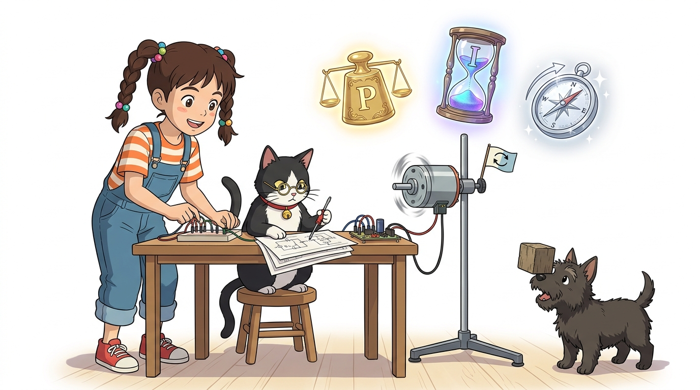
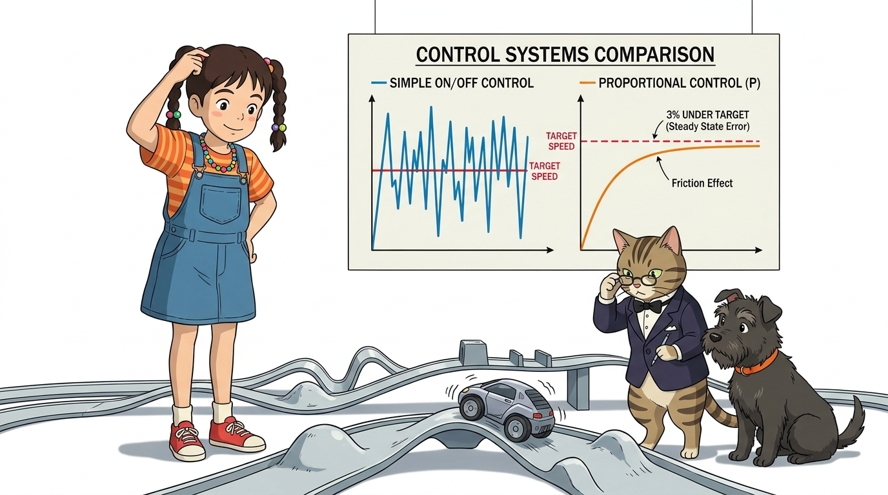
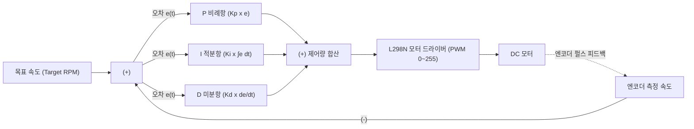
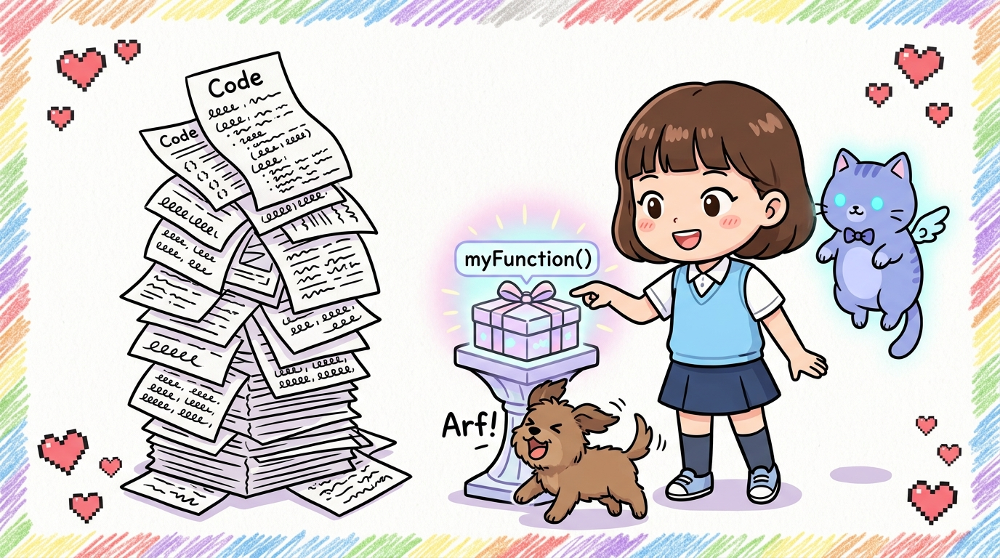

# 107_PID제어_정밀위치속도보정 🎯⚖️



**도로시와 지니가 함께하는 비례(P), 적분(I), 미분(D)으로 완성하는 최첨단 자율주행 정속 크루즈 컨트롤**
* 👧 **도로시**: "지니야! 로봇 자동차를 정확히 100 RPM 속도로 계속 달리게 하고 싶은데, 언덕을 만나면 느려지고 내리막길에선 너무 빨라져! 울퉁불퉁한 길에서도 목표 속도를 흔들림 없이 딱 유지하게 만드는 방법은 없을까?"
* 🐱 **지니**: "그 고민을 해결해 주는 현대 제어공학의 정점이 바로 **PID 제어(Proportional-Integral-Derivative Control)** 란다! 드론의 공중 정지 호버링, 쿼드콥터의 수평 유지, 자율주행차의 스마트 크루즈 컨트롤이 모두 이 수학적 알고리즘으로 작동하지!"
* 🐶 **토토**: "바우! 오차가 생길 때마다 아두이노가 스스로 엑셀과 브레이크를 밟아 균형을 잡는다 멍!"
* 📖 **상세 강의 교재**: [index.md](./index.md)


> 여러분 안녕하세요! 이번 시간에는 '107. PID제어 정밀위치속도보정 🎯⚖️'을 주제로 함께 흥미진진한 탐험을 떠나보겠습니다. 오늘 강의에서는 특히 도로시와 지니가 함께하는 비례(P), 적분(I), 미분(D)으로 완성하는 최첨단 자율주행 정속 크루즈 컨트롤, 👧 도로시: "지니야! 로봇 자동차를 정확히 100 RPM 속도로 계속 달리게 하고 싶은데, 언덕을 만나면 느려지고 내리막길에선 너무 빨라져! 울퉁불퉁한 길에서도 목표 속도를 흔들림 없이 딱 유지하게 만드는 방법은 없을까?"를 중심으로 핵심 원리와 응용 방법을 차근차근 배워보겠습니다. 마법 멘토 지니와 호기심 많은 탐험가 도로시, 그리고 귀여운 토토와 함께 신나는 아두이노 모험을 힘차게 시작해 봅시다. 준비되셨나요?

---

## 1. 도로시의 고민: 부하 변화와 오버슈트(Overshoot) 현상



* **단순 ON/OFF 제어의 한계 (히스테리시스 진동)**:
* 목표 속도보다 느리면 풀 액셀, 빠르면 전원 차단을 반복하면 차체가 덜덜 떨리며 심하게 출렁거립니다.
* **비례 제어(P 제어)의 한계 (정상 상태 오차, Steady-State Error)**:
* 목표에 가까워질수록 오차가 줄어들어 모터 힘이 빠집니다. 결국 마찰력을 이기지 못하고 목표치보다 2~3% 살짝 부족한 상태에서 영원히 멈추는 **잔류 편차(Offset)** 가 발생합니다.

### 📈 왜 단순한 비례 제어만으로는 부족할까?
목표 속도($Target$)와 현재 측정된 속도($Current$)의 차이를 **오차($e(t) = Target - Current$)** 라고 부릅니다.

> 이번 슬라이드에서는 '1. 도로시의 고민: 부하 변화와 오버슈트(Overshoot) 현상'에 대해 자세히 살펴보겠습니다. 화면의 다이어그램과 사진을 함께 참고해 주시기 바랍니다. 첫 번째 핵심은 단순 ON/OFF 제어의 한계 (히스테리시스 진동)이며, 두 번째로는 목표 속도보다 느리면 풀 액셀, 빠르면 전원 차단을 반복하면 차체가 덜덜 떨리며 심하게 출렁거립니다.입니다. 여기에 덧붙여 비례 제어(P 제어)의 한계 (정상 상태 오차, Steady-State Error) 내용까지 함께 이해해 두시면 완벽합니다. 이 원리는 아두이노 시스템 전체를 관통하는 핵심 논리이므로 머릿속에 꼭 정리해 두시기 바랍니다.

---

## 2. PID 3총사의 정의와 수학적 공식


| 제어 항목 | 영문 명칭 | 시간 관점 | 쉬운 비유 | 핵심 역할과 기능 |
| :---: | :--- | :---: | :--- | :--- |
| **P (비례)** | Proportional | **현재 (Present)** | "지금 차이가 크니 **세게 밟아!**" | 현재 오차 크기에 비례하여 강하고 빠르게 반응 |
| **I (적분)** | Integral | **과거 (Past)** | "미세한 오차가 누적됐으니 **더 밀어!**" | 과거의 누적 오차를 더해 잔류 편차(Offset)를 0으로 소멸 |
| **D (미분)** | Derivative | **미래 (Future)** | "목표에 너무 빨리 들이닥치니 **살짝 브레이크!**" | 오차의 변화 속도를 감지해 오버슈트와 출렁거림 억제 |

### 🎯 비례(P), 적분(I), 미분(D)의 완벽한 3중주
PID 제어기는 현재, 과거, 미래의 3가지 시간 축에서 오차를 분석하여 최적의 제어 출력(PWM)을 계산합니다.
$$u(t) = K_p e(t) + K_i \int_{0}^{t} e(\tau) d\tau + K_d \frac{de(t)}{dt}$$



> 이번 슬라이드에서는 '2. PID 3총사의 정의와 수학적 공식'에 대한 실제 동작 코드를 분석해 보겠습니다. 화면의 코드를 살펴보시면, 컴퓨터가 아두이노 하드웨어에 단계별로 명령을 내리는 흐름을 명확하게 확인할 수 있습니다. 각 함수의 역할과 괄호 안의 매개변수가 하드웨어 핀과 어떤 관계를 맺고 동작하는지 주의 깊게 살펴보시기 바랍니다.

---

## 3. 실습 코드: 폐루프 PID DC 모터 속도 제어 스케치



### 💻 100ms 주기 샘플링과 에러 적분/미분 연산 스케치

```cpp
#include <Arduino.h>

#define ENCODER_A 2
#define ENCODER_B A0

const int IN3 = 8;
const int IN4 = 9;
const int ENB = 10; // PWM 속도 제어 핀

// PID 튜닝 게인 계수
float Kp = 1.2;  // 비례 게인
float Ki = 0.08; // 적분 게인
float Kd = 0.05; // 미분 게인

float targetRPM = 120.0; // 목표 회전 속도 (120 RPM)
volatile long encoderCount = 0;

float lastError = 0;
float integral = 0;
unsigned long lastTime = 0;

void ISR_encoder() {
  if (digitalRead(ENCODER_B) == LOW) encoderCount++;
  else encoderCount--;
}

void setup() {
  Serial.begin(115200);
  pinMode(ENCODER_A, INPUT_PULLUP);
  pinMode(ENCODER_B, INPUT_PULLUP);
  pinMode(IN3, OUTPUT); pinMode(IN4, OUTPUT); pinMode(ENB, OUTPUT);

  // 모터 전진 방향 설정
  digitalWrite(IN3, HIGH); digitalWrite(IN4, LOW);
  
  attachInterrupt(digitalPinToInterrupt(ENCODER_A), ISR_encoder, RISING);
  lastTime = millis();
}

void loop() {
  unsigned long now = millis();
  float dt = (now - lastTime) / 1000.0; // 경과 시간 (초 단위)

  if (dt >= 0.1) { // 100ms (0.1초) 주기마다 PID 제어 실행
    // 1. 현재 RPM 계산: (100ms 동안의 펄스 수 / 1920) * (60 / 0.1)
    noInterrupts(); // 인터럽트 일시 정지 (원자적 읽기)
    long pulses = encoderCount;
    encoderCount = 0;
    interrupts();

    float currentRPM = (pulses / 1920.0) * (60.0 / dt);

    // 2. 오차 계산
    float error = targetRPM - currentRPM;

    // 3. P, I, D 제어항 계산
    float p_term = Kp * error;
    integral += error * dt;
    // 안티 와인드업(Anti-windup): 적분 누적 폭주 제한
    integral = constrain(integral, -100, 100);
    float i_term = Ki * integral;
    float d_term = Kd * (error - lastError) / dt;

    // 4. 최종 PWM 출력 산출 및 범위 제한 (0 ~ 255)
    float outputPWM = p_term + i_term + d_term;
    outputPWM = constrain(outputPWM, 0, 255);

    analogWrite(ENB, (int)outputPWM); // 모터에 보정된 PWM 인가!

    // 5. 시리얼 플로터 관찰용 출력 (목표치 vs 현재치)
    Serial.print("Target:"); Serial.print(targetRPM);
    Serial.print(" Current:"); Serial.print(currentRPM);
    Serial.print(" PWM:"); Serial.println(outputPWM);

    lastError = error;
    lastTime = now;
  }
}
```

> 이번 슬라이드에서는 '3. 실습 코드: 폐루프 PID DC 모터 속도 제어 스케치'에 대한 실제 동작 코드를 분석해 보겠습니다. 화면의 코드를 살펴보시면, 컴퓨터가 아두이노 하드웨어에 단계별로 명령을 내리는 흐름을 명확하게 확인할 수 있습니다. 각 함수의 역할과 괄호 안의 매개변수가 하드웨어 핀과 어떤 관계를 맺고 동작하는지 주의 깊게 살펴보시기 바랍니다.

---
## 4. 아두이노 IDE [시리얼 플로터]로 응답 곡선 튜닝하기


![4. 아두이노 IDE [시리얼 플로터]로 응답 곡선 튜닝하기](./img/dorothy_pid_serial_plotter_tuning.jpg)

* **시리얼 플로터(Ctrl + Shift + L)** 를 열면:
* 파란색(목표 RPM) 선을 주황색(현재 RPM) 곡선이 부드럽게 추종하며 딱 달라붙는 **완벽한 수렴 곡선**을 실시간 그래프로 볼 수 있습니다!
* **게인 튜닝 순서**:
1. $K_i=0, K_d=0$으로 두고 $K_p$를 서서히 올려 빠른 응답을 만듭니다.
2. 잔류 편차를 없애기 위해 $K_i$를 아주 조금씩 올립니다.
3. 목표치에 도달할 때 출렁이는 진동을 잡기 위해 $K_d$를 미세하게 더해줍니다.

> 이번 슬라이드에서는 '4. 아두이노 IDE [시리얼 플로터]로 응답 곡선 튜닝하기'에 대해 자세히 살펴보겠습니다. 첫 번째 핵심은 시리얼 플로터(Ctrl + Shift + L) 를 열면이며, 두 번째로는 파란색(목표 RPM) 선을 주황색(현재 RPM) 곡선이 부드럽게 추종하며 딱 달라붙는 완벽한 수렴 곡선을 실시간 그래프로 볼 수 있습니다!입니다. 여기에 덧붙여 게인 튜닝 순서 내용까지 함께 이해해 두시면 완벽합니다. 이 원리는 아두이노 시스템 전체를 관통하는 핵심 논리이므로 머릿속에 꼭 정리해 두시기 바랍니다.
---

## 🌟 06단원 DC 모터 & 고급 제어 대단원 완전 정복!


* 👧 **도로시**: "릴레이로 고전압 전기를 안전하게 스위칭하고, H-브리지 L298N으로 전진과 후진을 다루고, 인터럽트 엔코더로 바퀴 속도를 측정해 PID 정속 제어까지 완성했어!"
* 🐱 **지니**: "정말 대견해 도로시! 기계와 전기가 컴퓨터 코드와 만나 스스로 균형을 잡는 진정한 로봇 엔지니어링의 정점을 정복했단다."
* 🐶 **토토**: "바우! 축하합니다! 06단원 DC 모터의 모든 16개 챕터가 완벽하게 완료되었다 멍!"

> 오늘 배운 '🌟 06단원 DC 모터 & 고급 제어 대단원 완전 정복!'의 핵심 내용을 모두 정리해 보았습니다. 오늘 다룬 내용 중에서도 👧 도로시: "릴레이로 고전압 전기를 안전하게 스위칭하고, H-브리지 L298N으로 전진과 후진을 다루고, 인터럽트 엔코더로 바퀴 속도를 측정해 PID 정속 제어까지 완성했어!" 부분은 앞으로의 아두이노 실습과 프로젝트에서 계속 사용되는 매우 중요한 기초 지식입니다. 오늘 배운 내용을 꼭 다시 한번 복습해 보시고, 다음 강의에서 더욱 신나고 유익한 모험으로 다시 만나겠습니다. 모두 수고 많으셨습니다!