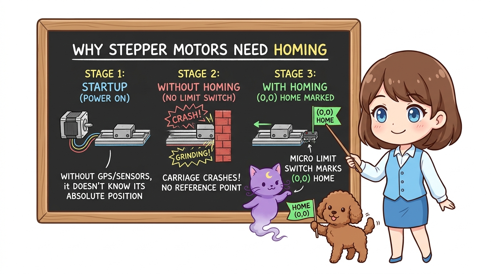
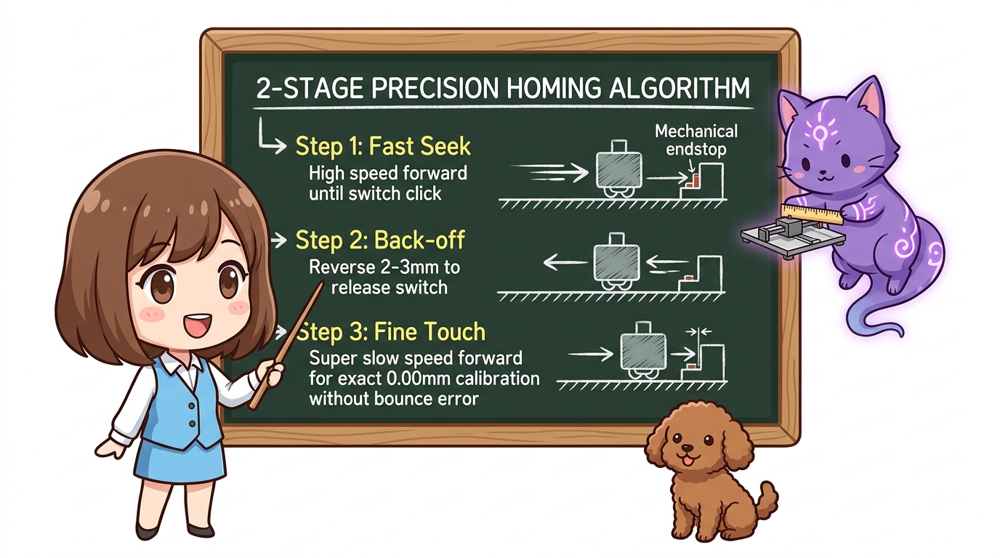
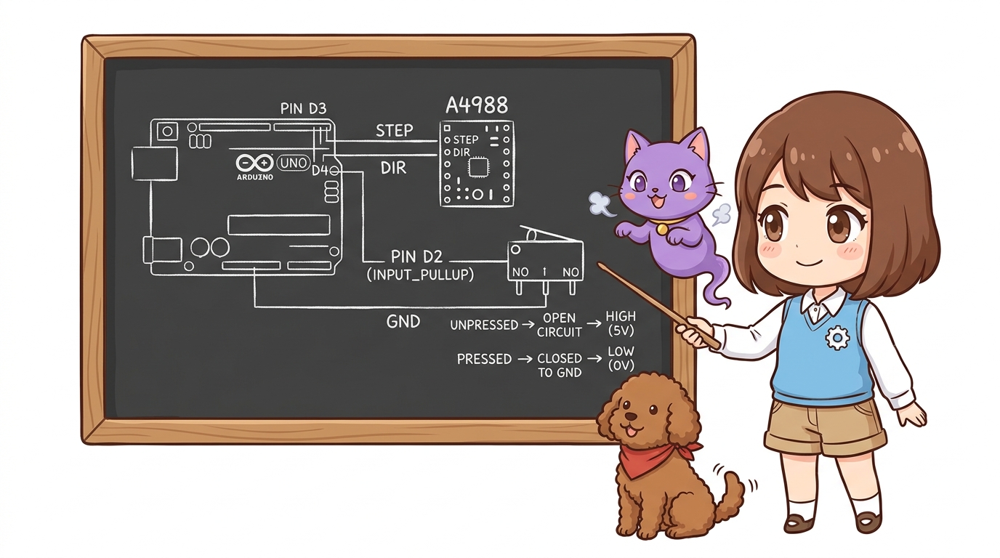
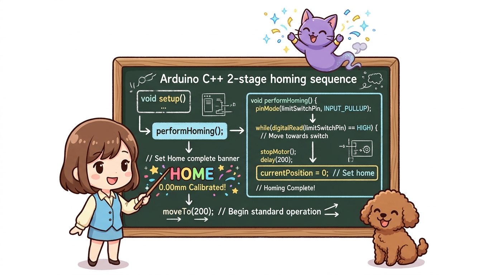
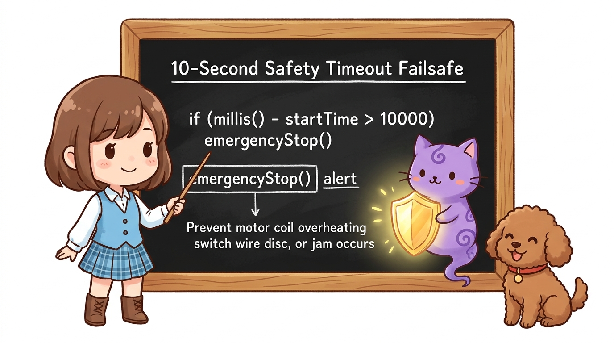

# 108_모터_홈포지션_영점복귀와_호밍알고리즘 🎯🤖


**도로시와 지니가 함께하는 리미트 스위치 기반 원점 복귀(Homing)와 절대 위치 캘리브레이션**
* 👧 **도로시**: "지니야! 3D 프린터나 로봇 팔은 전원을 켜면 왜 스스로 한쪽 구석으로 찌잉- 달려가서 스위치를 '딸깍' 누르고 시작해?"
* 🐱 **지니**: "스텝 모터는 자기가 몇 걸음 걸었는지는 알아도, 지금 세상의 어디에 서 있는지 **절대 위치**를 모르기 때문이야! 기준점인 0번 좌표를 찾는 마법을 **호밍(Homing)** 이라고 한단다!"
* 🐶 **토토**: "바우! 여기가 바로 (0, 0) 홈 포지션 깃발이다 멍!"
* 📖 **상세 강의 교재**: [index.md](./index.md)


> 여러분 안녕하세요! 이번 시간에는 '108. 모터 홈포지션 영점복귀와 호밍알고리즘 🎯🤖'을 주제로 함께 흥미진진한 탐험을 떠나보겠습니다. 오늘 강의에서는 특히 도로시와 지니가 함께하는 리미트 스위치 기반 원점 복귀(Homing)와 절대 위치 캘리브레이션, 👧 도로시: "지니야! 3D 프린터나 로봇 팔은 전원을 켜면 왜 스스로 한쪽 구석으로 찌잉- 달려가서 스위치를 '딸깍' 누르고 시작해?"를 중심으로 핵심 원리와 응용 방법을 차근차근 배워보겠습니다. 마법 멘토 지니와 호기심 많은 탐험가 도로시, 그리고 귀여운 토토와 함께 신나는 아두이노 모험을 힘차게 시작해 봅시다. 준비되셨나요?

---

## 1. 왜 모터는 전원을 켜면 자기 위치를 모를까?



* **스텝 모터의 맹점**: 스텝 모터는 1펄스당 1.8도씩 매우 정밀하게 돌지만, 모터 내부에 나침반이나 GPS 같은 절대 센서가 없습니다. 전원을 끄는 순간 모든 기억이 사라집니다.
* **만약 호밍을 하지 않는다면?**:
* 노즐이 슬라이더 끝에 부딪혀 "드르르륵!" 굉음을 내며 벨트가 끊어지거나 모터가 타버립니다.
* **해결책**: 기계의 한쪽 끝에 **리미트 스위치(Limit Switch / Endstop)** 를 달아두고, 전원이 켜지면 모터가 스위치를 만날 때까지 천천히 움직여 그 자리를 **"좌표 0(Home)"** 으로 약속하는 것입니다!

### ❓ 상대 위치(Relative) vs 절대 위치(Absolute)

> 자, 이번 슬라이드의 질문을 함께 보시겠습니다. 바로 '1. 왜 모터는 전원을 켜면 자기 위치를 모를까?'라는 아주 흥미로운 질문입니다. 우리가 일상에서 흔히 접하는 스텝 모터의 맹점: 스텝 모터는 1펄스당 1.8도씩 매우 정밀하게 돌지만, 모터 내부에 나침반이나 GPS 같은 절대 센서가 없습니다. 전원을 끄는 순간 모든 기억이 사라집니다. 현상을 떠올려보면 왜 이런 의문이 생기는지 쉽게 공감할 수 있습니다. 이 질문 속에 숨겨진 전자 회로와 컴퓨팅의 핵심 원리를 지금부터 차근차근 하나씩 파헤쳐 보겠습니다.

---
## 2. 산업용 3D 프린터의 2단계 정밀 호밍 알고리즘




단순히 스위치를 한 번 쾅 누르고 멈추면 관성과 기계식 스위치의 접점 반동(Bouncing) 때문에 0.5~1mm의 오차가 생깁니다. 실제 산업 현장과 3D 프린터 펌웨어(Marlin)는 **2단계 미세 호밍(Two-stage Homing)** 기법을 사용합니다.

```
[ 1단계 : 고속 접근 (Fast Seek) ]
───────▶ 모터가 빠른 속도로 스위치를 향해 전진 ➔ "딸깍!" 감지 즉시 정지

[ 2단계 : 미세 탈출 (Back-off) ]
◀─────── 반대 방향으로 살짝 후진 (약 2~3mm) ➔ 스위치 접점이 다시 열림

[ 3단계 : 저속 정밀 터치 (Fine Touch) ]
──▶ 1단계 속도의 1/5 속도로 아주 살금살금 접근 ➔ "딸깍!" 순간 ➔ 바로 여기가 0.00mm!
```

> 이번 슬라이드에서는 '2. 산업용 3D 프린터의 2단계 정밀 호밍 알고리즘'에 대한 실제 동작 코드를 분석해 보겠습니다. 화면의 코드를 살펴보시면, 컴퓨터가 아두이노 하드웨어에 단계별로 명령을 내리는 흐름을 명확하게 확인할 수 있습니다. 각 함수의 역할과 괄호 안의 매개변수가 하드웨어 핀과 어떤 관계를 맺고 동작하는지 주의 깊게 살펴보시기 바랍니다.
---
## 3. 하드웨어 회로 구성




* **아두이노 우노 (UNO)**
* **스텝모터 및 드라이버 (A4988 / 28BYJ-48 + ULN2003)**:
* STEP 핀: 디지털 **3번**
* DIR 핀: 디지털 **4번**
* **기계식 마이크로 리미트 스위치 (Endstop)**:
* C (공통 단자) ➔ 아두이노 **GND**
* NO (Normally Open, 평상시 열림) ➔ 아두이노 디지털 **2번 (내부 풀업 INPUT_PULLUP)**
* *평상시 HIGH(5V), 스위치가 눌리면 LOW(0V)로 안전하게 떨어집니다.*

> 이번 슬라이드에서는 '3. 하드웨어 회로 구성'에 대해 자세히 살펴보겠습니다. 첫 번째 핵심은 아두이노 우노 (UNO)이며, 두 번째로는 스텝모터 및 드라이버 (A4988 / 28BYJ-48 + ULN2003)입니다. 여기에 덧붙여 STEP 핀: 디지털 3번 내용까지 함께 이해해 두시면 완벽합니다. 이 원리는 아두이노 시스템 전체를 관통하는 핵심 논리이므로 머릿속에 꼭 정리해 두시기 바랍니다.
---
## 4. 완전한 2단계 정밀 호밍 아두이노 스케치 (C++)




```cpp
// [185_Motor_Homing_Algorithm.ino]
const int stepPin = 3;
const int dirPin = 4;
const int limitSwitchPin = 2; // 홈 포지션 리미트 스위치

long currentPosition = 0; // 모터의 현재 스텝 좌표

void setup() {
  Serial.begin(9600);
  pinMode(stepPin, OUTPUT);
  pinMode(dirPin, OUTPUT);
  pinMode(limitSwitchPin, INPUT_PULLUP); // 내부 풀업 사용

  Serial.println("======================================");
  Serial.println("  🤖 도로시의 스마트 모터 호밍 시퀀스 시작!");
  Serial.println("======================================");

  // 1. 전원 켜짐 즉시 정밀 호밍 수행
  performHoming();

  // 2. 호밍 완료 후 안전한 작업 위치(200스텝 전진)로 이동
  moveTo(200);
}

void loop() {
  // 메인 루프: 호밍 완료 후 시리얼 명령으로 원하는 절대 위치로 이동 가능
  if (Serial.available() > 0) {
    long targetPos = Serial.parseInt();
    if (targetPos >= 0) {
      moveTo(targetPos);
    }
  }
}

// 1스텝 펄스를 발생하는 기본 함수
void singleStep(int delayMicrosecondsSpeed) {
  digitalWrite(stepPin, HIGH);
  delayMicroseconds(delayMicrosecondsSpeed);
  digitalWrite(stepPin, LOW);
  delayMicroseconds(delayMicrosecondsSpeed);
}

// 산업용 2단계 정밀 호밍 알고리즘
void performHoming() {
  Serial.println("1단계: 홈 스위치를 향해 고속 후진 중...");
  digitalWrite(dirPin, LOW); // 홈 방향으로 회전 설정

  // 스위치가 눌릴 때(LOW)까지 고속 회전
  unsigned long startTime = millis();
  while (digitalRead(limitSwitchPin) == HIGH) {
    singleStep(1000); // 1000us 주기 (빠른 속도)

    // 안전 타임아웃: 10초 동안 스위치를 못 만나면 비상 정지!
    if (millis() - startTime > 10000) {
      Serial.println("🚨 [에러] 홈 스위치를 찾지 못했습니다! 비상 정지!");
      while (1);
    }
  }
  Serial.println("➔ 1차 터치 감지 완료!");
  delay(200);

  Serial.println("2단계: 스위치 해제를 위해 50스텝 전진 (Back-off)...");
  digitalWrite(dirPin, HIGH); // 반대 방향
  for (int i = 0; i < 50; i++) {
    singleStep(2000);
  }
  delay(200);

  Serial.println("3단계: 정밀 계측을 위해 초저속 접근...");
  digitalWrite(dirPin, LOW); // 다시 홈 방향
  while (digitalRead(limitSwitchPin) == HIGH) {
    singleStep(4000); // 4000us 주기 (초저속 미세 이동)
  }

  // ✨ 드디어 완벽한 영점 도달!
  currentPosition = 0;
  Serial.println("🎉 [완료] 영점(HOME 0.00mm) 캘리브레이션 완벽 성공!\n");
  delay(500);
}

// 절대 좌표 위치로 모터를 이동시키는 함수
void moveTo(long target) {
  long stepsToMove = target - currentPosition;
  if (stepsToMove == 0) return;

  Serial.print("목표 위치로 이동: ");
  Serial.print(currentPosition);
  Serial.print(" ➔ ");
  Serial.println(target);

  if (stepsToMove > 0) {
    digitalWrite(dirPin, HIGH); // 양의 방향
    for (long i = 0; i < stepsToMove; i++) {
      singleStep(1500);
    }
  } else {
    digitalWrite(dirPin, LOW); // 음의 방향
    for (long i = 0; i < -stepsToMove; i++) {
      singleStep(1500);
    }
  }

  currentPosition = target;
  Serial.print("도착 완료! 현재 위치: ");
  Serial.println(currentPosition);
}
```

> 이번 슬라이드에서는 '4. 완전한 2단계 정밀 호밍 아두이노 스케치 (C++)'에 대한 실제 동작 코드를 분석해 보겠습니다. 화면의 코드를 살펴보시면, 컴퓨터가 아두이노 하드웨어에 단계별로 명령을 내리는 흐름을 명확하게 확인할 수 있습니다. 각 함수의 역할과 괄호 안의 매개변수가 하드웨어 핀과 어떤 관계를 맺고 동작하는지 주의 깊게 살펴보시기 바랍니다.
---
## 5. 엔지니어링 실전 노하우: 안전 타임아웃(Timeout)




* 코드 안에 **`if (millis() - startTime > 10000)`** 처럼 최대 허용 시간(예: 10초)을 정해두고, 시간 내에 스위치가 감지되지 않으면 즉시 모터를 차단하는 **안전 펜스(Failsafe)** 를 반드시 심어야 합니다!

스위치 전선이 단선되거나 슬라이더에 이물질이 끼어 모터가 헛돌 때, 영점 코드가 무한 루프에 빠지면 모터 코일이 과열되어 불이 날 수 있습니다.

> 이번 슬라이드에서는 '5. 엔지니어링 실전 노하우: 안전 타임아웃(Timeout)'에 대해 자세히 살펴보겠습니다. 가장 중요한 핵심은 코드 안에 if (millis() - startTime > 10000) 처럼 최대 허용 시간(예: 10초)을 정해두고, 시간 내에 스위치가 감지되지 않으면 즉시 모터를 차단하는 안전 펜스(Failsafe) 를 반드시 심어야 합니다!입니다. 이 원리는 아두이노 시스템 전체를 관통하는 핵심 논리이므로 머릿속에 꼭 정리해 두시기 바랍니다.
---

## 🌟 도로시와 지니의 핵심 요약 노트!


* 👧 **도로시**: "빠르게 닿고 ➔ 살짝 물러선 뒤 ➔ 느리게 톡! 닿는 2단계 호밍 덕분에 모터가 언제나 오차 없이 0번 위치를 찾아낼 수 있구나!"
* 🐱 **지니**: "정답이야! 3D 프린터나 공작기계뿐 아니라 엘리베이터, 카메라 짐벌도 모두 이 호밍 원리로 시작한단다."
* 🐶 **토토**: "바우! 영점을 잡았으니 양쪽 끝 벽에 부딪히지 않는 안전 범위를 설정하는 **'186_모터동작범위_소프트리미트와_하드엔드스탑'**으로 넘어가자 멍!"

> 오늘 배운 '🌟 도로시와 지니의 핵심 요약 노트!'의 핵심 내용을 모두 정리해 보았습니다. 오늘 다룬 내용 중에서도 👧 도로시: "빠르게 닿고 ➔ 살짝 물러선 뒤 ➔ 느리게 톡! 닿는 2단계 호밍 덕분에 모터가 언제나 오차 없이 0번 위치를 찾아낼 수 있구나!" 부분은 앞으로의 아두이노 실습과 프로젝트에서 계속 사용되는 매우 중요한 기초 지식입니다. 오늘 배운 내용을 꼭 다시 한번 복습해 보시고, 다음 강의에서 더욱 신나고 유익한 모험으로 다시 만나겠습니다. 모두 수고 많으셨습니다!