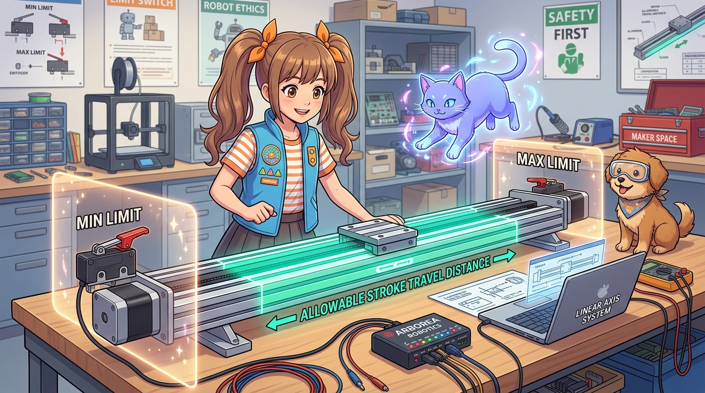
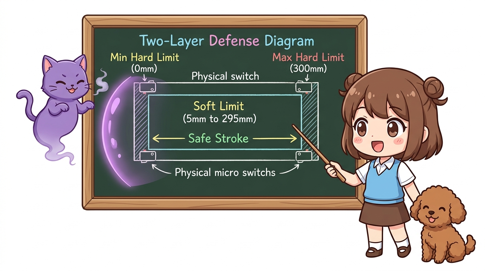
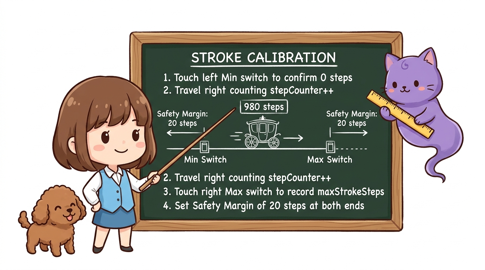
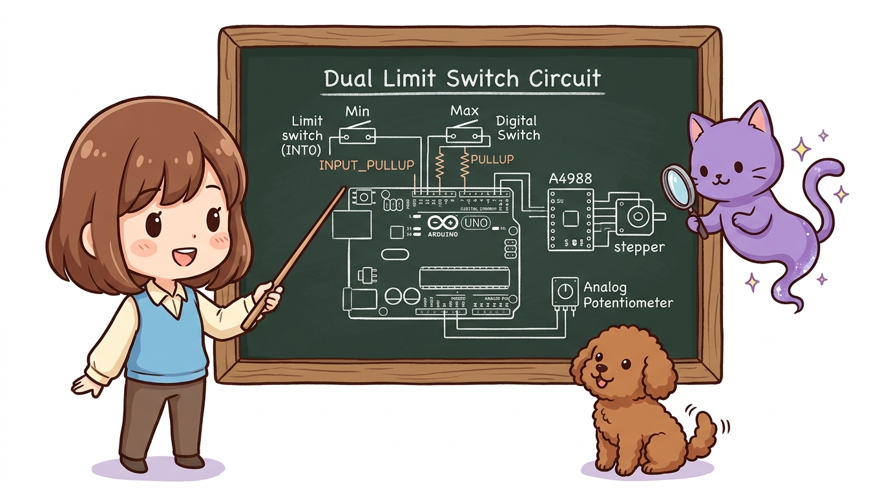
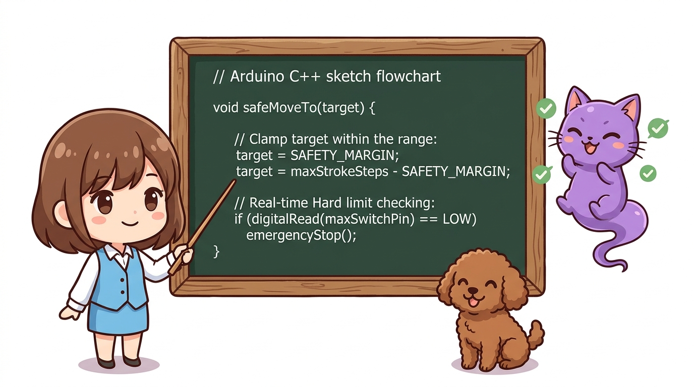
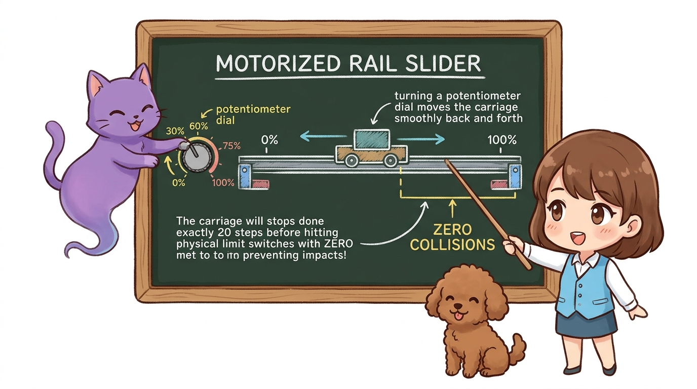

# 109_모터동작범위_소프트리미트와_하드엔드스탑 🛡️📏



**도로시와 지니가 함께하는 양방향 엔드스탑과 스트로크(Stroke) 가동 범위 소프트웨어 제한 기술**

* 👧 **도로시**: "지니야! 홈 포지션(0번)은 찾았는데, 반대쪽 끝으로 너무 멀리 달려가서 벽을 쾅! 하고 들이받으면 어떡해?"
* 🐱 **지니**: "그래서 레일의 양쪽 끝에 **Min 스위치**와 **Max 스위치**를 달고, 코드 안에서 가상 벽을 세우는 **소프트 리미트(Soft Limit)** 를 적용한단다!"
* 🐶 **토토**: "바우! 가상 보호벽 안에서만 안전하게 달린다 멍!"

* 🖥️ **강의 슬라이드**: [slides.md](./slides.md)

---

## 1. 하드 리미트(Hard Limit) vs 소프트 리미트(Soft Limit)



정밀 공작기계나 산업용 로봇은 충돌로 인한 모터와 기계 프레임 손상을 막기 위해 **2중 방어선**을 구축합니다.

```
       [ MIN HARD LIMIT ]                                   [ MAX HARD LIMIT ]
      (물리 스위치 1: 0mm)                                  (물리 스위치 2: 300mm)
             │                                                        │
             ▼                                                        ▼
         [스위치 1] ===|=======================================|=== [스위치 2]
                       ▲                                       ▲
                       │◀─────── 안전 가동 구간 (Stroke) ─────▶│
                       │                                       │
                [MIN SOFT LIMIT]                        [MAX SOFT LIMIT]
                 (소프트웨어 5mm)                        (소프트웨어 295mm)
```

1. **소프트 리미트 (1차 소프트웨어 방어선)**:
   * 코드가 모터의 현재 좌표를 항상 감시합니다.
   * 물리적 스위치에 닿기 전인 `5mm ~ 295mm` 구간 안에서만 모터가 움직이도록 수학적으로 명령을 제한합니다. 평상시에는 스위치를 딸깍딸깍 치지 않으므로 부품 수명이 영구적입니다.
2. **하드 리미트 (2차 물리적 비상 브레이크)**:
   * 코드 버그나 모터 탈조로 인해 소프트웨어 벽을 뚫고 지나쳤을 때, 물리적 스위치가 눌리는 즉시 하드웨어 인터럽트로 모터를 0.001초 만에 비상 정지시킵니다!

---

## 2. 전체 가동 거리(Stroke) 자동 측정 캘리브레이션



레일의 전체 길이가 몇 mm(또는 몇 스텝)인지 자로 일일이 잴 필요가 없습니다. 모터가 양쪽 스위치를 차례로 방문하며 스스로 거리를 측정하는 스마트 알고리즘입니다.

1. **Min 스위치 탐색**: 왼쪽으로 이동하여 Min 스위치를 터치 ➔ `좌표 = 0` 확정.
2. **Max 스위치 주행**: 오른쪽으로 스텝 펄스를 세며 이동 (`stepCount++`).
3. **Max 스위치 터치**: 오른쪽 스위치가 눌리는 순간 주행 정지! 이때의 카운트가 바로 **전체 가동 범위(Max Stroke Steps)** 가 됩니다!
4. **안전 마진(Margin) 부여**: 측정된 전체 거리에서 양 끝 10스텝을 안전 완충지대로 지정.

---

## 3. 회로 결선도 (양방향 이중 리미트 스위치)



* **스텝모터 드라이버**: STEP ➔ 디지털 **3번**, DIR ➔ 디지털 **4번**
* **Min 리미트 스위치 (왼쪽 끝)**: 아두이노 디지털 **2번 (외부 인터럽트 INT0)**
* **Max 리미트 스위치 (오른쪽 끝)**: 아두이노 디지털 **5번 (또는 인터럽트 핀)**
* *두 스위치 모두 공통(C)은 GND, NO 단자는 아두이노 핀에 연결 (INPUT_PULLUP 모드)*
* **조작용 가변저항**: 아두이노 아날로그 **A0** 핀 (레일 위치 0%~100% 비례 제어)

---

## 4. 스트로크 자동 측정 및 소프트 리미트 스케치 (C++)



```cpp
// [186_Motor_Dual_Limits_Stroke.ino]
const int stepPin = 3;
const int dirPin = 4;
const int minSwitchPin = 2; // 왼쪽 Min 리미트 스위치 (인터럽트 지원)
const int maxSwitchPin = 5; // 오른쪽 Max 리미트 스위치
const int potPin = A0;      // 위치 지령용 가변저항

long maxStrokeSteps = 0;    // 자동 측정될 전체 레일 스텝 수
long currentPos = 0;        // 현재 모터 좌표
const long SAFETY_MARGIN = 20; // 양 끝 20스텝 소프트 마진

// 1스텝 펄스 발생 함수
void singleStep(int usDelay) {
  digitalWrite(stepPin, HIGH);
  delayMicroseconds(usDelay);
  digitalWrite(stepPin, LOW);
  delayMicroseconds(usDelay);
}

void setup() {
  Serial.begin(9600);
  pinMode(stepPin, OUTPUT);
  pinMode(dirPin, OUTPUT);
  pinMode(minSwitchPin, INPUT_PULLUP);
  pinMode(maxSwitchPin, INPUT_PULLUP);

  Serial.println("==========================================");
  Serial.println(" 📏 도로시의 모터 스트로크 자동 계측 시스템 ");
  Serial.println("==========================================");

  // 1단계: Min 스위치로 원점(0) 복귀
  Serial.println("1단계: Min 스위치를 찾아 원점 복귀 중...");
  digitalWrite(dirPin, LOW);
  while (digitalRead(minSwitchPin) == HIGH) {
    singleStep(1200);
  }
  currentPos = 0;
  Serial.println("➔ [Min 원점 0스텝 확정]");
  delay(500);

  // 2단계: Max 스위치를 향해 전진하며 전체 거리 계측
  Serial.println("2단계: Max 스위치를 향해 전진하며 스트로크 측정...");
  digitalWrite(dirPin, HIGH);
  long stepCounter = 0;
  while (digitalRead(maxSwitchPin) == HIGH) {
    singleStep(1200);
    stepCounter++;
  }
  maxStrokeSteps = stepCounter;
  currentPos = maxStrokeSteps;
  
  Serial.print("🎉 [측정 완료] 전체 레일 가동 거리: ");
  Serial.print(maxStrokeSteps);
  Serial.println(" 스텝!");

  // 3단계: 안전 가동 영역(중앙)으로 복귀
  long centerTarget = maxStrokeSteps / 2;
  safeMoveTo(centerTarget);
  Serial.println("➔ 중앙 대기 위치로 이동 완료! 조작 준비 끝.\n");
}

void loop() {
  // 가변저항(0~1023)을 읽어 안전 소프트 리미트 범위(마진 적용) 내 목표 위치로 매핑
  int potVal = analogRead(potPin);
  long targetPos = map(potVal, 0, 1023, SAFETY_MARGIN, maxStrokeSteps - SAFETY_MARGIN);

  // 10스텝 이상 차이가 날 때만 부드럽게 추종 이동
  if (abs(targetPos - currentPos) > 10) {
    safeMoveTo(targetPos);
  }
  delay(50);
}

// 소프트 리미트 방어선이 적용된 안전 이동 함수
void safeMoveTo(long target) {
  // [소프트 리미트 검사] 물리 스위치에 닿지 않도록 마진 범위 내로 강제 제한!
  if (target < SAFETY_MARGIN) target = SAFETY_MARGIN;
  if (target > maxStrokeSteps - SAFETY_MARGIN) target = maxStrokeSteps - SAFETY_MARGIN;

  long steps = target - currentPos;
  if (steps == 0) return;

  if (steps > 0) {
    digitalWrite(dirPin, HIGH);
    for (long i = 0; i < steps; i++) {
      // 주행 중 혹시라도 물리 스위치가 눌리면 즉시 비상 정지 (하드 리미트)
      if (digitalRead(maxSwitchPin) == LOW) {
        Serial.println("🚨 [비상 정지] Max 물리 스위치 감지!");
        break;
      }
      singleStep(1500);
      currentPos++;
    }
  } else {
    digitalWrite(dirPin, LOW);
    for (long i = 0; i < -steps; i++) {
      if (digitalRead(minSwitchPin) == LOW) {
        Serial.println("🚨 [비상 정지] Min 물리 스위치 감지!");
        break;
      }
      singleStep(1500);
      currentPos--;
    }
  }
}
```

---

## 5. 실행 결과 및 가변저항 슬라이더 테스트



1. 아두이노에 전원을 인가하면 슬라이더가 자동으로 **왼쪽 끝 ➔ 오른쪽 끝**을 차례로 탐색하며 레일 길이를 스스로 파악합니다.
2. 계측이 끝나면 정확히 정중앙으로 이동하여 대기합니다.
3. 가변저항 손잡이를 돌리면 모터가 0%에서 100% 위치 사이를 매끄럽게 왕복하며, 양쪽 끝 스위치 직전(마진 20스텝)에서 부드럽게 멈추어 **단 1번의 충돌도 일어나지 않습니다!**

---

## 🌟 도로시와 지니의 핵심 요약 노트!


* 👧 **도로시**: "모터가 스스로 레일 길이를 재고, 양쪽 끝에 가상의 안전 방어벽(소프트 리미트)을 세우니 스위치를 쾅쾅 치지 않아도 절대 벽에 안 부딪혀!"
* 🐱 **지니**: "맞아! 이것이 바로 수천만 원짜리 산업용 CNC 밀링 머신과 고정밀 로봇에 적용되는 2중 리미트 안전 시스템이란다."
* 🐶 **토토**: "바우! 다음 시간엔 스위치 대신 빛으로 1마이크로미터 오차 없이 원점을 잡는 **'187_포토인터럽터_비접촉정밀원점과_슬릿원판_회전제어'**를 배워보자 멍!"
