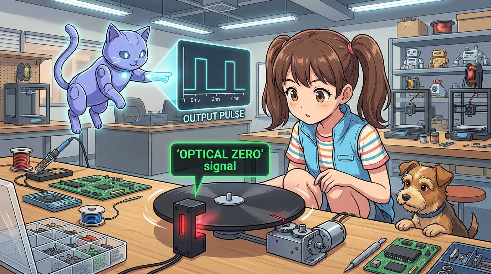
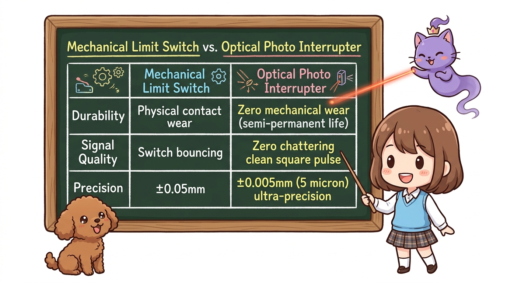
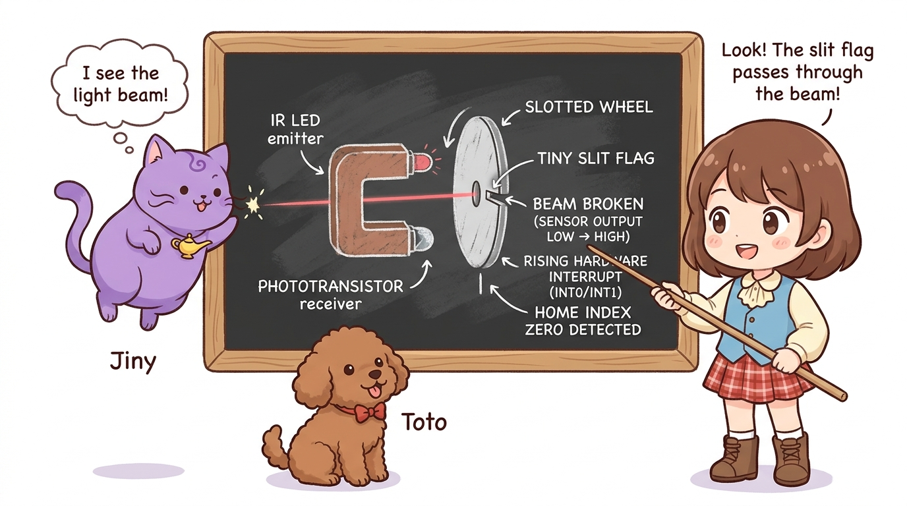
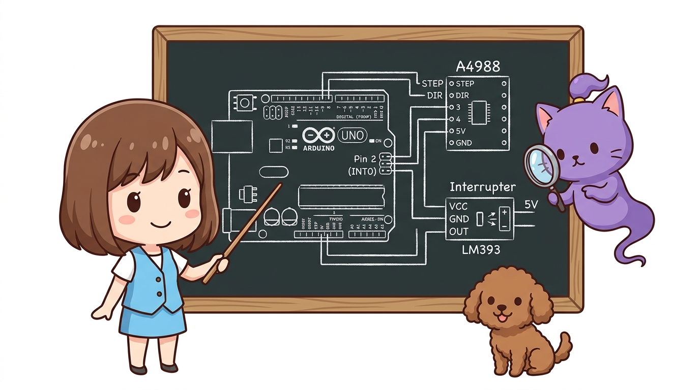
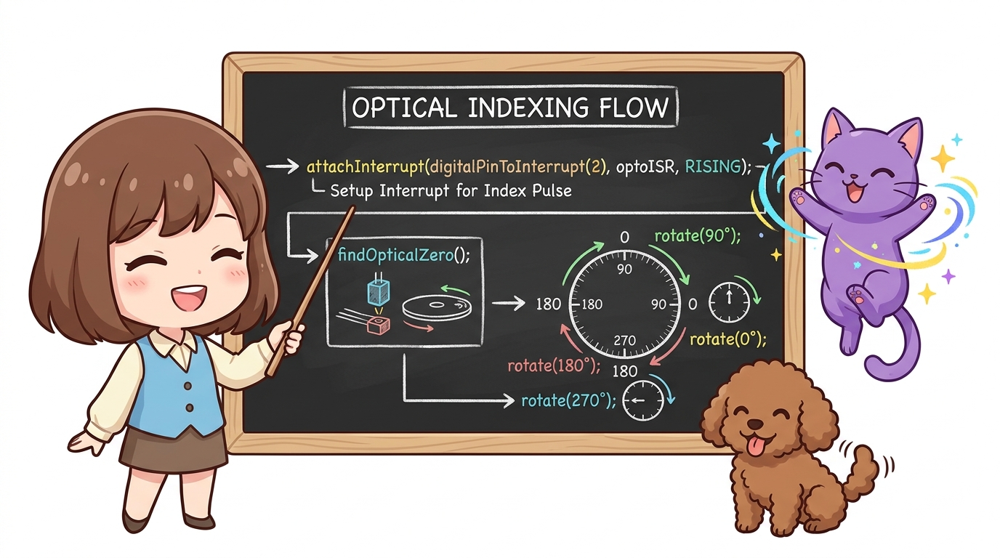
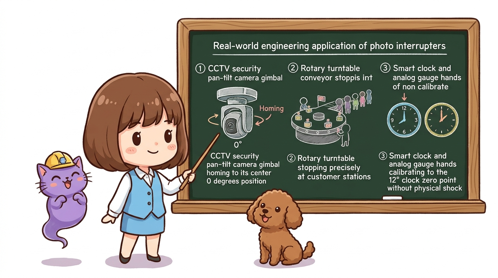

# 110_포토인터럽터_비접촉정밀원점과_슬릿원판_회전제어 🔦🎛️



**도로시와 지니가 함께하는 광학 슬롯 센서와 슬릿 차광판을 이용한 비접촉 초정밀 회전 원점 제어**

* 👧 **도로시**: "지니야! 360도 뱅글뱅글 도는 회전 턴테이블이나 로봇 팔 관절은 기계식 스위치를 달면 선이 꼬이거나 스위치가 부러지지 않아?"
* 🐱 **지니**: "맞아! 회전체나 초고속 기계에는 부딪히지 않고 빛으로 감지하는 **포토 인터럽터(Photo Interrupter)** 와 **슬릿(Slit) 차광판**을 사용한단다!"
* 🐶 **토토**: "바우! 적외선 광선을 통과하는 순간 'OPTICAL ZERO' 신호가 뜬다 멍!"

* 🖥️ **강의 슬라이드**: [slides.md](./slides.md)

---

## 1. 기계식 스위치 vs 광학 포토 인터럽트 비교



| 비교 항목 | 기계식 마이크로 리미트 스위치 | 광학 포토 인터럽터 (Optical Endstop) |
| :--- | :--- | :--- |
| **감지 방식** | 레버를 물리적으로 눌러 접점 접촉 | 적외선 빔(빛)을 차광판이 통과하며 차단 |
| **기계적 마모** | 수십만 번 작동 시 금속 스프링 피로 발생 | **비접촉식이므로 마모 0 (수명 반영구적)** |
| **채터링(바운싱)** | 금속 접점이 떨리는 채터링 현상 발생 | **채터링 제로! 마이크로초 단위 칼같은 사각파** |
| **반복 정밀도** | 약 ±0.05 mm ~ ±0.1 mm | **±0.005 mm (5마이크로미터 이하 초정밀!)** |
| **적합한 분야** | 3D 프린터 축 끝단, 도어 닫힘 감지 | **초고속 회전판 원점, 반도체 웨이퍼 이송기, 광학 렌즈 조리개** |

---

## 2. 슬릿 차광판과 회전 원점(Index Zero) 검출 메커니즘



회전축에 고정된 원판 가장자리에 **폭 1mm 정도의 작은 차광 깃발(Flag)** 또는 **슬릿(Slit 홈)** 을 가공합니다.

```
                  [ U자형 포토 인터럽터 센서 ]
                  ┌─────────┐       ┌─────────┐
                  │ 적외선  │ ~~~~~ │ 수광    │
                  │ LED(발광│ 광선  │ TR(수광)│
                  └─────────┘       └─────────┘
                       ▲                 ▲
                       │   [회전 슬릿 원판]│
                       └───▶ [차광 날개] ─┘
```

1. **평상시**: 적외선 빔이 가려지지 않아 수광 소자가 ON 상태 (출력 LOW).
2. **슬릿 통과 순간**: 모터가 회전하다가 차광 날개가 센서 틈 사이로 들어와 적외선 빔을 차단하는 순간, 출력이 번개처럼 **HIGH**로 치솟습니다.
3. **인터럽트 트리거**: 이 상승 에지(`RISING`)를 아두이노 하드웨어 인터럽트로 낚아채어 그 각도를 **"절대 0.0도(Home Index)"** 로 기억합니다!

---

## 3. 하드웨어 배선도



* **스텝모터 드라이버 (A4988 / 28BYJ-48)**:
  * STEP 핀: 디지털 **3번**
  * DIR 핀: 디지털 **4번**
* **광학 포토 인터럽터 모듈 (LM393 비교기 내장형)**:
  * VCC: **5V**
  * GND: **GND**
  * OUT (디지털 출력): 아두이노 **디지털 2번 핀 (외부 인터럽트 INT0)**

---

## 4. 광학 영점 검출 및 각도 제어 아두이노 스케치 (C++)



```cpp
// [187_Optical_Homing_Rotary.ino]
const int stepPin = 3;
const int dirPin = 4;
const int optoPin = 2; // 포토 인터럽트 출력핀 (INT0)

const int STEPS_PER_REV = 200; // 모터 1회전(360도)당 200스텝
volatile bool opticalZeroDetected = false;
long currentAngleSteps = 0;

// 외부 인터럽트 ISR: 슬릿이 빛을 가로막는 순간 1마이크로초 내 발동!
void optoISR() {
  opticalZeroDetected = true;
}

void singleStep(int usDelay) {
  digitalWrite(stepPin, HIGH);
  delayMicroseconds(usDelay);
  digitalWrite(stepPin, LOW);
  delayMicroseconds(usDelay);
}

void setup() {
  Serial.begin(9600);
  pinMode(stepPin, OUTPUT);
  pinMode(dirPin, OUTPUT);
  pinMode(optoPin, INPUT);

  Serial.println("==========================================");
  Serial.println(" 🔦 도로시의 광학 포토 인터럽트 회전 원점 제어 ");
  Serial.println("==========================================");

  // 1. 하드웨어 인터럽트 등록 (빛이 가려질 때 RISING 감지)
  attachInterrupt(digitalPinToInterrupt(optoPin), optoISR, RISING);

  // 2. 비접촉 광학 원점 탐색 실행
  findOpticalZero();

  // 3. 0도 원점 기준으로 인덱싱 각도 이동 테스트 (90도 ➔ 180도 ➔ 270도 ➔ 0도)
  delay(1000);
  rotateToAngle(90);
  delay(1000);
  rotateToAngle(180);
  delay(1000);
  rotateToAngle(270);
  delay(1000);
  rotateToAngle(0);
}

void loop() {
  // 시리얼 모니터로 원하는 각도(0~360)를 입력받아 회전
  if (Serial.available() > 0) {
    int targetDegree = Serial.parseInt();
    if (targetDegree >= 0 && targetDegree <= 360) {
      rotateToAngle(targetDegree);
    }
  }
}

// 비접촉 광학 원점 탐색 함수
void findOpticalZero() {
  Serial.println("1단계: 광학 슬릿을 찾기 위해 정속 회전 중...");
  digitalWrite(dirPin, HIGH); // 시계 방향 회전
  opticalZeroDetected = false;

  // 광학 인터럽트 플래그가 true가 될 때까지 펄스 발생
  while (!opticalZeroDetected) {
    singleStep(2000); // 2000us 주기 (안정적인 속도)
  }
  Serial.println("➔ [빛 가림 1차 감지!]");
  delay(300);

  // 2단계: 슬릿을 살짝 벗어난 후 초저속 재진입 (마이크로미터 정밀도 확보)
  digitalWrite(dirPin, LOW); // 반대 방향 15스텝 후진
  for (int i = 0; i < 15; i++) {
    singleStep(3000);
  }
  delay(200);

  opticalZeroDetected = false;
  digitalWrite(dirPin, HIGH); // 다시 정방향으로 아주 천천히 진입
  while (!opticalZeroDetected) {
    singleStep(5000); // 초저속 미세 펄스
  }

  // ✨ 완벽한 광학 0.0도 확정!
  currentAngleSteps = 0;
  Serial.println("🎉 [성공] 광학 0도(Optical Zero Index) 캘리브레이션 완료!\n");
}

// 지정한 각도(0~360도)로 모터를 정확히 회전시키는 함수
void rotateToAngle(int targetDeg) {
  long targetSteps = (long)targetDeg * STEPS_PER_REV / 360;
  long stepsToMove = targetSteps - currentAngleSteps;

  Serial.print("🎯 목표 각도: ");
  Serial.print(targetDeg);
  Serial.print("도 (");
  Serial.print(targetSteps);
  Serial.println(" 스텝)으로 이동 시작...");

  if (stepsToMove > 0) {
    digitalWrite(dirPin, HIGH);
    for (long i = 0; i < stepsToMove; i++) singleStep(2000);
  } else if (stepsToMove < 0) {
    digitalWrite(dirPin, LOW);
    for (long i = 0; i < -stepsToMove; i++) singleStep(2000);
  }

  currentAngleSteps = targetSteps;
  Serial.println("➔ 회전 완료!\n");
}
```

---

## 5. 엔지니어링 활용처



1. **CCTV 감시 카메라 팬/틸트(Pan-Tilt) 짐벌**: 전원이 켜지면 360도 회전하다가 포토 인터럽트 슬릿을 만나 정중앙(0도)을 조준합니다.
2. **원형 턴테이블 자판기 & 회전 초밥 레일**: 접시가 정확한 손님 자리에 멈추도록 홈 위치를 오차 없이 정렬합니다.
3. **스마트 시계 & 아날로그 바늘 계측기**: 시계 바늘이 12시 정각(0시 0분 0초)을 물리적 충격 없이 정밀하게 세팅합니다.

---

## 🌟 도로시와 지니의 핵심 요약 노트!


* 👧 **도로시**: "빛을 가르는 순간을 하드웨어 인터럽트로 낚아채니 기계가 닳지도 않고 0.005mm 오차도 없이 영점을 잡을 수 있구나!"
* 🐱 **지니**: "정답이야! 기계식 스위치는 직선 슬라이더에, 포토 인터럽터는 고속 회전체에 사용하는 것이 현업 로봇 엔지니어의 핵심 설계 공식이란다."
* 🐶 **토토**: "바우! 모터의 호밍과 범위 제어의 모든 비밀을 완벽하게 마스터했다 멍!"
