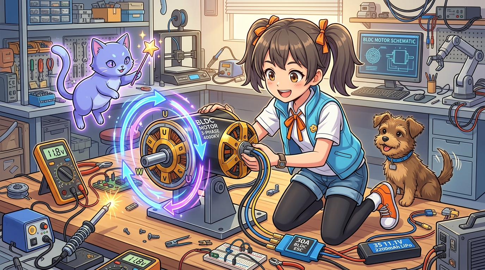
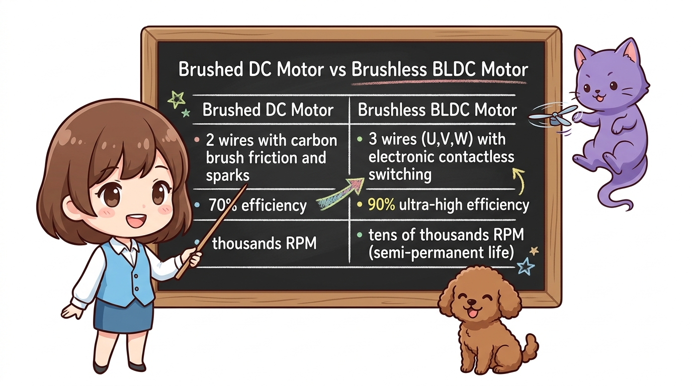
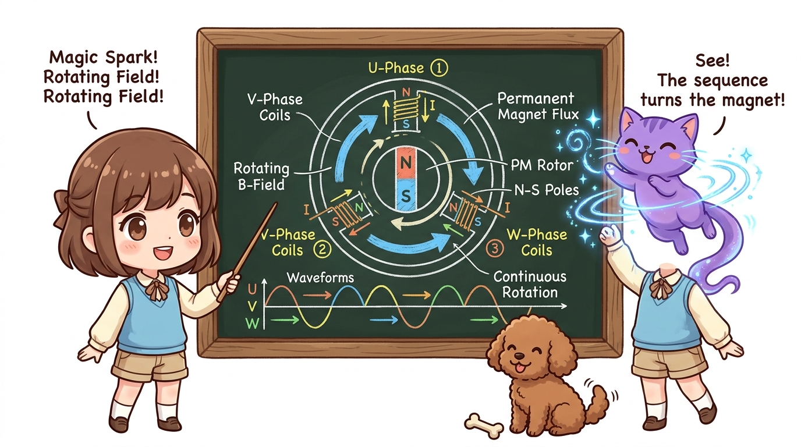
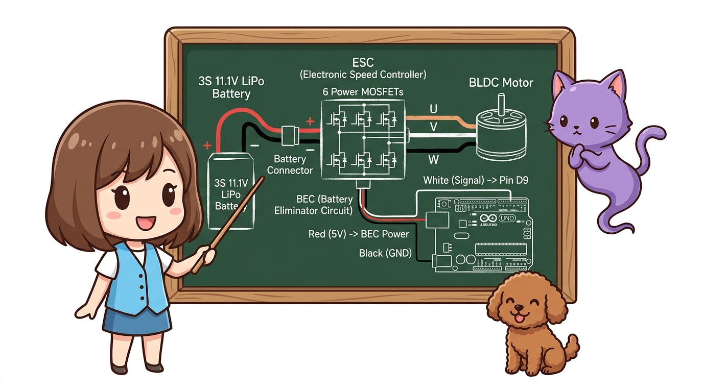
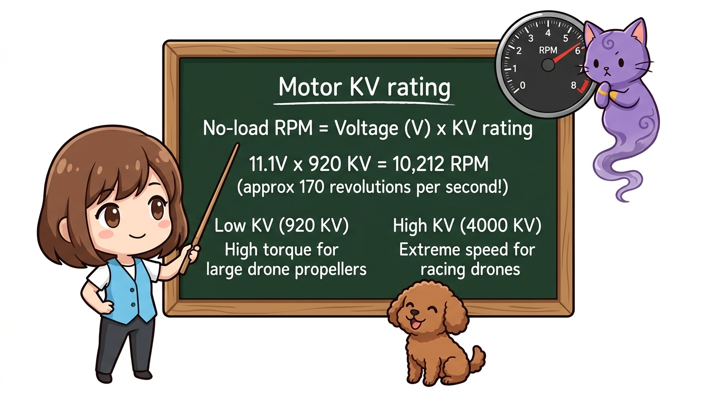
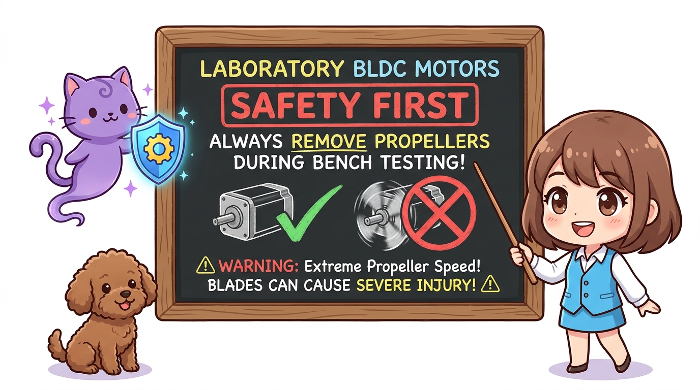

# 111_BLDC모터_원리와_ESC전자변속기 🌪️⚡



**도로시와 지니가 함께하는 초고속 드론과 전기차의 심장! 브러시리스(BLDC) 모터와 ESC의 원리**
* 👧 **도로시**: "지니야! 드론이나 고속 RC카에 달린 모터는 선이 2개가 아니라 3개나 달려있어! DC 모터랑 뭐가 달라?"
* 🐱 **지니**: "그건 마찰로 닳아 없어지는 브러시(Brush)를 아예 없애버린 궁극의 고효율 모터, **브러시리스 DC(BLDC: Brushless DC) 모터** 란다!"
* 🐶 **토토**: "바우! 1분에 2만 번이나 쌩쌩 돌아간다 멍!"
* 📖 **상세 강의 교재**: [index.md](./index.md)


> 여러분 안녕하세요! 이번 시간에는 '111. BLDC모터 원리와 ESC전자변속기 🌪️⚡'을 주제로 함께 흥미진진한 탐험을 떠나보겠습니다. 오늘 강의에서는 특히 도로시와 지니가 함께하는 초고속 드론과 전기차의 심장! 브러시리스(BLDC) 모터와 ESC의 원리, 👧 도로시: "지니야! 드론이나 고속 RC카에 달린 모터는 선이 2개가 아니라 3개나 달려있어! DC 모터랑 뭐가 달라?"를 중심으로 핵심 원리와 응용 방법을 차근차근 배워보겠습니다. 마법 멘토 지니와 호기심 많은 탐험가 도로시, 그리고 귀여운 토토와 함께 신나는 아두이노 모험을 힘차게 시작해 봅시다. 준비되셨나요?

---

## 1. 브러시드 DC vs 브러시리스 BLDC 모터 비교



| 비교 항목 | 일반 브러시드 DC 모터 (Brushed DC) | 브러시리스 BLDC 모터 (Brushless DC) |
| :--- | :--- | :--- |
| **내부 구조** | 코일이 회전, 영구자석이 외곽 고정 | **영구자석이 회전(로터), 3상 코일이 고정(스테이터)** |
| **전기 접점 (브러시)** | 카본 브러시 접촉 (마모 및 스파크 발생) | **물리 접점 없음! 전자식 무접점 스위칭** |
| **에너지 효율** | 약 60% ~ 75% | **약 85% ~ 95% (초고효율!)** |
| **최고 회전수** | 수천 RPM (내구성 한계) | **수만 RPM (10,000 ~ 50,000 RPM 이상)** |
| **모터 선 가닥 수** | 2가닥 (+, -) | **3가닥 (U, V, W 3상 교류)** |
| **수명** | 수백 시간 (브러시 닳으면 폐기) | **반영구적 (베어링 수명만 유지되면 무한대)** |
| **주요 사용처** | 미니카, 선풍기, 저가 전동 장난감 | **드론, 전기차(테슬라), 전동 킥보드, 고성능 세탁기** |

일반적인 완구용 DC 모터는 회전축에 전기를 전달하기 위해 탄소 브러시(Brush)가 회전판을 물리적으로 문지릅니다. 반면 **BLDC 모터는 물리적 마찰 부품을 완전히 제거**했습니다.

> 이번에 살펴볼 내용은 '1. 브러시드 DC vs 브러시리스 BLDC 모터 비교'입니다. 슬라이드에 정리된 표를 통해 각 항목의 특징과 수치, 차이점을 한눈에 비교해 보실 수 있습니다. 이 기본 개념을 확실히 잡아두셔야 실제 부품을 브레드보드에 꽂고 코딩할 때 실수 없이 완성할 수 있습니다.

---
## 2. 3상 회전 자기장의 비밀 (U, V, W 3가닥 선)




1. **U상에 (+), V상에 (-)** 전류를 흘리면 고정자 코일에 자기장이 형성되어 영구자석 회전자가 끌려옵니다.
2. 찰나의 순간 다음 단계인 **V상에 (+), W상에 (-)** 로 전류 방향을 전환합니다.
3. 이어서 **W상에 (+), U상에 (-)** 로 전환합니다.
4. 이 6단계 스위칭을 1초에 수천 번 연속으로 돌리면 **원형 회전 자기장**이 생겨 모터가 맹렬한 속도로 돌아갑니다!

BLDC 모터에서 나오는 3가닥 전선은 **U상, V상, W상** 삼상 코일과 연결되어 있습니다.

```
                   [ BLDC 모터 3상 회전 원리 ]
                           ( U 상 )
                           ┌──────┐
                           │ N 극 │
                           └──────┘
                      ▲                ▼
             ┌──────┐                    ┌──────┐
             │ S 극 │     [ 영구자석 ]    │ S 극 │
             └──────┘       (회전자)     └──────┘
             ( W 상 )                    ( V 상 )
```

> 이번 슬라이드에서는 '2. 3상 회전 자기장의 비밀 (U, V, W 3가닥 선)'에 대한 실제 동작 코드를 분석해 보겠습니다. 화면의 코드를 살펴보시면, 컴퓨터가 아두이노 하드웨어에 단계별로 명령을 내리는 흐름을 명확하게 확인할 수 있습니다. 여기서 핵심은 U상에 (+), V상에 (-) 전류를 흘리면 고정자 코일에 자기장이 형성되어 영구자석 회전자가 끌려옵니다.입니다. 각 함수의 역할과 괄호 안의 매개변수가 하드웨어 핀과 어떤 관계를 맺고 동작하는지 주의 깊게 살펴보시기 바랍니다.
---

## 3. 모터의 두뇌: ESC (Electronic Speed Controller: 전자변속기)



* 아두이노의 핀은 5V, 최대 20mA(0.02A)만 낼 수 있습니다.
* 하지만 드론용 BLDC 모터는 **11.1V~22.2V 전압에서 20A~40A 이상의 무시무시한 대전류**를 소모합니다!
* 아두이노의 미세한 제어 신호를 받아 초고속으로 3상 전류를 번갈아 쏴주는 강력한 파워 제어기가 바로 **ESC(전자변속기)** 입니다.

### 🔌 왜 아두이노에 직접 꽂을 수 없을까요?

```
       [ 3S 11.1V 리포 배터리 ] (굵은 빨강/검정 전원선)
                  │
                  ▼
 ┌──────────────────────────────────────────────┐
 │     ESC (Electronic Speed Controller)        │
 │  * 6개의 고성능 파워 N-MOSFET 인버터 탑재    │
 │  * BEC (Battery Elimination Circuit) 내장    │
 └──────┬────────────────────────────────┬──────┘
        │ (3가닥 파워 모터선)            │ (3가닥 얇은 신호선)
        ▼                                ▼
 [ BLDC 모터 (U, V, W) ]        [ 아두이노 보드 ]
                                 * 흰색/주황 : D9 (PWM 신호)
                                 * 빨간색    : 5V (BEC 전원 출력)
                                 * 검정/갈색 : GND (공통 접지)
```

> 이번 슬라이드에서는 '3. 모터의 두뇌: ESC (Electronic Speed Controller: 전자변속기)'에 대한 실제 동작 코드를 분석해 보겠습니다. 화면의 코드를 살펴보시면, 컴퓨터가 아두이노 하드웨어에 단계별로 명령을 내리는 흐름을 명확하게 확인할 수 있습니다. 여기서 핵심은 아두이노의 핀은 5V, 최대 20mA(0.02A)만 낼 수 있습니다.입니다. 각 함수의 역할과 괄호 안의 매개변수가 하드웨어 핀과 어떤 관계를 맺고 동작하는지 주의 깊게 살펴보시기 바랍니다.

---
## 4. 모터 스펙의 핵심: KV(RPM per Volt)값이란?




* **920 KV 모터에 3S 리포 배터리(11.1V)를 연결하면?**:
* **KV값이 낮을수록**: 토크(힘)가 세고 큰 프로펠러를 돌림 (촬영용 드론, 전기차).
* **KV값이 높을수록**: 회전 속도가 엄청나게 빠름 (레이싱 드론, 고속 RC 비행기).

BLDC 모터 표면에는 보통 `2212 920KV` 또는 `4000KV`라는 글자가 새겨져 있습니다.
$$\text{무부하 회전수(RPM)} = \text{인가 전압(V)} \times \text{KV 값}$$
$$11.1V \times 920 = 10,212 \text{ RPM! (초당 약 170바퀴 회전!)}$$

> 자, 이번 슬라이드의 질문을 함께 보시겠습니다. 바로 '4. 모터 스펙의 핵심: KV(RPM per Volt)값이란?'라는 아주 흥미로운 질문입니다. 우리가 일상에서 흔히 접하는 KV 모터에 3S 리포 배터리(11.1V)를 연결하면? 현상을 떠올려보면 왜 이런 의문이 생기는지 쉽게 공감할 수 있습니다. 이 질문 속에 숨겨진 전자 회로와 컴퓨팅의 핵심 원리를 지금부터 차근차근 하나씩 파헤쳐 보겠습니다.
---
## 5. ⚠️ 엔지니어링 안전 제1수칙: 프로펠러 분리!




* [!CAUTION]
* **실내 책상 실험 시 프로펠러를 절대 장착하지 마세요!**
* BLDC 모터는 순간 출력이 칼날과 같습니다. 코드 버그나 신호 혼선으로 모터가 갑자기 최고 속도로 회전하면 날카로운 프로펠러에 심각한 부상을 입을 수 있습니다. 모터 캘리브레이션과 속도 제어 실습은 **반드시 프로펠러를 분리한 순수 모터 축 상태**에서만 진행해야 합니다!

> 이번 슬라이드에서는 '5. ⚠️ 엔지니어링 안전 제1수칙: 프로펠러 분리!'에 대해 자세히 살펴보겠습니다. 이 원리는 아두이노 시스템 전체를 관통하는 핵심 논리이므로 머릿속에 꼭 정리해 두시기 바랍니다.
---

## 🌟 도로시와 지니의 핵심 요약 노트!


* 👧 **도로시**: "BLDC 모터는 마찰되는 브러시가 없어서 수만 RPM으로 쌩쌩 돌아가고 수명도 반영구적이구나!"
* 🐱 **지니**: "맞아! 3가닥 U, V, W 선에 마법의 3상 회전 전류를 쏴주는 파트너가 바로 ESC(전자변속기)란다."
* 🐶 **토토**: "바우! 다음 시간엔 아두이노로 ESC에 신호를 보내 모터 속도를 자유자재로 조종하는 **'107_BLDC모터_ESC캘리브레이션과_속도제어'**를 배워보자 멍!"

> 오늘 배운 '🌟 도로시와 지니의 핵심 요약 노트!'의 핵심 내용을 모두 정리해 보았습니다. 오늘 다룬 내용 중에서도 👧 도로시: "BLDC 모터는 마찰되는 브러시가 없어서 수만 RPM으로 쌩쌩 돌아가고 수명도 반영구적이구나!" 부분은 앞으로의 아두이노 실습과 프로젝트에서 계속 사용되는 매우 중요한 기초 지식입니다. 오늘 배운 내용을 꼭 다시 한번 복습해 보시고, 다음 강의에서 더욱 신나고 유익한 모험으로 다시 만나겠습니다. 모두 수고 많으셨습니다!