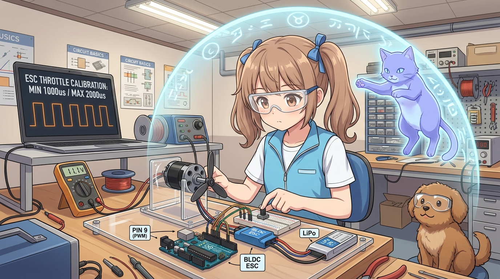
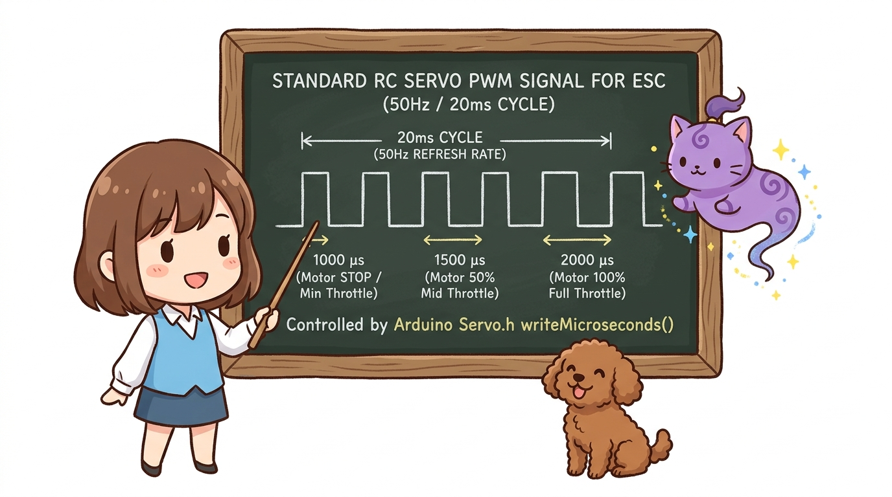
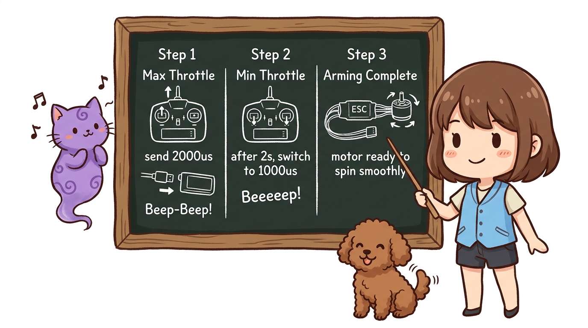
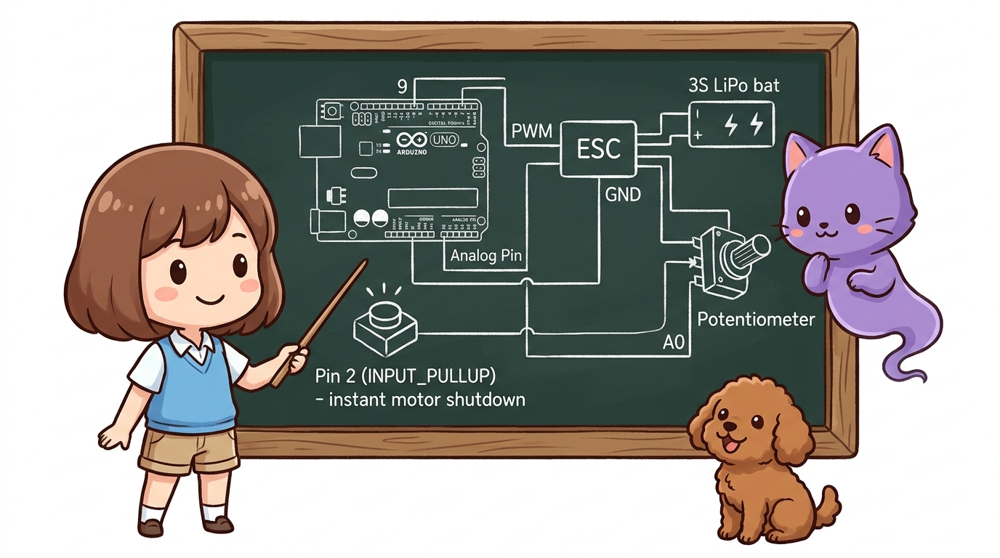
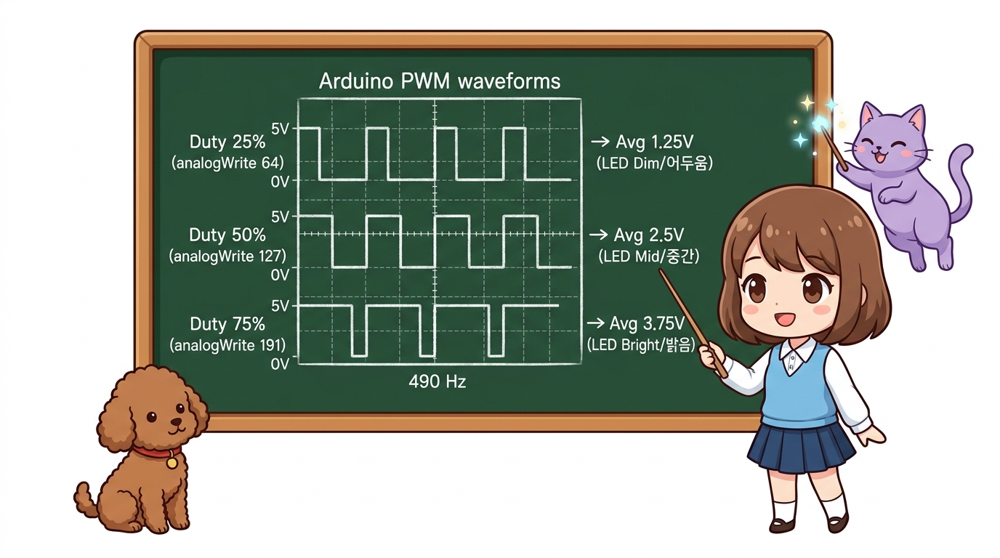
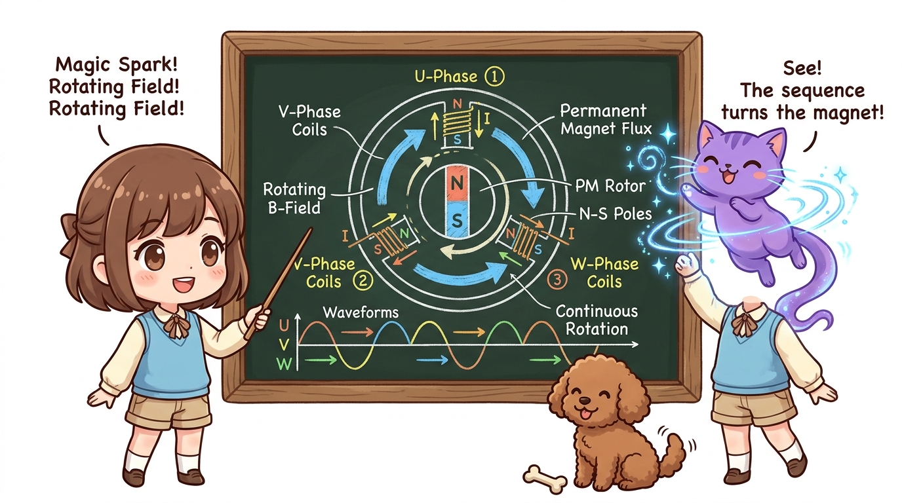

# 112_BLDC모터_ESC캘리브레이션과_속도제어 🎛️🚀



**도로시와 지니가 함께하는 Servo.h 기반 ESC 스로틀 캘리브레이션과 가변저항 RPM 무단 변속 제어**
* 👧 **도로시**: "지니야! BLDC 모터에 배터리를 연결했는데 삐-삐-삐- 경보음만 울리고 모터가 전혀 안 돌아!"
* 🐱 **지니**: "후후, ESC는 안전사고를 막기 위해 최저점(정지)과 최고점(전속력)의 신호 범위를 학습하는 **스로틀 캘리브레이션(Calibration)** 과 시동(Arming) 절차를 거쳐야만 비로소 눈을 뜬단다!"
* 🐶 **토토**: "바우! 가변저항을 돌리면 비행기 제트엔진 소리를 내며 돌아간다 멍!"
* 📖 **상세 강의 교재**: [index.md](./index.md)


> 여러분 안녕하세요! 이번 시간에는 '112. BLDC모터 ESC캘리브레이션과 속도제어 🎛️🚀'을 주제로 함께 흥미진진한 탐험을 떠나보겠습니다. 오늘 강의에서는 특히 도로시와 지니가 함께하는 Servo.h 기반 ESC 스로틀 캘리브레이션과 가변저항 RPM 무단 변속 제어, 👧 도로시: "지니야! BLDC 모터에 배터리를 연결했는데 삐-삐-삐- 경보음만 울리고 모터가 전혀 안 돌아!"를 중심으로 핵심 원리와 응용 방법을 차근차근 배워보겠습니다. 마법 멘토 지니와 호기심 많은 탐험가 도로시, 그리고 귀여운 토토와 함께 신나는 아두이노 모험을 힘차게 시작해 봅시다. 준비되셨나요?

---
## 1. 아두이노와 ESC의 신호 비밀: RC 서보 펄스!




* 아두이노 표준 라이브러리인 **`<Servo.h>`** 의 `writeMicroseconds()` 함수를 사용하면 별도의 전용 통신 칩 없이도 BLDC 모터를 손쉽게 완벽 제어할 수 있습니다!

ESC(전자변속기)는 놀랍게도 우리가 앞서 배웠던 **SG90 서보 모터의 PWM 신호 규격과 100% 동일**합니다!

```
       [ 50 Hz 주기 (20 ms) 표준 서보 펄스 폭 ]
      ┌──┐
  ────┘  └─────────────────────────────── (1000 µs : 모터 완전 정지 / Min Throttle)
      ┌────────┐
  ────┘        └───────────────────────── (1500 µs : 모터 50% 중속 회전 / Mid Throttle)
      ┌──────────────┐
  ────┘              └─────────────────── (2000 µs : 모터 100% 최대 전속력 / Max Throttle)
```

> 이번 슬라이드에서는 '1. 아두이노와 ESC의 신호 비밀: RC 서보 펄스!'에 대한 실제 동작 코드를 분석해 보겠습니다. 화면의 코드를 살펴보시면, 컴퓨터가 아두이노 하드웨어에 단계별로 명령을 내리는 흐름을 명확하게 확인할 수 있습니다. 여기서 핵심은 아두이노 표준 라이브러리인 <Servo.h> 의 writeMicroseconds() 함수를 사용하면 별도의 전용 통신 칩 없이도 BLDC 모터를 손쉽게 완벽 제어할 수 있습니다!입니다. 각 함수의 역할과 괄호 안의 매개변수가 하드웨어 핀과 어떤 관계를 맺고 동작하는지 주의 깊게 살펴보시기 바랍니다.
---

## 2. 시동의 필수 관문: 스로틀 캘리브레이션 3단계



새로운 ESC를 처음 사용할 때는 아두이노가 보내는 1000µs와 2000µs를 ESC에 등록해주어야 합니다.

```
[ 1단계 : 최고점 송출 ]
  아두이노가 D9 핀으로 먼저 2000 µs (최대 스로틀) 신호를 뿜어냄
  ➔ 이 상태에서 ESC에 배터리(전원) 연결!
  ➔ ESC 모터에서 "삐-빅!" 최고점 인식 비프음 발생

[ 2단계 : 최저점 전환 ]
  2초 후 아두이노가 1000 µs (최소 스로틀) 신호로 즉시 전환
  ➔ ESC 모터에서 "삐---익!" 롱 비프음과 함께 학습 완료!

[ 3단계 : 아밍(Arming) 완료 ]
  시동 잠금이 해제되고, 이제 보내는 펄스에 따라 모터가 부드럽게 회전 시작!
```

> 이번 슬라이드에서는 '2. 시동의 필수 관문: 스로틀 캘리브레이션 3단계'에 대한 실제 동작 코드를 분석해 보겠습니다. 화면의 코드를 살펴보시면, 컴퓨터가 아두이노 하드웨어에 단계별로 명령을 내리는 흐름을 명확하게 확인할 수 있습니다. 각 함수의 역할과 괄호 안의 매개변수가 하드웨어 핀과 어떤 관계를 맺고 동작하는지 주의 깊게 살펴보시기 바랍니다.

---
## 3. 하드웨어 회로 연결도




* **BLDC 모터 3선**: ESC의 파워 모터 3선 단자에 각각 결선
* **ESC 배터리 전원(굵은 선)**: 3S LiPo 배터리(11.1V) 또는 12V 5A 파워서플라이 연결
* **ESC 제어 신호선 (얇은 3선 케이블)**:
* **흰색 (신호선)** ➔ 아두이노 **디지털 9번 핀 (PWM)**
* **검정/갈색 (GND)** ➔ 아두이노 **GND 핀** (공통 접지!)
* *(참고: 빨간색 선은 ESC 내부 5V 출력이므로, 아두이노를 PC USB로 구동 중일 때는 절연 테이프로 감아두는 것이 안전합니다.)*
* **속도 조절용 가변저항**: 아두이노 아날로그 **A0** 핀
* **비상 정지 버튼(Kill Switch)**: 아두이노 디지털 **2번 핀 (INPUT_PULLUP)**

> 이번 슬라이드에서는 '3. 하드웨어 회로 연결도'에 대해 자세히 살펴보겠습니다. 첫 번째 핵심은 BLDC 모터 3선: ESC의 파워 모터 3선 단자에 각각 결선이며, 두 번째로는 ESC 배터리 전원(굵은 선): 3S LiPo 배터리(11.1V) 또는 12V 5A 파워서플라이 연결입니다. 여기에 덧붙여 ESC 제어 신호선 (얇은 3선 케이블) 내용까지 함께 이해해 두시면 완벽합니다. 이 원리는 아두이노 시스템 전체를 관통하는 핵심 논리이므로 머릿속에 꼭 정리해 두시기 바랍니다.
---
## 4. 완전한 BLDC 모터 속도 제어 스케치 (C++)




```cpp
// [107_BLDC_Motor_ESC_Speed_Control.ino]
#include <Servo.h>

const int escPin = 9;       // ESC 제어 핀 (PWM)
const int potPin = A0;      // 가변저항 핀
const int emergencyPin = 2; // 비상 정지 킬 스위치

Servo esc;
bool isEmergencyStopped = false;

// 비상 정지 인터럽트 서비스 루틴
void emergencyISR() {
  isEmergencyStopped = true;
}

void setup() {
  Serial.begin(9600);
  pinMode(emergencyPin, INPUT_PULLUP);
  attachInterrupt(digitalPinToInterrupt(emergencyPin), emergencyISR, FALLING);

  Serial.println("==========================================");
  Serial.println("  🌪️ 도로시의 BLDC 모터 ESC 속도 제어 시작!");
  Serial.println("==========================================");

  esc.attach(escPin, 1000, 2000); // 1000us ~ 2000us 펄스 범위 지정

  // 1. ESC 안전 시동(Arming) 절차
  Serial.println("1단계: ESC에 정지 신호(1000us) 송출 중...");
  esc.writeMicroseconds(1000);
  delay(3000); // ESC가 시동 비프음을 내고 준비될 때까지 3초 대기

  Serial.println("🎉 [완료] ESC 아밍 성공! 속도 제어 모드 진입.\n");
}

void loop() {
  // 비상 정지 상태 감시
  if (isEmergencyStopped) {
    esc.writeMicroseconds(1000); // 모터 즉시 전원 차단
    Serial.println("🚨 [비상 정지] 킬 스위치 발동! 모터 완전 차단!");
    while (1); // 시스템 영구 정지 (안전 확보)
  }

  // 가변저항(0~1023)을 읽어 안전 모터 펄스(1000~1800us)로 매핑
  // (실내 실험 안전을 위해 최대 출력을 1800us로 제한)
  int potVal = analogRead(potPin);
  int throttlePulse = map(potVal, 0, 1023, 1000, 1800);

  // ESC로 정밀 스로틀 펄스 전송
  esc.writeMicroseconds(throttlePulse);

  // 0.2초마다 현재 스로틀 상태 출력
  static unsigned long lastPrint = 0;
  if (millis() - lastPrint > 200) {
    lastPrint = millis();
    int percent = map(throttlePulse, 1000, 1800, 0, 100);
    Serial.print("가변저항: ");
    Serial.print(potVal);
    Serial.print(" ➔ 스로틀 펄스: ");
    Serial.print(throttlePulse);
    Serial.print(" µs (출력: ");
    Serial.print(percent);
    Serial.println(" %)");
  }

  delay(20);
}
```

> 이번 슬라이드에서는 '4. 완전한 BLDC 모터 속도 제어 스케치 (C++)'에 대한 실제 동작 코드를 분석해 보겠습니다. 화면의 코드를 살펴보시면, 컴퓨터가 아두이노 하드웨어에 단계별로 명령을 내리는 흐름을 명확하게 확인할 수 있습니다. 각 함수의 역할과 괄호 안의 매개변수가 하드웨어 핀과 어떤 관계를 맺고 동작하는지 주의 깊게 살펴보시기 바랍니다.
---
## 5. 엔지니어링 꿀팁: 회전 방향(CW ↔ CCW) 뒤집기!




* 코드를 고칠 필요가 전혀 없습니다!
* 모터와 ESC를 잇는 3가닥 전선(U, V, W) 중 **아무거나 2가닥을 뽑아서 서로 자리를 맞바꿔 꽂으면** 3상 전류의 위상이 뒤집혀 **회전 방향이 즉시 반대로 전환**됩니다!

모터를 조립했는데 드론 날개가 반대로 돌거나 RC카가 후진을 한다면?

> 이번 슬라이드에서는 '5. 엔지니어링 꿀팁: 회전 방향(CW ↔ CCW) 뒤집기!'에 대해 자세히 살펴보겠습니다. 첫 번째 핵심은 코드를 고칠 필요가 전혀 없습니다!이며, 두 번째로는 모터와 ESC를 잇는 3가닥 전선(U, V, W) 중 아무거나 2가닥을 뽑아서 서로 자리를 맞바꿔 꽂으면 3상 전류의 위상이 뒤집혀 회전 방향이 즉시 반대로 전환됩니다!입니다. 이 원리는 아두이노 시스템 전체를 관통하는 핵심 논리이므로 머릿속에 꼭 정리해 두시기 바랍니다.
---

## 🌟 도로시와 지니의 핵심 요약 노트!


* 👧 **도로시**: "ESC도 서보 모터처럼 1000µs~2000µs 신호로 움직여서 `<Servo.h>` 라이브러리로 쉽게 조종할 수 있구나!"
* 🐱 **지니**: "맞아! 모터 선 2가닥만 바꾸면 회전 방향도 쉽게 반전시킬 수 있어. 안전을 위해 실내 실험 땐 프로펠러 분리와 킬 스위치가 필수란다."
* 🐶 **토토**: "바우! 이제 모터 구동 파트의 모든 모터(서보, 스텝, DC, BLDC)를 완벽하게 정복했다 멍!"

> 오늘 배운 '🌟 도로시와 지니의 핵심 요약 노트!'의 핵심 내용을 모두 정리해 보았습니다. 오늘 다룬 내용 중에서도 👧 도로시: "ESC도 서보 모터처럼 1000µs~2000µs 신호로 움직여서 <Servo.h> 라이브러리로 쉽게 조종할 수 있구나!" 부분은 앞으로의 아두이노 실습과 프로젝트에서 계속 사용되는 매우 중요한 기초 지식입니다. 오늘 배운 내용을 꼭 다시 한번 복습해 보시고, 다음 강의에서 더욱 신나고 유익한 모험으로 다시 만나겠습니다. 모두 수고 많으셨습니다!