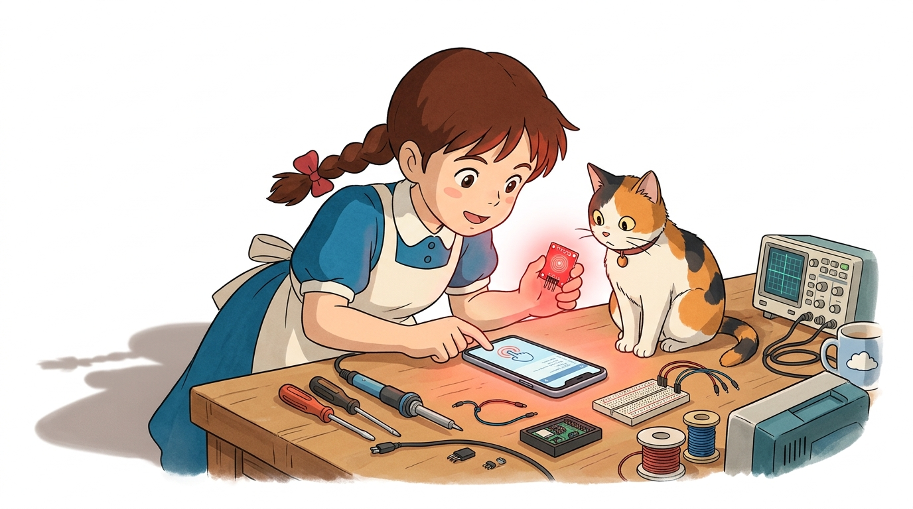
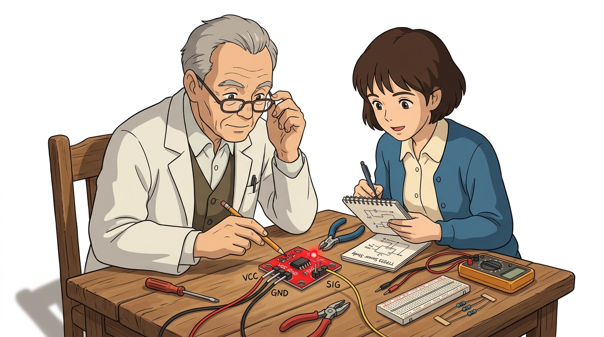
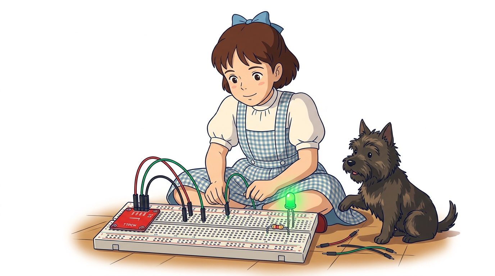
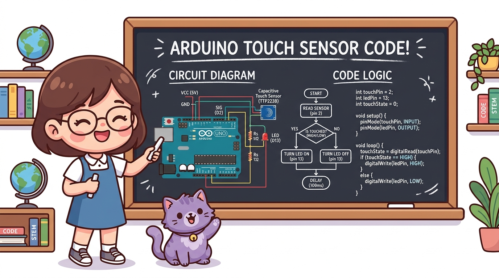
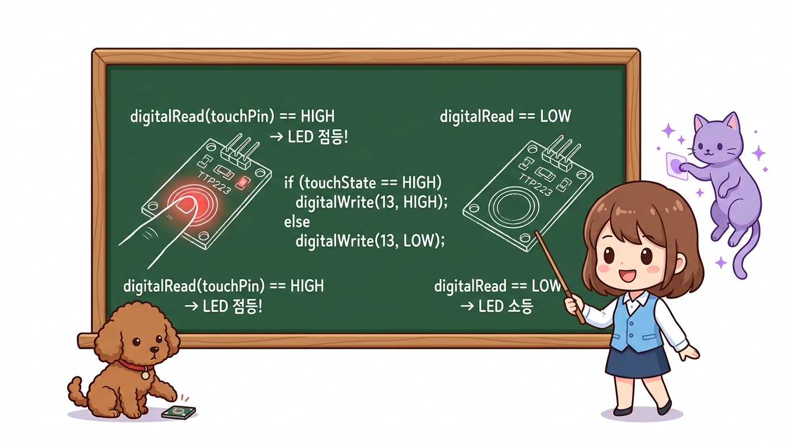
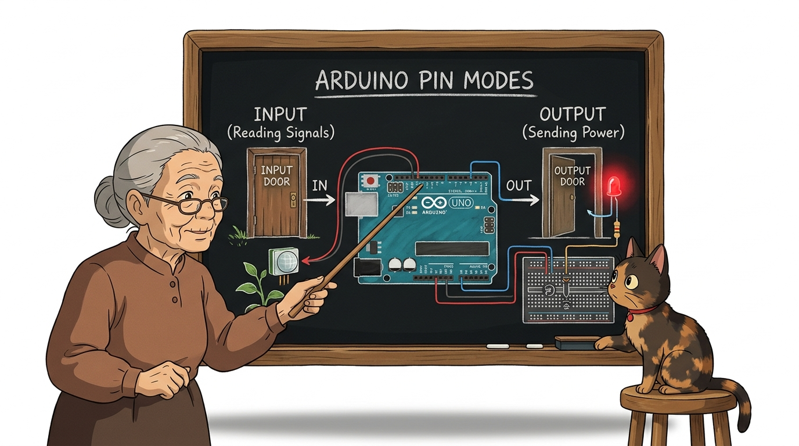
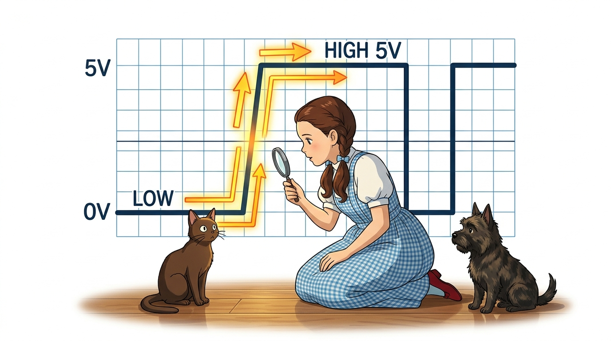
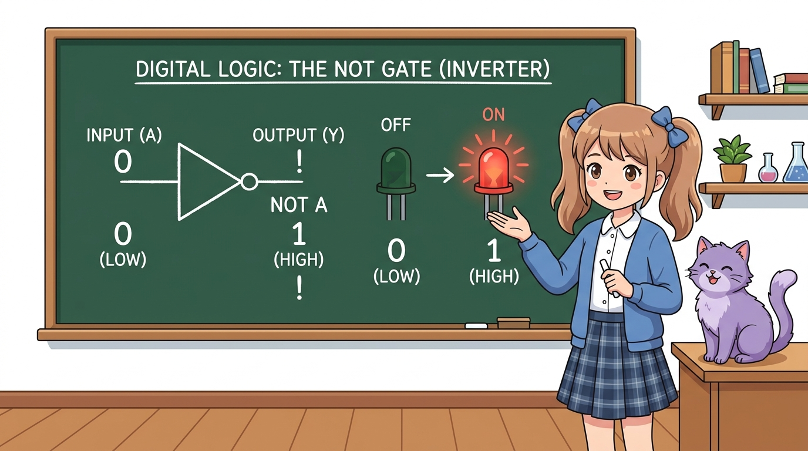

# 113_정전식터치센서_TTP223 👆✨



* 👧 **도로시**: "지니야! 힘주어 딸깍 누르는 딱딱한 스위치 말고, 스마트폰이나 엘리베이터 버튼처럼 살짝 손끝만 대도 불이 켜지는 센서는 어떻게 만드는 거야?"
* 🐱 **지니**: "우리 몸속에 흐르는 아주 미세한 전하를 감지하는 **TTP223 정전식 터치 센서(Capacitive Touch Sensor)** 를 사용하면 된단다! 오늘은 손끝 하나로 마법처럼 불을 켜는 터치 조명등을 만들어보자!"
* 🐶 **토토**: "바우! (코끝만 살짝 콩 대도 불이 반짝인다 멍!)"

### 도로시와 마법 멘토 지니의 스마트폰 터치스크린 비밀 탐험
* 📖 **상세 강의 교재**: [index.md](./index.md)


> 여러분 안녕하세요! 이번 시간에는 '113. 정전식터치센서 TTP223 👆✨'을 주제로 함께 흥미진진한 탐험을 떠나보겠습니다. 오늘 강의에서는 특히 👧 도로시: "지니야! 힘주어 딸깍 누르는 딱딱한 스위치 말고, 스마트폰이나 엘리베이터 버튼처럼 살짝 손끝만 대도 불이 켜지는 센서는 어떻게 만드는 거야?", 🐱 지니: "우리 몸속에 흐르는 아주 미세한 전하를 감지하는 TTP223 정전식 터치 센서(Capacitive Touch Sensor) 를 사용하면 된단다! 오늘은 손끝 하나로 마법처럼 불을 켜는 터치 조명등을 만들어보자!"를 중심으로 핵심 원리와 응용 방법을 차근차근 배워보겠습니다. 마법 멘토 지니와 호기심 많은 탐험가 도로시, 그리고 귀여운 토토와 함께 신나는 아두이노 모험을 힘차게 시작해 봅시다. 준비되셨나요?

---

## 1. 정전식 터치 센서(TTP223)의 특징과 응용 📱


* **비접촉·무소음 스위치**: 기계식 스프링이 없어 딸깍거리는 소음이 전혀 없고, 마찰로 인한 마모가 없어 반영구적인 수명을 자랑합니다.
* **초절전 저전력 설계**: 평상시 대기 전류가 수 마이크로암페어($\mu\text{A}$) 수준으로 극히 낮아 배터리로 구동되는 휴대용 스마트 기기에 안성맞춤입니다.
* **비금속 재질 관통 감지**: 센서 금속 패드 위에 얇은 아크릴, 유리, 종이, 플라스틱 판을 덮어두어도 인체의 정전용량을 감지하므로 방수·방진 외장 설계가 가능합니다.
* **즉각적인 디지털 출력**: 복잡한 아날로그 변환 없이 손을 대면 즉시 HIGH(5V), 손을 떼면 LOW(0V)의 깨끗한 2진 디지털 신호를 출력합니다.

스마트폰 화면, 도어록 터치패드, 최신 가전제품의 터치 버튼에 널리 쓰이는 센서입니다.

> 이번 슬라이드에서는 '1. 정전식 터치 센서(TTP223)의 특징과 응용 📱'에 대해 자세히 살펴보겠습니다. 화면의 다이어그램과 사진을 함께 참고해 주시기 바랍니다. 첫 번째 핵심은 비접촉·무소음 스위치: 기계식 스프링이 없어 딸깍거리는 소음이 전혀 없고, 마찰로 인한 마모가 없어 반영구적인 수명을 자랑합니다.이며, 두 번째로는 초절전 저전력 설계: 평상시 대기 전류가 수 마이크로암페어($\mu\text{A}$) 수준으로 극히 낮아 배터리로 구동되는 휴대용 스마트 기기에 안성맞춤입니다.입니다. 여기에 덧붙여 비금속 재질 관통 감지: 센서 금속 패드 위에 얇은 아크릴, 유리, 종이, 플라스틱 판을 덮어두어도 인체의 정전용량을 감지하므로 방수·방진 외장 설계가 가능합니다. 내용까지 함께 이해해 두시면 완벽합니다. 이 원리는 아두이노 시스템 전체를 관통하는 핵심 논리이므로 머릿속에 꼭 정리해 두시기 바랍니다.

---

## 2. 정전식 터치(Capacitive Sensing)의 과학 원리 ⚡


* **평상시 대기 상태 (No Touch)**: 센서 PCB 표면의 둥근 구리 패드에 미세한 전기장(Electric Field)과 기준 전하량(정전용량, Capacitance)이 형성되어 안정된 평형을 유지합니다.
* **손가락 접근 및 접촉 (Touch)**: 도체인 인체의 손가락이 센서 패드 표면에 다가가면, 인체와 센서 전극 사이에 새로운 미세 커패시턴스가 형성되어 전하의 균형이 순간적으로 변합니다.
* **고감도 칩셋의 전압 판정**: 내장된 TTP223-BA6 감지 전용 칩셋이 충방전 주파수의 미세한 변화를 포착하여 아두이노가 바로 읽을 수 있는 **HIGH(5V)** 디지털 전압 신호로 전환합니다!

사람의 몸은 약 70%가 수분과 전해질로 이루어져 있어 전기가 잘 통하는 **도체(Conductor)** 역할을 합니다.

> 이번 슬라이드에서는 '2. 정전식 터치(Capacitive Sensing)의 과학 원리 ⚡'에 대해 자세히 살펴보겠습니다. 화면의 다이어그램과 사진을 함께 참고해 주시기 바랍니다. 첫 번째 핵심은 평상시 대기 상태 (No Touch)이며, 두 번째로는 센서 PCB 표면의 둥근 구리 패드에 미세한 전기장(Electric Field)과 기준 전하량(정전용량, Capacitance)이 형성되어 안정된 평형을 유지합니다.입니다. 여기에 덧붙여 손가락 접근 및 접촉 (Touch) 내용까지 함께 이해해 두시면 완벽합니다. 이 원리는 아두이노 시스템 전체를 관통하는 핵심 논리이므로 머릿속에 꼭 정리해 두시기 바랍니다.

---

## 3. TTP223 센서 모듈의 핀 구성과 스펙 🔍



* **보드 내장 상태 LED**: 센서 기판에 초소형 붉은색 LED가 내장되어 있어 아두이노 프로그램 없이도 전원만 넣고 손을 대면 불이 켜져 하드웨어 정상 여부를 즉시 확인할 수 있습니다.
* **동작 모드 설정 납땜 패드 (A, B 패드)**:
* 뒷면의 A, B 점퍼 패드를 납땜하여 연결하면 출력 극성(Active HIGH / Active LOW)이나 동작 모드(순간 버튼 / 하드웨어 토글 래치)를 취향대로 변경할 수 있습니다.

| 핀 기호 | 역할 | 권장 아두이노 연결 | 기술적 상세 사양 |
| :---: | :---: | :---: | :--- |
| **VCC** | 전원 공급 (+) | **5V 또는 3.3V** | 작동 전압 범위: DC 2.0V ~ 5.5V (3.3V 보드 호환) |
| **GND** | 전원 접지 (-) | **GND 핀** | 0V 기준 전위선 |
| **SIG (I/O)**| 디지털 신호선 | **디지털 7번 핀** | 평상시 0V (LOW), 손가락 접촉 시 5V (HIGH) |

TTP223 모듈은 3개의 직관적인 핀으로 설계되어 초보자도 10초 만에 완벽하게 배선할 수 있습니다.

> 이번에 살펴볼 내용은 '3. TTP223 센서 모듈의 핀 구성과 스펙 🔍'입니다. 슬라이드에 정리된 표를 통해 각 항목의 특징과 수치, 차이점을 한눈에 비교해 보실 수 있습니다. 첫째로 보드 내장 상태 LED: 센서 기판에 초소형 붉은색 LED가 내장되어 있어 아두이노 프로그램 없이도 전원만 넣고 손을 대면 불이 켜져 하드웨어 정상 여부를 즉시 확인할 수 있습니다.에 유의해야 하며, 둘째로 동작 모드 설정 납땜 패드 (A, B 패드)라는 점이 핵심입니다. 이 기본 개념을 확실히 잡아두셔야 실제 부품을 브레드보드에 꽂고 코딩할 때 실수 없이 완성할 수 있습니다.

---

## 4. 아두이노와 터치 센서 브레드보드 회로 결선도 🔌



1. **센서 전원 연결**:
* TTP223 센서의 **VCC 핀** ➔ 아두이노 **5V 핀** 연결
* TTP223 센서의 **GND 핀** ➔ 아두이노 **GND 핀** 연결
2. **센서 신호선 연결**:
* TTP223 센서의 **SIG 핀** ➔ 아두이노 **디지털 7번 핀** 연결
3. **외부 LED 및 보호 저항 연결 (시각적 피드백)**:
* LED의 긴 다리(애노드, +) ➔ $220\Omega$ 저항 ➔ 아두이노 **디지털 13번 핀**
* LED의 짧은 다리(캐소드, -) ➔ 아두이노 **GND 핀**

아두이노 우노 보드에 터치 센서와 상태 확인용 외부 LED를 브레드보드로 안전하게 연결합니다.
### 📌 부품 결선 단계별 가이드

> 이번에 살펴볼 내용은 '4. 아두이노와 터치 센서 브레드보드 회로 결선도 🔌'입니다. 화면의 회로도와 부품 사진을 보면서 각 핀과 배선이 어떻게 구성되어 있는지 눈으로 직접 따라와 주시기 바랍니다. 첫째로 센서 전원 연결에 유의해야 하며, 둘째로 TTP223 센서의 VCC 핀 ➔ 아두이노 5V 핀 연결라는 점이 핵심입니다. 이 기본 개념을 확실히 잡아두셔야 실제 부품을 브레드보드에 꽂고 코딩할 때 실수 없이 완성할 수 있습니다.

---

## 5. 칠판 교실: 터치 센서 회로와 코드 알고리즘 🎨



* **하드웨어 입력**: 사용자가 손끝으로 센서 패드를 만지면 7번 핀으로 5V 전기가 유입됩니다.
* **소프트웨어 처리**: `digitalRead(7)` 함수가 실시간으로 전압을 읽어와 `HIGH`인지 `LOW`인지 판정합니다.
* **하드웨어 출력**: `HIGH`이면 13번 핀에 연결된 LED에 5V를 출력하여 불을 밝히고, 시리얼 모니터로 상태 메시지를 전송합니다.

지니 선생님이 교실 칠판에 회로 결선도와 아두이노 C++ 코드 알고리즘의 유기적인 관계를 정리해 주었습니다!

> 이번에 살펴볼 내용은 '5. 칠판 교실: 터치 센서 회로와 코드 알고리즘 🎨'입니다. 화면의 회로도와 부품 사진을 보면서 각 핀과 배선이 어떻게 구성되어 있는지 눈으로 직접 따라와 주시기 바랍니다. 첫째로 하드웨어 입력: 사용자가 손끝으로 센서 패드를 만지면 7번 핀으로 5V 전기가 유입됩니다.에 유의해야 하며, 둘째로 소프트웨어 처리: digitalRead(7) 함수가 실시간으로 전압을 읽어와 HIGH인지 LOW인지 판정합니다.라는 점이 핵심입니다. 이 기본 개념을 확실히 잡아두셔야 실제 부품을 브레드보드에 꽂고 코딩할 때 실수 없이 완성할 수 있습니다.

---
## 6. 실습 ①: 기본 터치 감지 전체 스케치 💻




손가락이 닿았을 때 LED가 켜지고 손을 떼면 꺼지는 가장 직관적인 터치 감지 스케치입니다.

```cpp
// 터치 센서의 디지털 입력 상태(HIGH / LOW) 읽기
int touchState = digitalRead(touchPin);
```
```cpp
// ==========================================
// 07.4-1 정전식 터치 센서 기본 감지 예제
// ==========================================

const int touchPin = 7; // 터치 센서 SIG 신호 입력 핀
const int ledPin   = 13; // 상태 표시용 LED 출력 핀

void setup() {
  Serial.begin(115200);   // PC와 초고속 시리얼 통신 시작 (115200 bps)
  pinMode(touchPin, INPUT); // 7번 핀을 센서 신호 감지 문(INPUT)으로 설정
  pinMode(ledPin, OUTPUT);  // 13번 핀을 전기를 공급하는 문(OUTPUT)으로 설정

  Serial.println("==================================");
  Serial.println("  TTP223 Touch Sensor Initialized ");
  Serial.println("  센서에 손가락을 살짝 대보세요!   ");
  Serial.println("==================================");
}

void loop() {
  int touchState = digitalRead(touchPin); // 7번 핀 전압 검사 (HIGH or LOW)

  if (touchState == HIGH) {
    digitalWrite(ledPin, HIGH); // 손가락 접촉 시 LED 점등!
    Serial.println("✨ [TOUCH ON!] 손가락 감지됨 -> LED 점등");
  } else {
    digitalWrite(ledPin, LOW);  // 손을 떼면 LED 소등!
    Serial.println("... [TOUCH OFF] 대기 중");
  }

  delay(150); // 모니터 스크롤 속도 조절 및 안정화 대기
}
```

> 이번 슬라이드에서는 '6. 실습 ①: 기본 터치 감지 전체 스케치 💻'에 대한 실제 동작 코드를 분석해 보겠습니다. 화면의 코드를 살펴보시면, 컴퓨터가 아두이노 하드웨어에 단계별로 명령을 내리는 흐름을 명확하게 확인할 수 있습니다. 각 함수의 역할과 괄호 안의 매개변수가 하드웨어 핀과 어떤 관계를 맺고 동작하는지 주의 깊게 살펴보시기 바랍니다.
---

## 7. 코드 상세 해설 ①-A: `setup()` 핀 모드 초기화 🚪



* **`pinMode(touchPin, INPUT)`**:
* TTP223 센서가 생성한 5V 또는 0V 전압 신호가 아두이노 내부로 흘러 들어와야 하므로 반드시 **`INPUT`** 모드로 열어두어야 합니다.
* **`pinMode(ledPin, OUTPUT)`**:
* 아두이노가 LED를 켜기 위해 5V 전압을 능동적으로 공급해야 하므로 **`OUTPUT`** 모드로 설정합니다.
* **`Serial.begin(115200)`**:
* 초당 115,200개의 비트를 주고받는 고속 통신 속도로 컴퓨터 화면에 실시간 감지 로그를 즉각 인쇄합니다.

아두이노가 부팅될 때 딱 한 번 실행되는 `setup()` 함수에서 각 핀의 입출력 성격을 명확히 선언합니다.

```cpp
void setup() {
  Serial.begin(115200);     // 1. 시리얼 모니터 통신 속도 개방
  pinMode(touchPin, INPUT); // 2. 7번 핀: 외부 전압을 받아들이는 '입력(INPUT)'
  pinMode(ledPin, OUTPUT);  // 3. 13번 핀: 전기를 밖으로 밀어내는 '출력(OUTPUT)'
}
```

> 이번 슬라이드에서는 '7. 코드 상세 해설 ①-A: setup() 핀 모드 초기화 🚪'에 대한 실제 동작 코드를 분석해 보겠습니다. 화면의 코드를 살펴보시면, 컴퓨터가 아두이노 하드웨어에 단계별로 명령을 내리는 흐름을 명확하게 확인할 수 있습니다. 여기서 핵심은 pinMode(touchPin, INPUT)입니다. 각 함수의 역할과 괄호 안의 매개변수가 하드웨어 핀과 어떤 관계를 맺고 동작하는지 주의 깊게 살펴보시기 바랍니다.

---

## 8. 코드 상세 해설 ①-B: `loop()` 신호 읽기와 `if-else` 분기 제어 ⚙️


* **`digitalRead(touchPin)`**:
* 7번 핀의 전압이 약 3V 이상이면 정수 `1`(`HIGH`), 1.5V 이하이면 정수 `0`(`LOW`)을 반환하여 변수 `touchState`에 담습니다.
* **조건 분기 `if (touchState == HIGH)`**:
* 손가락을 대고 있는 동안에는 매 루프마다 참이 성립하여 LED가 밝게 유지됩니다.
* 손을 떼는 찰나에 조건이 거짓이 되어 `else` 블록이 실행되고, LED가 꺼집니다.
* **`delay(150)`의 미덕**:
* 너무 빠른 시리얼 모니터의 텍스트 폭주를 방지하고 사람의 눈으로 상태 변화를 편안하게 관찰할 수 있는 완충 시간을 제공합니다.

`loop()` 함수는 전원이 켜져 있는 동안 무한 반복하며 1초에 수천 번씩 센서 상태를 감시합니다.

```cpp
void loop() {
  int touchState = digitalRead(touchPin); // 1. 현재 전압 측정

  if (touchState == HIGH) {
    digitalWrite(ledPin, HIGH); // 2-A. 접촉 중: 5V 공급 (불 켜짐)
  } else {
    digitalWrite(ledPin, LOW);  // 2-B. 미접촉: 0V 차단 (불 꺼짐)
  }

  delay(150); // 3. 0.15초 대기
}
```

> 이번 슬라이드에서는 '8. 코드 상세 해설 ①-B: loop() 신호 읽기와 if-else 분기 제어 ⚙️'에 대한 실제 동작 코드를 분석해 보겠습니다. 화면의 코드를 살펴보시면, 컴퓨터가 아두이노 하드웨어에 단계별로 명령을 내리는 흐름을 명확하게 확인할 수 있습니다. 여기서 핵심은 digitalRead(touchPin)입니다. 각 함수의 역할과 괄호 안의 매개변수가 하드웨어 핀과 어떤 관계를 맺고 동작하는지 주의 깊게 살펴보시기 바랍니다.

---

## 9. 실습 ②: 원터치 토글(Toggle) 스마트 무드등 스케치 💡


손을 대고 있을 때만 켜지는 게 아니라, **한 번 터치하면 켜진 채 유지되고, 다시 터치하면 꺼지는 토글(Toggle) 스위치**를 구현합니다!

```cpp
// ==========================================
// 07.4-1 스마트 무드등 토글(Toggle) 스케치
// ==========================================

const int touchPin = 7;
const int ledPin   = 13;

int ledState = LOW;       // 현재 램프의 켜짐/꺼짐 상태 (초기값: 소등)
int lastTouchState = LOW; // 바로 이전 루프에서의 센서 신호 기록

void setup() {
  Serial.begin(115200);
  pinMode(touchPin, INPUT);
  pinMode(ledPin, OUTPUT);
  digitalWrite(ledPin, ledState); // 초기 LED 상태 반영
}

void loop() {
  int currentTouch = digitalRead(touchPin); // 현재 센서 상태 읽기

  // [상승 엣지 감출]: 이전엔 안 눌렸다가(LOW) 지금 막 눌린(HIGH) 첫 순간!
  if (currentTouch == HIGH && lastTouchState == LOW) {
    ledState = !ledState;           // LED 상태를 정반대로 뒤집기 (반전)
    digitalWrite(ledPin, ledState); // 실제 하드웨어 LED에 반영

    Serial.print("💡 무드등 상태 전환 -> ");
    Serial.println(ledState == HIGH ? "전등 [ON] 켜짐!" : "전등 [OFF] 꺼짐!");

    delay(50); // 스위치 바운싱 노이즈 방지 안정화 시간
  }

  lastTouchState = currentTouch; // 현재 상태를 다음 루프 비교용으로 보존
}
```

> 이번 슬라이드에서는 '9. 실습 ②: 원터치 토글(Toggle) 스마트 무드등 스케치 💡'에 대한 실제 동작 코드를 분석해 보겠습니다. 화면의 코드를 살펴보시면, 컴퓨터가 아두이노 하드웨어에 단계별로 명령을 내리는 흐름을 명확하게 확인할 수 있습니다. 각 함수의 역할과 괄호 안의 매개변수가 하드웨어 핀과 어떤 관계를 맺고 동작하는지 주의 깊게 살펴보시기 바랍니다.

---

## 10. 코드 상세 해설 ②-A: 상승 엣지(Rising Edge) 순간 포착 📈



* **단순 레벨 감지의 치명적 한계**:
* 만약 `if (currentTouch == HIGH)`라고만 작성하면, 손가락을 대고 있는 0.3초 동안 전등이 수천 번 켜졌다 꺼졌다를 번개처럼 반복하여 손을 뗄 때 켜질지 꺼질지 운에 맡겨야 합니다!
* **상승 엣지(Rising Edge, 신호가 0에서 1로 치솟는 순간)의 마법**:
1. `lastTouchState == LOW` : 직전 루프까지는 손을 안 대고 있었음!
2. `currentTouch == HIGH`  : 지금 딱 손가락이 닿았음!
3. 두 조건이 동시에 만족하는 순간은 **터치 동작이 시작되는 단 1회의 클록 사이클**뿐입니다.
* 손을 계속 대고 있어도 다음 루프부터는 `lastTouchState`가 `HIGH`로 바뀌므로 조건문이 실행되지 않아 불빛이 안전하게 유지됩니다.

사람이 손가락으로 센서를 살짝 터치해도 아두이노는 그 짧은 0.3초 동안 `loop()`를 수만 번 실행합니다.

```cpp
if (currentTouch == HIGH && lastTouchState == LOW)
```

> 이번 슬라이드에서는 '10. 코드 상세 해설 ②-A: 상승 엣지(Rising Edge) 순간 포착 📈'에 대한 실제 동작 코드를 분석해 보겠습니다. 화면의 코드를 살펴보시면, 컴퓨터가 아두이노 하드웨어에 단계별로 명령을 내리는 흐름을 명확하게 확인할 수 있습니다. 여기서 핵심은 단순 레벨 감지의 치명적 한계입니다. 각 함수의 역할과 괄호 안의 매개변수가 하드웨어 핀과 어떤 관계를 맺고 동작하는지 주의 깊게 살펴보시기 바랍니다.

---

## 11. 코드 상세 해설 ②-B: 논리 NOT(`!`) 연산자와 상태 반전 🔄



* **논리 NOT 연산자 (`!`)**:
* 참을 거짓으로, 거짓을 참으로 반전시키는 불리언 연산자입니다.
* `ledState`가 `LOW(0)`일 때 `!ledState`는 **`HIGH(1)`**이 됩니다.
* `ledState`가 `HIGH(1)`일 때 `!ledState`는 **`LOW(0)`**이 됩니다.
* **기억 장치 역할을 하는 변수**:
* `ledState` 변수가 무드등의 현재 켜짐/꺼짐 상태를 아두이노 RAM 메모리에 기억해 두기 때문에, 사용자가 손을 떼어도 불빛이 그대로 유지됩니다.
* **`lastTouchState = currentTouch;` 의 중요성**:
* 루프 맨 마지막 줄에서 현재 센서의 전압 상태를 저장해 두어야만, 다음 루프가 시작되었을 때 엣지(변화의 순간)를 정확히 비교할 수 있습니다.

스마트 조명의 전원 버튼처럼 하나의 버튼으로 ON/OFF를 교대로 전환하는 원리입니다.

```cpp
ledState = !ledState;           // 1. 상태 뒤집기 (Toggle)
digitalWrite(ledPin, ledState); // 2. LED 출력
lastTouchState = currentTouch; // 3. 이전 상태 갱신
```

> 이번 슬라이드에서는 '11. 코드 상세 해설 ②-B: 논리 NOT(!) 연산자와 상태 반전 🔄'에 대한 실제 동작 코드를 분석해 보겠습니다. 화면의 코드를 살펴보시면, 컴퓨터가 아두이노 하드웨어에 단계별로 명령을 내리는 흐름을 명확하게 확인할 수 있습니다. 여기서 핵심은 논리 NOT 연산자 (!)입니다. 각 함수의 역할과 괄호 안의 매개변수가 하드웨어 핀과 어떤 관계를 맺고 동작하는지 주의 깊게 살펴보시기 바랍니다.

---

## 🌟 도로시와 지니의 핵심 요약 노트! 🏆


* **👧 도로시**: "기계식 스위치는 딸깍 소리가 나고 손가락에 힘이 들어가는데, 정전식 터치는 스마트폰 화면처럼 살짝 대기만 해도 불이 켜지니까 진짜 미래 마법 도구 같아!"
* **🐱 지니**: "맞아! 게다가 `ledState = !ledState` 토글 원리와 상승 엣지 검출 알고리즘을 함께 쓰면 멋진 호텔식 원터치 조명 스위치를 누구나 쉽게 만들 수 있단다."
* **🐶 토토**: "바우! 다음 시간에는 사람이 방에 들어오면 척척 알아채는 **'07.4-2 인체 감지 센서(PIR)'**를 배우러 떠나자 멍!"

* [x] **정전용량 감지 원리**: 인체의 전하가 센서 패드에 닿을 때 발생하는 미세한 커패시턴스 변화를 디지털 신호(HIGH/LOW)로 감지했습니다.
* [x] **TTP223 모듈 배선**: VCC(5V), GND, SIG(디지털 7번 핀)의 3선식 결선으로 간결한 스마트 터치 회로를 완성했습니다.
* [x] **상승 엣지(Rising Edge) 알고리즘**: 이전 상태(`lastTouchState`)와 현재 상태(`currentTouch`)를 비교하여 단 1회의 터치 순간만 정확히 포착했습니다.
* [x] **논리 NOT(`!`) 토글 제어**: 한 번 터치하면 켜지고 다시 터치하면 꺼지는 스마트 호텔식 무드등 알고리즘을 체득했습니다.

### 📋 07.4-1 정전식 터치 센서 정복 체크리스트

> 오늘 배운 '🌟 도로시와 지니의 핵심 요약 노트! 🏆'의 핵심 내용을 모두 정리해 보았습니다. 오늘 다룬 내용 중에서도 [x] 정전용량 감지 원리: 인체의 전하가 센서 패드에 닿을 때 발생하는 미세한 커패시턴스 변화를 디지털 신호(HIGH/LOW)로 감지했습니다. 부분은 앞으로의 아두이노 실습과 프로젝트에서 계속 사용되는 매우 중요한 기초 지식입니다. 지니 멘토가 강조했듯이 맞아! 게다가 ledState = !ledState 토글 원리와 상승 엣지 검출 알고리즘을 함께 쓰면 멋진 호텔식 원터치 조명 스위치를 누구나 쉽게 만들 수 있단다.라는 점을 꼭 마음에 새겨두시길 바랍니다. 오늘 배운 내용을 꼭 다시 한번 복습해 보시고, 다음 강의에서 더욱 신나고 유익한 모험으로 다시 만나겠습니다. 모두 수고 많으셨습니다!