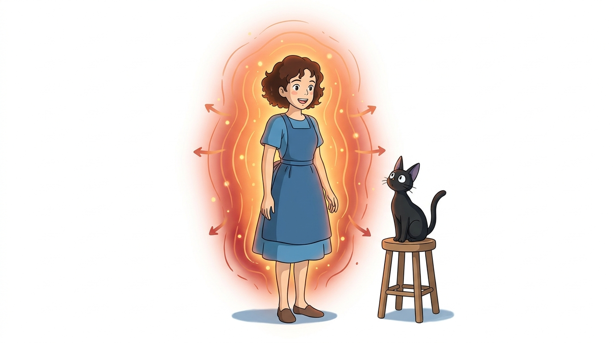
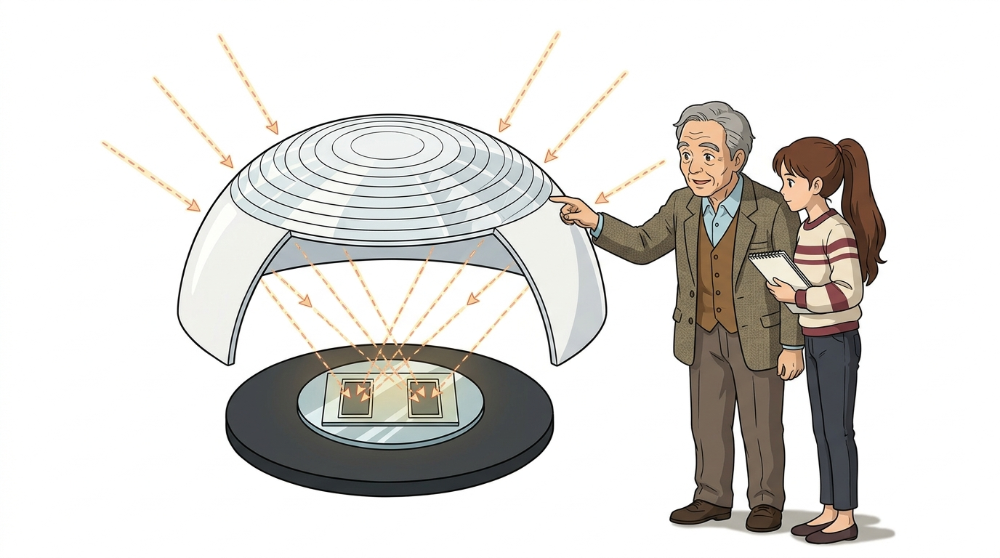
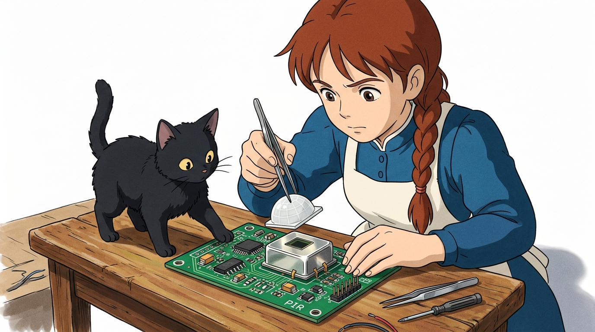
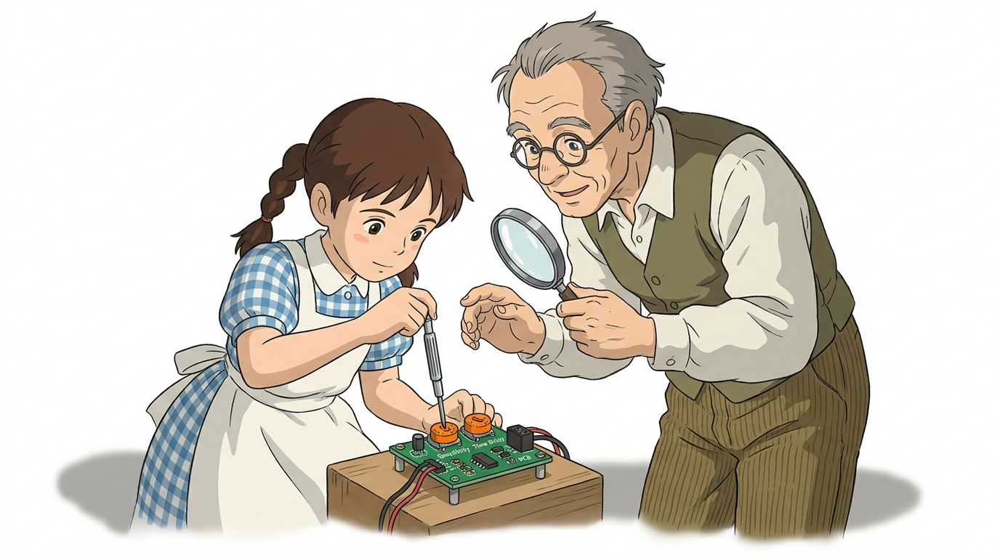
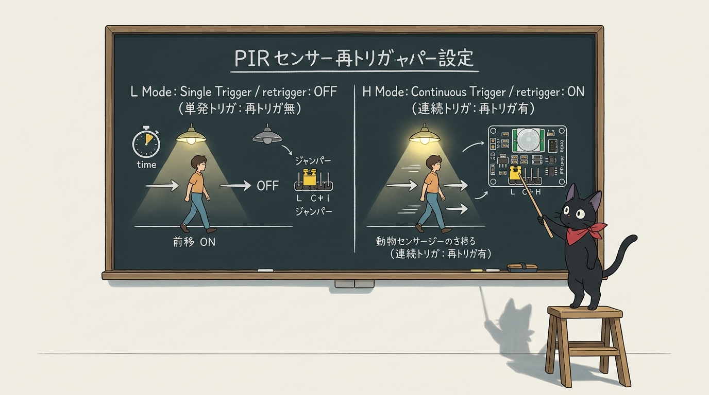
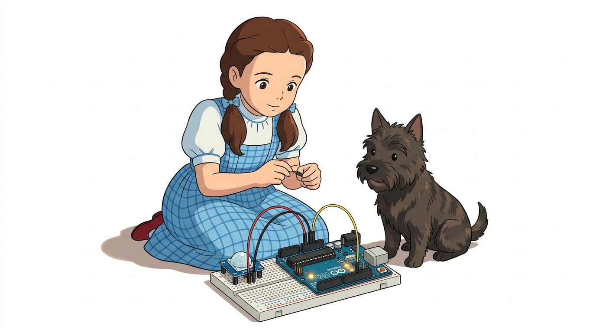
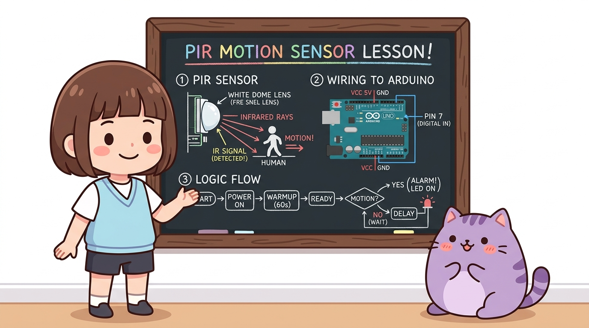

# 114_PIR인체감지센서_스마트조명 🚶♂️💡


* 👧 **도로시**: "지니야! 밤에 현관문에 들어서거나 아파트 복도를 걸어가면 천장 조명이 '딸깍!' 하고 저절로 켜지잖아! 스위치도 안 눌렀는데 내가 온 걸 어떻게 알고 켜는 거야?"
* 🐱 **지니**: "사람의 따뜻한 체온(36.5℃)에서 뿜어져 나오는 보이지 않는 적외선 열기를 감지하는 **PIR(Passive Infrared) 인체 감지 센서** 덕분이란다! 오늘 우리도 멋진 자동 스마트 현관등을 직접 만들어보자!"
* 🐶 **토토**: "바우! (살금살금 까치발로 지나가도 딱 걸린다 멍!)"

### 도로시와 마법 멘토 지니의 현관 자동 센서등과 침입 감지기
* 📖 **상세 강의 교재**: [index.md](./index.md)


> 여러분 안녕하세요! 이번 시간에는 '114. PIR인체감지센서 스마트조명 🚶♂️💡'을 주제로 함께 흥미진진한 탐험을 떠나보겠습니다. 오늘 강의에서는 특히 👧 도로시: "지니야! 밤에 현관문에 들어서거나 아파트 복도를 걸어가면 천장 조명이 '딸깍!' 하고 저절로 켜지잖아! 스위치도 안 눌렀는데 내가 온 걸 어떻게 알고 켜는 거야?", 🐱 지니: "사람의 따뜻한 체온(36.5℃)에서 뿜어져 나오는 보이지 않는 적외선 열기를 감지하는 PIR(Passive Infrared) 인체 감지 센서 덕분이란다! 오늘 우리도 멋진 자동 스마트 현관등을 직접 만들어보자!"를 중심으로 핵심 원리와 응용 방법을 차근차근 배워보겠습니다. 마법 멘토 지니와 호기심 많은 탐험가 도로시, 그리고 귀여운 토토와 함께 신나는 아두이노 모험을 힘차게 시작해 봅시다. 준비되셨나요?

---

## 1. PIR 센서란 무엇일까요? 🔍


* **수동형(Passive) 센서의 비밀**:
* 센서가 직접 초음파나 빛을 쏘아 반사파를 측정하는 능동형(Active) 센서와 달리, 주변 환경과 사람 몸에서 자연 방출되는 적외선만을 **조용히 받아들이기(Passive)** 때문에 전력 소모가 극히 적습니다.
* **주요 응용 분야**:
* 아파트 현관문, 복도, 계단, 공중화장실의 에너지 절약형 자동 센서등
* 침입자 발생 시 사이렌을 울리는 무인 방범 도난 경보기 (CCTV 연동)
* 백화점, 호텔, 지하철 역사의 자동문 출입문 개폐 제어기

PIR 센서는 움직이는 사람이나 동물이 방출하는 **적외선(Infrared Radiation)**의 공간적 변화를 포착하여 디지털 스위치 신호를 발생시키는 모션 감지 센서입니다.

> 자, 이번 슬라이드의 질문을 함께 보시겠습니다. 바로 '1. PIR 센서란 무엇일까요? 🔍'라는 아주 흥미로운 질문입니다. 우리가 일상에서 흔히 접하는 수동형(Passive) 센서의 비밀 현상을 떠올려보면 왜 이런 의문이 생기는지 쉽게 공감할 수 있습니다. 이 질문 속에 숨겨진 전자 회로와 컴퓨팅의 핵심 원리를 지금부터 차근차근 하나씩 파헤쳐 보겠습니다.

---

## 2. 눈에 보이지 않는 열의 전자기파: 적외선(IR) 🌐



* **인체 방출 파장**:
* 사람의 정상 체온(약 $36.5^\circ\text{C}$)에서는 파장 약 **$9\mu\text{m} \sim 10\mu\text{m}$ 부근의 원적외선(Far Infrared)** 에너지가 가장 강하게 뿜어져 나옵니다.
* **주변 배경과의 열 대조(Thermal Contrast)**:
* 실내 방 안의 벽면이나 가구의 온도(약 $20^\circ\text{C} \sim 24^\circ\text{C}$)보다 사람의 체온이 더 높기 때문에, 사람이 센서 앞을 걸어가면 센서의 시야각 안에서 적외선 에너지의 급격한 출렁임이 발생합니다.

절대영도($-273.15^\circ\text{C}$)보다 높은 온도를 가진 우주의 모든 물체는 표면에서 고유한 파장의 전자기파를 우주로 복사 방출합니다.

> 이번 슬라이드에서는 '2. 눈에 보이지 않는 열의 전자기파: 적외선(IR) 🌐'에 대해 자세히 살펴보겠습니다. 화면의 다이어그램과 사진을 함께 참고해 주시기 바랍니다. 첫 번째 핵심은 인체 방출 파장이며, 두 번째로는 사람의 정상 체온(약 $36.5^\circ\text{C}$)에서는 파장 약 $9\mu\text{m} \sim 10\mu\text{m}$ 부근의 원적외선(Far Infrared) 에너지가 가장 강하게 뿜어져 나옵니다.입니다. 여기에 덧붙여 주변 배경과의 열 대조(Thermal Contrast) 내용까지 함께 이해해 두시면 완벽합니다. 이 원리는 아두이노 시스템 전체를 관통하는 핵심 논리이므로 머릿속에 꼭 정리해 두시기 바랍니다.

---

## 3. 프레넬 렌즈(Fresnel Lens)와 파이로일렉트릭 소자 🔬



1. **하얀색 반구형 캡 (프레넬 렌즈, Fresnel Lens)**:
* 겉표면에 동심원 모양의 미세 프리즘 굴절 패턴이 촘촘히 새겨져 있습니다.
* 좌우 $100^\circ \sim 120^\circ$의 넓은 부채꼴 각도에서 흩어져 들어오는 적외선 빛을 돋보기처럼 한 점으로 집광하여 내부 소자에 쏘아줍니다.
2. **파이로일렉트릭(Pyroelectric) 듀얼 센서 소자**:
* 금속 캔 뚜껑 속에는 두 개의 감지 전극(슬롯 A, 슬롯 B)이 나란히 배치되어 있습니다.
* 사람이 왼쪽에서 오른쪽으로 걸어가면, 슬롯 A에 먼저 적외선 열이 닿았다가 슬롯 B로 열기가 이동합니다.
3. **차동 전압 펄스 생성**:
* 두 슬롯 사이의 순간적인 온도 차이로 인해 극성이 반대인 플러스/마이너스 전압 펄스가 만들어지며, 제어 칩(BISS0001)이 이를 증폭하여 **HIGH(5V)** 신호로 전환합니다!

PIR 센서의 겉면을 감싸고 있는 하얀색 돔 뚜껑과 내부 핵심 반도체 소자의 협업 원리입니다.

> 이번 슬라이드에서는 '3. 프레넬 렌즈(Fresnel Lens)와 파이로일렉트릭 소자 🔬'에 대해 자세히 살펴보겠습니다. 화면의 다이어그램과 사진을 함께 참고해 주시기 바랍니다. 첫 번째 핵심은 하얀색 반구형 캡 (프레넬 렌즈, Fresnel Lens)이며, 두 번째로는 겉표면에 동심원 모양의 미세 프리즘 굴절 패턴이 촘촘히 새겨져 있습니다.입니다. 여기에 덧붙여 좌우 $100^\circ \sim 120^\circ$의 넓은 부채꼴 각도에서 흩어져 들어오는 적외선 빛을 돋보기처럼 한 점으로 집광하여 내부 소자에 쏘아줍니다. 내용까지 함께 이해해 두시면 완벽합니다. 이 원리는 아두이노 시스템 전체를 관통하는 핵심 논리이므로 머릿속에 꼭 정리해 두시기 바랍니다.

---

## 4. 센서 모듈 외형과 돔 캡 내부 구조 🔎



* **금속 실드 캔(Metal Shielding Can)**:
* 스마트폰이나 Wi-Fi 전파, 형광등 노이즈 등 외부 전자기파 간섭(EMI)을 차단하여 오작동을 방지합니다.
* **적외선 투과 필터 윈도우(IR Window)**:
* 센서 캔 상단 유리창은 $7\mu\text{m} \sim 14\mu\text{m}$ 파장의 인체 적외선만을 선택적으로 통과시키고, 일반 가시광선 햇빛은 반사하여 걸러냅니다.

흰색 돔 캡을 조심스럽게 열어보면 금속으로 실딩된 파이로일렉트릭 센서 캔과 정밀 집적회로가 드러납니다.

> 이번 슬라이드에서는 '4. 센서 모듈 외형과 돔 캡 내부 구조 🔎'에 대해 자세히 살펴보겠습니다. 화면의 다이어그램과 사진을 함께 참고해 주시기 바랍니다. 첫 번째 핵심은 금속 실드 캔(Metal Shielding Can)이며, 두 번째로는 스마트폰이나 Wi-Fi 전파, 형광등 노이즈 등 외부 전자기파 간섭(EMI)을 차단하여 오작동을 방지합니다.입니다. 여기에 덧붙여 적외선 투과 필터 윈도우(IR Window) 내용까지 함께 이해해 두시면 완벽합니다. 이 원리는 아두이노 시스템 전체를 관통하는 핵심 논리이므로 머릿속에 꼭 정리해 두시기 바랍니다.

---

## 5. 센서 모듈 핀 배열과 조절 다이얼 2개 🎛️



| 조절기 / 핀 | 주요 기능 및 역할 | 튜닝 방향 가이드 |
| :---: | :---: | :--- |
| **거리 조절 (Sensitivity)** | 유효 감지 거리 (약 3m ~ 최대 7m) 조절 | 시계 방향 ➔ 거리 증가(멀리 감지), 반시계 ➔ 거리 감소(가까이 감지) |
| **시간 조절 (Time Delay)** | 사람 감지 후 HIGH 신호 유지 시간 (약 3초 ~ 300초) | 시계 방향 ➔ 켜짐 시간 길어짐, 반시계 ➔ 켜짐 시간 짧아짐(약 3초) |
| **VCC 핀** | 전원 공급 단자 (+) | 아두이노 **5V** 핀에 연결 (내부 레귤레이터 탑재) |
| **OUT 핀** | 디지털 모션 감지 출력 신호 | 아두이노 **디지털 7번 핀** 연결 (감지 시 5V HIGH, 미감지 시 0V LOW) |
| **GND 핀** | 전원 접지 단자 (-) | 아두이노 **GND 핀** 연결 |

PIR 센서 뒷면에는 드라이버로 돌려 감도와 유지 시간을 손쉽게 튜닝할 수 있는 주황색 가변저항 2개가 탑재되어 있습니다.

> 이번에 살펴볼 내용은 '5. 센서 모듈 핀 배열과 조절 다이얼 2개 🎛️'입니다. 슬라이드에 정리된 표를 통해 각 항목의 특징과 수치, 차이점을 한눈에 비교해 보실 수 있습니다. 이 기본 개념을 확실히 잡아두셔야 실제 부품을 브레드보드에 꽂고 코딩할 때 실수 없이 완성할 수 있습니다.

---

## 6. 재트리거(Retrigger) 점퍼 설정: H 모드 vs L 모드 🔀



* **H 모드 (연속 트리거, Repeat Trigger - 권장)**:
* 사람이 센서 앞에서 계속 춤을 추거나 서성거리면, 설정된 시간이 지나도 전등이 꺼지지 않고 **움직임이 멈출 때까지 계속 불이 켜진 상태를 유지**합니다. (현관등, 스마트 룸 조명에 최적!)
* **L 모드 (단일 트리거, Single Trigger)**:
* 사람이 센서 앞에서 계속 움직여도 정해진 시간(예: 5초)이 지나면 **무조건 불이 한 번 꺼졌다가** 다시 감지 사이클을 시작합니다. (출입자 계수기 카운터에 적합)

모듈 모서리에 있는 노란색 점퍼 핀으로 동작 방식을 하드웨어적으로 전환할 수 있습니다.

> 이번 슬라이드에서는 '6. 재트리거(Retrigger) 점퍼 설정: H 모드 vs L 모드 🔀'에 대해 자세히 살펴보겠습니다. 화면의 다이어그램과 사진을 함께 참고해 주시기 바랍니다. 첫 번째 핵심은 H 모드 (연속 트리거, Repeat Trigger - 권장)이며, 두 번째로는 사람이 센서 앞에서 계속 춤을 추거나 서성거리면, 설정된 시간이 지나도 전등이 꺼지지 않고 움직임이 멈출 때까지 계속 불이 켜진 상태를 유지합니다. (현관등, 스마트 룸 조명에 최적!)입니다. 여기에 덧붙여 L 모드 (단일 트리거, Single Trigger) 내용까지 함께 이해해 두시면 완벽합니다. 이 원리는 아두이노 시스템 전체를 관통하는 핵심 논리이므로 머릿속에 꼭 정리해 두시기 바랍니다.

---

## 7. 아두이노와 PIR 센서 브레드보드 회로 배선도 🔌



1. **PIR 센서 전원선 배선**:
* 센서 모듈의 **VCC 핀** ➔ 아두이노 **5V 핀** 연결
* 센서 모듈의 **GND 핀** ➔ 아두이노 **GND 핀** 연결
2. **센서 디지털 신호선 배선**:
* 센서 모듈의 **OUT 핀** ➔ 아두이노 **디지털 7번 핀** 연결
3. **현관 표시등 LED 배선**:
* 아두이노 **디지털 13번 핀** ➔ $220\Omega$ 저항 ➔ LED 긴 다리(애노드, +)
* LED 짧은 다리(캐소드, -) ➔ 아두이노 **GND 핀** 연결

아두이노 우노 보드에 PIR 센서와 감지 확인용 LED를 브레드보드로 견고하게 배선합니다.
### 📌 부품 연결 3단계

> 이번에 살펴볼 내용은 '7. 아두이노와 PIR 센서 브레드보드 회로 배선도 🔌'입니다. 화면의 회로도와 부품 사진을 보면서 각 핀과 배선이 어떻게 구성되어 있는지 눈으로 직접 따라와 주시기 바랍니다. 첫째로 PIR 센서 전원선 배선에 유의해야 하며, 둘째로 센서 모듈의 VCC 핀 ➔ 아두이노 5V 핀 연결라는 점이 핵심입니다. 이 기본 개념을 확실히 잡아두셔야 실제 부품을 브레드보드에 꽂고 코딩할 때 실수 없이 완성할 수 있습니다.

---

## 8. 칠판 교실: PIR 센서 시스템과 제어 로직 구조 🎨



* **1단계 (Power On & Warmup)**: 전원을 넣은 후 20초간 센서의 열 평형 안정화를 기다립니다.
* **2단계 (IR Signal Sensing)**: 프레넬 렌즈가 인체 적외선을 집광하여 파이로 소자가 차동 펄스를 만듭니다.
* **3단계 (Digital Read & Action)**: 아두이노 7번 핀으로 들어온 신호가 HIGH이면 즉시 13번 핀 LED를 켜고 시리얼 경보를 띄웁니다!

지니 선생님이 칠판에 정리해 준 스마트 현관등의 전체 하드웨어-소프트웨어 제어 흐름입니다.

> 이번 슬라이드에서는 '8. 칠판 교실: PIR 센서 시스템과 제어 로직 구조 🎨'에 대해 자세히 살펴보겠습니다. 화면의 다이어그램과 사진을 함께 참고해 주시기 바랍니다. 첫 번째 핵심은 단계 (Power On & Warmup): 전원을 넣은 후 20초간 센서의 열 평형 안정화를 기다립니다.이며, 두 번째로는 단계 (IR Signal Sensing): 프레넬 렌즈가 인체 적외선을 집광하여 파이로 소자가 차동 펄스를 만듭니다.입니다. 여기에 덧붙여 단계 (Digital Read & Action): 아두이노 7번 핀으로 들어온 신호가 HIGH이면 즉시 13번 핀 LED를 켜고 시리얼 경보를 띄웁니다! 내용까지 함께 이해해 두시면 완벽합니다. 이 원리는 아두이노 시스템 전체를 관통하는 핵심 논리이므로 머릿속에 꼭 정리해 두시기 바랍니다.

---

## 9. 실습: 스마트 현관등 전체 아두이노 스케치 💻


사람의 움직임이 포착되면 즉각 불을 밝히고 시리얼 모니터로 출입 상태를 보고하는 표준 스케치입니다.

```cpp
// ==========================================
// 07.4-2 스마트 현관 센서등 & 침입 감지기
// ==========================================

const int pirPin = 7;   // PIR 센서 OUT 신호 입력 핀
const int ledPin = 13;  // 현관등 상태 표시 LED 출력 핀

void setup() {
  Serial.begin(115200);   // PC 시리얼 모니터와 115200 bps 통신 개시
  pinMode(pirPin, INPUT); // 7번 핀: 센서의 HIGH/LOW 신호를 읽는 입력 모드
  pinMode(ledPin, OUTPUT); // 13번 핀: LED에 5V 전압을 공급하는 출력 모드

  Serial.println("========================================");
  Serial.println("  PIR Motion Sensor Initializing...     ");
  Serial.println("  센서가 실내 온도를 학습 중입니다 (20초) ");
  Serial.println("========================================");

  // 센서가 주변 적외선 환경을 학습할 때까지 20초간 깜빡이며 대기
  for (int i = 0; i < 20; i++) {
    digitalWrite(ledPin, HIGH);
    delay(200);
    digitalWrite(ledPin, LOW);
    delay(800);
    Serial.print(".");
  }
  Serial.println("\n>> [READY] 센서 준비 완료! 움직임을 감지합니다.");
}

void loop() {
  int motionDetected = digitalRead(pirPin); // 7번 핀 신호 검사

  if (motionDetected == HIGH) {
    digitalWrite(ledPin, HIGH); // 사람 감지 시 전등 ON!
    Serial.println("🚨 [ALERT] 사람의 움직임 포착! -> 현관 조명 ON");
  } else {
    digitalWrite(ledPin, LOW);  // 사람 부재 시 전등 OFF!
    Serial.println("... [QUIET] 주변이 조용합니다 (대기 모드)");
  }

  delay(500); // 0.5초 간격으로 상태 갱신
}
```

> 이번 슬라이드에서는 '9. 실습: 스마트 현관등 전체 아두이노 스케치 💻'에 대한 실제 동작 코드를 분석해 보겠습니다. 화면의 코드를 살펴보시면, 컴퓨터가 아두이노 하드웨어에 단계별로 명령을 내리는 흐름을 명확하게 확인할 수 있습니다. 각 함수의 역할과 괄호 안의 매개변수가 하드웨어 핀과 어떤 관계를 맺고 동작하는지 주의 깊게 살펴보시기 바랍니다.

---

## 10. 코드 상세 해설 ①: 20초 예열(Warm-up) 대기 루프 ⚙️


* **PIR 센서의 열적 안정화 시간(Thermal Settling Time)**:
* 파이로일렉트릭 결정체는 전원이 공급된 직후 내부 전하가 요동치며 약 20초에서 길게는 60초까지 불안정한 과도 상태를 겪습니다.
* **사용자 친화적 LED 인디케이터**:
* `for` 반복문으로 1초에 한 번씩 LED를 경쾌하게 깜빡여 "센서가 실내 배경 온도를 안전하게 학습하는 중입니다"라는 시각적 신호를 사용자에게 제공합니다.
* **가짜 경보(False Alarm) 차단**:
* 워밍업 루프가 끝난 뒤에야 비로소 `loop()` 함수가 시작되므로 가짜 침입 경보가 발생하지 않습니다.

초보 메이커들이 가장 많이 겪는 "센서에 전원만 꽂으면 혼자 멋대로 켜져요!" 오류를 원천 차단하는 핵심 알고리즘입니다.

```cpp
for (int i = 0; i < 20; i++) {
  digitalWrite(ledPin, HIGH);
  delay(200);
  digitalWrite(ledPin, LOW);
  delay(800);
  Serial.print(".");
}
```

> 이번 슬라이드에서는 '10. 코드 상세 해설 ①: 20초 예열(Warm-up) 대기 루프 ⚙️'에 대한 실제 동작 코드를 분석해 보겠습니다. 화면의 코드를 살펴보시면, 컴퓨터가 아두이노 하드웨어에 단계별로 명령을 내리는 흐름을 명확하게 확인할 수 있습니다. 여기서 핵심은 PIR 센서의 열적 안정화 시간(Thermal Settling Time)입니다. 각 함수의 역할과 괄호 안의 매개변수가 하드웨어 핀과 어떤 관계를 맺고 동작하는지 주의 깊게 살펴보시기 바랍니다.

---

## 11. 코드 상세 해설 ②: `digitalRead(7)`와 움직임 감지 판정 🚪


* **전압 판정**:
* `digitalRead(7)`이 센서 OUT 핀의 전압을 측정합니다.
* 센서 내부 BISS0001 칩이 움직임을 감지하면 5V 전압을 내보내어 `motionDetected`에 `HIGH(1)`이 대입됩니다.
* **지속 시간 딜레이와의 조화**:
* 모듈 뒷면의 시간 조절 가변저항으로 설정된 시간(기본 약 3~5초) 동안 센서 하드웨어가 스스로 HIGH 전압을 유지해 주므로, 코드가 복잡한 타이머를 작성하지 않아도 안정적인 켜짐 시간을 유지할 수 있습니다.

`loop()` 안에서 0.5초마다 호출되는 디지털 판정 로직입니다.

```cpp
int motionDetected = digitalRead(pirPin);

if (motionDetected == HIGH) {
  digitalWrite(ledPin, HIGH);
} else {
  digitalWrite(ledPin, LOW);
}
```

> 이번 슬라이드에서는 '11. 코드 상세 해설 ②: digitalRead(7)와 움직임 감지 판정 🚪'에 대한 실제 동작 코드를 분석해 보겠습니다. 화면의 코드를 살펴보시면, 컴퓨터가 아두이노 하드웨어에 단계별로 명령을 내리는 흐름을 명확하게 확인할 수 있습니다. 여기서 핵심은 전압 판정입니다. 각 함수의 역할과 괄호 안의 매개변수가 하드웨어 핀과 어떤 관계를 맺고 동작하는지 주의 깊게 살펴보시기 바랍니다.

---

## 12. 코드 상세 해설 ③: 부저와 LED를 결합한 스마트 방범 경보기 확장 🔔


* **소리와 빛의 복합 피드백**:
* 8번 디지털 핀에 피에조 부저를 추가 결선하고 `tone(pin, freq, duration)` 함수를 사용하면 야간 침입 시 귓전을 울리는 강력한 방범 사이렌을 울릴 수 있습니다.
* **반려동물(펫) 오작동 방지 노하우**:
* 36.5℃ 체온을 가진 강아지(토토)나 고양이도 센서 시야각에 들어오면 반응합니다.
* 센서를 성인 가슴 높이(약 1.2m~1.5m)에 장착하고 렌즈 하단을 절연 테이프로 살짝 가려주면 사람만 감지하는 스마트 펫 면역(Pet-Immune) 센서가 완성됩니다!

단순한 현관등을 넘어 침입자 경보기(Burglar Alarm)로 회로와 코드를 확장하는 기법입니다.

```cpp
if (motionDetected == HIGH) {
  digitalWrite(ledPin, HIGH);
  tone(8, 2000, 300); // 8번 핀 피에조 부저로 2000Hz 경고음 0.3초 발생!
} else {
  digitalWrite(ledPin, LOW);
  noTone(8);          // 소리 끄기
}
```

> 이번 슬라이드에서는 '12. 코드 상세 해설 ③: 부저와 LED를 결합한 스마트 방범 경보기 확장 🔔'에 대한 실제 동작 코드를 분석해 보겠습니다. 화면의 코드를 살펴보시면, 컴퓨터가 아두이노 하드웨어에 단계별로 명령을 내리는 흐름을 명확하게 확인할 수 있습니다. 여기서 핵심은 소리와 빛의 복합 피드백입니다. 각 함수의 역할과 괄호 안의 매개변수가 하드웨어 핀과 어떤 관계를 맺고 동작하는지 주의 깊게 살펴보시기 바랍니다.

---

## 🌟 도로시와 지니의 핵심 요약 노트! 🏆


* **👧 도로시**: "PIR 센서는 스스로 빛을 쏘지 않고 사람 몸에서 나오는 적외선 열을 조용히 받아들이는 수동형 센서라 전기를 아주 적게 먹는 거였구나!"
* **🐱 지니**: "맞아! 하얀 프레넬 렌즈가 넓은 시야를 모아주고, 가변저항 2개로 거리와 켜짐 시간을 손쉽게 맞출 수 있단다."
* **🐶 토토**: "바우! 다음 시간에는 손가락 끝에서 콩닥콩닥 뛰는 심장 박동을 재는 **'07.4-3 심박 센서'**를 배우러 가자 멍!"

* [x] **수동 적외선(PIR) 원리**: 체온에서 방출되는 $9\sim10\mu\text{m}$ 원적외선 열변화를 파이로 소자로 포착하는 저전력 수동 센싱의 원리를 배웠습니다.
* [x] **프레넬 렌즈의 역할**: 넓은 시야각($120^\circ$)의 적외선 빛을 집광하여 듀얼 슬롯에 차동 펄스를 만들어냄을 이해했습니다.
* [x] **2대 가변저항 튜닝**: 거리(Sensitivity)와 유지 시간(Time Delay) 조절 다이얼을 환경에 맞게 조율했습니다.
* [x] **20초 예열 알고리즘**: 전원 투입 초기 과도 현상과 가짜 경보를 제거하는 `for` 루프 초기화 테크닉을 체득했습니다.

### 📋 07.4-2 PIR 인체 감지 센서 정복 체크리스트

> 오늘 배운 '🌟 도로시와 지니의 핵심 요약 노트! 🏆'의 핵심 내용을 모두 정리해 보았습니다. 오늘 다룬 내용 중에서도 [x] 수동 적외선(PIR) 원리: 체온에서 방출되는 $9\sim10\mu\text{m}$ 원적외선 열변화를 파이로 소자로 포착하는 저전력 수동 센싱의 원리를 배웠습니다. 부분은 앞으로의 아두이노 실습과 프로젝트에서 계속 사용되는 매우 중요한 기초 지식입니다. 지니 멘토가 강조했듯이 맞아! 하얀 프레넬 렌즈가 넓은 시야를 모아주고, 가변저항 2개로 거리와 켜짐 시간을 손쉽게 맞출 수 있단다.라는 점을 꼭 마음에 새겨두시길 바랍니다. 오늘 배운 내용을 꼭 다시 한번 복습해 보시고, 다음 강의에서 더욱 신나고 유익한 모험으로 다시 만나겠습니다. 모두 수고 많으셨습니다!