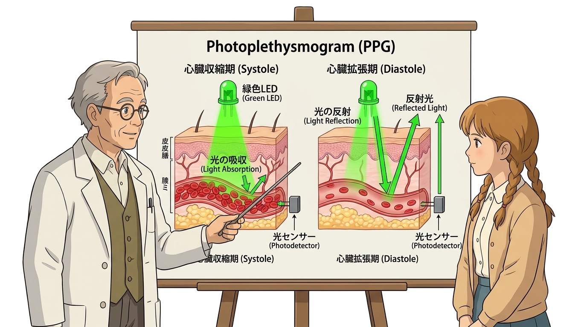
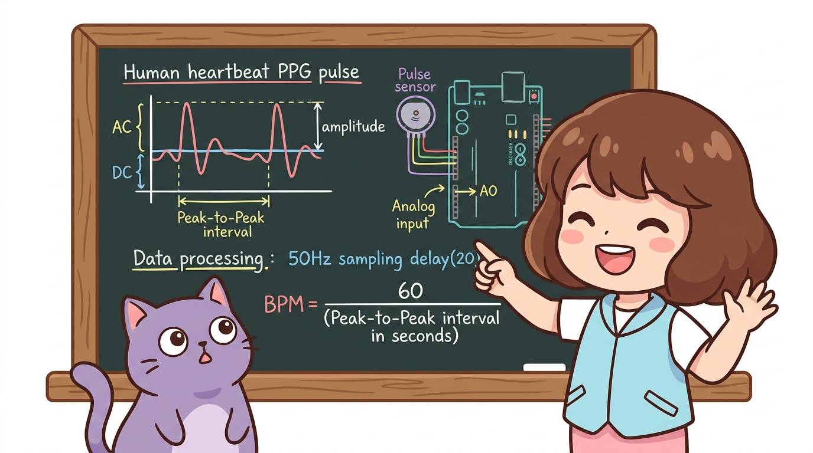
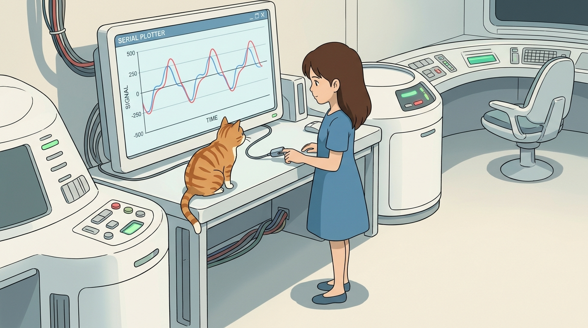
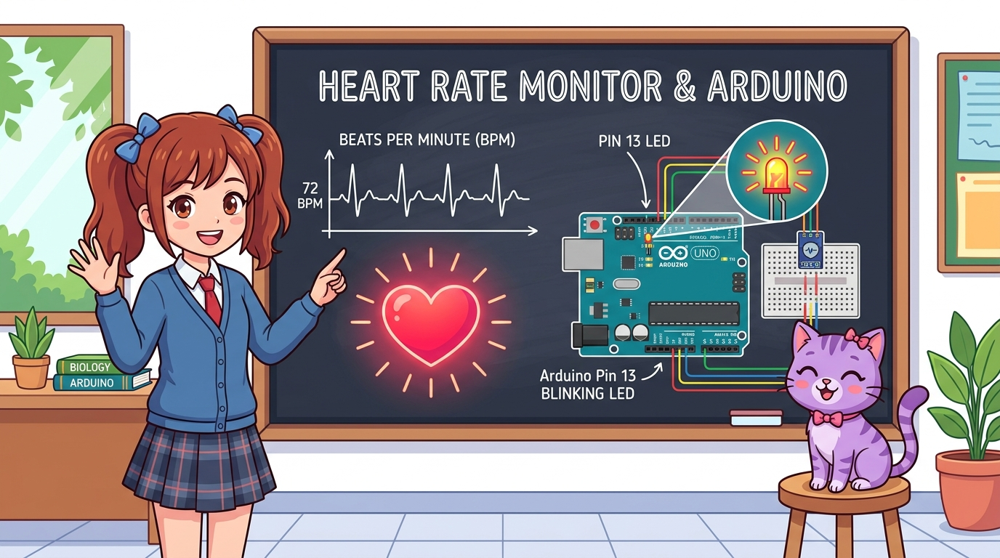
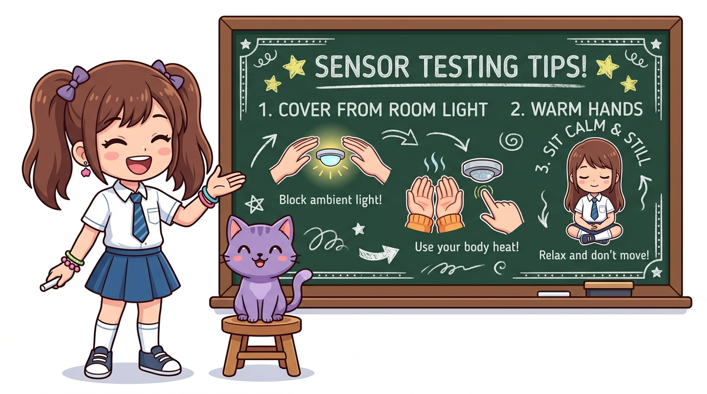

# 115_광학심박센서_생체맥파 ❤️📈


### 도로시와 마법 멘토 지니의 광학식 심장 박동수(BPM) 측정 교실

* 👧 **도로시**: "지니야! 스마트워치를 차고 달리기하면 시계 화면에 내 심장이 1분에 몇 번 뛰는지 숫자로 뜨잖아! 손목 안을 째어보지도 않는데 어떻게 심장 박동을 알아채는 거야?"
* 🐱 **지니**: "초록색 LED 빛을 피부에 쏘아서 혈관 속 피가 쿵쾅거리며 지나가는 양을 빛의 반사로 측정하는 **광용적맥파(PPG) 광학 심박 센서** 덕분이란다! 오늘 우리도 심장 박동 파형을 화면에 실시간으로 그려보자!"
* 🐶 **토토**: "바우! (토토 가슴에도 손을 대보면 콩닥콩닥 빠르게 뛴다 멍!)"

* 🖥️ **강의 슬라이드**: [slides.md](./slides.md)

---

## 1. 광학 심박 센서의 개요와 스마트 헬스케어 ⌚


병원 중환자실의 환자 모니터링 장치나 애플워치, 갤럭시 워치 등 최신 웨어러블 헬스케어 기기에 탑재되는 핵심 생체 신호 감지 센서입니다.

* **비침습(Non-invasive) 생체 측정**:
  * 주삿바늘로 피부를 찌르거나 혈액을 채취하지 않고, 피부 표면에 안전한 가시광선 빛을 비추기만 하므로 통증이 없고 감염 위험이 없습니다.
* **실시간 심박수(BPM) 모니터링**:
  * 1분당 심장이 펌프질하는 횟수인 **BPM(Beats Per Minute)**을 실시간으로 추적하여 운동 강도, 수면 단계, 스트레스 지수를 분석합니다.
* **소형화와 다목적 활용**:
  * 동전 크기보다 작은 초소형 기판으로 제작되어 손가락 끝, 귓불, 손목 등 피부 표면에 손쉽게 부착할 수 있습니다.

---

## 2. 센서 모듈의 하드웨어 구조와 광학 소자 🔬


심박 센서 앞면의 하트 모양 마크 중심에는 정밀한 광학 송수광 소자 쌍이 배치되어 있습니다.

* **초록색 고휘도 발광 LED**:
  * 피부 진피층의 모세혈관망까지 침투할 수 있는 최적의 파장인 약 **565nm 녹색 파장**의 빛을 지속적으로 투사합니다.
* **광학 수광 다이오드 (Photodiode)**:
  * 피부 및 혈액에서 반사되어 되돌아오는 미세한 빛 알갱이(광자)의 양을 실시간으로 흡수하여 전류 신호로 변환합니다.
* **뒷면 초소형 증폭/필터 회로 (Op-Amp)**:
  * 인체 노이즈와 미세한 생체 신호를 수백 배 증폭하고 고주파 잡음을 걸러내어 아두이노가 읽을 수 있는 깨끗한 아날로그 파동 신호로 정돈해 줍니다.

---

## 3. PPG(광용적맥파) 측정의 과학적 원리 💚



피부 아래를 지나가는 혈액의 부피 변화를 빛의 흡수율로 측정하는 기술을 **PPG(Photoplethysmogram, 광용적맥파)**라고 부릅니다.

1. **초록빛과 붉은 헤모글로빈의 보색 관계**:
   * 혈액 속에서 산소를 운반하는 단백질인 **헤모글로빈(Hemoglobin)**은 붉은색을 띠며, 빛의 스펙트럼에서 보색인 **초록색 파장의 빛을 가장 강력하게 흡수**하는 특성이 있습니다.
2. **심장 수축기 (Systole, 혈액 유입)**:
   * 심장이 힘차게 수축하여 동맥을 통해 손끝 모세혈관으로 피가 콸콸 쏟아져 들어오면 혈액량이 급증합니다.
   * 혈관 속 헤모글로빈이 초록색 빛을 많이 흡수하므로, 센서로 반사되어 되돌아오는 빛의 양은 **최솟값(Valley)**으로 떨어집니다.
3. **심장 이완기 (Diastole, 혈액 유출)**:
   * 심장이 이완되며 손끝의 혈액이 빠져나가면 혈관 속 헤모글로빈 양이 줄어듭니다.
   * 초록빛을 덜 흡수하므로 센서로 되돌아오는 반사광의 양이 **최댓값(Peak)**으로 증가합니다.
4. **아날로그 전압 파형 출력**:
   * 이 주기적인 반사광의 출렁임을 0V ~ 5V 사이의 연속 전압으로 변환하여 아두이노 A0 핀으로 전달합니다!

---

## 4. 센서 착용 부위와 벨크로 압력 조절법 🖐️


광학 생체 센서는 측정 부위의 혈류 상태와 착용 압력에 따라 신호 품질이 크게 달라집니다.

* **최적의 측정 부위**:
  * **집게손가락 끝 지문 부위**: 피부가 얇고 모세혈관망이 매우 조밀하게 밀집되어 있어 가장 뚜렷하고 박진감 넘치는 맥파를 얻을 수 있습니다.
  * **귓불(Ear Lobe)**: 근육의 움직임이 적고 뼈가 없어 안정적인 파형을 관찰할 수 있습니다.
* **⚠️ 초보자 주의: 손가락을 꽉 누르면 안 돼요!**:
  * 손끝을 센서에 너무 강하게 꾹 누르면 모세혈관이 압박되어 피가 통하지 않게 되므로 맥파 신호가 완전히 죽어 평평한 직선이 나옵니다.
  * 동봉된 벨크로 밴드를 사용하여 **손가락 위에 센서를 살포시 얹어놓는 느낌**으로 가볍게 감싸주는 것이 핵심입니다.

---

## 5. 아두이노와 심박 센서 브레드보드 회로 배선도 🔌


심박 센서는 단 3가닥의 점퍼선으로 아두이노 우노 보드에 즉시 연결할 수 있습니다.

| 전선 기호 / 색상 | 아두이노 연결 핀 | 기능 및 역할 |
| :---: | :---: | :--- |
| **`+` (빨간색 선)** | **5V (또는 3.3V)** | 센서 내부 녹색 LED 및 증폭기 전원 공급 |
| **`-` (검은색 선)** | **GND 핀** | 전원 기준 접지 (0V) |
| **`S` (보라색 선)** | **A0 (아날로그 입력)** | 모세혈관 반사광에 비례하는 0~5V 아날로그 맥파 전압 출력 |

---

## 6. 칠판 교실: PPG 맥파 파형과 아두이노 연동 구조 🎨



지니 선생님이 칠판에 심장 박동 파형의 수학적 구조와 아두이노 데이터 처리 방식을 정리해 주었습니다!

* **AC 성분 vs DC 성분**:
  * 피부와 뼈에 의해 반사되는 일정한 빛(DC 성분, 기준 전위) 위에 심장 박동에 따라 쿵덕쿵덕 뛰는 맥파(AC 성분, 진폭)가 실려 들어옵니다.
* **50Hz 고속 샘플링**:
  * 아두이노가 `delay(20)` 간격으로 1초에 50번씩 전압을 정밀 측정합니다.
* **BPM 공식**:
  * 연속된 두 심박 피크 사이의 시간 간격(Peak-to-Peak Interval)을 초 단위로 재어 $\text{BPM} = 60 / \text{시간 간격}$으로 1분당 박동수를 계산합니다!

---

## 7. 실습 ①: 실시간 심박 파형 플로터 전체 스케치 💻



아두이노 IDE의 시리얼 플로터를 활용하여 심장 박동 곡선을 모니터 화면에 영화처럼 띄우는 스케치입니다.

```cpp
// ==========================================
// 07.4-3 실시간 광학 심박 파형 플로터 스케치
// ==========================================

const int pulsePin = A0; // 심박 센서 S 신호선 연결 핀

void setup() {
  // 1. PC와 고속 시리얼 통신 개방 (115200 bps)
  Serial.begin(115200);

  // A0 핀은 analogRead() 호출 시 자동으로 아날로그 입력 모드로 동작합니다.
}

void loop() {
  // 2. 모세혈관 반사광 강도를 10비트 디지털 숫자(0 ~ 1023)로 정밀 변환
  int rawSignal = analogRead(pulsePin);

  // 3. 시리얼 플로터가 그래프를 그릴 수 있도록 숫자를 한 줄씩 출력
  Serial.println(rawSignal);

  // 4. 20밀리초(0.02초) 대기 -> 초당 50회 샘플링(50Hz) 유지
  delay(20);
}
```

---

## 8. 코드 상세 해설 ①-A: `analogRead(A0)`와 50Hz 고속 샘플링 ⏱️



부드러운 곡선의 맥파를 렌더링하기 위한 고속 데이터 수집 테크닉입니다.

```cpp
int rawSignal = analogRead(pulsePin);
Serial.println(rawSignal);
delay(20);
```

* **`delay(20)`이 만드는 50Hz 샘플링 주파수**:
  * 1초($1000\text{ms}$) $\div 20\text{ms} = \mathbf{50\text{회 / 초}}$
  * 사람의 심장은 1초에 1번~1.5번 뜁니다. 만약 `delay(500)`처럼 느리게 측정하면 피크가 뭉개져 곡선이 사라집니다.
  * 1초에 50번씩 전압을 촘촘히 샘플링함으로써 심장의 수축-이완 파형이 마치 병원 환자 감시 장치처럼 매끄럽게 연결됩니다.
* **115200 bps 고속 전송의 이유**:
  * 기본 속도인 9600 bps는 초당 50번의 숫자 문자열을 전송하기에 대역폭이 턱없이 부족하여 데이터 병목(지연)이 일어납니다. 115200 bps를 사용해야 실시간 렉 없는 파형을 감상할 수 있습니다.

---

## 9. 코드 상세 해설 ①-B: 시리얼 플로터(Serial Plotter) 파형 분석 📈


텍스트 모니터 대신 그래픽 화면을 띄워 내 몸의 생체 리듬을 관찰하는 방법입니다.

1. **플로터 창 실행**:
   * 아두이노 IDE 상단 메뉴의 **[툴] ➔ [시리얼 플로터]** (단축키 `Ctrl + Shift + L` / Mac `Cmd + Shift + L`)를 클릭합니다.
2. **Baud Rate 설정**:
   * 플로터 창 우측 하단의 통신 속도를 코드와 동일한 **115200 보드(Baud)**로 선택합니다.
3. **파형 관찰**:
   * 손가락을 대고 가만히 심호흡을 하면, 그래프가 위아래로 규칙적인 리듬을 타며 '쿵덕- 쿵덕-' 하는 심장 박동 파형이 아름답게 그려집니다!

---

## 10. 실습 ②: 1분당 심박수(BPM) 산출 알고리즘 🧮


파형 그래프를 넘어 "내 심장이 지금 1분에 몇 번 뛰는가(BPM)"를 계산하는 프로그래밍 수학 원리입니다.

1. **임계값 피크 검출 (Threshold Detection)**:
   * 평상시 기준선(약 512~550)을 상향 돌파하는 꼭짓점을 심장 박동(Beat)으로 인식합니다.
2. **심박 간격 (IBI, Inter-Beat Interval) 측정**:
   * 이전 박동 시각($t_{prev}$)과 현재 박동 시각($t_{curr}$)의 차이를 `millis()` 함수로 측정합니다:
     $$\Delta t = t_{curr} - t_{prev} \quad (\text{단위: ms})$$
3. **BPM 변환 공식**:
   $$\text{BPM} = \frac{60{,}000\text{ ms}}{\Delta t\text{ (ms)}} = \frac{60{,}000}{750\text{ ms}} = \mathbf{80\text{ 회/분}}$$
* 아두이노 공식 라이브러리 매니저에서 **`PulseSensor Playground`**를 설치하면 이 알고리즘이 캡슐화되어 있어 손쉽게 전문 스마트워치 프로그램을 제작할 수 있습니다.

---

## 11. 성공적인 측정을 위한 3대 실습 팁 💡



* ☀️ **주변 조명 빛 가리기 (암막 차폐)**:
  * 형광등이나 직사광선이 센서 뒷면으로 새어 들어가면 심한 노이즈가 발생합니다. 검은색 절연 테이프나 벨크로로 센서 겉면을 덮어주면 파형이 3배 이상 선명해집니다.
* 🧘 **신체 움직임 정지 (정적 상태 유지)**:
  * 말을 하거나 손가락을 꼼지락거리면 근육 전위 잡음(동작 아티팩트)이 섞입니다. 팔을 책상에 편안히 내려놓고 측정하세요.
* 🌡️ **손가락 체온 유지**:
  * 겨울철 손이 차가우면 말초 모세혈관이 수축하여 맥파 진폭이 매우 작아집니다. 손을 따뜻하게 비빈 후 측정하면 완벽한 신호를 얻을 수 있습니다.

---

## 🌟 도로시와 지니의 핵심 요약 노트! 🏆


### 📋 07.4-3 펄스(심박) 센서 정복 체크리스트

* [x] **PPG(광용적맥파) 원리**: 혈액 속 헤모글로빈이 초록색 빛(565nm)을 흡수하여 생기는 반사광의 주기적 변화를 감지했습니다.
* [x] **비침습 생체 인터페이스**: 손끝에 살포시 얹는 벨크로 압력 조절법과 A0 아날로그 핀 결선을 완료했습니다.
* [x] **50Hz 고속 샘플링**: `delay(20)`과 `115200 bps` 통신으로 렉 없는 매끄러운 맥파 곡선을 그렸습니다.
* [x] **시리얼 플로터와 BPM**: 아두이노 IDE 시리얼 플로터로 파형을 시각화하고, 박동 간격(IBI)을 이용한 1분당 심박수 산출 수학 공식을 마스터했습니다.

> **👧 도로시**: "혈관 속 헤모글로빈이 초록색 빛을 흡수하는 원리로 심장 박동을 잴 수 있다니, 물리학과 의학이 코딩으로 만나는 마법 같아!"  
> **🐱 지니**: "맞아! 50Hz 고속 샘플링과 시리얼 플로터를 활용하면 병원의 심전도 모니터를 내 방 책상 위에서 그대로 구현할 수 있단다."  
> **🐶 토토**: "바우! 다음 시간엔 쿵! 부딪히거나 흔들리는 힘을 감지하는 **'07.5-2 충격 감지 센서'**를 정복하러 가자 멍!"
