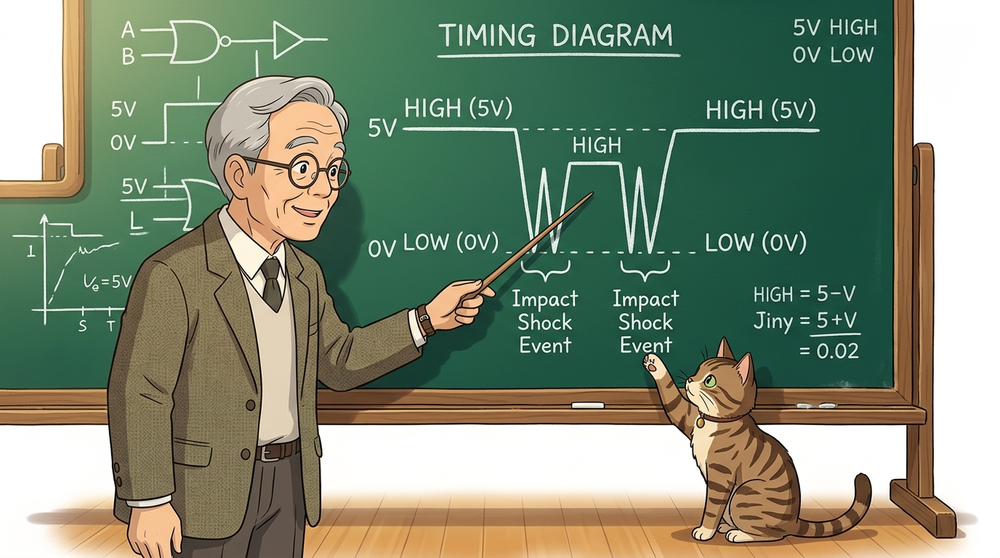
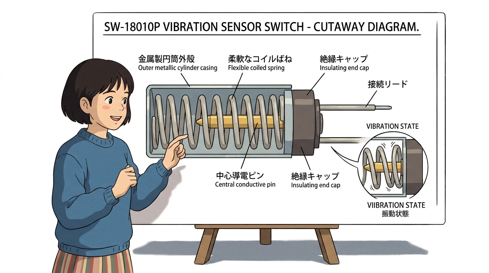
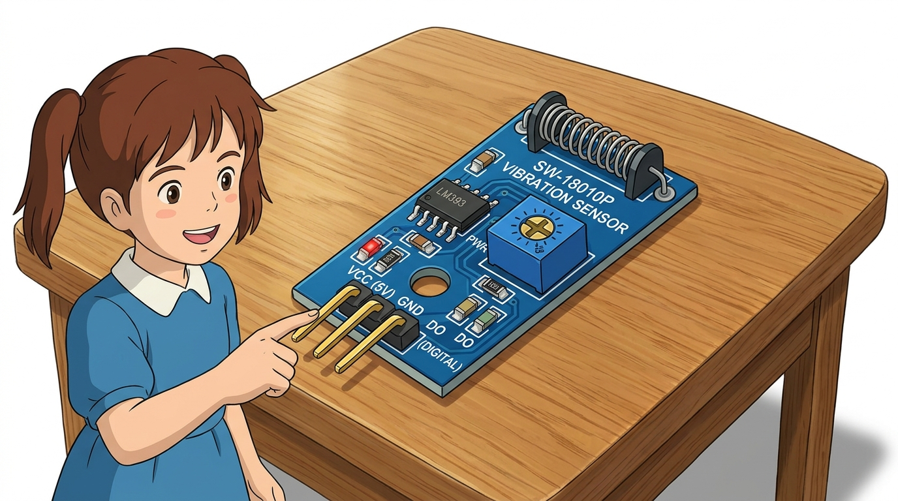
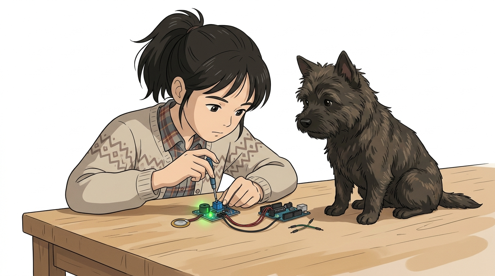
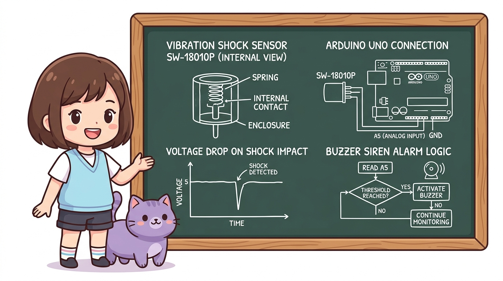
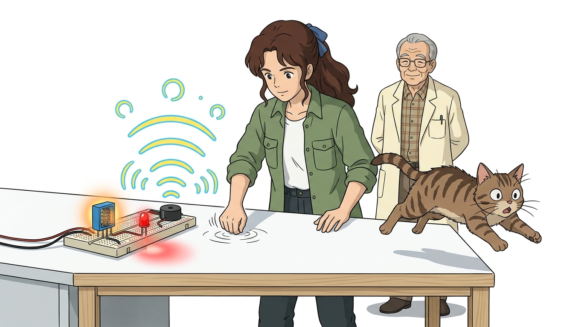

# 116_SW18010P_충격진동센서 💥🚨


### 도로시와 마법 멘토 지니의 지진 경보기와 자전거 도난 방지기

* 👧 **도로시**: "지니야! 지진이 와서 땅이 흔들리거나, 누가 내 소중한 자전거를 슬쩍 건드려서 훔쳐가려고 할 때 즉시 '삐-익!' 하고 큰 소리로 알려주는 기계는 어떻게 만들어?"
* 🐱 **지니**: "원통 속의 아주 미세한 용수철 스프링이 쿵 흔들리며 전기를 통하게 해주는 **SW-18010P 충격·진동 감지 센서** 를 사용하면 된단다! 오늘 우리만의 든든한 스마트 보안 경보기를 완성해 보자!"
* 🐶 **토토**: "바우! (살짝만 발로 툭 건드려도 토토가 멍멍 짖으며 지킨다 멍!)"

* 🖥️ **강의 슬라이드**: [slides.md](./slides.md)

---

## 1. 충격·진동 센서의 특징과 실생활 활용 🔍


SW-18010P 센서는 물체에 가해지는 물리적인 충격, 떨림, 흔들림, 진동을 순간적으로 감지하는 고감도 관성 스위치 센서입니다.

* **초고속 반응 속도**: 충격이 가해지는 찰나의 순간(수 밀리초, $\text{ms}$)에 스위치 접점이 닫히며 즉각 반응합니다.
* **단순한 구조와 높은 내구성**: 정밀한 전자 칩 대신 물리적 스프링 접점 방식을 채택하여 고온, 충격, 전자기 노이즈에 강하고 잔고장이 없습니다.
* **주요 응용 분야**:
  * 자전거 및 오토바이 스마트 도난 방지 경보기
  * 가정 및 산업 시설의 지진 감지 조기 가스 차단 장치
  * 자동차 블랙박스의 주차 충격 녹화 트리거
  * 세탁기 고속 탈수 시 통 흔들림 불균형 감지

---

## 2. 진동과 충격 에너지의 물리적 형태 🌊



물리적 충격은 정지해 있던 물체에 가속도가 급격히 전달되면서 짧은 순간 고주파 진동 파동을 만들어냅니다.

* **감쇠 진동(Damped Oscillation)**:
  * 망치로 책상을 '탁' 치면 순간적으로 큰 충격 피크가 발생한 후 잔여 진동이 서서히 줄어듭니다.
* **기계식 스위치의 바운싱 현상**:
  * 센서 내부의 스프링이 흔들릴 때 한 번만 닿는 것이 아니라 수 밀리초 동안 수십 번 접촉과 단락을 반복하며 펄스 군(Burst Pulse)을 형성합니다.

---

## 3. SW-18010P 센서의 기계식 스프링 접점 구조 🌀



작은 검은색 원통(캡슐) 속을 들여다보면 정밀한 기계식 접점 장치가 숨어 있습니다.

1. **중심 전극 기둥 (고정 전극, Center Electrode)**:
   * 캡슐 중앙에 굵은 금속 기둥이 굳건하게 똑바로 서 있습니다.
2. **외곽 나선형 스프링 (가동 전극, Coil Spring)**:
   * 중심 기둥 주위를 닿을 듯 말 듯 유연한 나선형 용수철 스프링이 감싸고 있습니다.
3. **평상시 (안정 상태, Open)**:
   * 스프링과 중심 기둥이 서로 떨어져 있어 **회로가 열려 전기가 통하지 않습니다 (단락 차단, 높은 저항).**
4. **쿵! 충격 발생 시 (진동 접촉, Close)**:
   * 충격이나 진동이 가해지면 유연한 스프링이 출렁출렁 흔들리며 **중심 기둥을 찰나의 순간 때리면서 접촉(도통)!**
   * 순간적으로 전기가 통과하며 전압이 급격히 떨어지는 펄스 신호가 발생합니다.

---

## 4. 센서 모듈의 핀 구성과 LM393 전압 비교기 🎛️



SW-18010P 소자 자체는 접점 스위치이지만, 모듈 기판에는 신호를 정밀하게 가공해 주는 **LM393 듀얼 비교기 IC**가 내장되어 있습니다.

| 핀 기호 | 주요 역할 | 아두이노 연결 | 기능 상세 설명 |
| :---: | :---: | :---: | :--- |
| **VCC** | 전원 공급 (+) | **5V 핀** | DC 3.3V ~ 5V 작동 전압 공급 |
| **GND** | 전원 접지 (-) | **GND 핀** | 0V 기준 접지 |
| **DO** | 디지털 스위칭 출력 | **디지털 7번 핀** | 충격 감지 시 LOW(0V), 평상시 HIGH(5V) |
| **AO** | 아날로그 전압 출력 | **A5번 핀** | 스프링 접촉 시의 순간 전압 강하를 연속 측정 |

---

## 5. 감도 조절 가변저항 튜닝 가이드 🔧



모듈에 탑재된 파란색 정밀 가변저항을 십자 드라이버로 돌려 원하는 진동 민감도를 튜닝합니다.

* **반시계 방향 회전 (High Sensitivity, 예민)**:
  * 기준 전압 임계치를 낮추어 살짝 책상을 톡 건드리거나 사람이 발자국만 쿵 디뎌도 반응합니다.
* **시계 방향 회전 (Low Sensitivity, 둔감)**:
  * 기준 전압 임계치를 높여 물체가 바닥에 쾅 떨어지거나 주먹으로 강하게 칠 때만 반응하도록 조절합니다.
* **전원 LED vs 출력 LED**:
  * 빨간색 LED는 전원 인가 표시등이며, 초록색 LED는 진동이 감지되는 찰나에만 깜빡입니다.

---

## 6. 풀업 저항과 전압 강하 원리 ⚡

```cpp
// 충격 감지 시 1023에서 0V로 급락하는 전압 아날로그 읽기
int shockVal = analogRead(A5);
```

충격이 가해졌을 때 아두이노 아날로그 핀의 측정 숫자가 왜 `1023`에서 `0`으로 급락하는지 분석합니다.

1. **평상시 (스프링 분리 상태)**:
   * 모듈 내부의 $10\text{k}\Omega$ 풀업 저항을 통해 5V 전원이 A5 핀으로 직결되므로 전압은 $5.0\text{V}$, `analogRead(A5)` 값은 **1023**을 유지합니다.
2. **충격 접촉 순간 (스프링 쇼트 상태)**:
   * 스프링이 GND에 닿는 순간, 전류가 저항이 전혀 없는 접지(0V)로 빠져나가며 A5 핀 전압이 **순식간에 0V (값 0~100)**로 뚝 떨어집니다!
3. **판정 기준**:
   * 따라서 코드는 값이 커질 때가 아니라, **"평상시 1023에서 1000 미만으로 떨어지는 순간"**을 포착해야 합니다!

---

## 7. 아두이노와 충격 센서 브레드보드 회로 배선도 🔌


아두이노 우노 보드에 충격 센서 모듈과 경보용 피에조 부저를 브레드보드로 결선합니다.

### 📌 결선 순서 가이드
1. **충격 센서 배선**:
   * 센서 **VCC 핀** ➔ 아두이노 **5V 핀** 연결
   * 센서 **GND 핀** ➔ 아두이노 **GND 핀** 연결
   * 센서 **AO 핀** ➔ 아두이노 **A5번 아날로그 핀** 연결
2. **피에조 부저 및 LED 배선 (옵션)**:
   * 부저 (+) 긴 다리 ➔ 아두이노 **디지털 8번 핀**
   * 부저 (-) 짧은 다리 ➔ 아두이노 **GND 핀**
   * 보드 내장 13번 LED를 시각 경보 인디케이터로 활용

---

## 8. 칠판 교실: 충격 센서 시스템과 전압 강하 판정 로직 🎨



지니 선생님이 칠판에 정리해 준 충격 센서의 기계적 접촉과 아두이노 판정 알고리즘입니다!

* **기계적 접촉**: 원통 속 스프링이 충격을 받아 중심 기둥과 접촉합니다.
* **전압 파형 변화**: 정상 전압 5V에서 접지 도통으로 전압이 순간 급락($\text{Voltage Drop}$)합니다.
* **C++ 제어 판정**: `analogRead(A5)`를 읽어와 임계치(Threshold) 미만으로 떨어지면 부저를 울리고 경보를 작동시킵니다!

---

## 9. 실습 ①: 실시간 진동 모니터링 전체 스케치 💻


책상을 톡톡 두드릴 때마다 전압 수치를 읽어와 충격을 감지하는 기초 스케치입니다.

```cpp
// ==========================================
// 07.5-2 충격 감지 센서 실시간 모니터링
// ==========================================

const int shockPin = A5; // 충격 센서 AO 연결 핀
const int ledPin   = 13; // 알림용 보드 내장 LED 핀

void setup() {
  Serial.begin(115200);   // 초고속 시리얼 통신 개방 (115200 bps)
  pinMode(shockPin, INPUT);
  pinMode(ledPin, OUTPUT);

  Serial.println("=========================================");
  Serial.println("   SW-18010P Shock Sensor Active!        ");
  Serial.println("   책상을 톡톡 두드려 충격을 주어보세요!   ");
  Serial.println("=========================================");
}

void loop() {
  // 1. 센서의 아날로그 전압 값(0~1023)을 읽어옵니다.
  int shockValue = analogRead(shockPin);

  // 2. 평상시 1023에서 충격 시 전압이 급락(1000 미만)합니다!
  if (shockValue < 1000) {
    digitalWrite(ledPin, HIGH); // LED 즉각 점등
    Serial.print("💥 [SHOCK DETECTED!] 진동 포착! 전압 수치: ");
    Serial.println(shockValue);
    delay(200); // 사람의 눈으로 확인할 수 있도록 LED 켜짐 유지
  } else {
    digitalWrite(ledPin, LOW);  // 평상시 소등
  }

  delay(20); // 찰나의 충격을 놓치지 않기 위해 20ms 간격 초고속 검사
}
```

---

## 10. 코드 상세 해설 ①: `analogRead(A5)`와 임계값 판정 📊


초고속 루프 검사와 임계값 필터링을 통해 진동을 감지하는 원리입니다.

```cpp
int shockValue = analogRead(shockPin);
if (shockValue < 1000) { ... }
delay(20);
```

* **`delay(20)`의 중요성**:
  * 충격으로 스프링이 부딪히는 시간은 불과 수십 밀리초($\text{ms}$)에 불과합니다.
  * 만약 `delay(500)`처럼 0.5초마다 검사하면 스프링이 닿았다가 떨어지는 순간을 지나쳐 충격을 완전히 놓치게 됩니다!
  * 20ms 간격으로 빠르게 검사해야 찰나의 충격을 100% 포착할 수 있습니다.
* **임계값 `1000` 설정 이유**:
  * 전원 노이즈로 인해 평상시 값이 1023에서 1015 정도로 미세하게 흔들릴 수 있습니다.
  * 기준값을 1000으로 잡으면 사소한 전기적 잡음을 무시하고 명확한 물리적 충격만 분별할 수 있습니다.

---

## 11. 실습 ②: 3초 지속 스마트 사이렌 경보기 전체 스케치 🚨



충격이 0.01초만 스쳐 지나가도, 사람이 알아챌 수 있도록 **3초 동안 시끄러운 경보음을 삐-익 울려주는 스마트 알람 로직**입니다.

```cpp
// ==========================================
// 07.5-2 3초 래치(Latch) 스마트 사이렌 경보기
// ==========================================

const int shockPin  = A5; // 충격 센서 아날로그 핀
const int buzzerPin = 8;  // 피에조 부저 핀
const int ledPin    = 13; // 경보 LED 핀

void setup() {
  Serial.begin(115200);
  pinMode(shockPin, INPUT);
  pinMode(buzzerPin, OUTPUT);
  pinMode(ledPin, OUTPUT);
}

void loop() {
  int shockValue = analogRead(shockPin);

  // 충격 포착 시 3초 동안 강력 경보 발령!
  if (shockValue < 900) {
    Serial.println("🚨🚨 [SECURITY ALERT!] 침입자 발생! 경보 발령! 🚨🚨");

    // 3초(3000ms) 동안 경찰차 사이렌 래칭 동작
    unsigned long startTime = millis();
    while (millis() - startTime < 3000) {
      digitalWrite(ledPin, HIGH);
      tone(buzzerPin, 1200); // 1200Hz 높은 사이렌 소리
      delay(150);
      digitalWrite(ledPin, LOW);
      tone(buzzerPin, 800);  // 800Hz 낮은 사이렌 소리
      delay(150);
    }
    noTone(buzzerPin); // 3초 경과 후 경보 자동 차단
  }
}
```

---

## 12. 코드 상세 해설 ②: `millis()`를 활용한 경보 래칭 알고리즘 🧠


찰나의 충격을 지속적인 경보 동작으로 변환하는 **래칭(Latching) 프로그래밍 테크닉**입니다.

```cpp
unsigned long startTime = millis();
while (millis() - startTime < 3000) {
  tone(buzzerPin, 1200);
  delay(150);
  tone(buzzerPin, 800);
  delay(150);
}
noTone(buzzerPin);
```

* **순간 충격 ➔ 지속 경보 변환 (래치 회로의 소프트웨어 구현)**:
  * 물리적인 충격은 0.05초 만에 사라집니다. 만약 단순 조건문만 쓰면 부저가 "삑" 하고 바로 꺼져 아무도 알아채지 못합니다.
  * 충격이 감지된 시점의 시계(`millis()`)를 `startTime`에 기록하고, `while` 반복문으로 3초($3000\text{ms}$) 동안 사이렌을 지속시킵니다.
* **이중 주파수 사이렌 사운드**:
  * `1200Hz`와 `800Hz`를 0.15초마다 번갈아 출력하여 경찰차나 소방차 사이렌 특유의 긴박한 청각 경고 효과를 구현했습니다.

---

## 🌟 도로시와 지니의 핵심 요약 노트! 🏆


### 📋 07.5-2 충격·진동 센서 정복 체크리스트

* [x] **SW-18010P의 기계식 접점 원리**: 용수철 스프링이 충격에 의해 중심 고정 전극과 접촉(도통)하는 관성 메커니즘을 마스터했습니다.
* [x] **풀업 저항과 전압 급락**: 평상시 5V(1023)에서 충격 순간 0V(접지 도통)로 전압이 급락하는 전기적 신호 변화를 체득했습니다.
* [x] **초고속 샘플링(20ms)**: 찰나의 순간 충격을 놓치지 않는 타이밍 프로그래밍 원리를 이해했습니다.
* [x] **`millis()` 래칭 사이렌**: 0.05초의 순간 충격을 3초간 지속되는 강력한 자전거 도난 방지 사이렌으로 완성했습니다.

> **👧 도로시**: "작은 원통 안의 용수철 스프링이 흔들리며 중심 기둥에 닿는 순간을 포착해 경보를 울리는 거였구나! 단순하지만 정말 빠르고 똑똑한 아이디어야!"  
> **🐱 지니**: "맞아! 파란색 가변저항을 조절하면 살금살금 걷는 발자국 소리부터 세게 쾅 부딪히는 대형 지진까지 용도에 맞게 감도를 자유자재로 설정할 수 있단다."  
> **🐶 토토**: "바우! 다음 시간엔 짝짝 박수 소리를 알아채는 **'07.5-3 사운드 센서'**를 배우러 가자 멍!"
