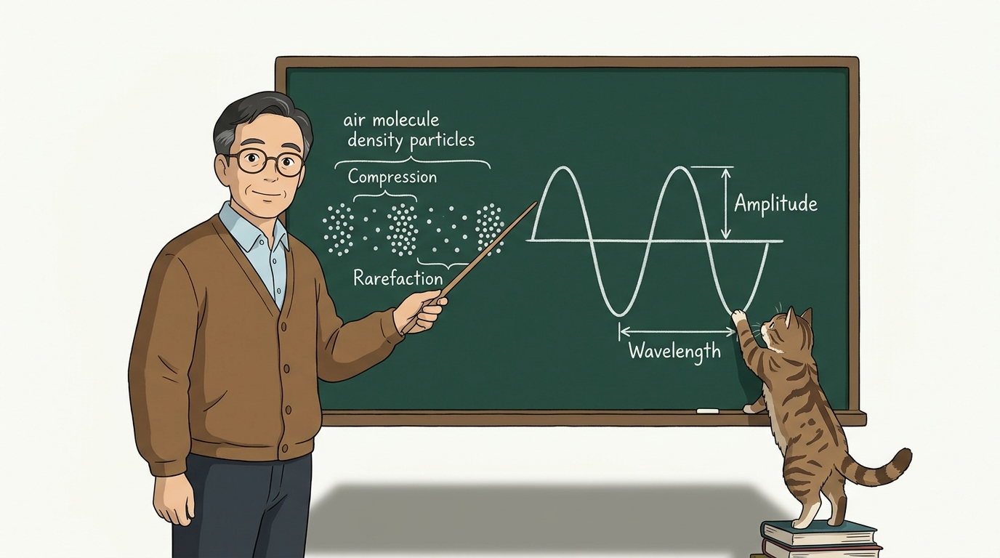
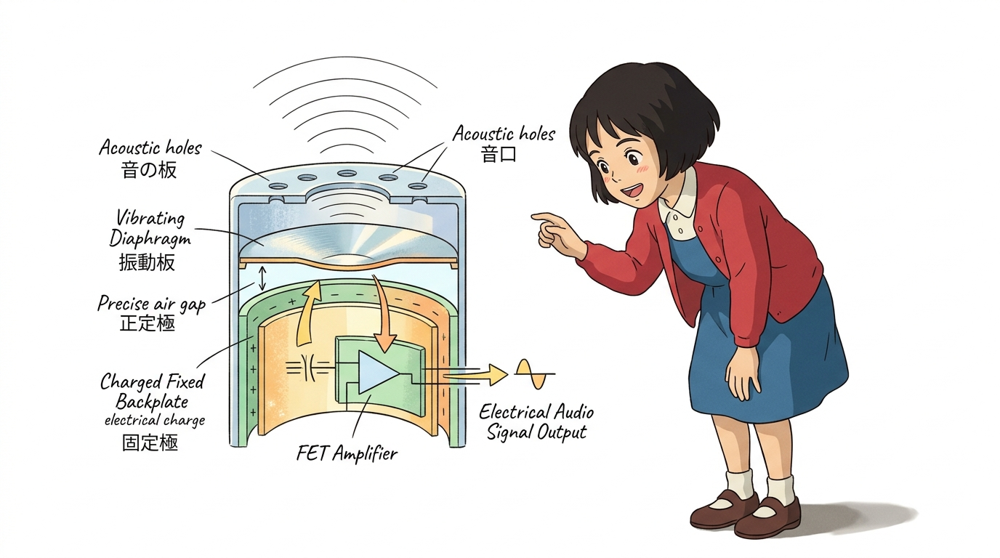
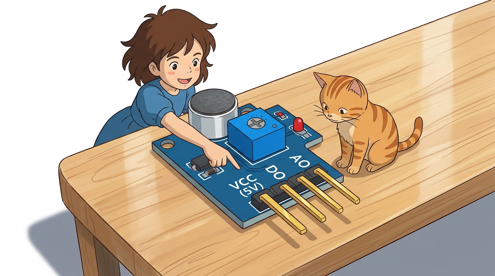
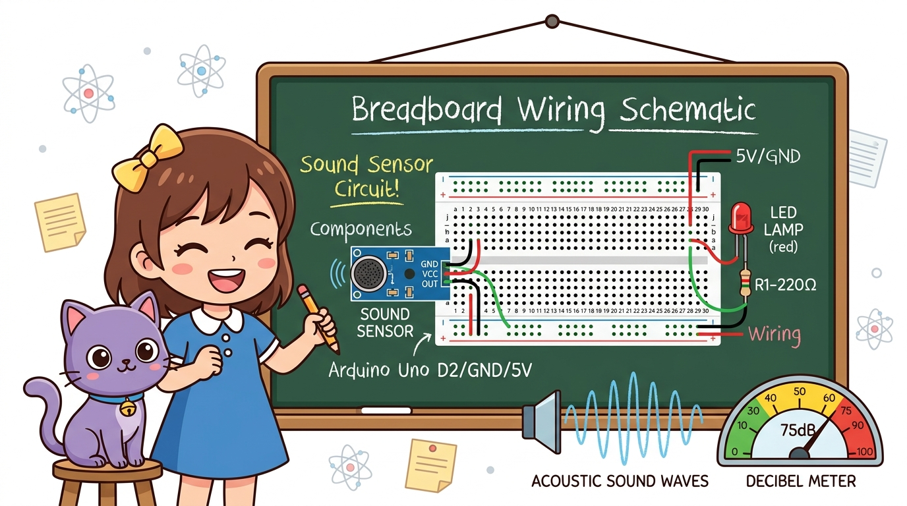
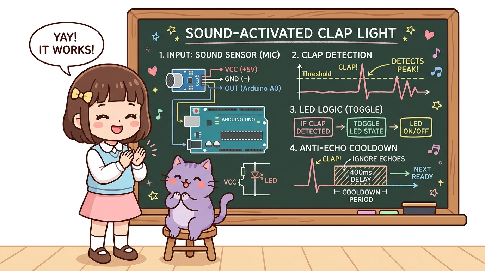
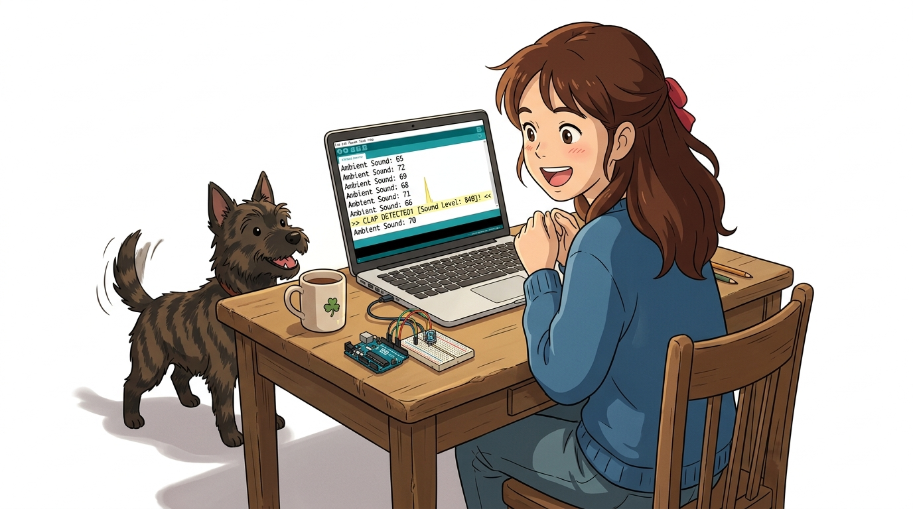
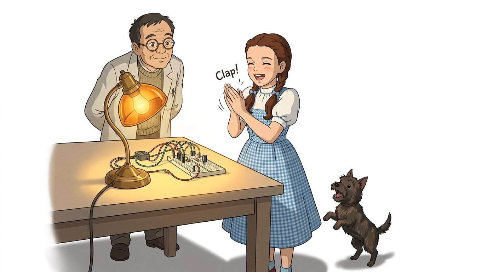
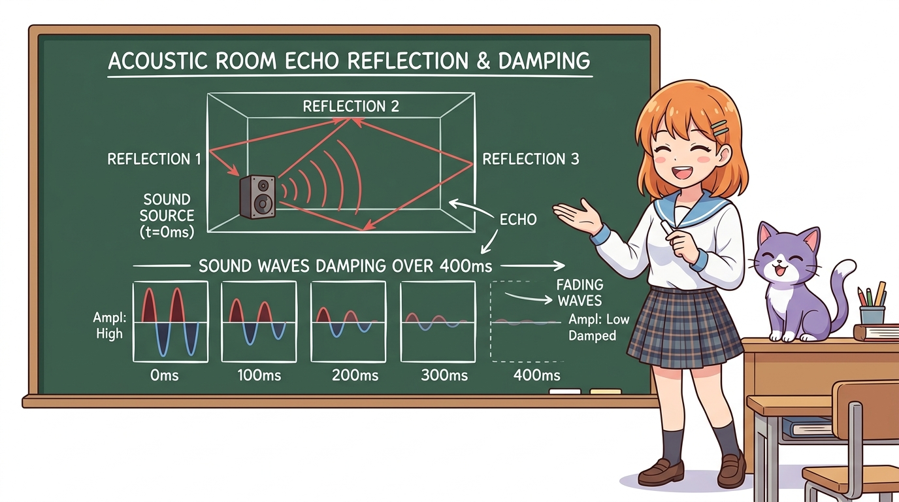

# 117_사운드센서_박수스위치 👏💡


* 👧 **도로시**: "지니야! 침대에 누워서 일어나기 귀찮을 때 '짝! 짝!' 박수를 치면 방 안의 전등이 탁 켜지고, 다시 치면 스르륵 꺼지는 마법 같은 박수 스위치는 어떻게 만들어?"
* 🐱 **지니**: "공기를 타고 전달되는 소리의 떨림(음파)을 전압 신호로 바꿔주는 **일렉트릿 콘덴서 마이크(사운드 센서)** 를 사용하면 된단다! 오늘 아두이노에게 소리를 듣는 귀를 선물해 주자!"
* 🐶 **토토**: "바우! (토토가 '멍멍!' 짖어도 불이 켜지게 해보자 멍!)"

### 도로시와 마법 멘토 지니의 마이크로폰 음성 감지와 박수 스위치
* 📖 **상세 강의 교재**: [index.md](./index.md)


> 여러분 안녕하세요! 이번 시간에는 '117. 사운드센서 박수스위치 👏💡'을 주제로 함께 흥미진진한 탐험을 떠나보겠습니다. 오늘 강의에서는 특히 👧 도로시: "지니야! 침대에 누워서 일어나기 귀찮을 때 '짝! 짝!' 박수를 치면 방 안의 전등이 탁 켜지고, 다시 치면 스르륵 꺼지는 마법 같은 박수 스위치는 어떻게 만들어?", 🐱 지니: "공기를 타고 전달되는 소리의 떨림(음파)을 전압 신호로 바꿔주는 일렉트릿 콘덴서 마이크(사운드 센서) 를 사용하면 된단다! 오늘 아두이노에게 소리를 듣는 귀를 선물해 주자!"를 중심으로 핵심 원리와 응용 방법을 차근차근 배워보겠습니다. 마법 멘토 지니와 호기심 많은 탐험가 도로시, 그리고 귀여운 토토와 함께 신나는 아두이노 모험을 힘차게 시작해 봅시다. 준비되셨나요?

---

## 1. 사운드 센서 모듈의 외형과 구성 🔍


* **초소형 마이크로폰 탑재**: 전면부에 직경 6mm/9mm의 고감도 일렉트릿 마이크(ECM)가 장착되어 있어 20Hz~20kHz 가청 주파수 대역의 음향을 수음합니다.
* **아두이노의 인공 청각**: 아두이노는 귀가 없지만, 사운드 센서를 연결하면 손뼉 소리, 목소리, 노크 소리, 호루라기 소리를 명확히 판별할 수 있습니다.

사운드 센서는 주변 환경에서 발생하는 소리의 크기(음압, Sound Pressure)를 실시간 전기 신호로 변환하는 오디오 감지 모듈입니다.

> 이번 슬라이드에서는 '1. 사운드 센서 모듈의 외형과 구성 🔍'에 대해 자세히 살펴보겠습니다. 화면의 다이어그램과 사진을 함께 참고해 주시기 바랍니다. 첫 번째 핵심은 초소형 마이크로폰 탑재: 전면부에 직경 6mm/9mm의 고감도 일렉트릿 마이크(ECM)가 장착되어 있어 20Hz~20kHz 가청 주파수 대역의 음향을 수음합니다.이며, 두 번째로는 아두이노의 인공 청각: 아두이노는 귀가 없지만, 사운드 센서를 연결하면 손뼉 소리, 목소리, 노크 소리, 호루라기 소리를 명확히 판별할 수 있습니다.입니다. 이 원리는 아두이노 시스템 전체를 관통하는 핵심 논리이므로 머릿속에 꼭 정리해 두시기 바랍니다.

---

## 2. 사운드(소리) 센서의 개요와 실생활 활용 🎙️


* **박수 스위치 (Clap Switch)**: 거동이 불편한 환자나 어린이를 위해 손뼉 소리 하나로 전등과 선풍기를 켜고 끄는 무선 조작 스위치.
* **소음 경고 신호등**: 도서관, 독서실, 초등학교 교실에서 소음이 기준치를 초과하면 노란색/빨간색 불이 켜지는 시각적 소음 피드백 장치.
* **무인 방범 음향 감지기**: 야간에 침입자의 발소리나 유리창이 깨지는 고주파 파열음을 즉각 포착하여 관제실로 전송하는 보안 시스템.
* **비트 반응형 음악 조명**: 음악의 리듬과 비트에 맞추어 RGB LED 스트립이 화려하게 번쩍이는 파티 조명.

소리 감지 기술은 음성 인터페이스, 보안 장비, 스마트 홈 자동화 시스템 등 현대 생활 곳곳에 깊숙이 적용되어 있습니다.

> 이번 슬라이드에서는 '2. 사운드(소리) 센서의 개요와 실생활 활용 🎙️'에 대해 자세히 살펴보겠습니다. 화면의 다이어그램과 사진을 함께 참고해 주시기 바랍니다. 첫 번째 핵심은 박수 스위치 (Clap Switch): 거동이 불편한 환자나 어린이를 위해 손뼉 소리 하나로 전등과 선풍기를 켜고 끄는 무선 조작 스위치.이며, 두 번째로는 소음 경고 신호등: 도서관, 독서실, 초등학교 교실에서 소음이 기준치를 초과하면 노란색/빨간색 불이 켜지는 시각적 소음 피드백 장치.입니다. 여기에 덧붙여 무인 방범 음향 감지기: 야간에 침입자의 발소리나 유리창이 깨지는 고주파 파열음을 즉각 포착하여 관제실로 전송하는 보안 시스템. 내용까지 함께 이해해 두시면 완벽합니다. 이 원리는 아두이노 시스템 전체를 관통하는 핵심 논리이므로 머릿속에 꼭 정리해 두시기 바랍니다.

---

## 3. 음파(Sound Wave)의 물리적 전파 원리 🌊



* **밀(Compression, 압축)**:
* 손뼉을 마주칠 때 공기 분자가 강하게 압축되어 순간적으로 기압이 높아집니다.
* **소(Rarefaction, 팽창)**:
* 압축된 공기가 지나간 직후 공기 분자가 희박해지며 기압이 기준치보다 낮아집니다.
* **음압의 파동 진폭**:
* 큰 소리(박수, 고함)일수록 공기 분자의 압축-팽창 압력 차이(진폭, Amplitude)가 거대해지며 마이크 센서에 큰 전압 진동을 유발합니다.

소리는 진동하는 물체가 주변 매질(공기)을 밀고 당기면서 전파되는 **종파(Longitudinal Wave, 소한 부분과 밀한 부분의 파동)**입니다.

> 이번 슬라이드에서는 '3. 음파(Sound Wave)의 물리적 전파 원리 🌊'에 대해 자세히 살펴보겠습니다. 화면의 다이어그램과 사진을 함께 참고해 주시기 바랍니다. 첫 번째 핵심은 밀(Compression, 압축)이며, 두 번째로는 손뼉을 마주칠 때 공기 분자가 강하게 압축되어 순간적으로 기압이 높아집니다.입니다. 여기에 덧붙여 소(Rarefaction, 팽창) 내용까지 함께 이해해 두시면 완벽합니다. 이 원리는 아두이노 시스템 전체를 관통하는 핵심 논리이므로 머릿속에 꼭 정리해 두시기 바랍니다.

---

## 4. 일렉트릿 콘덴서 마이크(ECM)의 작동 원리 🔬



1. **얇은 전도성 진동판 (Diaphragm)**:
* 마이크 앞면에는 음파의 미세한 떨림에도 즉각 반응하는 극박 금속박(또는 금 증착 마일러 필름) 진동판이 설치되어 있습니다.
2. **고정 전극판 (Backplate)**:
* 진동판 뒤쪽에 닿을 듯 말 듯 일정한 간격을 두고 고정 금속판이 평행하게 놓여 있어 하나의 평행판 **커패시터(콘덴서)**를 형성합니다.
3. **정전용량 변화에 따른 전압 유도**:
* 소리 음파가 진동판을 때리면 두 판 사이의 거리($d$)가 수 마이크로미터 단위로 요동칩니다:
* 거리가 좁아졌다 멀어지면서 정전용량($C$)이 격렬하게 변하고, 충전되어 있던 전하에 의해 **마이크로볼트($\mu\text{V}$) 단위의 미세 교류 음향 전압**이 발생합니다!
4. **내장 FET 및 연산증폭기(Op-Amp, LM393)**:
* 마이크 내부의 초소형 FET 트랜지스터와 모듈의 LM393 증폭기가 이 미세 전압을 수백 배 증폭하여 아두이노가 읽을 수 있는 0~5V 전압으로 가공합니다.

센서 앞부분의 은색 원통형 부품(ECM) 내부에서 공기 진동이 전기로 바뀌는 과학적 메커니즘입니다.
$$C = \epsilon \frac{A}{d}$$

> 이번 슬라이드에서는 '4. 일렉트릿 콘덴서 마이크(ECM)의 작동 원리 🔬'에 대해 자세히 살펴보겠습니다. 화면의 다이어그램과 사진을 함께 참고해 주시기 바랍니다. 첫 번째 핵심은 얇은 전도성 진동판 (Diaphragm)이며, 두 번째로는 마이크 앞면에는 음파의 미세한 떨림에도 즉각 반응하는 극박 금속박(또는 금 증착 마일러 필름) 진동판이 설치되어 있습니다.입니다. 여기에 덧붙여 고정 전극판 (Backplate) 내용까지 함께 이해해 두시면 완벽합니다. 이 원리는 아두이노 시스템 전체를 관통하는 핵심 논리이므로 머릿속에 꼭 정리해 두시기 바랍니다.

---

## 5. 센서 모듈의 핀 구성과 감도 조절 가변저항 🎛️



* **파란색 감도 조절 가변저항 (Potentiometer)**:
* **시계 방향 회전 (둔감 모드)**: 작은 잡음을 무시하고 아주 큰 박수 소리나 외침에만 반응하도록 설정합니다.
* **반시계 방향 회전 (예민 모드)**: 작은 속삭임이나 펜 굴러가는 소리에도 민감하게 반응하도록 설정합니다.

| 핀 기호 | 주요 역할 | 아두이노 연결 | 기능 상세 설명 |
| :---: | :---: | :---: | :--- |
| **VCC** | 전원 공급 (+) | **5V 핀** | 모듈 내부 증폭기 및 마이크 바이어스 구동 전원 (DC 3.3V ~ 5V) |
| **GND** | 전원 접지 (-) | **GND 핀** | 0V 기준 접지 |
| **OUT (AO)** | 아날로그 음압 출력 | **A0번 핀** | 실시간 음량 크기에 비례하는 0~1023 연속 전압 파형 출력 |
| **DO** | 디지털 스위칭 출력 | **디지털 7번 핀** | 기준 음량 초과 시 LOW(0V) 또는 HIGH(5V) 스위치 신호 |

사운드 센서 모듈의 핀 역할과 최적의 감도를 맞추는 튜닝 요령입니다.

> 이번에 살펴볼 내용은 '5. 센서 모듈의 핀 구성과 감도 조절 가변저항 🎛️'입니다. 슬라이드에 정리된 표를 통해 각 항목의 특징과 수치, 차이점을 한눈에 비교해 보실 수 있습니다. 첫째로 파란색 감도 조절 가변저항 (Potentiometer)에 유의해야 하며, 둘째로 시계 방향 회전 (둔감 모드): 작은 잡음을 무시하고 아주 큰 박수 소리나 외침에만 반응하도록 설정합니다.라는 점이 핵심입니다. 이 기본 개념을 확실히 잡아두셔야 실제 부품을 브레드보드에 꽂고 코딩할 때 실수 없이 완성할 수 있습니다.

---

## 6. 아두이노와 사운드 센서 브레드보드 회로 배선도 🔌



1. **사운드 센서 전원선 배선**:
* 센서 **VCC 핀** ➔ 아두이노 **5V 핀** 연결
* 센서 **GND 핀** ➔ 아두이노 **GND 핀** 연결
2. **사운드 신호선 배선**:
* 센서 **OUT(AO) 핀** ➔ 아두이노 **A0번 아날로그 핀** 연결
3. **제어용 LED 램프 배선**:
* 아두이노 **디지털 9번 핀** ➔ $220\Omega$ 저항 ➔ LED 긴 다리(애노드, +)
* LED 짧은 다리(캐소드, -) ➔ 아두이노 **GND 핀** 연결

아두이노 우노 보드에 사운드 센서와 박수로 켜고 끌 제어용 LED를 브레드보드로 결선합니다.
### 📌 결선 순서 가이드

> 이번에 살펴볼 내용은 '6. 아두이노와 사운드 센서 브레드보드 회로 배선도 🔌'입니다. 화면의 회로도와 부품 사진을 보면서 각 핀과 배선이 어떻게 구성되어 있는지 눈으로 직접 따라와 주시기 바랍니다. 첫째로 사운드 센서 전원선 배선에 유의해야 하며, 둘째로 센서 VCC 핀 ➔ 아두이노 5V 핀 연결라는 점이 핵심입니다. 이 기본 개념을 확실히 잡아두셔야 실제 부품을 브레드보드에 꽂고 코딩할 때 실수 없이 완성할 수 있습니다.

---

## 7. 칠판 교실: 사운드 감지 파형과 클랩 토글 로직 🎨



* **음파 피크 감지**: 평상시 조용한 기준 전압 위에 손뼉을 치는 순간 전압이 임계값(Threshold)을 훌쩍 넘는 스파이크 피크를 그립니다.
* **상태 토글(Toggle)**: 피크가 감지되면 전등 변수 `lampState = !lampState;`로 불빛 상태를 반전시킵니다.
* **400ms 에코 쿨다운**: 박수 소리가 방 안 벽면에 부딪히며 생기는 잔향(Echo) 때문에 불이 꺼졌다 다시 켜지는 오작동을 막기 위해 0.4초간 입력을 쉬어갑니다!

지니 선생님이 칠판에 정리해 준 박수 감지 알고리즘과 잔향 방지 쿨다운의 비밀입니다!

> 이번 슬라이드에서는 '7. 칠판 교실: 사운드 감지 파형과 클랩 토글 로직 🎨'에 대해 자세히 살펴보겠습니다. 화면의 다이어그램과 사진을 함께 참고해 주시기 바랍니다. 첫 번째 핵심은 음파 피크 감지: 평상시 조용한 기준 전압 위에 손뼉을 치는 순간 전압이 임계값(Threshold)을 훌쩍 넘는 스파이크 피크를 그립니다.이며, 두 번째로는 상태 토글(Toggle): 피크가 감지되면 전등 변수 lampState = !lampState;로 불빛 상태를 반전시킵니다.입니다. 여기에 덧붙여 ms 에코 쿨다운: 박수 소리가 방 안 벽면에 부딪히며 생기는 잔향(Echo) 때문에 불이 꺼졌다 다시 켜지는 오작동을 막기 위해 0.4초간 입력을 쉬어갑니다! 내용까지 함께 이해해 두시면 완벽합니다. 이 원리는 아두이노 시스템 전체를 관통하는 핵심 논리이므로 머릿속에 꼭 정리해 두시기 바랍니다.

---

## 8. 실습 ①: 실시간 소리 크기 모니터링 전체 스케치 💻



현재 내 방 안의 기본 소음 크기를 측정하고 박수를 칠 때 숫자가 얼마나 치솟는지 확인하는 스케치입니다.

```cpp
// ==========================================
// 07.5-3 사운드 센서 실시간 소음 크기 측정
// ==========================================

const int soundPin = A0; // 사운드 센서 아날로그 출력 핀

void setup() {
  Serial.begin(115200);   // 초고속 시리얼 통신 개시 (115200 bps)
  pinMode(soundPin, INPUT);

  Serial.println("=========================================");
  Serial.println("   Sound Microphone Sensor Active!       ");
  Serial.println("   조용히 있을 때와 박수 칠 때를 비교해보세요 ");
  Serial.println("=========================================");
}

void loop() {
  // 1. 소리의 실시간 전압 크기(0~1023)를 정밀 측정
  int soundLevel = analogRead(soundPin);

  // 2. 시리얼 모니터에 현재 소음 값 출력
  Serial.print("현재 소리 크기: ");
  Serial.println(soundLevel);

  // 3. 소리 파동은 변화가 매우 빠르므로 50ms마다 측정
  delay(50);
}
```

> 이번 슬라이드에서는 '8. 실습 ①: 실시간 소리 크기 모니터링 전체 스케치 💻'에 대한 실제 동작 코드를 분석해 보겠습니다. 화면의 코드를 살펴보시면, 컴퓨터가 아두이노 하드웨어에 단계별로 명령을 내리는 흐름을 명확하게 확인할 수 있습니다. 각 함수의 역할과 괄호 안의 매개변수가 하드웨어 핀과 어떤 관계를 맺고 동작하는지 주의 깊게 살펴보시기 바랍니다.

---

## 9. 코드 상세 해설 ①: 기준 소음과 박수 피크(Peak) 감지 📊


* **평상시 조용한 상태의 기준 전압 (DC 바이어스)**:
* 마이크 내부 프리앰프의 바이어스 회로로 인해 아무 소리도 내지 않아도 보통 **약 500 ~ 520** 안팎의 중심 전압이 측정됩니다.
* **"짝!" 박수를 칠 때의 파형 스파이크**:
* 손뼉을 치는 찰나의 수십 밀리초 동안 강한 음파가 진동판을 강타하며 전압이 **600, 750 이상으로 급격히 치솟습니다.**
* **임계값 설정의 황금률**:
* 조용한 상태의 값(약 510)보다 약 100 이상 높은 **`soundThreshold = 620`** 정도로 조건을 설정하면, 일상적인 대화 소리와 명확한 박수 소리를 똑똑하게 분별할 수 있습니다!

소리 센서를 다룰 때 가장 중요한 **주변 소음 보정(Calibration)** 원리입니다.

> 이번 슬라이드에서는 '9. 코드 상세 해설 ①: 기준 소음과 박수 피크(Peak) 감지 📊'에 대해 자세히 살펴보겠습니다. 화면의 다이어그램과 사진을 함께 참고해 주시기 바랍니다. 첫 번째 핵심은 평상시 조용한 상태의 기준 전압 (DC 바이어스)이며, 두 번째로는 마이크 내부 프리앰프의 바이어스 회로로 인해 아무 소리도 내지 않아도 보통 약 500 ~ 520 안팎의 중심 전압이 측정됩니다.입니다. 여기에 덧붙여 "짝!" 박수를 칠 때의 파형 스파이크 내용까지 함께 이해해 두시면 완벽합니다. 이 원리는 아두이노 시스템 전체를 관통하는 핵심 논리이므로 머릿속에 꼭 정리해 두시기 바랍니다.

---

## 10. 실습 ②: 짝! 박수로 켜고 끄는 클랩 토글 스위치 전체 스케치 👏💡



박수를 한 번 치면 불이 켜지고, 다시 한 번 치면 불이 꺼지는 **스마트 클랩 무드등** 전체 코드입니다.

```cpp
// ==========================================
// 07.5-3 스마트 박수 스위치 토글 조명등
// ==========================================

const int soundPin = A0; // 사운드 센서 아날로그 핀
const int ledPin   = 9;  // 제어용 LED 램프 핀

const int soundThreshold = 620; // 박수 소리 판정 기준값 (환경에 맞춰 조절)
int lampState = LOW;            // 전등 켜짐/꺼짐 상태 (초기: 소등)

void setup() {
  Serial.begin(115200);
  pinMode(soundPin, INPUT);
  pinMode(ledPin, OUTPUT);
  digitalWrite(ledPin, lampState);
}

void loop() {
  int soundLevel = analogRead(soundPin);

  // 기준치(620) 이상의 큰 박수 소리가 감지되었을 때!
  if (soundLevel > soundThreshold) {
    // 1. 전등 상태를 정반대로 뒤집기 (토글)
    lampState = !lampState;
    digitalWrite(ledPin, lampState);

    Serial.print("👏 [CLAP DETECTED!] 박수 감지! -> 전등 상태: ");
    Serial.println(lampState == HIGH ? "💡 ON 켜짐!" : "🌑 OFF 꺼짐!");

    // 2. 박수 소리의 잔향(에코)으로 인한 중복 트리거 방지 쿨다운
    delay(400);
  }
}
```

> 이번 슬라이드에서는 '10. 실습 ②: 짝! 박수로 켜고 끄는 클랩 토글 스위치 전체 스케치 👏💡'에 대한 실제 동작 코드를 분석해 보겠습니다. 화면의 코드를 살펴보시면, 컴퓨터가 아두이노 하드웨어에 단계별로 명령을 내리는 흐름을 명확하게 확인할 수 있습니다. 각 함수의 역할과 괄호 안의 매개변수가 하드웨어 핀과 어떤 관계를 맺고 동작하는지 주의 깊게 살펴보시기 바랍니다.

---

## 11. 코드 상세 해설 ②: 잔향(Echo) 방지 400ms 쿨다운 알고리즘 🛡️



* **실내 음향 잔향(Reverberation & Echo)의 복병**:
* 사람이 손뼉을 "짝!" 하고 딱 한 번 쳐도, 그 음파는 방 안의 벽, 천장, 바닥에 반사되며 약 200~300ms 동안 공기 중에 맴돕니다.
* **쿨다운이 없을 때의 대참사**:
* 만약 `delay(400);` 쿨다운이 없다면, 아두이노는 잔향 파편들을 독립된 박수로 오해하여 0.3초 동안 불을 켜졌다 꺼졌다를 4~5번 반복하며 엉뚱한 상태로 멈추게 됩니다.
* **400ms 안정화 딜레이의 마법**:
* 박수가 감지된 직후 0.4초 동안 센서 입력을 일시 정지(블로킹)함으로써 소리의 메아리가 완전히 소멸할 때까지 기다려 완벽한 1회 토글 동작을 보장합니다!

> 이번 슬라이드에서는 '11. 코드 상세 해설 ②: 잔향(Echo) 방지 400ms 쿨다운 알고리즘 🛡️'에 대해 자세히 살펴보겠습니다. 화면의 다이어그램과 사진을 함께 참고해 주시기 바랍니다. 첫 번째 핵심은 실내 음향 잔향(Reverberation & Echo)의 복병이며, 두 번째로는 사람이 손뼉을 "짝!" 하고 딱 한 번 쳐도, 그 음파는 방 안의 벽, 천장, 바닥에 반사되며 약 200~300ms 동안 공기 중에 맴돕니다.입니다. 여기에 덧붙여 쿨다운이 없을 때의 대참사 내용까지 함께 이해해 두시면 완벽합니다. 이 원리는 아두이노 시스템 전체를 관통하는 핵심 논리이므로 머릿속에 꼭 정리해 두시기 바랍니다.

---

## 🌟 도로시와 지니의 핵심 요약 노트! 🏆


* **👧 도로시**: "공기의 진동이 마이크 속 얇은 판을 흔들어 전압 파형을 만들고, 그 파형이 기준선을 넘을 때마다 불을 껐다 켰다 하는 거였구나! 박수 칠 때마다 불이 켜지니까 진짜 스마트 홈 주인공이 된 기분이야!"
* **🐱 지니**: "맞아! 여기에 잔향 방지 딜레이를 넣어 오작동을 막는 것이 프로그래밍의 묘미란다. 조금 더 업그레이드하면 '짝! 짝!' 두 번 쳐야만 켜지는 더블 클랩(Double Clap) 안전 스위치도 만들 수 있어."
* **🐶 토토**: "바우! 다음 시간에는 활활 타오르는 불빛을 0.1초 만에 감지하는 **'07.5-4 불꽃 감지 센서'**를 정복하러 가자 멍!"

* [x] **일렉트릿 콘덴서 마이크(ECM) 원리**: 음파가 진동판을 흔들 때 발생하는 정전용량 변화를 전압 신호로 변환하는 메커니즘을 마스터했습니다.
* [x] **기준 전압과 피크 감지**: 평상시 중심 전압(약 512)과 박수 발생 시의 전압 스파이크(620 이상)를 이용한 임계치 필터링을 체득했습니다.
* [x] **클랩 토글(Toggle) 스위치**: 박수 한 번으로 조명을 켜고 다시 치면 끄는 상태 반전 프로그래밍을 완성했습니다.
* [x] **잔향(Echo) 방지 400ms 딜레이**: 실내 반사 음향 노이즈로 인한 중복 트리거 오작동을 차단하는 쿨다운 알고리즘을 배웠습니다.

### 📋 07.5-3 사운드 센서 정복 체크리스트

> 오늘 배운 '🌟 도로시와 지니의 핵심 요약 노트! 🏆'의 핵심 내용을 모두 정리해 보았습니다. 오늘 다룬 내용 중에서도 [x] 일렉트릿 콘덴서 마이크(ECM) 원리: 음파가 진동판을 흔들 때 발생하는 정전용량 변화를 전압 신호로 변환하는 메커니즘을 마스터했습니다. 부분은 앞으로의 아두이노 실습과 프로젝트에서 계속 사용되는 매우 중요한 기초 지식입니다. 지니 멘토가 강조했듯이 맞아! 여기에 잔향 방지 딜레이를 넣어 오작동을 막는 것이 프로그래밍의 묘미란다. 조금 더 업그레이드하면 라는 점을 꼭 마음에 새겨두시길 바랍니다. 오늘 배운 내용을 꼭 다시 한번 복습해 보시고, 다음 강의에서 더욱 신나고 유익한 모험으로 다시 만나겠습니다. 모두 수고 많으셨습니다!