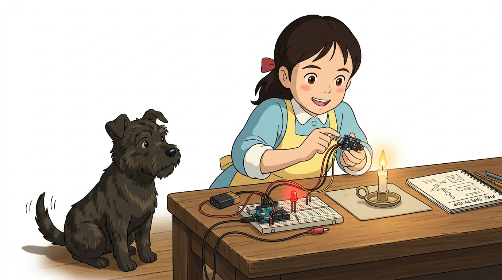
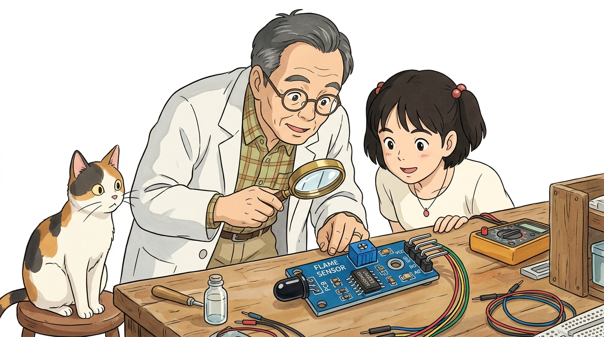
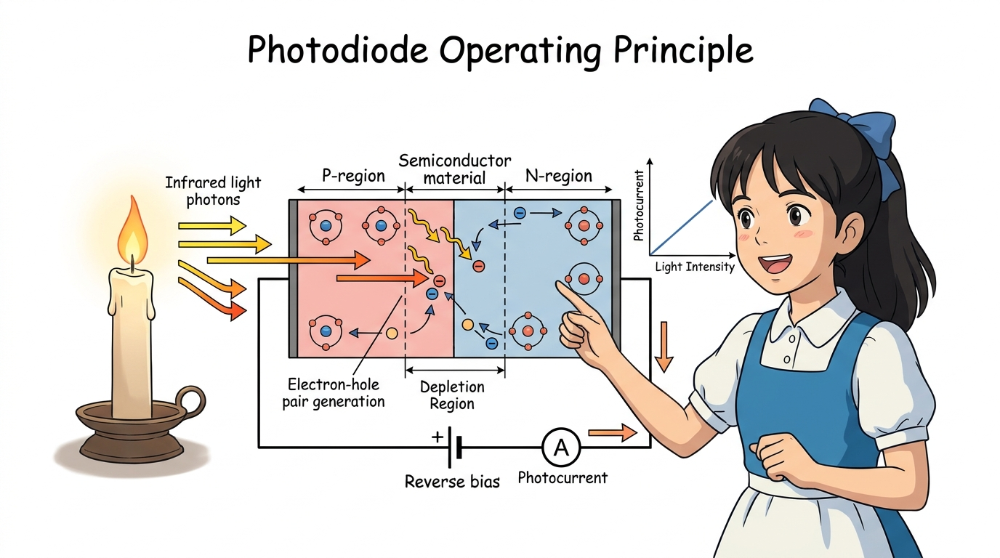
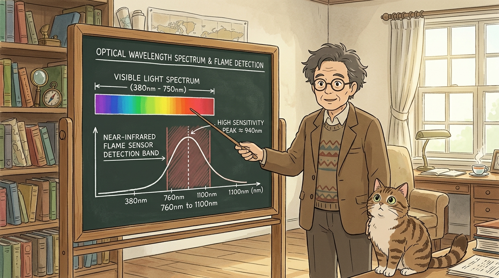
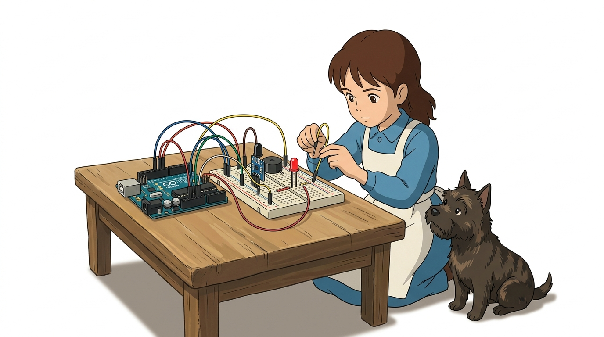
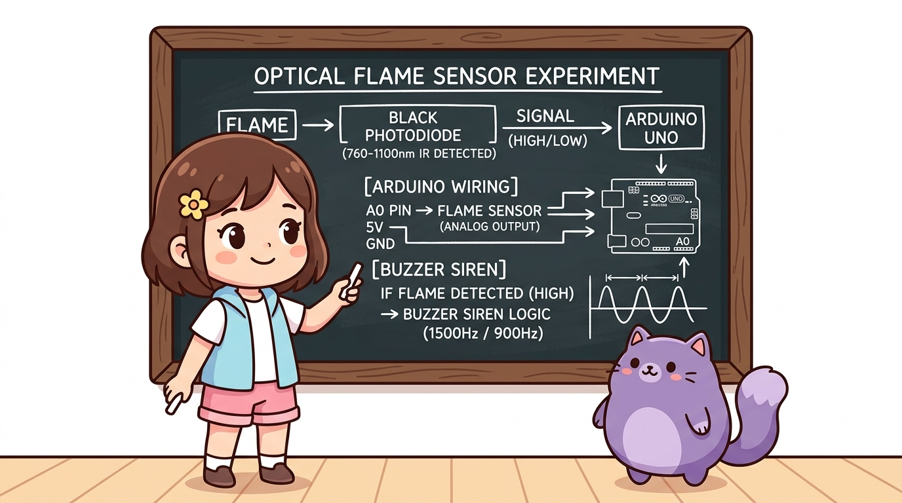
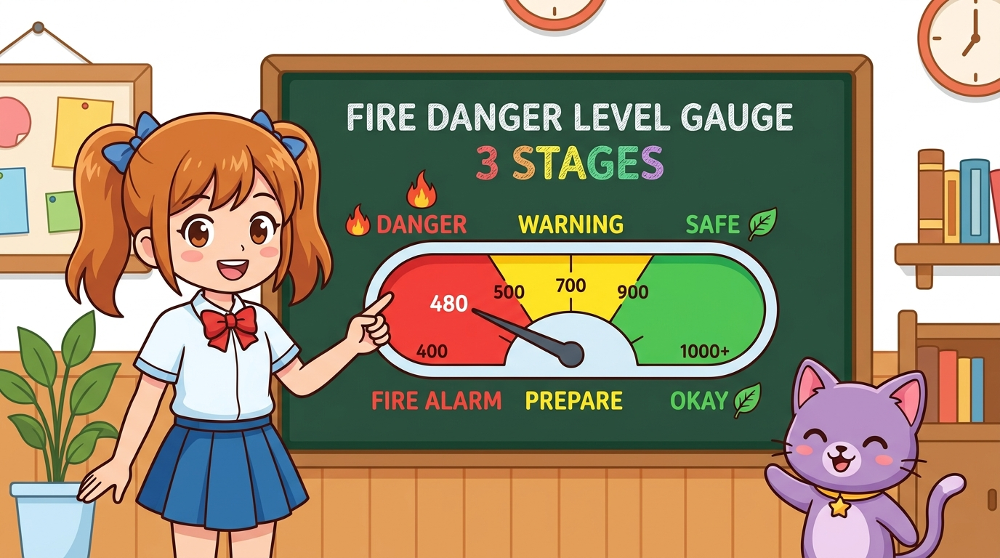
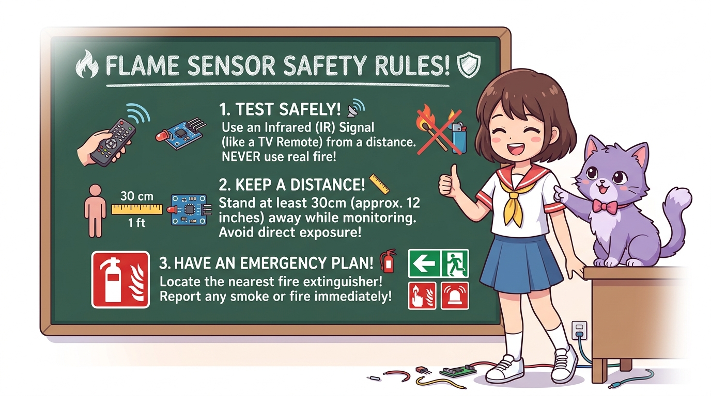

# 118_광학불꽃센서_화재경보기 🔥🚨



* 👧 **도로시**: "지니야! 작은 촛불이나 라이터 불이 켜지거나 주방에 작은 불씨가 생겼을 때, 불이 크게 번지기 전에 0.1초 만에 삐-익! 하고 알려주는 기계는 어떻게 만들어?"
* 🐱 **지니**: "불꽃이 활활 타오를 때 내뿜는 고유한 적외선 파장(760~1100nm)만 쏙쏙 골라 감지하는 **광학식 불꽃 감지 센서(Flame Sensor)** 가 있단다! 오늘 소방관처럼 든든한 스마트 화재 경보기를 만들어보자!"
* 🐶 **토토**: "바우! (불이야! 냄새보다 빠른 빛의 속도로 화재를 잡는다 멍!)"

### 도로시와 마법 멘토 지니의 스마트 소방 화재 경보기
* 📖 **상세 강의 교재**: [index.md](./index.md)


> 여러분 안녕하세요! 이번 시간에는 '118. 광학불꽃센서 화재경보기 🔥🚨'을 주제로 함께 흥미진진한 탐험을 떠나보겠습니다. 오늘 강의에서는 특히 👧 도로시: "지니야! 작은 촛불이나 라이터 불이 켜지거나 주방에 작은 불씨가 생겼을 때, 불이 크게 번지기 전에 0.1초 만에 삐-익! 하고 알려주는 기계는 어떻게 만들어?", 🐱 지니: "불꽃이 활활 타오를 때 내뿜는 고유한 적외선 파장(760~1100nm)만 쏙쏙 골라 감지하는 광학식 불꽃 감지 센서(Flame Sensor) 가 있단다! 오늘 소방관처럼 든든한 스마트 화재 경보기를 만들어보자!"를 중심으로 핵심 원리와 응용 방법을 차근차근 배워보겠습니다. 마법 멘토 지니와 호기심 많은 탐험가 도로시, 그리고 귀여운 토토와 함께 신나는 아두이노 모험을 힘차게 시작해 봅시다. 준비되셨나요?

---

## 1. 불꽃(화염) 감지 센서의 개요와 실생활 활용 🔍



* **초고속 화재 조기 경보**:
* 연기 감지기는 연기가 천장까지 올라가야 울리지만, 불꽃 감지기는 **불빛이 켜지는 즉시(빛의 속도로)** 감지하여 대피 골든타임을 확보합니다.
* **주요 응용 분야**:
* 보일러 및 주방 가스레인지 불꽃 꺼짐/화재 방지기
* 주유소, 화학 공장 등 가연성 물질 보관 창고
* 자율주행 소방 방재 로봇 및 자동 소화기
* 문화재 및 목조 건축물 무인 산불 감시 타워

불꽃 감지 센서는 가스레인지 불꽃, 양초, 라이터, 산불 등 실제로 무언가 타고 있을 때 발생하는 특수한 빛을 포착하는 안전 센서입니다.

> 이번 슬라이드에서는 '1. 불꽃(화염) 감지 센서의 개요와 실생활 활용 🔍'에 대해 자세히 살펴보겠습니다. 화면의 다이어그램과 사진을 함께 참고해 주시기 바랍니다. 첫 번째 핵심은 초고속 화재 조기 경보이며, 두 번째로는 연기 감지기는 연기가 천장까지 올라가야 울리지만, 불꽃 감지기는 불빛이 켜지는 즉시(빛의 속도로) 감지하여 대피 골든타임을 확보합니다.입니다. 여기에 덧붙여 주요 응용 분야 내용까지 함께 이해해 두시면 완벽합니다. 이 원리는 아두이노 시스템 전체를 관통하는 핵심 논리이므로 머릿속에 꼭 정리해 두시기 바랍니다.

---

## 2. 불꽃 감지 센서의 광학 원리와 포토다이오드 🔬



* **검은색 에폭시 수광 다이오드 (Photodiode)**:
* 센서 끝에 달린 검은색 알맹이는 일반 가시광선(빨주노초파남보)을 필터링하여 반사하고, 오직 **근적외선(Near Infrared) 대역의 빛만 통과**시킵니다.
* **광전 효과에 의한 전압 변화**:
* **불꽃이 없을 때**: 전기가 통하지 않아 센서 저항이 매우 큽니다. (출력값 1023 근처)
* **불꽃이 다가올 때**: 적외선 광자가 다이오드를 때리면서 저항이 급격히 낮아져 **아날로그 출력 전압이 0V 쪽으로 뚝 떨어집니다!**

사람 눈에 보이는 형광등 불빛과 진짜 불꽃은 빛의 성질(파장 스펙트럼)이 완전히 다릅니다.

> 이번 슬라이드에서는 '2. 불꽃 감지 센서의 광학 원리와 포토다이오드 🔬'에 대해 자세히 살펴보겠습니다. 화면의 다이어그램과 사진을 함께 참고해 주시기 바랍니다. 첫 번째 핵심은 검은색 에폭시 수광 다이오드 (Photodiode)이며, 두 번째로는 센서 끝에 달린 검은색 알맹이는 일반 가시광선(빨주노초파남보)을 필터링하여 반사하고, 오직 근적외선(Near Infrared) 대역의 빛만 통과시킵니다.입니다. 여기에 덧붙여 광전 효과에 의한 전압 변화 내용까지 함께 이해해 두시면 완벽합니다. 이 원리는 아두이노 시스템 전체를 관통하는 핵심 논리이므로 머릿속에 꼭 정리해 두시기 바랍니다.

---

## 3. 연소 반응과 760nm ~ 1100nm 적외선 스펙트럼 🌈🔥



* **화염의 고유 방출 파장**:
* 유기물이 탈 때 발생하는 CO2 공명 방출선과 고열 복사선은 **760nm에서 1100nm 사이의 파장 대역**에 에너지가 집중됩니다.
* **광학적 필터링의 마법**:
* 일반 실내 형광등이나 스마트폰 화면은 가시광선(400~700nm) 위주이므로 센서가 반응하지 않아 실내 조명 오작동을 방지합니다.

물질이 산소와 반응하여 격렬하게 연소할 때 탄소 원자와 가스가 고유한 파장의 빛을 방출합니다.

> 이번 슬라이드에서는 '3. 연소 반응과 760nm ~ 1100nm 적외선 스펙트럼 🌈🔥'에 대해 자세히 살펴보겠습니다. 화면의 다이어그램과 사진을 함께 참고해 주시기 바랍니다. 첫 번째 핵심은 화염의 고유 방출 파장이며, 두 번째로는 유기물이 탈 때 발생하는 CO2 공명 방출선과 고열 복사선은 760nm에서 1100nm 사이의 파장 대역에 에너지가 집중됩니다.입니다. 여기에 덧붙여 광학적 필터링의 마법 내용까지 함께 이해해 두시면 완벽합니다. 이 원리는 아두이노 시스템 전체를 관통하는 핵심 논리이므로 머릿속에 꼭 정리해 두시기 바랍니다.

---

## 4. 아두이노와 불꽃 감지 회로 브레드보드 배선도 🔌



1. **불꽃 센서 배선**:
* 센서 **VCC 핀** ➔ 아두이노 **5V 핀** 연결
* 센서 **GND 핀** ➔ 아두이노 **GND 핀** 연결
* 센서 **AO 핀** ➔ 아두이노 **A0번 아날로그 핀** 연결
2. **비상 부저 및 LED 배선**:
* 피에조 부저 (+) 긴 다리 ➔ 아두이노 **디지털 8번 핀**
* 피에조 부저 (-) 짧은 다리 ➔ 아두이노 **GND 핀**
* 보드 내장 13번 LED를 비상 경보등으로 연동

아두이노 우노 보드에 불꽃 센서와 비상 사이렌용 피에조 부저를 안전하게 연결합니다.
### 📌 결선 순서 가이드

> 이번에 살펴볼 내용은 '4. 아두이노와 불꽃 감지 회로 브레드보드 배선도 🔌'입니다. 화면의 회로도와 부품 사진을 보면서 각 핀과 배선이 어떻게 구성되어 있는지 눈으로 직접 따라와 주시기 바랍니다. 첫째로 불꽃 센서 배선에 유의해야 하며, 둘째로 센서 VCC 핀 ➔ 아두이노 5V 핀 연결라는 점이 핵심입니다. 이 기본 개념을 확실히 잡아두셔야 실제 부품을 브레드보드에 꽂고 코딩할 때 실수 없이 완성할 수 있습니다.

---

## 5. 칠판 교실: 광학식 불꽃 감지와 사이렌 제어 로직 🎨



* **광학 입력**: 불꽃의 760~1100nm 적외선이 검은색 포토다이오드에 닿습니다.
* **아두이노 A0 전압 판독**: 불빛이 강할수록 아날로그 측정 숫자가 1023에서 0 쪽으로 급락합니다.
* **사이렌 사운드 제어**: 측정값이 화재 기준치(700 미만)로 떨어지면 8번 핀 피에조 부저로 $1500\text{Hz}$와 $900\text{Hz}$의 경고음을 교대로 울립니다!

지니 선생님이 칠판에 정리해 준 불꽃 감지 센서의 광학 신호 처리와 사이렌 경보 알고리즘입니다!

> 이번 슬라이드에서는 '5. 칠판 교실: 광학식 불꽃 감지와 사이렌 제어 로직 🎨'에 대해 자세히 살펴보겠습니다. 화면의 다이어그램과 사진을 함께 참고해 주시기 바랍니다. 첫 번째 핵심은 광학 입력: 불꽃의 760~1100nm 적외선이 검은색 포토다이오드에 닿습니다.이며, 두 번째로는 아두이노 A0 전압 판독: 불빛이 강할수록 아날로그 측정 숫자가 1023에서 0 쪽으로 급락합니다.입니다. 여기에 덧붙여 사이렌 사운드 제어: 측정값이 화재 기준치(700 미만)로 떨어지면 8번 핀 피에조 부저로 $1500\text{Hz}$와 $900\text{Hz}$의 경고음을 교대로 울립니다! 내용까지 함께 이해해 두시면 완벽합니다. 이 원리는 아두이노 시스템 전체를 관통하는 핵심 논리이므로 머릿속에 꼭 정리해 두시기 바랍니다.

---

## 6. 실습 ①: 스마트 화재 비상 사이렌 전체 아두이노 스케치 💻


불꽃이 감지되면 즉시 시리얼 모니터에 경보를 띄우고 부저로 요란한 사이렌을 울리는 코드입니다.

```cpp
// ==========================================
// 07.5-4 스마트 화재 감지 및 비상 사이렌 스케치
// ==========================================

const int flamePin  = A0; // 불꽃 센서 AO 핀 연결
const int buzzerPin = 8;  // 비상 경보 피에조 부저 핀
const int ledPin    = 13; // 비상 경보 LED 핀

// 불꽃 감지 판정 기준값 (환경 조명에 맞춰 600~800 사이로 조절)
const int fireThreshold = 700;

void setup() {
  Serial.begin(115200);   // 초고속 시리얼 통신 개시 (115200 bps)
  pinMode(flamePin, INPUT);
  pinMode(buzzerPin, OUTPUT);
  pinMode(ledPin, OUTPUT);

  Serial.println("=========================================");
  Serial.println("   Flame Fire Detector Initialized!      ");
  Serial.println("   화재 감시 시스템이 정상 작동 중입니다    ");
  Serial.println("=========================================");
}

void loop() {
  // 1. 센서의 아날로그 전압 값(0~1023)을 읽어옵니다.
  int flameValue = analogRead(flamePin);

  Serial.print("불꽃 감지 수치: ");
  Serial.print(flameValue);

  // 2. 불꽃이 감지되면 수치가 기준치(700) 아래로 뚝 떨어집니다!
  if (flameValue < fireThreshold) {
    Serial.println(" -> 🔥🚨 [FIRE WARNING!] 화재 발생! 즉시 대피하세요!");

    // 비상 사이렌 소리 연주 (높은음 1500Hz, 낮은음 900Hz 교대)
    digitalWrite(ledPin, HIGH);
    tone(buzzerPin, 1500); // 삐-
    delay(150);
    digitalWrite(ledPin, LOW);
    tone(buzzerPin, 900);  // 뽀-
    delay(150);
  } else {
    // 정상 상태 (불꽃 없음)
    Serial.println(" -> 🟢 [SAFE] 정상 (화재 위험 없음)");
    noTone(buzzerPin);
    digitalWrite(ledPin, LOW);
    delay(300);
  }
}
```

> 이번 슬라이드에서는 '6. 실습 ①: 스마트 화재 비상 사이렌 전체 아두이노 스케치 💻'에 대한 실제 동작 코드를 분석해 보겠습니다. 화면의 코드를 살펴보시면, 컴퓨터가 아두이노 하드웨어에 단계별로 명령을 내리는 흐름을 명확하게 확인할 수 있습니다. 각 함수의 역할과 괄호 안의 매개변수가 하드웨어 핀과 어떤 관계를 맺고 동작하는지 주의 깊게 살펴보시기 바랍니다.

---

## 7. 코드 상세 해설: 3단계 화재 위험도 게이지와 다중 임계값 📊



* **1단계: 정상 안전 (Safe, 900 ~ 1023)**:
* 주변에 불꽃이 전혀 없는 평상시 상태입니다. 초록 LED를 켜고 대기합니다.
* **2단계: 주의 경고 (Warning, 500 ~ 890)**:
* 약 50cm ~ 1m 거리에서 작은 촛불 불씨나 반사광이 감지된 상태입니다. 노란 LED를 켜고 완만한 경고음을 냅니다.
* **3단계: 초비상 위험 (Danger, 500 미만)**:
* 센서 바로 앞(30cm 이내)에 커다란 화염이 직접 접근한 초비상 상태입니다! 빨간 LED가 격렬히 깜빡이며 1500Hz 화재 사이렌을 발령합니다!

불꽃 센서의 수치가 의미하는 물리적 거리와 위험도 다단계 판정 알고리즘입니다.

> 이번 슬라이드에서는 '7. 코드 상세 해설: 3단계 화재 위험도 게이지와 다중 임계값 📊'에 대해 자세히 살펴보겠습니다. 화면의 다이어그램과 사진을 함께 참고해 주시기 바랍니다. 첫 번째 핵심은 단계: 정상 안전 (Safe, 900 ~ 1023)이며, 두 번째로는 주변에 불꽃이 전혀 없는 평상시 상태입니다. 초록 LED를 켜고 대기합니다.입니다. 여기에 덧붙여 단계: 주의 경고 (Warning, 500 ~ 890) 내용까지 함께 이해해 두시면 완벽합니다. 이 원리는 아두이노 시스템 전체를 관통하는 핵심 논리이므로 머릿속에 꼭 정리해 두시기 바랍니다.

---

## 8. 안전한 불꽃 센서 실습 가이드와 TV 리모컨 테스트 🧯🛡️



1. **가정/교실 안전 수칙**:
* 라이터나 양초를 사용할 때는 반드시 **보호자나 선생님의 지도하에** 안전한 장소에서 진행하세요.
* 불꽃을 센서에 너무 가깝게 대면 검은색 플라스틱 센서 캡이 녹을 수 있으므로 **최소 30cm 이상 거리**를 두고 실험하세요.
2. **💡 지니의 안심 테스트 꿀팁: TV 리모컨 활용하기**:
* 진짜 불을 피우지 않고도, **적외선 리모컨(TV/에어컨 리모컨)**의 앞부분을 센서에 대고 채널 버튼을 누르면 리모컨 적외선 LED가 940nm 적외선을 뿜어내어 불꽃 센서가 즉시 반응합니다! 100% 안전한 무화염 테스트 방법입니다.

초등학생과 청소년도 교실이나 가정에서 100% 안전하게 실험할 수 있는 안전 수칙입니다.

> 이번 슬라이드에서는 '8. 안전한 불꽃 센서 실습 가이드와 TV 리모컨 테스트 🧯🛡️'에 대해 자세히 살펴보겠습니다. 화면의 다이어그램과 사진을 함께 참고해 주시기 바랍니다. 첫 번째 핵심은 가정/교실 안전 수칙이며, 두 번째로는 라이터나 양초를 사용할 때는 반드시 보호자나 선생님의 지도하에 안전한 장소에서 진행하세요.입니다. 여기에 덧붙여 불꽃을 센서에 너무 가깝게 대면 검은색 플라스틱 센서 캡이 녹을 수 있으므로 최소 30cm 이상 거리를 두고 실험하세요. 내용까지 함께 이해해 두시면 완벽합니다. 이 원리는 아두이노 시스템 전체를 관통하는 핵심 논리이므로 머릿속에 꼭 정리해 두시기 바랍니다.

---

## 🌟 도로시와 지니의 핵심 요약 노트! 🏆


* **👧 도로시**: "불꽃 감지 센서는 연기보다 훨씬 빠르게, 불이 탈 때 나오는 760~1100nm 적외선 빛을 포착해서 0.1초 만에 사이렌을 울려주는 거였구나!"
* **🐱 지니**: "맞아! 여기에 서보 모터와 작은 워터 펌프를 연결하면 불이 난 방향을 향해 물을 쏴서 불을 끄는 똑똑한 소방 로봇을 완성할 수 있단다."
* **🐶 토토**: "바우! 다음 시간에는 파란색 네모 모양의 **'07.6-1 온도습도 센서(DHT11)'**로 날씨 요정이 되어보자 멍!"

* [x] **광학식 화재 조기 경보**: 연기보다 빠른 760~1100nm 근적외선 파장 감지로 화재 골든타임을 확보하는 원리를 배웠습니다.
* [x] **포토다이오드 특성**: 불꽃 접근 시 저항이 급감하여 아날로그 측정값이 0V 쪽으로 급락하는 전기적 신호를 체득했습니다.
* [x] **2중 주파수 사이렌**: `tone(8, 1500)`과 `tone(8, 900)`을 교대로 연주하여 경찰차/소방차 사이렌 효과를 완성했습니다.
* [x] **3단계 위험도 판정**: 안전(900+), 주의(500~900), 위험(500 미만)의 스마트 소방 모니터링 시스템을 구축했습니다.

### 📋 07.5-4 불꽃(화염) 감지 센서 정복 체크리스트

> 오늘 배운 '🌟 도로시와 지니의 핵심 요약 노트! 🏆'의 핵심 내용을 모두 정리해 보았습니다. 오늘 다룬 내용 중에서도 [x] 광학식 화재 조기 경보: 연기보다 빠른 760~1100nm 근적외선 파장 감지로 화재 골든타임을 확보하는 원리를 배웠습니다. 부분은 앞으로의 아두이노 실습과 프로젝트에서 계속 사용되는 매우 중요한 기초 지식입니다. 지니 멘토가 강조했듯이 맞아! 여기에 서보 모터와 작은 워터 펌프를 연결하면 불이 난 방향을 향해 물을 쏴서 불을 끄는 똑똑한 소방 로봇을 완성할 수 있단다.라는 점을 꼭 마음에 새겨두시길 바랍니다. 오늘 배운 내용을 꼭 다시 한번 복습해 보시고, 다음 강의에서 더욱 신나고 유익한 모험으로 다시 만나겠습니다. 모두 수고 많으셨습니다!