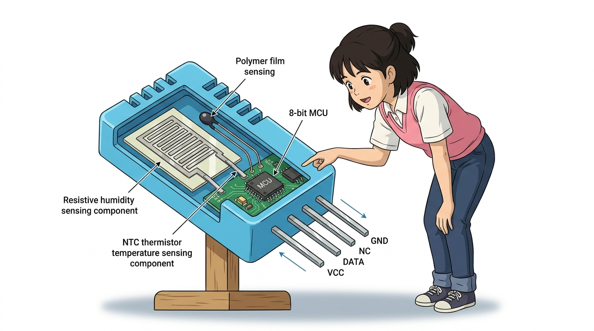

# 119_DHT11_디지털온습도센서 🌡️💧


### 도로시와 마법 멘토 지니의 나만의 스마트 기상 관측소 만들기

* 👧 **도로시**: "지니야! 오늘 날씨가 몇 도인지뿐만 아니라, 빨래가 잘 마를지 공기가 눅눅한지 뽀송한지 습도까지 함께 잴 수 있는 센서도 있어?"
* 🐱 **지니**: "그럼! 파란색 예쁜 격자 옷을 입고 있는 **DHT11 디지털 온습도 센서** 가 있으면 온도와 습도를 단 1가닥의 전선으로 척척 알려준단다! 오늘 우리 집만의 기상청을 만들어보자!"
* 🐶 **토토**: "바우! (비 오기 전 꿉꿉함을 귀신같이 알아맞힌다 멍!)"

* 🖥️ **강의 슬라이드**: [slides.md](./slides.md)

---

## 1. DHT11 센서의 개요와 실생활 활용 🌦️


DHT11은 저렴한 가격에 **섭씨 온도(℃)**와 **상대 습도(%)**를 동시에 측정할 수 있는 초소형 디지털 센서입니다.

* **복합 센서 (2-in-1)**: 온도 센서와 습도 센서가 하나의 모듈 안에 결합되어 공간을 적게 차지합니다.
* **디지털 단일 버스(Single-Bus)**: 아날로그-디지털 변환(ADC)을 센서 내부에서 직접 끝내고, 단 1개의 디지털 데이터선으로 깨끗한 40비트 디지털 숫자를 전달합니다.
* **주요 응용 분야**:
  * 스마트 홈 자동 에어컨 및 가습기·제습기 제어
  * 스마트팜 비닐하우스 농작물 환경 모니터링
  * 실내 불쾌지수(THI) 안내 전광판
  * 귀여운 책상용 탁상 기상 관측 시계

---

## 2. 파란 케이스 속 이중 감지 부품의 비밀 🔬



파란색 플라스틱 통풍구 케이스를 열어보면 2개의 특수 부품과 초소형 마이크로칩이 들어있습니다.

1. **NTC 서미스터 (온도 감지체)**:
   * 온도가 올라가면 전기 저항이 줄어들고, 온도가 내려가면 저항이 커지는 정밀 세라믹 반도체입니다.
   * **측정 범위**: 0℃ ~ 50℃ (오차 ±2℃)
2. **정전식 습도 감지체 (습도 감지체)**:
   * 두 개의 전극 사이에 수분을 흡수하는 고분자 필름이 끼워져 있습니다.
   * 공기 중에 수증기(습기)가 많아지면 필름이 수분을 머금어 **전기 용량(커패시턴스)**이 변합니다.
   * **측정 범위**: 20% ~ 90% RH (오차 ±5%)
3. **내장 8비트 마이크로컨트롤러 (MCU)**:
   * 두 감지체의 미세한 아날로그 변화를 직접 계산하여, **40비트 디지털 패킷(습도 정수/소수 + 온도 정수/소수 + 체크섬)**으로 변환해 아두이노로 쏴줍니다!

---

## 3. 센서 모듈의 핀 구성과 아두이노 연결 🔌


초보자용 3핀 모듈 형태를 사용하면 풀업 저항이 기판에 이미 내장되어 있어 선 연결이 매우 간편합니다.

| 핀 기호 | 역할 | 아두이노 연결 핀 | 기능 설명 |
| :--- | :--- | :--- | :--- |
| **`+` (VCC)** | 전원 입력 (+) | **5V (또는 3.3V)** | 센서 및 내부 8비트 칩 구동 전원 |
| **`-` (GND)** | 접지 (-) | **GND** | 0V 접지 |
| **`S` (Data)** | 40비트 디지털 데이터선 | **A1 핀 (또는 디지털 2번)** | 온도 및 습도 데이터 패킷 전송 |

* **배선 시 주의사항**: `+`와 `-`를 거꾸로 연결하면 내부 마이크로칩이 뜨거워지며 손상될 수 있으니 핀 라벨을 꼭 확인하세요.

---

## 4. 필수 라이브러리 설치 가이드 📚


DHT11의 40비트 마이크로초 단위 디지털 펄스를 손쉽게 해석하기 위해 전 세계 개발자들이 사용하는 공식 라이브러리를 설치합니다.

1. 아두이노 IDE 상단 메뉴: **[스케치] ➔ [라이브러리 포함하기] ➔ [라이브러리 관리...]** (단축키 `Ctrl + Shift + I`)를 엽니다.
2. 상단 검색창에 **`DHT sensor library`** 를 입력합니다.
3. **Adafruit**가 제작한 **`DHT sensor library`**의 [설치] 버튼을 클릭합니다.
4. *"종속된 라이브러리도 함께 설치하시겠습니까?"* 알림창이 뜨면 반드시 **[Install 'Adafruit Unified Sensor' and all dependencies]** (모두 설치)를 선택합니다.

---

## 5. 아두이노와 DHT11 회로 배선도 🔌


점퍼선 3가닥으로 아두이노 우노와 센서를 깔끔하게 연결합니다.

* 센서 **`+` (VCC)** ➔ 아두이노 **5V**
* 센서 **`-` (GND)** ➔ 아두이노 **GND**
* 센서 **`S` (DATA)** ➔ 아두이노 **A1 핀** (아날로그 핀도 디지털 입출력 핀으로 완벽 작동합니다)

---

## 6. 실습: 실시간 온습도 측정 아두이노 스케치 💻


2초마다 방 안의 온도와 습도를 측정하여 시리얼 모니터에 출력하는 표준 스케치입니다.

```cpp
// ==========================================
// 07.6-1 DHT11 실시간 스마트 온습도 기상관측기
// ==========================================

#include <DHT.h> // DHT 온습도 센서 전용 라이브러리 불러오기

#define DHTPIN A1     // 센서의 데이터(S) 핀이 연결된 아두이노 핀
#define DHTTYPE DHT11 // 센서 모델 지정 (DHT11 또는 DHT22)

// DHT 객체 생성 (센서와 대화할 통신 전령사)
DHT dht(DHTPIN, DHTTYPE);

void setup() {
  Serial.begin(115200);

  // 센서 가동 시작! (초기화 및 핀 설정 자동 수행)
  dht.begin();

  Serial.println("========================================");
  Serial.println("   DHT11 Weather Station Initialized!   ");
  Serial.println("   온도와 습도를 실시간으로 측정합니다   ");
  Serial.println("========================================");
}

void loop() {
  // 1. 센서에서 습도(%)와 섭씨 온도(℃)를 읽어옵니다.
  float humidity = dht.readHumidity();
  float temperature = dht.readTemperature();

  // 2. 센서에서 값을 제대로 읽어왔는지 오류 검사 (NaN: Not a Number)
  if (isnan(humidity) || isnan(temperature)) {
    Serial.println("⚠️ [오류] 센서에서 데이터를 읽어오지 못했습니다. 배선을 확인하세요!");
    delay(2000);
    return;
  }

  // 3. 시리얼 모니터에 보기 좋게 출력
  Serial.print("🌡️ 현재 온도: ");
  Serial.print(temperature, 1); // 소수점 첫째 자리까지 출력
  Serial.print(" ℃  |  💧 현재 습도: ");
  Serial.print(humidity, 1);
  Serial.println(" %");

  // 4. DHT11 센서는 하드웨어 특성상 최소 2초(2000ms)의 측정 간격이 필요해요!
  delay(2000);
}
```

---

## 7. 코드 상세 해설 ①: 라이브러리 함수와 오류 검증 ⚙️

초보자도 전문 엔지니어처럼 코드를 이해할 수 있는 핵심 해설입니다.

### 1) `dht.readTemperature()` & `dht.readHumidity()`
* 라이브러리가 40개의 마이크로초 펄스를 대신 계산하여, 섭씨 온도(℃)와 백분율 습도(%)를 실수형 숫자(`float`)로 깔끔하게 반환해 줍니다.

### 2) `isnan()` 오류 예외 처리
```cpp
if (isnan(humidity) || isnan(temperature))
```
* `isnan`은 "숫자가 아니다(Is Not a Number)"의 약자입니다.
* 전선이 빠지거나 접촉이 불량하여 센서가 응답하지 않을 때, 엉뚱한 쓰레기 값이 계산되는 것을 막아주는 안전장치입니다.

---

## 8. 코드 상세 해설 ②: 2초 딜레이의 비밀과 불쾌지수 🧠


### 1) 왜 반드시 `delay(2000)`을 주어야 할까요?
* DHT11 센서 내부의 고분자 습도 필름과 서미스터는 주변 공기와 열·수분을 교환하는 데 물리적인 시간이 걸립니다.
* 1초에 10번씩 너무 빠르게 읽으면 센서 내부 칩에 열이 발생하여 온도가 높게 측정되는 왜곡이 생깁니다. **2초에 한 번(0.5Hz)** 읽는 것이 최상의 정밀도를 유지하는 황금률입니다.

### 2) 여름철 불쾌지수(THI, Temperature-Humidity Index) 공식
기상청에서 발표하는 불쾌지수도 아두이노 코드로 바로 계산할 수 있습니다:
$$\text{THI} = \frac{9}{5} T - 0.55 (1 - \frac{H}{100}) (\frac{9}{5} T - 26) + 32$$
* **68 미만**: 쾌적한 날씨 🟢
* **75 이상 80 미만**: 절반 정도가 불쾌감을 느끼는 날씨 🟡
* **80 이상**: 대부분 불쾌감을 느끼는 날씨 (에어컨 가동 필요!) 🔴

---

## 🌟 도로시와 지니의 핵심 요약 노트! 📝

* 👧 **도로시**: "서미스터와 수분 흡수 필름이 함께 들어있어서 단 전선 한 가닥으로 온도와 습도를 동시에 디지털로 받아오는 거였구나! 시리얼 모니터에 우리 방 온도와 습도가 실시간으로 뜨니까 진짜 기상청 관측소 연구원이 된 것 같아!"
* 🐱 **지니**: "맞아! 여기에 I2C LCD 화면을 달아주면 침대 옆에서 매일 아침 날씨를 확인하는 멋진 스마트 탁상시계가 완성된단다."
* 🐶 **토토**: "바우! 다음 시간엔 위험한 가스 누출을 냄새로 알아채는 **'07.6-2 가스 센서(MQ-2)'**를 배우러 가자 멍!"
