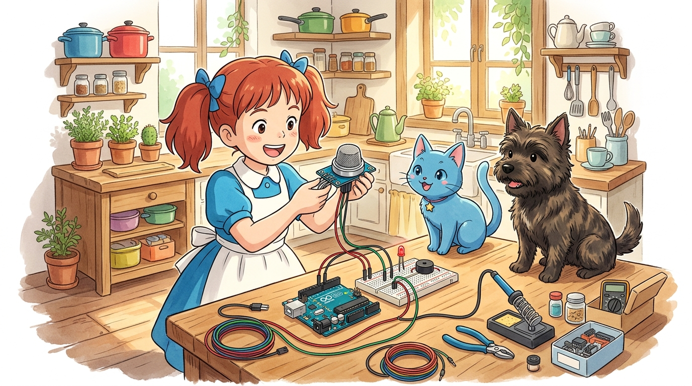
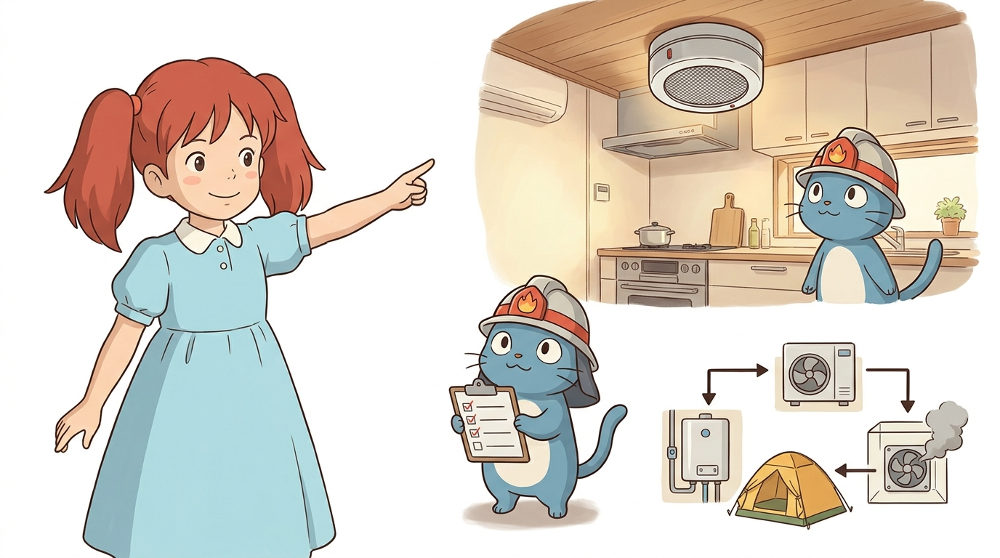
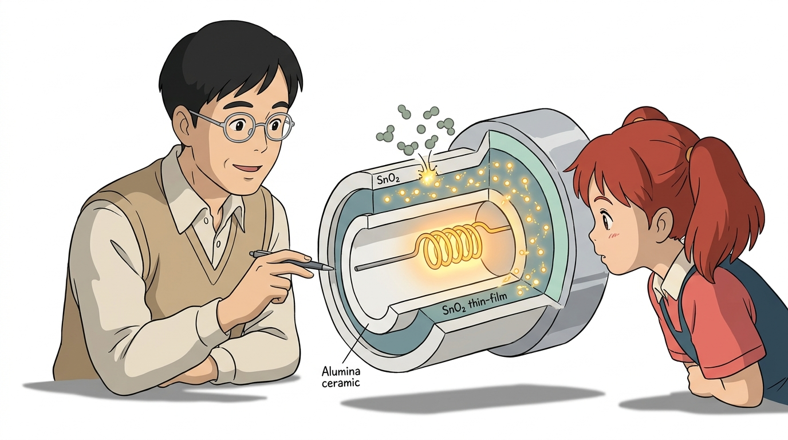
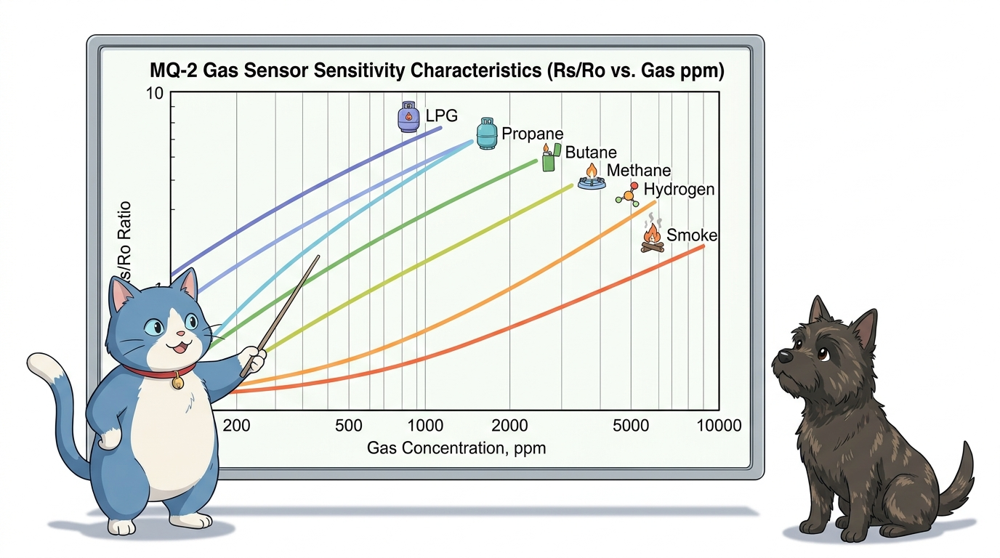
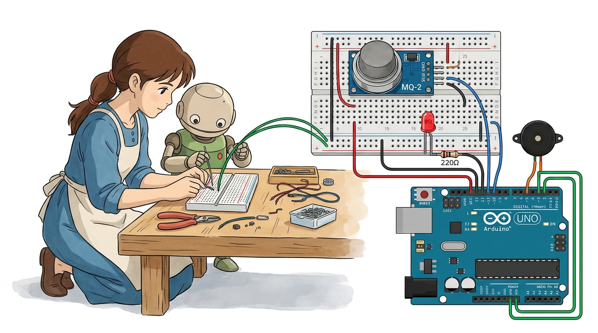
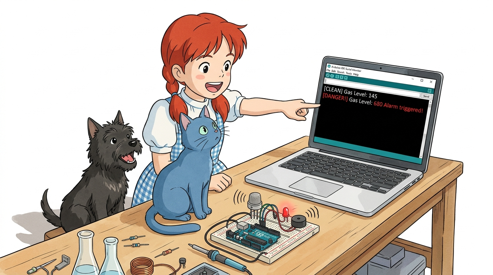
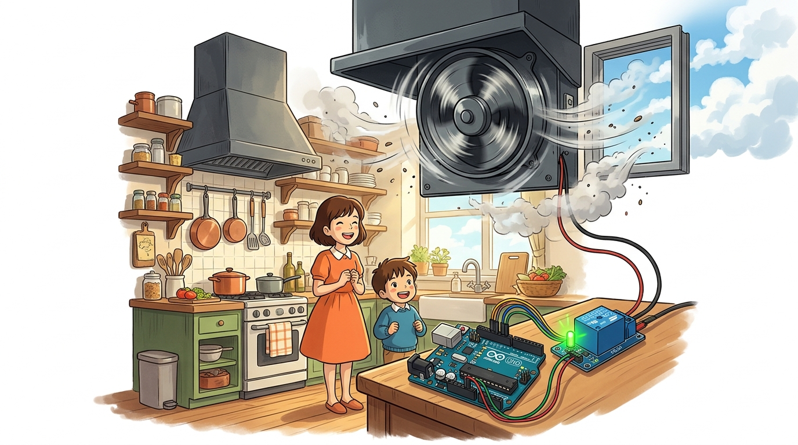

# 120_MQ2_가스연기감지센서 💨🚨



### 도로시와 마법 멘토 지니의 주방 가스 누출 및 연기 경보기 만들기

* 👧 **도로시**: "지니야! 주방에서 찌개를 끓이다가 바람에 가스레인지 불이 꺼지거나, 냄비가 타서 매캐한 연기가 날 때 위험을 냄새로 먼저 알아채는 똑똑한 경보기는 어떻게 만들어?"
* 🐱 **지니**: "공기 중에 흩어진 가연성 가스와 연기 분자를 쏙쏙 잡아채는 **MQ-2 전자 코 가스 센서** 를 사용하면 된단다! 오늘 위험한 가스 누출 사고를 1초 만에 막아주는 주방 안전 지킴이를 완성해 보자!"
* 🐶 **토토**: "바우! (토토 코보다 더 예민한 전자 코 탐정 출동이다 멍!)"

* 🖥️ **강의 슬라이드**: [slides.md](./slides.md)

---

## 1. MQ-2 가스·연기 센서의 개요와 실생활 활용 🔍



MQ-2 센서는 공기 중에 섞인 다양한 종류의 **가연성 가스(LPG, 부탄, 메탄 등)**와 **연기(Smoke)**를 폭넓게 감지하는 범용 환경 안전 센서입니다.

* **전자 코(Electronic Nose) 역할**: 사람의 후각보다 훨씬 낮은 극미량의 농도(300ppm ~ 10,000ppm)에서도 가스 누출을 포착합니다.
* **빠른 반응 및 복원 속도**: 가스가 닿는 즉시 1초 이내에 반응하며, 창문을 열어 환기하면 수 초 만에 원래 상태로 복귀합니다.
* **주요 응용 분야**:
  * 아파트 및 단독주택 주방 가스 누출 자동 경보기
  * 보일러실 일산화탄소·연기 조기 감지기
  * 캠핑장 텐트 내 질식·가스 사고 예방 휴대용 경보기
  * 화재 감지 시 자동으로 환풍기를 돌리는 스마트 홈 환기 시스템

---

## 2. MQ-2 센서의 내부 구조와 화학-전기 반응 ♨️🧪



둥근 스테인리스 철망 속에는 알루미나 세라믹 튜브와 정밀 히터 코일이 내장되어 있습니다.

1. **내부 초소형 열선(Heater)**:
   * 센서에 전원(5V)이 공급되면 열선 코일이 달궈져 세라믹 튜브 표면을 약 200℃~300℃로 뜨겁게 가열합니다.
   * (센서 철망 겉면이 따뜻해지는 것은 내부 화학 반응을 위한 정상 동작입니다!)
2. **이산화주석($SnO_2$) 박막 반도체**:
   * **맑은 공기 중**: 공기 중의 산소($O_2$) 분자가 뜨거운 반도체 표면에 달라붙어 전자를 꽉 쥐고 있어 **저항이 매우 높습니다 (전류 안 흐름).**
   * **가스/연기 유입 시**: 메탄이나 부탄, 연기 분자가 산소와 산화 반응을 일으키며 산소가 붙잡고 있던 전자들을 와르르 방출합니다!
3. **전기 전도도 상승**:
   * 전자가 자유롭게 움직이면서 **전기 저항이 급격히 떨어지고, 아날로그 출력 전압이 쑥쑥 올라갑니다!**

---

## 3. 감지 가능한 가스 종류와 감도 특성 📊



MQ-2 센서는 다양한 가스에 서로 다른 감도로 반응하는 다목적 센서입니다.

* **LPG & 프로판(Propane)**: 가장 민감하게 반응 (가스통, 주방 배관 누출)
* **부탄(Butane)**: 휴대용 버너 가스 감지
* **메탄(Methane, 도시가스)**: 천연가스(LNG) 누출 감지
* **수소(Hydrogen)**: 배터리 충전실 등 수소 누출 감지
* **연기(Smoke)**: 목재, 종이, 전선이 탈 때 생기는 유독 연기 입자 감지

---

## 4. 센서 모듈의 핀 구성과 예열(Preheat) 수칙 🎛️


센서 기판에는 LM393 전압 비교기와 조절용 가변저항이 탑재되어 있습니다.

| 핀 이름 | 역할 | 아두이노 연결 핀 | 기능 설명 |
| :--- | :--- | :--- | :--- |
| **VCC** | 전원 입력 (+) | **5V** | 센서 구동 및 히터 열선 가열 전원 (약 150mA 소모) |
| **GND** | 접지 (-) | **GND** | 0V 접지 |
| **AO** | 아날로그 출력 | **A1 아날로그 핀** | 가스 농도에 비례하는 전압 신호 (0 ~ 1023) |
| **DO** | 디지털 출력 | **디지털 핀** | 가변저항 기준치 초과 시 스위치 출력 (0 또는 1) |

> **⚠️ 필수 주의사항: 센서 예열(Pre-heating) 시간!**  
> 새 센서를 처음 전원에 꽂으면 내부 화학물질이 안정화되는 데 약 **20초 ~ 1분** 정도의 예열 시간이 필요합니다. 예열 중에는 수치가 다소 들쭉날쭉할 수 있으니 수치가 차분히 안정될 때까지 기다려주세요.

---

## 5. 아두이노와 가스 센서 회로 배선도 🔌



아두이노 우노 보드에 센서와 비상 알림용 부저, LED를 연결합니다.

1. **가스 센서 결선**:
   * 센서 **VCC** ➔ 아두이노 **5V**
   * 센서 **GND** ➔ 아두이노 **GND**
   * 센서 **AO** ➔ 아두이노 **A1 핀**
2. **비상 알림 장치 결선**:
   * 피에조 부저 (+) ➔ **디지털 8번 핀**, (-) ➔ **GND**
   * 경고 빨간색 LED ➔ **디지털 13번 핀** (내장 LED 활용 가능)

---

## 6. 실습: 실시간 가스 농도 감시 및 누출 경보기 💻



가스 농도를 실시간으로 모니터링하고 임계치를 초과하면 비상 사이렌을 울리는 표준 스케치입니다.

```cpp
// ==========================================
// 07.6-2 스마트 주방 가스 누출 및 화재 경보기
// ==========================================

const int gasPin = A1;    // 가스 센서 AO 연결 핀
const int buzzerPin = 8;  // 비상 경보 부저
const int ledPin = 13;    // 비상 경고 LED

// 평상시 맑은 공기 기준값보다 약 150~200 높은 위험 기준선
const int gasThreshold = 400;

void setup() {
  Serial.begin(115200);
  pinMode(gasPin, INPUT);
  pinMode(buzzerPin, OUTPUT);
  pinMode(ledPin, OUTPUT);

  Serial.println("=========================================");
  Serial.println("   MQ-2 Gas Sensor Initializing...       ");
  Serial.println("   센서 내부 히터를 예열 중입니다 (20초)  ");
  Serial.println("=========================================");

  // 센서 안정화를 위한 20초 카운트다운
  for (int i = 0; i < 20; i++) {
    digitalWrite(ledPin, HIGH);
    delay(200);
    digitalWrite(ledPin, LOW);
    delay(800);
    Serial.print(".");
  }
  Serial.println("\n>> 가스 감시 시스템 가동 준비 완료!");
}

void loop() {
  // 1. 가스 센서의 아날로그 전압 값(0~1023)을 읽어옵니다.
  int gasLevel = analogRead(gasPin);

  Serial.print("현재 가스 농도 수치: ");
  Serial.print(gasLevel);

  // 2. 가스 농도에 따른 단계별 위험 판정
  if (gasLevel >= gasThreshold) {
    Serial.println(" -> 🚨 [DANGER!] 가스 누출 위험! 밸브를 잠그고 환기하세요!");

    // 비상 사이렌 울리기
    digitalWrite(ledPin, HIGH);
    tone(buzzerPin, 1000);
    delay(200);
    digitalWrite(ledPin, LOW);
    tone(buzzerPin, 600);
    delay(200);
  } else if (gasLevel >= 250) {
    Serial.println(" -> ⚠️ [CAUTION] 미세 가스 감지 (주의 관찰)");
    noTone(buzzerPin);
    digitalWrite(ledPin, LOW);
    delay(500);
  } else {
    Serial.println(" -> 🟢 [CLEAN] 맑고 안전한 공기");
    noTone(buzzerPin);
    digitalWrite(ledPin, LOW);
    delay(500);
  }
}
```

---

## 7. 코드 상세 해설 ①: 가스 농도 수치와 환경 보정 📊


실제 방 안에서 코드를 실행할 때 수치를 정확히 이해하는 방법입니다.

### 1) 맑은 공기에서의 기본 측정값 (Baseline)
* 환기가 잘 된 방 안에서는 대략 **100 ~ 180** 사이의 평화로운 수치가 출력됩니다.

### 2) 안전한 테스트 방법
* 라이터 불을 켜지 않고, **가스 누름 레버만 1초간 '취익' 살짝 눌러** 센서 그물망 2~3cm 앞에서 가스를 방출해 봅니다.
* 수치가 순식간에 **500, 700 이상**으로 솟구치며 🚨 비상 사이렌이 울립니다!
* 라이터를 치우면 공기 중으로 가스가 흩어지며 수 초 만에 다시 100대로 내려옵니다.

---

## 8. 코드 상세 해설 ②: 릴레이 모듈로 자동 환풍기 돌리기 🌪️



```cpp
// 아날로그 가스 농도(0~1023) 측정
int gasLevel = analogRead(gasPin);
```

단순히 소리만 내는 것을 넘어, 실제로 집안의 창문이나 환풍기를 열어주는 **액티브 안전 시스템**으로 발전시키는 방법입니다.

```cpp
if (gasLevel >= gasThreshold) {
  digitalWrite(relayPin, HIGH); // 릴레이 모듈을 작동시켜 220V 주방 환풍기 모터 가동!
} else {
  digitalWrite(relayPin, LOW);  // 안전 수치로 내려오면 환풍기 정지
}
```
* 아두이노의 디지털 핀에 **5V 릴레이 모듈(Relay Module)**을 연결하면, 가스가 샜을 때 사람 손을 거치지 않고도 **환풍기 모터를 자동으로 돌려 가스를 밖으로 배출**하는 완전 자동화 안전 장치를 만들 수 있습니다!

---

## 🌟 도로시와 지니의 핵심 요약 노트! 📝

* 👧 **도로시**: "센서 안의 열선이 따뜻하게 달궈져서 가스 분자가 달라붙으면 저항이 떨어져 전압이 올라가는 원리였구나! 라이터 가스를 살짝만 스쳐도 0.5초 만에 알아채니까 정말 믿음직스러워!"
* 🐱 **지니**: "맞아! 여기에 릴레이 모듈을 결합하면 가스가 샜을 때 자동으로 밸브를 차단하고 환풍기를 돌려주는 든든한 스마트 홈 방재 시스템을 완성할 수 있단다."
* 🐶 **토토**: "바우! 이미 완성한 알코올 센서에 이어, 다음 시간엔 아날로그 핀이 없을 때 쓰는 **'07.6-4 단계 응답 회로'**로 떠나자 멍!"
