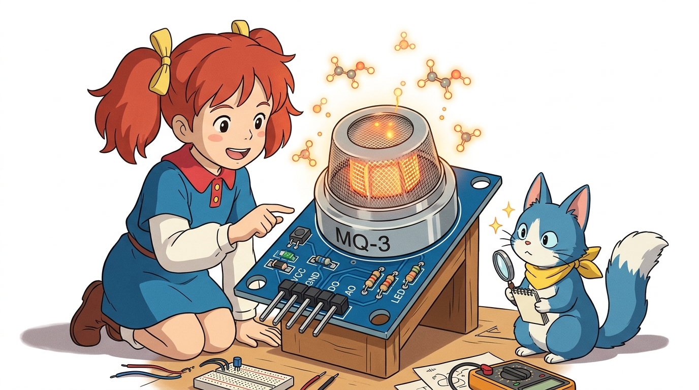
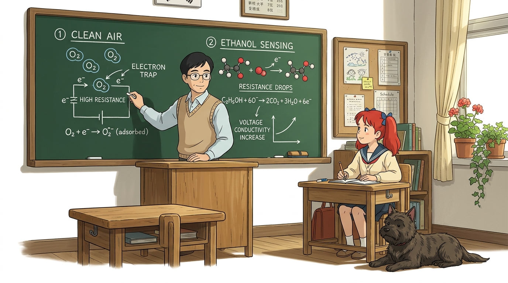
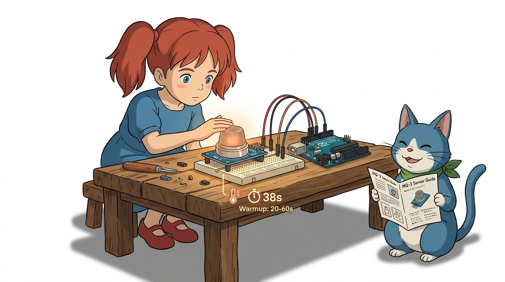
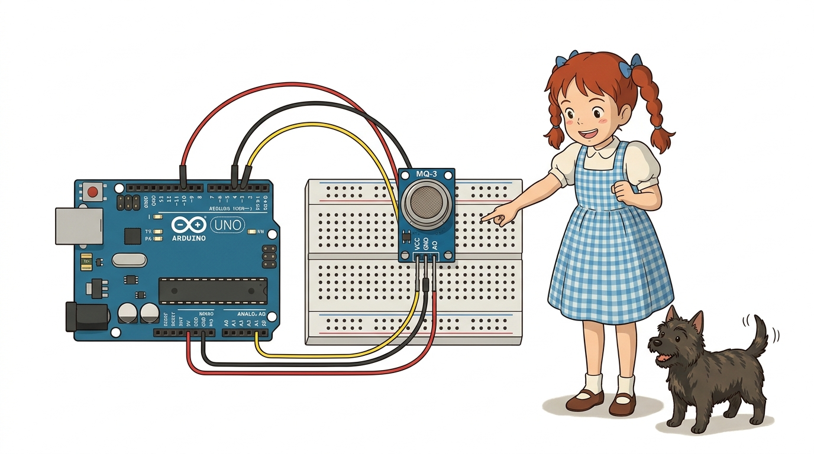
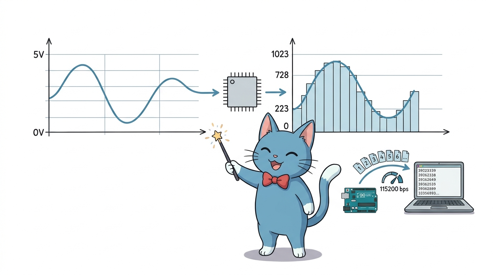
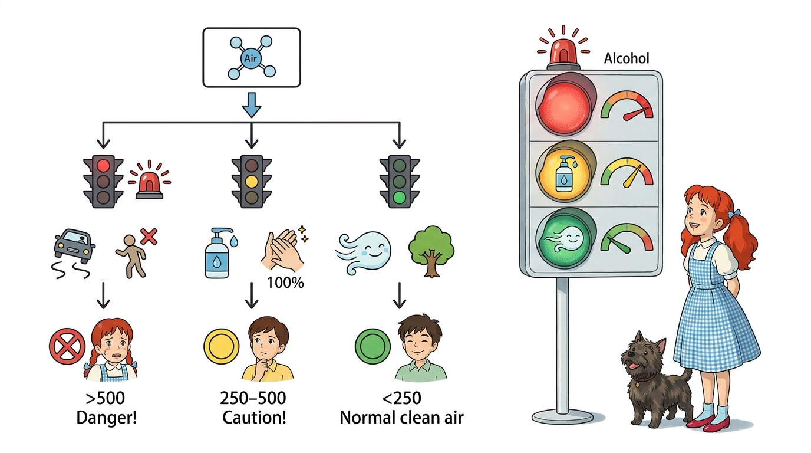
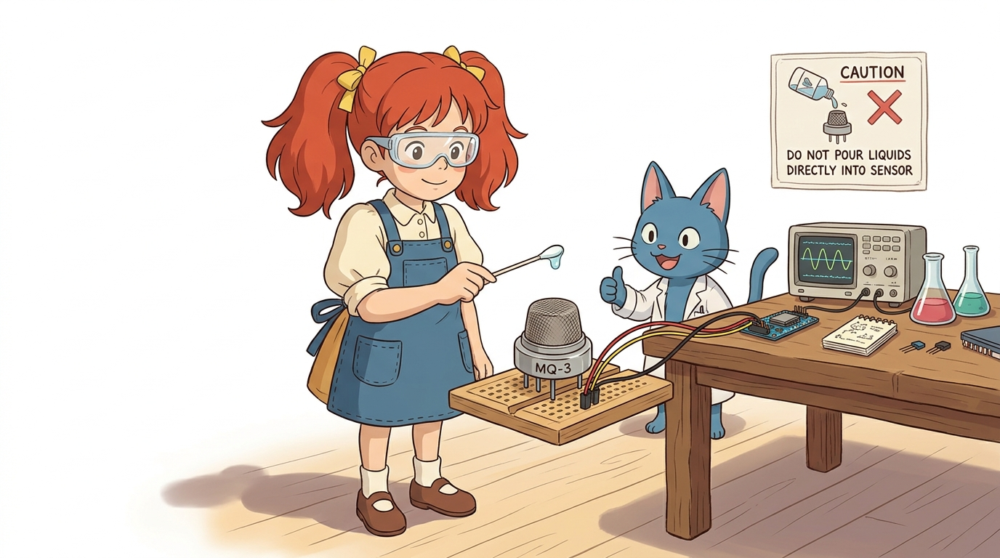

# 121_MQ3_알코올측정센서 🍷🌬️


### 도로시와 마법 멘토 지니의 전자 음주 측정기 만들기

* 👧 **도로시**: "지니야! 경찰관 아저씨들이 길에서 운전자분들에게 '후~' 하고 입김을 불게 하는 기계는 어떻게 술을 마셨는지 알아채는 거야?"
* 🐱 **지니**: "그 기계 안에는 공기 중의 알코올 분자만 기가 막히게 찾아내는 마법의 감지기가 들어있단다. 바로 오늘 우리가 배울 **MQ-3 가스 센서**가 그 핵심 주인공이야!"
* 🐶 **토토**: "바우! (킁킁! 냄새로 잡아내는 비밀 탐정이다 멍!)"

* 🖥️ **강의 슬라이드**: [slides.md](./slides.md)

---

## 1. 알코올 센서(MQ-3)의 정체와 특징 🔍



MQ-3 센서는 공기 중에 흩어져 있는 **에탄올(알코올) 증기**의 농도를 감지하여 전기 신호로 바꿔주는 화학-전기 변환 센서입니다.

* **감지 대상**: 에탄올(Ethanol, 주류 및 소독용 알코올 성분), 알코올 증기
* **출력 방식**:
  * **아날로그 출력(AO)**: 알코올 농도가 진할수록 전압(0V ~ 5V)이 점진적으로 올라갑니다.
  * **디지털 출력(DO)**: 가변저항으로 설정한 기준치보다 높으면 LOW(0) 또는 HIGH(1) 스위치 신호를 냅니다.
* **센서 상단**: 둥근 금속 그물망(철망) 캡이 감지 소자를 외부 충격으로부터 보호하면서 공기가 자유롭게 통하도록 만듭니다.

---

## 2. 칠판 교실: 에탄올을 찾아내는 반도체의 마법 🧪



MQ-3 센서 속에는 **이산화주석($SnO_2$)**이라는 특별한 금속산화물 반도체가 들어있습니다.

1. **맑은 공기 속 (기본 상태)**:
   * 공기 중의 산소($O_2$) 분자들이 센서 표면에 달라붙어 전자를 꽉 붙잡아둡니다.
   * 전자가 움직이지 못하므로 **전기 저항이 매우 높고, 전류가 거의 흐르지 않습니다.**
2. **알코올 증기 접촉 시**:
   * 에탄올 분자가 센서 표면의 산소와 격렬하게 반응하며 산화됩니다.
   * 산소가 붙잡고 있던 전자들을 다시 뿜어내어 **전기 저항이 급격히 떨어집니다.**
   * 저항이 작아지니 전류가 콸콸 흘러 **아날로그 출력 전압($V_{out}$)이 쑥쑥 상승**합니다!

---

## 3. MQ-3 센서 모듈의 핀 구성과 예열 주의사항 ⚠️



센서를 올바르게 사용하기 위해 4개의 핀 역할과 동작 조건을 알아봅니다.

* **VCC (전원 +)**: 아두이노의 **5V** 핀에 연결합니다. (센서 내부 열선 작동에 5V 필요)
* **GND (접지 -)**: 아두이노의 **GND** 핀에 연결합니다.
* **AO (Analog Output)**: 농도에 비례하는 연속 전압 출력 ➔ 아두이노 **A0 핀**에 연결!
* **DO (Digital Output)**: 기준치 초과 여부 스위치 신호 (임계치 비교기 LM393 경유)

> **💡 지니의 안전 상식: "센서가 따뜻해요!"**  
> MQ-3 센서는 내부에 화학 반응을 돕는 **초소형 히터(열선)**가 내장되어 있습니다. 전원을 꽂으면 쇠 그물망 부분이 따뜻해지는 것은 정상 동작입니다. 전원을 켜고 약 20초~1분 정도 예열(Pre-heating) 시간을 주어야 안정적인 측정값을 얻을 수 있습니다.

---

## 4. 브레드보드 회로 연결도 🔌



아두이노 우노 보드와 MQ-3 센서 모듈을 점퍼선 3가닥으로 간편하게 연결합니다.

| MQ-3 센서 핀 | 연결할 아두이노 우노 핀 | 전선 색상 권장 | 역할 설명 |
| :--- | :--- | :--- | :--- |
| **VCC** | **5V** | 🔴 빨간색 | 센서 및 내부 히터 전원 공급 |
| **GND** | **GND** | ⚫ 검은색 | 기준 전압 0V 접지 |
| **AO** | **A0 (아날로그 입력)** | 🟡 노란색 또는 파란색 | 알코올 농도 전압 신호 전달 |

* **배선 점검 체크리스트**:
  1. VCC와 GND가 반대로 꽂히지 않았는지 두 번 확인합니다.
  2. 아두이노를 컴퓨터 USB 포트에 꽂으면 센서 모듈의 전원 LED(빨간불)가 켜집니다.

---

## 5. 디지털 음주 측정기 전체 아두이노 스케치 💻


아두이노 IDE에 아래 코드를 입력하고 보드로 업로드합니다.

```cpp
// ==========================================
// 도로시와 지니의 스마트 MQ-3 알코올 측정기
// ==========================================

const int alcoholPin = A0; // MQ-3의 AO핀이 연결된 아두이노 아날로그 0번 핀

void setup() {
  // 컴퓨터와 통신할 속도를 115200 bps로 설정해요!
  Serial.begin(115200);

  // A0 핀을 센서 신호를 받아들이는 '입력(INPUT)' 문으로 지정해요.
  pinMode(alcoholPin, INPUT);

  Serial.println("==================================");
  Serial.println("   MQ-3 Alcohol Sensor Started!   ");
  Serial.println("   센서 예열 중... 잠시 기다려주세요   ");
  Serial.println("==================================");
}

void loop() {
  // 1. 센서의 아날로그 전압 값(0~1023)을 읽어와요.
  int sensorValue = analogRead(alcoholPin);

  // 2. 시리얼 모니터에 현재 측정된 숫자를 출력해요.
  Serial.print("알코올 감지 수치: ");
  Serial.print(sensorValue);

  // 3. 수치 범위에 따라 안전 단계를 판정해요.
  if (sensorValue >= 500) {
    Serial.println(" -> 🚨 [경고] 음주 감지! 운전 절대 금지!");
  } else if (sensorValue >= 250) {
    Serial.println(" -> ⚠️ [주의] 미세 알코올 감지 (손소독제, 구강청결제 등)");
  } else {
    Serial.println(" -> 🟢 [정상] 맑은 공기 (알코올 미검출)");
  }

  // 4. 0.8초마다 한 번씩 새로 측정해요.
  delay(800);
}
```

---

## 6. 코드 상세 해설 ①: 초기화와 아날로그 읽기 ⚙️



작성한 스케치의 앞부분 동작 원리를 꼼꼼하게 짚어봅니다.

### 1) 통신 설정과 핀 모드
```cpp
const int alcoholPin = A0;
Serial.begin(115200);
pinMode(alcoholPin, INPUT);
```
* `const int alcoholPin = A0;`: 핀 번호를 상수로 선언하여 코드 가독성을 높입니다.
* `Serial.begin(115200);`: 아두이노가 측정한 결과를 컴퓨터 시리얼 모니터 화면으로 빠르게 쏴주기 위한 통신 개통 명령입니다. 시리얼 모니터 창 우측 하단의 보드레이트(Baud rate)도 반드시 **115200**으로 맞춰야 글자가 깨지지 않습니다.
* `pinMode(alcoholPin, INPUT);`: A0 핀에 전기를 흘려보내는 것이 아니라, 센서에서 들어오는 전압을 **읽어 들이는 입력 통로**로 활성화합니다.

### 2) `analogRead()` 함수의 원리
```cpp
int sensorValue = analogRead(alcoholPin);
```
* 아두이노의 10비트 ADC(아날로그-디지털 변환기)는 **0V ~ 5V** 전압을 **0 ~ 1023** 단계의 정수 숫자로 환산해 줍니다.
* 맑은 공기에서는 약 **100 ~ 200** 안팎의 낮은 값이 측정됩니다.
* 알코올 증기가 닿으면 전압이 오르면서 **400, 600, 800 이상**으로 숫자가 껑충 뛰어오릅니다!

---

## 7. 코드 상세 해설 ②: 다단계 안전 판정 조건문 🚦



```cpp
if (sensorValue >= 500) {
  Serial.println(" -> 🚨 [경고] 음주 감지! 운전 절대 금지!");
} else if (sensorValue >= 250) {
  Serial.println(" -> ⚠️ [주의] 미세 알코올 감지 (손소독제, 구강청결제 등)");
} else {
  Serial.println(" -> 🟢 [정상] 맑은 공기 (알코올 미검출)");
}
```

컴퓨터가 똑똑하게 사람의 상태를 판정하는 `if - else if - else` 조건 분기 구조입니다.

1. **1차 기준 (500 이상)**: 강한 알코올 증기가 유입된 상태! 🚨 경고 메시지를 띄웁니다.
2. **2차 기준 (250 이상 ~ 500 미만)**: 손소독제를 바른 손이 센서 근처에 있거나 미세 증기가 스친 상태를 분별합니다.
3. **그 외 (250 미만)**: 정상적인 맑은 공기 상태로 판단하여 🟢 안전 초록 신호를 표시합니다.

> **💡 기준치 조정 꿀팁 (캘리브레이션)**  
> 방 안의 기본 공기 상태에 따라 기본값이 80일 수도, 180일 수도 있습니다. 먼저 코드를 실행하여 맑은 공기에서의 평상시 기준 숫자를 확인한 후 조건문의 숫자(250, 500)를 내 환경에 맞게 조금씩 조절해 주면 최고의 정밀도를 발휘합니다!

---

## 8. 안전한 알코올 센서 실험 가이드 🧪🧫



어린이와 청소년도 교실이나 가정에서 100% 안전하게 실험할 수 있는 방법입니다.

* **준비물**: 면봉 1개, 소독용 에탄올(약국 판매용) 또는 젤 타입 손소독제 1방울
* **실험 순서**:
  1. 면봉 끝에 손소독제를 쌀알 크기만큼 살짝 묻힙니다.
  2. 센서 금속망에 **직접 닿지 않도록 2~3cm 정도 떨어진 위치**에서 면봉을 살랑살랑 흔들어 봅니다.
  3. 시리얼 모니터의 숫자가 순식간에 200에서 600~700으로 급상승하는 모습을 관찰합니다!
  4. 면봉을 멀리 치우면 공기 중으로 알코올이 날아가면서 숫자가 서서히 원래대로 내려옵니다.
* ⚠️ **주의**: 센서 구멍 안에 액체를 직접 떨어뜨리거나 쏟으면 센서가 망가지므로 절대 액체를 붓지 마세요!

---

## 🌟 도로시와 지니의 핵심 요약 노트! 📝


* 👧 **도로시**: "이산화주석($SnO_2$) 반도체가 에탄올을 만나면 저항이 낮아져서 전압이 올라가는 원리였구나! 숫자가 쑥 올라가는 게 눈에 보여서 정말 신기해!"
* 🐱 **지니**: "맞아! 여기에 빨간색 LED 경고등과 '삐-삐-' 부저 소리까지 추가하면 실제 경찰 음주 측정기나 공장 유해가스 경보기와 똑같은 장치를 만들 수 있단다."
* 🐶 **토토**: "바우! 다음 시간에는 아날로그 핀이 모자랄 때 디지털 핀으로 아날로그 값을 재는 **'07.6-4 단계 응답 회로'**를 향해 떠나자 멍!"
