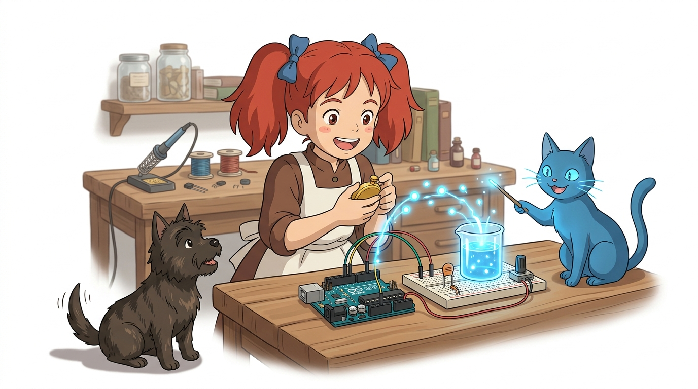
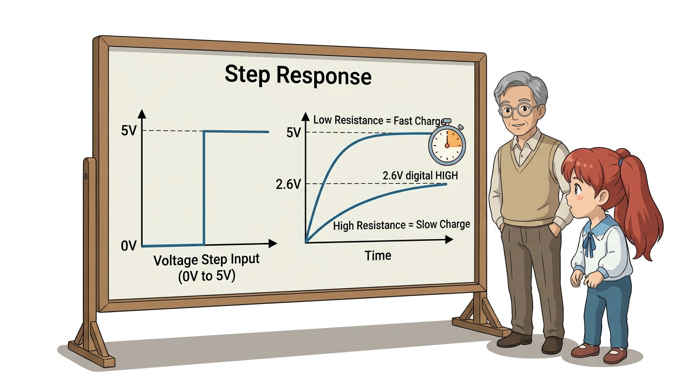
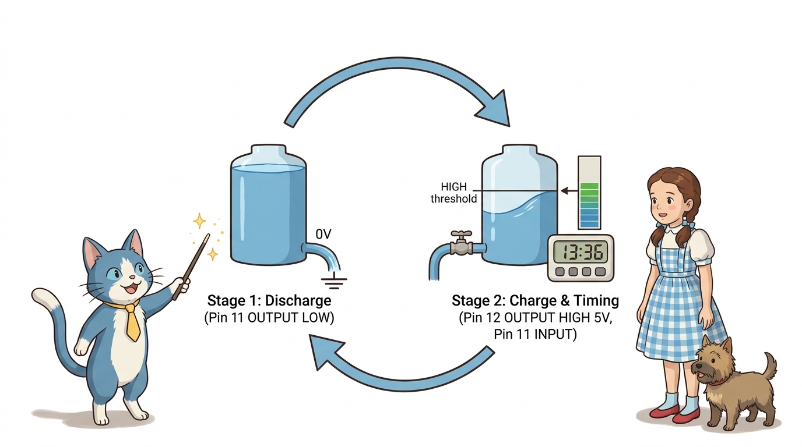
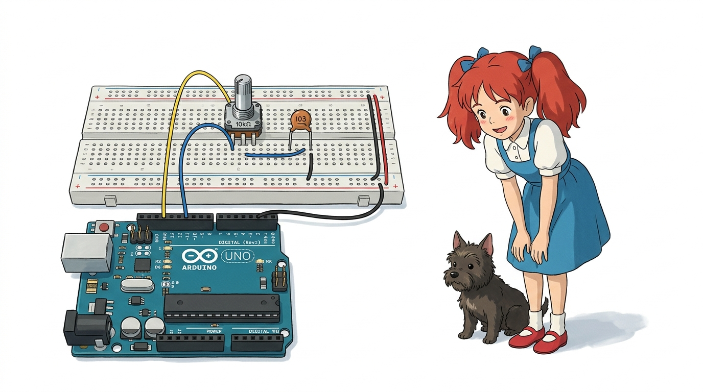
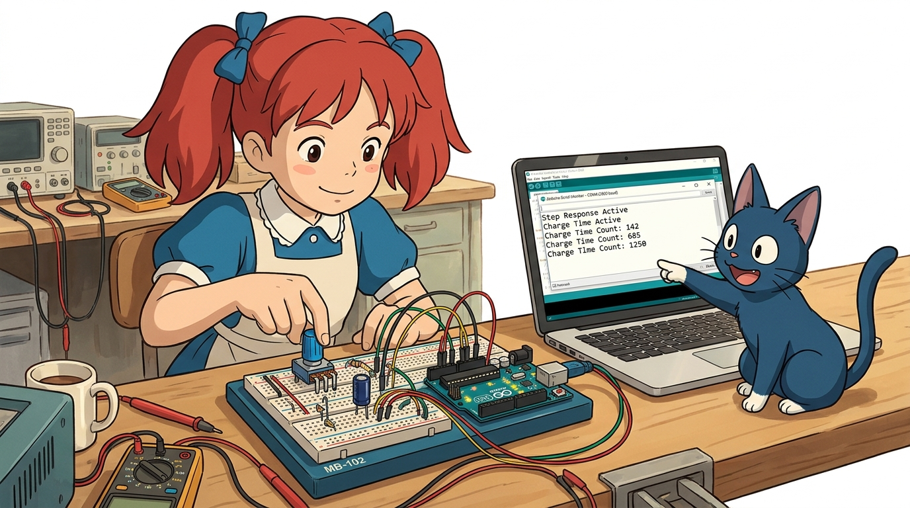
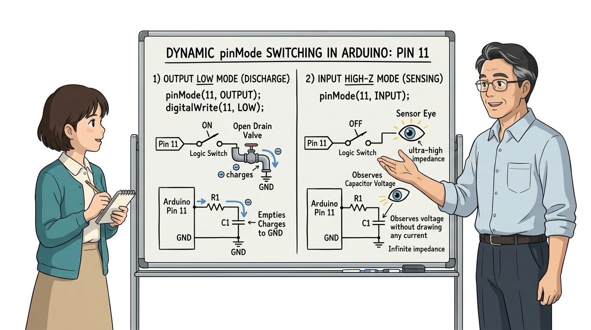
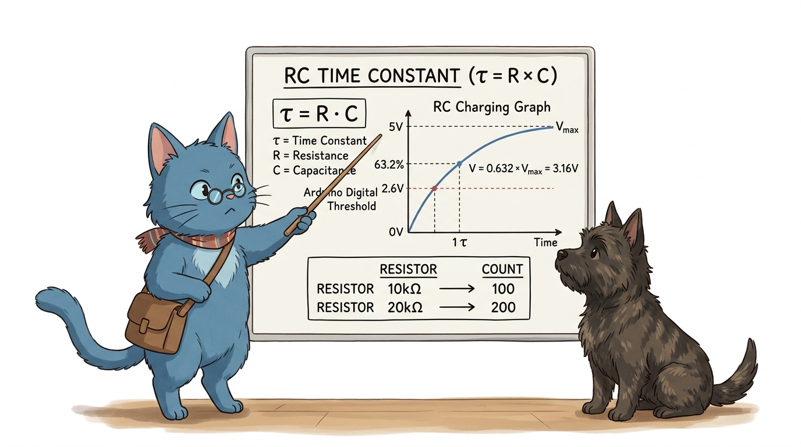
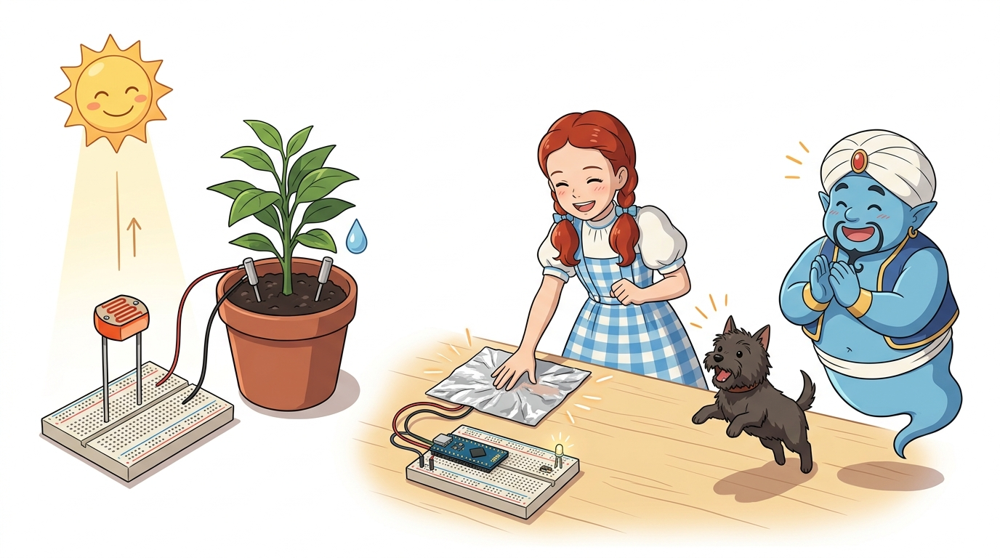

# 122_단계응답회로_StepResponse ⏱️⚡



* 👧 **도로시**: "지니야! 아두이노 우노의 아날로그 핀(A0~A5) 6개를 이미 다른 센서들로 다 써버렸어! 조도 센서나 가변저항을 하나 더 연결하고 싶은데 핀이 모자라면 아두이노를 더 큰 걸로 새로 사야 해?"
* 🐱 **지니**: "천만에 도로시! 0과 1밖에 모르는 평범한 디지털 핀 2개와 꼬마 커패시터(콘덴서) 1개만 있으면, 충전 시간을 측정하는 **단계 응답(Step Response)** 마법으로 아날로그 센서값을 얼마든지 읽어낼 수 있단다!"
* 🐶 **토토**: "바우! (스톱워치로 전기 물탱크 채우는 시간을 재는 트릭이다 멍!)"

### 도로시와 마법 멘토 지니의 디지털 핀으로 아날로그 저항 측정하기
* 📖 **상세 강의 교재**: [index.md](./index.md)


> 여러분 안녕하세요! 이번 시간에는 '122. 단계응답회로 StepResponse ⏱️⚡'을 주제로 함께 흥미진진한 탐험을 떠나보겠습니다. 오늘 강의에서는 특히 👧 도로시: "지니야! 아두이노 우노의 아날로그 핀(A0~A5) 6개를 이미 다른 센서들로 다 써버렸어! 조도 센서나 가변저항을 하나 더 연결하고 싶은데 핀이 모자라면 아두이노를 더 큰 걸로 새로 사야 해?", 🐱 지니: "천만에 도로시! 0과 1밖에 모르는 평범한 디지털 핀 2개와 꼬마 커패시터(콘덴서) 1개만 있으면, 충전 시간을 측정하는 단계 응답(Step Response) 마법으로 아날로그 센서값을 얼마든지 읽어낼 수 있단다!"를 중심으로 핵심 원리와 응용 방법을 차근차근 배워보겠습니다. 마법 멘토 지니와 호기심 많은 탐험가 도로시, 그리고 귀여운 토토와 함께 신나는 아두이노 모험을 힘차게 시작해 봅시다. 준비되셨나요?

---

## 1. 단계 응답(Step Response)이란 무엇일까요? ⏱️



* **디지털 핀의 한계 극복**:
* 아두이노의 디지털 핀은 전압의 높낮이(0V 또는 5V)만 구별할 뿐, 2.3V나 3.7V 같은 중간 아날로그 전압을 읽을 수 없습니다.
* **시간(Time)을 아날로그 정보로 변환**:
* 전압을 직접 재는 대신, **"커패시터에 전기가 가득 차서 디지털 HIGH가 될 때까지 걸린 시간"**을 잽니다.
* 저항이 크면 전기가 천천히 흘러 시간이 오래 걸리고, 저항이 작으면 전기가 콸콸 흘러 순식간에 충전됩니다.
* 즉, **충전 시간(Count) = 센서의 저항값**이 됩니다!

단계 응답이란 회로에 갑자기 직사각형 전압 계단(Step, 0V ➔ 5V)을 가했을 때, 회로 내부의 전압이 시간에 따라 어떻게 반응하며 충전되는지를 관찰하는 기법입니다.

> 자, 이번 슬라이드의 질문을 함께 보시겠습니다. 바로 '1. 단계 응답(Step Response)이란 무엇일까요? ⏱️'라는 아주 흥미로운 질문입니다. 우리가 일상에서 흔히 접하는 디지털 핀의 한계 극복 현상을 떠올려보면 왜 이런 의문이 생기는지 쉽게 공감할 수 있습니다. 이 질문 속에 숨겨진 전자 회로와 컴퓨팅의 핵심 원리를 지금부터 차근차근 하나씩 파헤쳐 보겠습니다.

---

## 2. 2단계 순환 사이클: 방전과 충전 🔄



* 다음 측정을 위해 커패시터에 남아있는 잔류 전기를 0V로 완전히 빼냅니다.
* 11번 핀을 **OUTPUT LOW(0V)**로 만들어 전기를 바닥으로 쏟아냅니다.
* 12번 핀을 **OUTPUT HIGH(5V)**로 올려 저항을 거쳐 커패시터로 전기를 밀어 넣습니다.
* 동시에 11번 핀을 **INPUT(감시 모드)**으로 전환하여, 전압이 디지털 인식 기준선(약 2.5V~3.0V, HIGH)에 도달할 때까지 걸린 루프 반복 횟수를 측정합니다!

단계 응답 측정은 '물탱크 비우기(방전)'와 '물탱크 채우며 시간 재기(충전)'의 2단계 루프로 끊임없이 반복됩니다.
### 1단계: 방전 (Discharge) - 물탱크 깨끗이 비우기
### 2단계: 충전 (Charge) - 물탱크 채우며 시간 측정

> 이번 슬라이드에서는 '2. 2단계 순환 사이클: 방전과 충전 🔄'에 대해 자세히 살펴보겠습니다. 화면의 다이어그램과 사진을 함께 참고해 주시기 바랍니다. 첫 번째 핵심은 다음 측정을 위해 커패시터에 남아있는 잔류 전기를 0V로 완전히 빼냅니다.이며, 두 번째로는 번 핀을 OUTPUT LOW(0V)로 만들어 전기를 바닥으로 쏟아냅니다.입니다. 여기에 덧붙여 번 핀을 OUTPUT HIGH(5V)로 올려 저항을 거쳐 커패시터로 전기를 밀어 넣습니다. 내용까지 함께 이해해 두시면 완벽합니다. 이 원리는 아두이노 시스템 전체를 관통하는 핵심 논리이므로 머릿속에 꼭 정리해 두시기 바랍니다.

---

## 3. 회로 구성도 (가변저항 + 10nF 커패시터) 🔌



| 부품 | 연결 위치 | 역할 설명 |
| :--- | :--- | :--- |
| **디지털 12번 핀** | 저항의 한쪽 다리 | 충전 전압(5V) 공급 핀 (스위치 역할) |
| **디지털 11번 핀** | 저항과 커패시터가 만나는 중간 지점 | 방전 통로(출력 LOW) 및 충전 완료 감시(입력) |
| **커패시터 (10nF~0.1uF)** | 11번 핀 지점 ➔ 아두이노 **GND** | 전기를 모아두는 소형 전기 물탱크 |

외부 부품은 측정하고자 하는 가변저항(또는 조도 센서)과 소형 세라믹 커패시터 1개뿐입니다.

> 이번에 살펴볼 내용은 '3. 회로 구성도 (가변저항 + 10nF 커패시터) 🔌'입니다. 슬라이드에 정리된 표를 통해 각 항목의 특징과 수치, 차이점을 한눈에 비교해 보실 수 있습니다. 이 기본 개념을 확실히 잡아두셔야 실제 부품을 브레드보드에 꽂고 코딩할 때 실수 없이 완성할 수 있습니다.

---

## 4. 단계 응답 아두이노 스케치 💻



디지털 11번과 12번 핀만으로 아날로그 저항값을 정밀하게 읽어내는 코드입니다.

```cpp
// ==========================================
// 07.6-4 단계 응답(Step Response) 저항 측정
// ==========================================

const int sensePin = 11;  // 측정 및 방전 핀
const int chargePin = 12; // 충전 공급 핀

void setup() {
  Serial.begin(115200);

  Serial.println("=========================================");
  Serial.println("   Step Response ADC Alternative Active  ");
  Serial.println("   가변저항을 돌려 충전 시간을 관찰하세요  ");
  Serial.println("=========================================");
}

// 1. 커패시터의 잔류 전기를 0V로 쏟아내는 방전 함수
void discharge() {
  pinMode(chargePin, INPUT); // 12번 핀을 끊어 전원 공급 차단
  pinMode(sensePin, OUTPUT);
  digitalWrite(sensePin, LOW); // 11번 핀을 통해 잔류 전기를 접지로 방전
  delay(5);                    // 완벽한 방전을 위해 5ms 대기
}

// 2. 전기를 공급하며 HIGH가 될 때까지 걸린 시간을 카운트하는 함수
int getChargeTime() {
  int count = 0;

  pinMode(sensePin, INPUT);    // 11번 핀을 전압 감시 입력으로 전환
  pinMode(chargePin, OUTPUT);
  digitalWrite(chargePin, HIGH); // 12번 핀에서 5V 전기 공급 시작!

  // 11번 핀의 전압이 약 2.5V(디지털 HIGH)가 될 때까지 뺑뺑이 돌며 시간 카운트!
  while (digitalRead(sensePin) == LOW) {
    count++;
    // 혹시 저항이 무한대여서 멈추지 않을 경우를 대비한 안전 타임아웃
    if (count > 30000) break;
  }

  return count; // 충전에 걸린 카운트 시간 반환
}

void loop() {
  // 1단계: 물탱크 비우기
  discharge();

  // 2단계: 물탱크 채우며 시간 재기
  int chargeTime = getChargeTime();

  // 3단계: 측정된 충전 시간 출력
  Serial.print("⏱️ 충전 시간 카운트 (저항값): ");
  Serial.println(chargeTime);

  delay(100); // 0.1초마다 반복 측정
}
```

> 이번 슬라이드에서는 '4. 단계 응답 아두이노 스케치 💻'에 대한 실제 동작 코드를 분석해 보겠습니다. 화면의 코드를 살펴보시면, 컴퓨터가 아두이노 하드웨어에 단계별로 명령을 내리는 흐름을 명확하게 확인할 수 있습니다. 각 함수의 역할과 괄호 안의 매개변수가 하드웨어 핀과 어떤 관계를 맺고 동작하는지 주의 깊게 살펴보시기 바랍니다.

---

## 5. 코드 상세 해설 ①: 핀 방향(PinMode)의 동적 전환 ⚙️



* **하이 임피던스(High-Z)**: 11번 핀을 `INPUT`으로 두면 핀 자체의 저항이 무한대에 가까워져 전기를 거의 빨아들이지 않고, 순수하게 커패시터에 모이는 전압만을 고스란히 지켜볼 수 있습니다.

일반적인 아두이노 코드는 `setup()`에서 `pinMode`를 한 번 정하면 끝이지만, 단계 응답 회로는 **루프 안에서 핀의 입출력 모드를 실시간으로 바꿉니다.**

```cpp
// 방전할 때:
pinMode(sensePin, OUTPUT);
digitalWrite(sensePin, LOW); // 11번을 출구(스위치 ON)로 열어 전기를 뺌

// 충전할 때:
pinMode(sensePin, INPUT);    // 11번을 귀(센서)로 바꿔서 전압 관찰
```

> 이번 슬라이드에서는 '5. 코드 상세 해설 ①: 핀 방향(PinMode)의 동적 전환 ⚙️'에 대한 실제 동작 코드를 분석해 보겠습니다. 화면의 코드를 살펴보시면, 컴퓨터가 아두이노 하드웨어에 단계별로 명령을 내리는 흐름을 명확하게 확인할 수 있습니다. 여기서 핵심은 하이 임피던스(High-Z): 11번 핀을 INPUT으로 두면 핀 자체의 저항이 무한대에 가까워져 전기를 거의 빨아들이지 않고, 순수하게 커패시터에 모이는 전압만을 고스란히 지켜볼 수 있습니다.입니다. 각 함수의 역할과 괄호 안의 매개변수가 하드웨어 핀과 어떤 관계를 맺고 동작하는지 주의 깊게 살펴보시기 바랍니다.

---

## 6. 코드 상세 해설 ②: RC 시상수와 `while` 카운팅 🧠



* **커패시터 충전 전압 공식**:
* 아두이노의 디지털 핀은 입력 전압이 약 **2.6V (약 53%)**를 넘어서는 순간 `LOW(0)`에서 `HIGH(1)`로 판정을 바꿉니다.
* 저항($R$)이 10kΩ일 때 카운트가 `100`이었다면, 저항을 20kΩ으로 2배 늘리면 전류가 절반으로 줄어 충전 시간이 정확히 2배인 `200`으로 측정됩니다!
* 즉, 복잡한 전압 변환 칩(ADC) 없이도 **프로그래밍 루프 시간 카운트만으로 완벽한 아날로그 저항 측정기**가 탄생합니다.

전기공학의 핵심 공식인 **RC 시상수($\tau$)**가 아두이노 코드에서 어떻게 구현되는지 살펴봅니다.
$$\tau = R \times C$$
$$V(t) = V_{in} \left(1 - e^{-\frac{t}{RC}}\right)$$

> 이번 슬라이드에서는 '6. 코드 상세 해설 ②: RC 시상수와 while 카운팅 🧠'에 대해 자세히 살펴보겠습니다. 화면의 다이어그램과 사진을 함께 참고해 주시기 바랍니다. 첫 번째 핵심은 커패시터 충전 전압 공식이며, 두 번째로는 아두이노의 디지털 핀은 입력 전압이 약 2.6V (약 53%)를 넘어서는 순간 LOW(0)에서 HIGH(1)로 판정을 바꿉니다.입니다. 여기에 덧붙여 저항($R$)이 10kΩ일 때 카운트가 100이었다면, 저항을 20kΩ으로 2배 늘리면 전류가 절반으로 줄어 충전 시간이 정확히 2배인 200으로 측정됩니다! 내용까지 함께 이해해 두시면 완벽합니다. 이 원리는 아두이노 시스템 전체를 관통하는 핵심 논리이므로 머릿속에 꼭 정리해 두시기 바랍니다.

---

## 7. 단계 응답 기법의 무궁무진한 응용 🌟



1. **조도 센서(CdS) 연결**:
* 어두워지면 조도 센서 저항이 커져 충전 카운트가 수천으로 올라가고, 밝아지면 수십으로 떨어집니다.
2. **토양 수분 센서 / 빗물 감지**:
* 흙 속에 꽂은 두 전극 사이의 수분 저항을 디지털 핀 2개로 측정할 수 있습니다.
3. **인체 정전용량 터치 패드**:
* 커패시터 대신 사람이 손을 대면 사람 몸의 정전용량이 더해져 충전 시간이 지연되는 원리를 이용해 DIY 터치패드를 만들 수 있습니다.

> 이번 슬라이드에서는 '7. 단계 응답 기법의 무궁무진한 응용 🌟'에 대해 자세히 살펴보겠습니다. 첫 번째 핵심은 조도 센서(CdS) 연결이며, 두 번째로는 어두워지면 조도 센서 저항이 커져 충전 카운트가 수천으로 올라가고, 밝아지면 수십으로 떨어집니다.입니다. 여기에 덧붙여 토양 수분 센서 / 빗물 감지 내용까지 함께 이해해 두시면 완벽합니다. 이 원리는 아두이노 시스템 전체를 관통하는 핵심 논리이므로 머릿속에 꼭 정리해 두시기 바랍니다.

---

## 🌟 도로시와 지니의 핵심 요약 노트! 📝


* 👧 **도로시**: "디지털 핀은 0과 1밖에 모르는 바보인 줄 알았는데, 커패시터에 전기가 차오르는 시간을 재서 아날로그 저항값을 알아내는 기막힌 지혜를 배웠어! 이제 아날로그 핀이 모자라도 걱정 없어!"
* 🐱 **지니**: "맞아! 하드웨어의 부족한 부분을 소프트웨어 알고리즘과 창의적인 발상으로 극복하는 것이 진짜 훌륭한 엔지니어의 자세란다."
* 🐶 **토토**: "바우! 이것으로 **'10.오전. 센서'** 10개 강의를 모두 완벽하게 마스터했다 멍! 최고다 멍멍!"

> 오늘 배운 '🌟 도로시와 지니의 핵심 요약 노트! 📝'의 핵심 내용을 모두 정리해 보았습니다. 오늘 다룬 내용 중에서도 👧 도로시: "디지털 핀은 0과 1밖에 모르는 바보인 줄 알았는데, 커패시터에 전기가 차오르는 시간을 재서 아날로그 저항값을 알아내는 기막힌 지혜를 배웠어! 이제 아날로그 핀이 모자라도 걱정 없어!" 부분은 앞으로의 아두이노 실습과 프로젝트에서 계속 사용되는 매우 중요한 기초 지식입니다. 오늘 배운 내용을 꼭 다시 한번 복습해 보시고, 다음 강의에서 더욱 신나고 유익한 모험으로 다시 만나겠습니다. 모두 수고 많으셨습니다!
