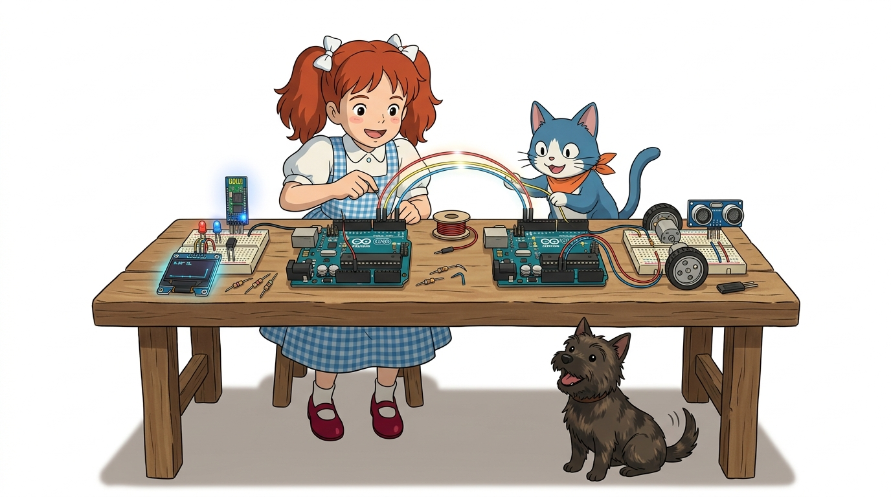
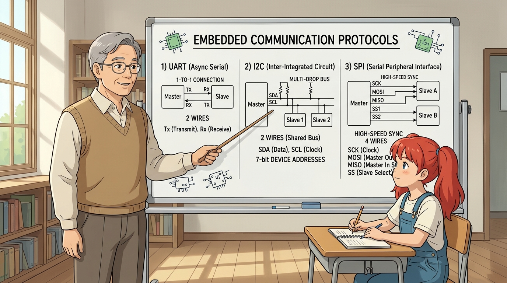
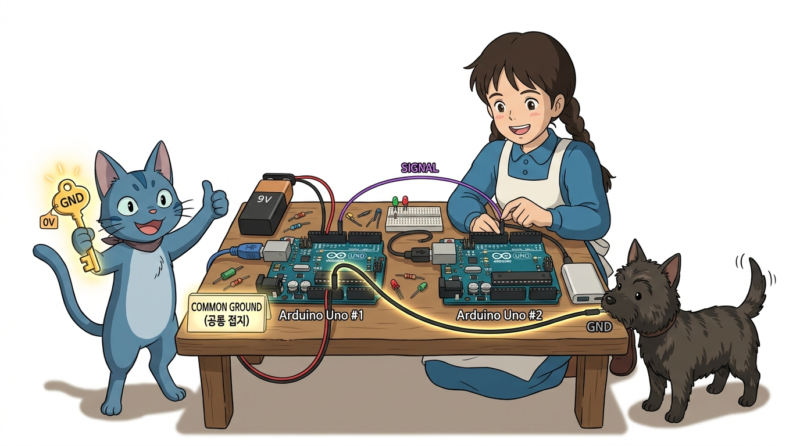
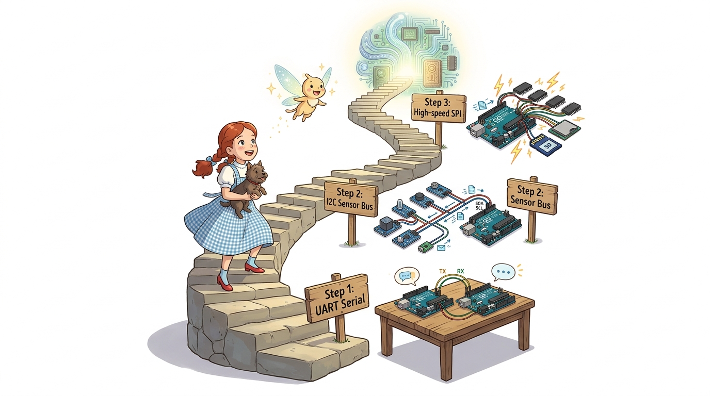

# 123_다중아두이노_네트워크개요 🌐🤝


**도로시와 지니가 함께하는 다중 MCU 분산 처리(Distributed Processing)의 필요성과 3대 임베디드 통신 프로토콜 비교**
* 👧 **도로시**: "지니야! 로봇 자동차를 만들었는데 모터도 돌리고, 초음파 센서도 재고, 블루투스 무선 명령도 받고, LCD 화면도 그려야 해! 혼자서 모든 걸 다 하려니까 화면이 버벅거리고 모터가 덜컥거려!"
* 🐱 **지니**: "사람도 일이 너무 많으면 친구와 역할을 나누어 일하잖아! **2대 이상의 아두이노(다중 MCU)** 를 통신선으로 연결해 한 대는 모터 전담, 한 대는 센서와 디스플레이 전담으로 협동 작전을 펼치면 된단다!"
* 🐶 **토토**: "바우! 백지장도 맞들면 낫고, 아두이노도 뭉치면 슈퍼컴퓨터가 된다 멍!"
* 📖 **상세 강의 교재**: [index.md](./index.md)


> 여러분 안녕하세요! 이번 시간에는 '123. 다중아두이노 네트워크개요 🌐🤝'을 주제로 함께 흥미진진한 탐험을 떠나보겠습니다. 오늘 강의에서는 특히 도로시와 지니가 함께하는 다중 MCU 분산 처리(Distributed Processing)의 필요성과 3대 임베디드 통신 프로토콜 비교, 👧 도로시: "지니야! 로봇 자동차를 만들었는데 모터도 돌리고, 초음파 센서도 재고, 블루투스 무선 명령도 받고, LCD 화면도 그려야 해! 혼자서 모든 걸 다 하려니까 화면이 버벅거리고 모터가 덜컥거려!"를 중심으로 핵심 원리와 응용 방법을 차근차근 배워보겠습니다. 마법 멘토 지니와 호기심 많은 탐험가 도로시, 그리고 귀여운 토토와 함께 신나는 아두이노 모험을 힘차게 시작해 봅시다. 준비되셨나요?

---

## 1. 단일 마이크로컨트롤러의 한계와 분산 처리의 필연성



1. **블로킹(Blocking) 함수의 병목 현상**:
* `delay()`, `pulseIn()`처럼 시간을 끄는 함수가 실행되는 동안에는 CPU가 다른 센서를 읽거나 모터 펄스를 발생시키지 못합니다.
2. **I/O 핀 개수의 물리적 한계**:
* 디지털 핀 14개, 아날로그 핀 6개로는 수많은 센서, 7세그먼트, 모터 드라이버, 디스플레이를 동시에 연결하기에 핀이 태부족합니다.
3. **분산 처리(Distributed Processing)의 해결책**:
* **마스터 아두이노 (Master / Brain)**: 사용자 UI, 버튼 입력, 무선 통신(Bluetooth/Wi-Fi), 고수준 판단 담당.
* **슬레이브 아두이노 (Slave / Motor & Sensor Hub)**: 초음파 거리 측정, 모터 PWM 제어, 엔코더 카운팅 등 실시간 하드웨어 작업 전담.

### 🤖 왜 하나의 아두이노만으로는 부족할까요?
아두이노 우노에 탑재된 ATmega328P는 16MHz 클럭으로 동작하는 8비트 싱글 코어(Single Core) 마이크로컨트롤러입니다.

> 이번 슬라이드에서는 '1. 단일 마이크로컨트롤러의 한계와 분산 처리의 필연성'에 대해 자세히 살펴보겠습니다. 화면의 다이어그램과 사진을 함께 참고해 주시기 바랍니다. 첫 번째 핵심은 블로킹(Blocking) 함수의 병목 현상이며, 두 번째로는 delay(), pulseIn()처럼 시간을 끄는 함수가 실행되는 동안에는 CPU가 다른 센서를 읽거나 모터 펄스를 발생시키지 못합니다.입니다. 여기에 덧붙여 I/O 핀 개수의 물리적 한계 내용까지 함께 이해해 두시면 완벽합니다. 이 원리는 아두이노 시스템 전체를 관통하는 핵심 논리이므로 머릿속에 꼭 정리해 두시기 바랍니다.

---

## 2. 임베디드 3대 유선 통신 방식 비교 (UART vs I2C vs SPI)



| 비교 항목 | 1. UART 시리얼 (Serial) | 2. I2C (Inter-IC) | 3. SPI (Serial Peripheral) |
| :--- | :--- | :--- | :--- |
| **필요 전선 수** | **2가닥 (TX, RX)** (+공통 GND) | **2가닥 (SDA, SCL)** (+공통 GND) | **4가닥 (MOSI, MISO, SCK, SS)** |
| **통신 속도** | 보통 (9600 ~ 115200 bps) | 빠름 (100kHz / 400kHz) | **초고속 (최대 4MHz ~ 8MHz 이상)** |
| **연결 토폴로지** | **1 대 1 (Point-to-Point)** | **1 대 多 (7비트 주소 기반)** | **1 대 多 (전용 SS 칩선택 핀 기반)** |
| **하드웨어 구현**| 매우 간단 (직교 연결) | 풀업 저항 필요, 주소 충돌 주의 | 선이 많지만 프로토콜 오버헤드 없음 |
| **주요 사용처** | 보드 간 1:1 대화, 블루투스 | 센서 다수 연결, OLED, RTC | SD 카드, 고해상도 TFT LCD, 고속 DAC |

### 📡 두 아두이노를 잇는 3가지 통신 고속도로

> 이번에 살펴볼 내용은 '2. 임베디드 3대 유선 통신 방식 비교 (UART vs I2C vs SPI)'입니다. 슬라이드에 정리된 표를 통해 각 항목의 특징과 수치, 차이점을 한눈에 비교해 보실 수 있습니다. 이 기본 개념을 확실히 잡아두셔야 실제 부품을 브레드보드에 꽂고 코딩할 때 실수 없이 완성할 수 있습니다.

---

## 3. 통신의 제1원칙: 공통 접지 (Common Ground)



* 서로 다른 두 아두이노가 USB 케이블이나 독립된 배터리로 전원을 공급받을 때, 두 보드의 **0V 기준 전위(GND)** 가 서로 다르면 전압의 높낮이(HIGH/LOW)를 올바르게 판별할 수 없습니다.
* 따라서 어떤 통신 방식을 사용하든 **두 아두이노의 GND 핀을 점퍼선으로 반드시 하나로 묶어(Common Ground)** 기준 전압을 동일하게 맞춰주어야 합니다!

### ⚡ 접지(GND)를 묶지 않으면 통신이 불가능해요!

> 이번 슬라이드에서는 '3. 통신의 제1원칙: 공통 접지 (Common Ground)'에 대해 자세히 살펴보겠습니다. 화면의 다이어그램과 사진을 함께 참고해 주시기 바랍니다. 첫 번째 핵심은 서로 다른 두 아두이노가 USB 케이블이나 독립된 배터리로 전원을 공급받을 때, 두 보드의 0V 기준 전위(GND) 가 서로 다르면 전압의 높낮이(HIGH/LOW)를 올바르게 판별할 수 없습니다.이며, 두 번째로는 따라서 어떤 통신 방식을 사용하든 두 아두이노의 GND 핀을 점퍼선으로 반드시 하나로 묶어(Common Ground) 기준 전압을 동일하게 맞춰주어야 합니다!입니다. 이 원리는 아두이노 시스템 전체를 관통하는 핵심 논리이므로 머릿속에 꼭 정리해 두시기 바랍니다.

---

## 4. 다중 아두이노 프로젝트 설계 로드맵



```text
[1단계: UART 시리얼 연동]
   두 아두이노의 TX/RX 핀을 교차 연결하여 문자열('A', 'B')과 명령을 1:1로 주고받기!
            ↓
[2단계: I2C 다중 센서 버스 연동]
   SDA(A4), SCL(A5) 두 가닥 버스선 위에 주소(0x08, 0x09)를 부여하여 여러 보드를 줄줄이 연결하기!
            ↓
[3단계: SPI 초고속 통신 연동]
   마스터가 고속 클럭(SCK)을 뿜어내며 슬레이브와 바이트 단위로 실시간 고속 양방향 데이터 교환!
```

> 이번 슬라이드에서는 '4. 다중 아두이노 프로젝트 설계 로드맵'에 대한 실제 동작 코드를 분석해 보겠습니다. 화면의 코드를 살펴보시면, 컴퓨터가 아두이노 하드웨어에 단계별로 명령을 내리는 흐름을 명확하게 확인할 수 있습니다. 각 함수의 역할과 괄호 안의 매개변수가 하드웨어 핀과 어떤 관계를 맺고 동작하는지 주의 깊게 살펴보시기 바랍니다.

---

## 🌟 도로시와 지니의 핵심 요약 노트!


* 👧 **도로시**: "일이 너무 많을 땐 아두이노 여러 대가 역할을 나누어 분산 처리하면 버벅거림 없이 매끄럽게 돌아가는구나!"
* 🐱 **지니**: "맞아! UART, I2C, SPI 세 가지 통신 방식의 장단점을 알고 상황에 맞게 골라 쓰는 것이 핵심이란다."
* 🐶 **토토**: "바우! 먼저 가장 기본이 되는 시리얼 포트(UART) 통신부터 배우러 가자 멍!"

> 오늘 배운 '🌟 도로시와 지니의 핵심 요약 노트!'의 핵심 내용을 모두 정리해 보았습니다. 오늘 다룬 내용 중에서도 👧 도로시: "일이 너무 많을 땐 아두이노 여러 대가 역할을 나누어 분산 처리하면 버벅거림 없이 매끄럽게 돌아가는구나!" 부분은 앞으로의 아두이노 실습과 프로젝트에서 계속 사용되는 매우 중요한 기초 지식입니다. 오늘 배운 내용을 꼭 다시 한번 복습해 보시고, 다음 강의에서 더욱 신나고 유익한 모험으로 다시 만나겠습니다. 모두 수고 많으셨습니다!
