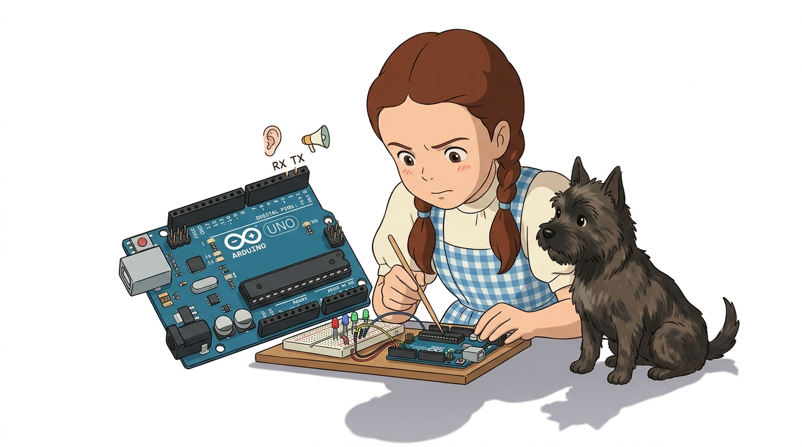
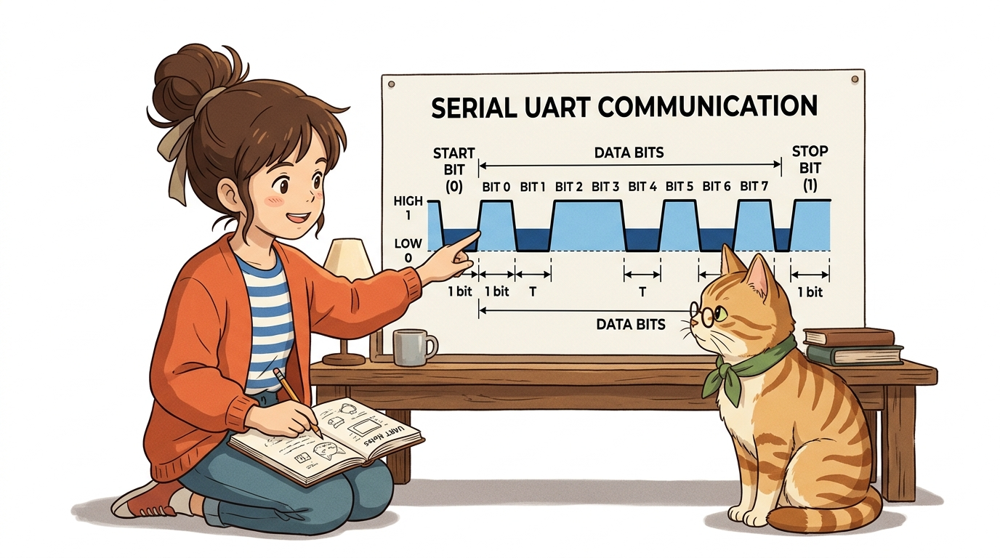
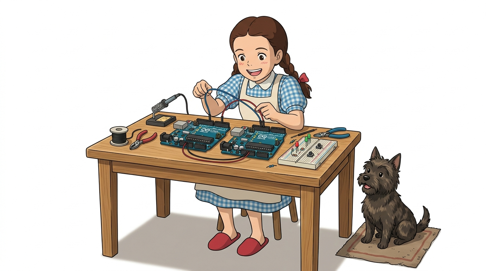
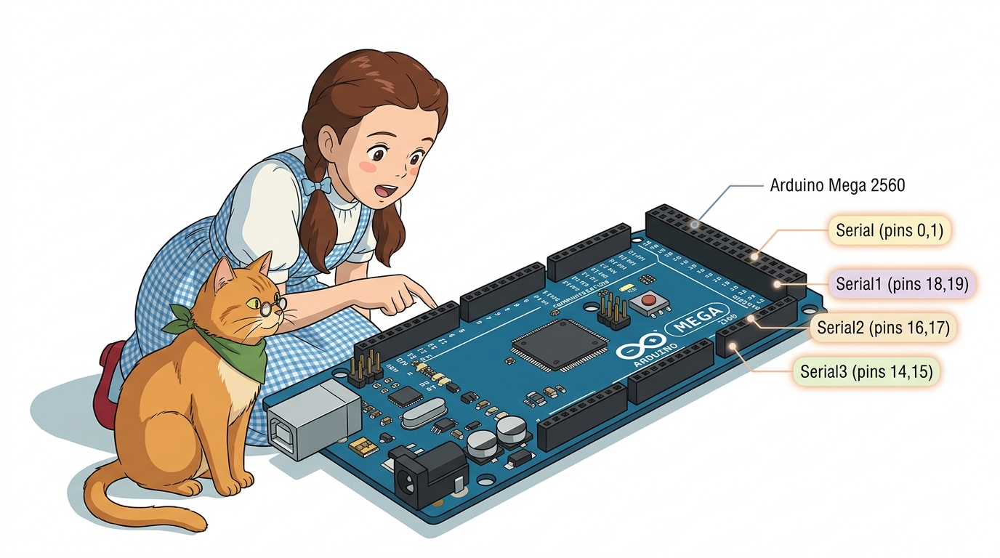
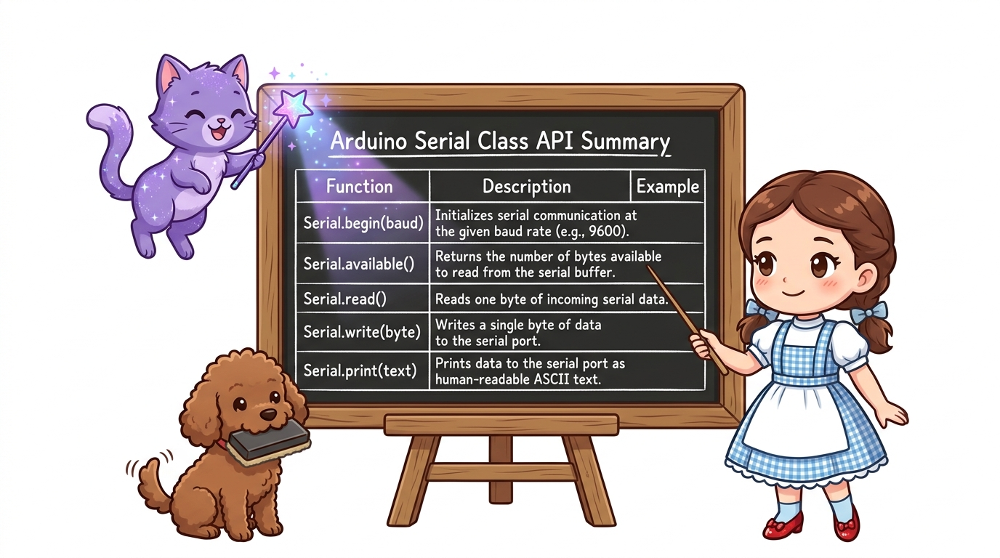
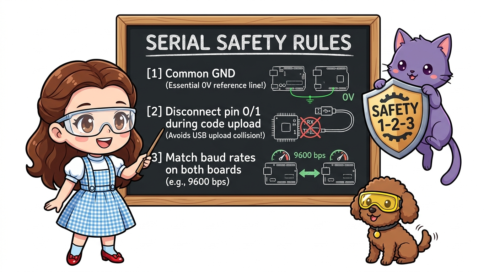

# 124_시리얼포트의_하드웨어비밀 🔌🕵️

**도로시와 지니가 함께하는 UART 비동기 통신 규격, TX/RX 교차 배선 및 아두이노 메가 다중 시리얼 포트 심층 분석**
* 👧 **도로시**: "지니야! 아두이노가 컴퓨터와 USB로 대화할 때 쓰는 포트로 다른 아두이노 친구와도 직접 대화를 나눌 수 있어?"
* 🐱 **지니**: "그럼! 아두이노 우노의 디지털 0번(RX)과 1번(TX) 핀이 바로 전 세계 모든 컴퓨터의 공용 언어인 **하드웨어 UART 시리얼 통로**란다!"
* 🐶 **토토**: "바우! 0번은 남의 말을 듣는 귀(RX), 1번은 내 생각을 말하는 입(TX)이다 멍!"
* 📖 **상세 강의 교재**: [index.md](./index.md)

> 여러분 안녕하세요! 이번 시간에는 '124. 시리얼포트의 하드웨어비밀 🔌🕵️'을 주제로 함께 흥미진진한 탐험을 떠나보겠습니다. 오늘 강의에서는 특히 도로시와 지니가 함께하는 UART 비동기 통신 규격, TX/RX 교차 배선 및 아두이노 메가 다중 시리얼 포트 심층 분석, 👧 도로시: "지니야! 아두이노가 컴퓨터와 USB로 대화할 때 쓰는 포트로 다른 아두이노 친구와도 직접 대화를 나눌 수 있어?"를 중심으로 핵심 원리와 응용 방법을 차근차근 배워보겠습니다. 마법 멘토 지니와 호기심 많은 탐험가 도로시, 그리고 귀여운 토토와 함께 신나는 아두이노 모험을 힘차게 시작해 봅시다. 준비되셨나요?

---

## 1. 아두이노의 기본 하드웨어 통신 핀 (UNO 기준)

* **Digital 0번 (RX - Receiver)**:
* 상대방 장치가 보낸 직렬 데이터 비트들을 귀 기울여 **수신(듣기)** 하는 핀입니다.
* **Digital 1번 (TX - Transmitter)**:
* 내가 상대방에게 보내고 싶은 데이터를 한 비트씩 차례대로 **송신(말하기)** 하는 핀입니다.
* **보드 내부의 USB 변환 칩(ATmega16U2)**:
* 0번과 1번 핀은 아두이노 기판 내부에서 컴퓨터 USB 포트와 직결되어 있습니다.
* 따라서 스케치 코드를 업로드하거나 PC 시리얼 모니터로 글자를 출력할 때 이 두 핀이 실시간으로 사용됩니다.

### 📌 디지털 0번과 1번 핀의 정체: 하드웨어 UART

> 이번에 살펴볼 내용은 '1. 아두이노의 기본 하드웨어 통신 핀 (UNO 기준)'입니다. 화면의 회로도와 부품 사진을 보면서 각 핀과 배선이 어떻게 구성되어 있는지 눈으로 직접 따라와 주시기 바랍니다. 첫째로 Digital 0번 (RX - Receiver)에 유의해야 하며, 둘째로 상대방 장치가 보낸 직렬 데이터 비트들을 귀 기울여 수신(듣기) 하는 핀입니다.라는 점이 핵심입니다. 이 기본 개념을 확실히 잡아두셔야 실제 부품을 브레드보드에 꽂고 코딩할 때 실수 없이 완성할 수 있습니다.

---

## 2. UART 패킷 프레임 구조와 비동기 전송 규격

1. **아이들 상태 (Idle State)**: 통신이 없을 때는 통신선이 항상 **`HIGH (5V)`** 를 유지합니다.
2. **시작 비트 (Start Bit)**: 데이터를 보내기 직전, 1비트 동안 전압을 **`LOW (0V)`** 로 떨어뜨려 상대방에게 "데이터 전송 시작!"을 알립니다.
3. **데이터 비트 (Data Bits)**: 보통 **8비트(1바이트, LSB 우선)** 의 데이터가 사전에 합의된 보드레이트(Baud Rate) 타이밍에 맞춰 순서대로 흘러갑니다.
4. **정지 비트 (Stop Bit)**: 데이터 전송이 끝나면 다시 전압을 **`HIGH (5V)`** 로 올려 다음 바이트를 위한 대기 상태로 복귀합니다.

### ⏱️ 공통 클럭선 없이도 통신이 가능한 비결
UART(Universal Asynchronous Receiver-Transmitter)는 별도의 클럭(동기) 신호선이 없는 **비동기(Asynchronous)** 통신입니다:

> 이번 슬라이드에서는 '2. UART 패킷 프레임 구조와 비동기 전송 규격'에 대해 자세히 살펴보겠습니다. 화면의 다이어그램과 사진을 함께 참고해 주시기 바랍니다. 첫 번째 핵심은 아이들 상태 (Idle State): 통신이 없을 때는 통신선이 항상 HIGH (5V) 를 유지합니다.이며, 두 번째로는 시작 비트 (Start Bit): 데이터를 보내기 직전, 1비트 동안 전압을 LOW (0V) 로 떨어뜨려 상대방에게 "데이터 전송 시작!"을 알립니다.입니다. 여기에 덧붙여 데이터 비트 (Data Bits): 보통 8비트(1바이트, LSB 우선) 의 데이터가 사전에 합의된 보드레이트(Baud Rate) 타이밍에 맞춰 순서대로 흘러갑니다. 내용까지 함께 이해해 두시면 완벽합니다. 이 원리는 아두이노 시스템 전체를 관통하는 핵심 논리이므로 머릿속에 꼭 정리해 두시기 바랍니다.

---

## 3. 하드웨어 시리얼 1:1 교차 연결(Cross-Wiring) 원칙

| 송신 보드 (아두이노 A) | 연결 방향 | 수신 보드 (아두이노 B) | 연결 이유 및 설명 |
| :--- | :---: | :--- | :--- |
| **TX (디지털 1번)** | ➡️ | **RX (디지털 0번)** | A의 입(말하기)에서 나온 신호가 B의 귀(듣기)로 쏙! |
| **RX (디지털 0번)** | ⬅️ | **TX (디지털 1번)** | B의 입에서 나온 응답 신호를 A의 귀로 수신! |
| **GND (공통 접지)** | ➗ | **GND (공통 접지)** | **두 보드의 0V 기준 전위를 일치시키는 절대 필수선!** |

### 🤝 귀와 입을 X자로 교차해 연결해요!
시리얼 통신을 연결할 때 가장 많이 범하는 실수는 TX끼리, RX끼리 나란히 꽂는 것입니다:

> 이번에 살펴볼 내용은 '3. 하드웨어 시리얼 1:1 교차 연결(Cross-Wiring) 원칙'입니다. 슬라이드에 정리된 표를 통해 각 항목의 특징과 수치, 차이점을 한눈에 비교해 보실 수 있습니다. 이 기본 개념을 확실히 잡아두셔야 실제 부품을 브레드보드에 꽂고 코딩할 때 실수 없이 완성할 수 있습니다.

---

## 4. 대형 프로젝트를 위한 아두이노 Mega 2560의 4개 시리얼 포트

* 아두이노 우노(UNO)는 하드웨어 시리얼이 1쌍(`Serial`)뿐이어서 PC와 통신하면서 동시에 블루투스나 다른 아두이노와 통신하기가 까다롭습니다.
* **아두이노 메가 2560(Mega)** 은 독립된 하드웨어 시리얼이 4쌍 제공됩니다:
* **`Serial`**: 0번(RX0) & 1번(TX0) ➡️ USB PC 시리얼 모니터 및 코드 업로드 전용
* **`Serial1`**: 19번(RX1) & 18번(TX1) ➡️ 다른 아두이노 보드와 1:1 직결 통신
* **`Serial2`**: 17번(RX2) & 16번(TX2) ➡️ 블루투스(HC-06) 통신
* **`Serial3`**: 15번(RX3) & 14번(TX3) ➡️ GPS 모듈 또는 열전사 프린터 연결

### 🌟 하드웨어 시리얼 통로가 4쌍이나 탑재된 메가 보드!

> 이번 슬라이드에서는 '4. 대형 프로젝트를 위한 아두이노 Mega 2560의 4개 시리얼 포트'에 대해 자세히 살펴보겠습니다. 화면의 다이어그램과 사진을 함께 참고해 주시기 바랍니다. 첫 번째 핵심은 아두이노 우노(UNO)는 하드웨어 시리얼이 1쌍(Serial)뿐이어서 PC와 통신하면서 동시에 블루투스나 다른 아두이노와 통신하기가 까다롭습니다.이며, 두 번째로는 아두이노 메가 2560(Mega) 은 독립된 하드웨어 시리얼이 4쌍 제공됩니다입니다. 여기에 덧붙여 Serial: 0번(RX0) & 1번(TX0) ➡️ USB PC 시리얼 모니터 및 코드 업로드 전용 내용까지 함께 이해해 두시면 완벽합니다. 이 원리는 아두이노 시스템 전체를 관통하는 핵심 논리이므로 머릿속에 꼭 정리해 두시기 바랍니다.

---

## 5. 아두이노 내장 `Serial` 클래스의 핵심 API 요약

| 함수 이름 | 매개변수 / 반환값 | 주요 역할 |
| :--- | :--- | :--- |
| **`Serial.begin(baud)`** | 9600, 115200 등 | 통신 속도(보드레이트)를 설정하고 통신 포트 초기화 |
| **`Serial.available()`** | 정수(수신된 바이트 수) | 수신 FIFO 버퍼에 읽지 않은 데이터가 몇 바이트 있는지 반환 |
| **`Serial.read()`** | 1바이트 문자 (int/char) | 수신 버퍼의 선두에서 1글자를 꺼내어 읽음 (없으면 -1) |
| **`Serial.write(val)`** | 원시 바이너리 바이트 | 1바이트의 이진 데이터를 그대로 전송 |
| **`Serial.print(val)`** | 문자열, 숫자, 변수 | 사람이 읽기 편한 ASCII 문자열로 변환하여 출력 |

> 이번에 살펴볼 내용은 '5. 아두이노 내장 Serial 클래스의 핵심 API 요약'입니다. 슬라이드에 정리된 표를 통해 각 항목의 특징과 수치, 차이점을 한눈에 비교해 보실 수 있습니다. 이 기본 개념을 확실히 잡아두셔야 실제 부품을 브레드보드에 꽂고 코딩할 때 실수 없이 완성할 수 있습니다.

---

## 6. 시리얼 연동 시 반드시 기억해야 할 3대 안전 수칙

1. **GND 공통 접지(Common Ground) 연결 확인**:
* 기준 전압(0V)이 같지 않으면 전압의 HIGH(5V)/LOW(0V)가 흔들려 외계어 같은 깨진 글자(모지바케)가 수신됩니다.
2. **스케치 업로드 시 0번, 1번 선 분리**:
* PC에서 USB로 코드를 업로드할 때 0번, 1번에 다른 아두이노가 꽂혀 있으면 업로드 충돌(`avrdude: stk500_recv(): programmer is not responding`) 오류가 발생합니다. 업로드할 때는 선을 잠시 뽑아주세요!
3. **양쪽 보드의 보드레이트 일치**:
* 마스터가 9600 bps로 쏘는데 슬레이브가 115200 bps로 듣고 있으면 전혀 대화가 통하지 않습니다.

> 이번 슬라이드에서는 '6. 시리얼 연동 시 반드시 기억해야 할 3대 안전 수칙'에 대해 자세히 살펴보겠습니다. 첫 번째 핵심은 GND 공통 접지(Common Ground) 연결 확인이며, 두 번째로는 기준 전압(0V)이 같지 않으면 전압의 HIGH(5V)/LOW(0V)가 흔들려 외계어 같은 깨진 글자(모지바케)가 수신됩니다.입니다. 여기에 덧붙여 스케치 업로드 시 0번, 1번 선 분리 내용까지 함께 이해해 두시면 완벽합니다. 이 원리는 아두이노 시스템 전체를 관통하는 핵심 논리이므로 머릿속에 꼭 정리해 두시기 바랍니다.

---

## 🌟 도로시와 지니의 핵심 요약 노트!

* 👧 **도로시**: "하드웨어 시리얼은 TX와 RX를 X자로 엇갈려 꽂고, 두 보드의 GND를 반드시 하나로 묶어줘야 한다는 사실을 완벽히 이해했어!"
* 🐱 **지니**: "맞아! 보드레이트만 일치시키면 아두이노끼리 수십 킬로미터 떨어진 거리에서도 유선 케이블을 타고 완벽한 대화가 가능하단다."
* 🐶 **토토**: "바우! 다음 시간에 2대의 아두이노로 버튼을 눌러 상대방 LED를 켜는 실전 코딩을 해보자 멍!"

> 오늘 배운 '🌟 도로시와 지니의 핵심 요약 노트!'의 핵심 내용을 모두 정리해 보았습니다. 오늘 다룬 내용 중에서도 👧 도로시: "하드웨어 시리얼은 TX와 RX를 X자로 엇갈려 꽂고, 두 보드의 GND를 반드시 하나로 묶어줘야 한다는 사실을 완벽히 이해했어!" 부분은 앞으로의 아두이노 실습과 프로젝트에서 계속 사용되는 매우 중요한 기초 지식입니다. 오늘 배운 내용을 꼭 다시 한번 복습해 보시고, 다음 강의에서 더욱 신나고 유익한 모험으로 다시 만나겠습니다. 모두 수고 많으셨습니다!
