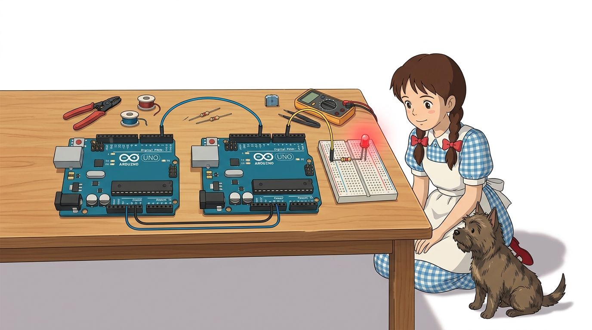
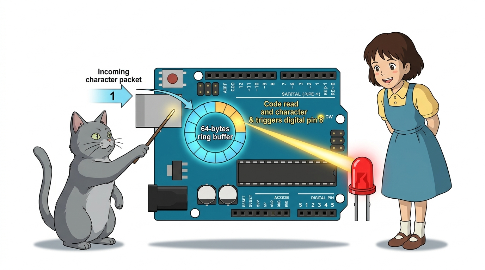
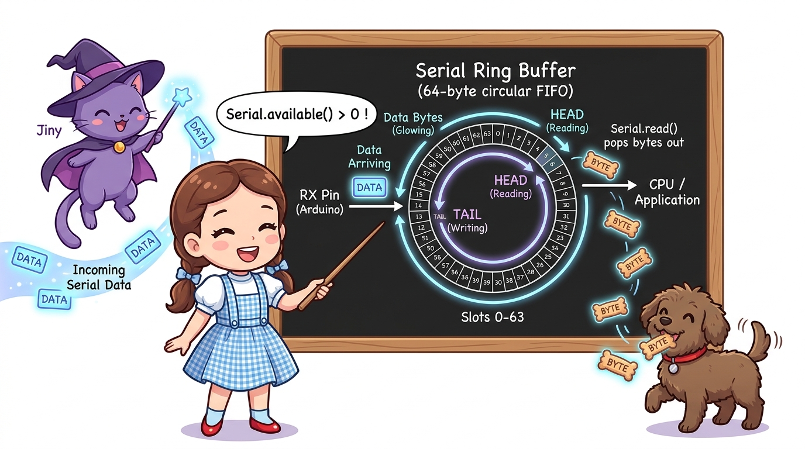
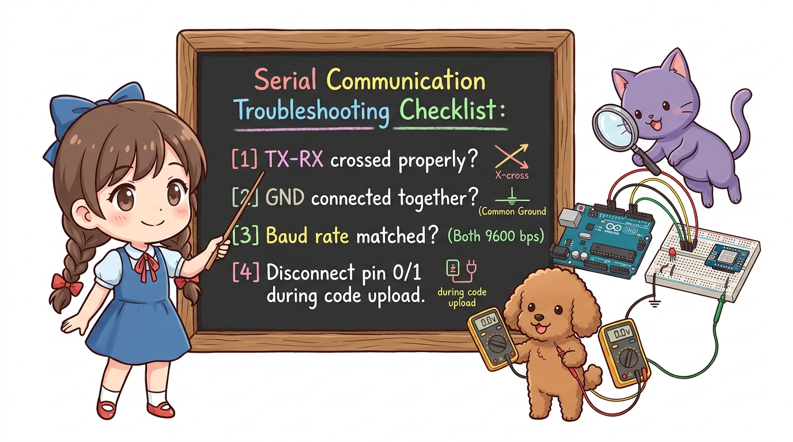

# 125_두대의아두이노_시리얼연동 💬🤝


**도로시와 지니가 함께하는 마스터-슬레이브 원격 제어, 1:1 UART 직결 및 원격 LED 점멸 실습**
* 👧 **도로시**: "지니야! 1번 아두이노에서 '불 켜!' 하고 신호를 쏘면 2번 아두이노가 신호를 받아서 LED를 번쩍 켤 수 있을까?"
* 🐱 **지니**: "당연하지! 송신 아두이노가 '1'과 '0' 문자를 시리얼로 쏘고, 수신 아두이노가 귀를 열어두고 있다가 읽어내면 완벽한 원격 제어가 이루어진단다!"
* 🐶 **토토**: "바우! 두 보드 사이에 텔레파시 광선이 흐른다 멍!"
* 📖 **상세 강의 교재**: [index.md](./index.md)


> 여러분 안녕하세요! 이번 시간에는 '125. 두대의아두이노 시리얼연동 💬🤝'을 주제로 함께 흥미진진한 탐험을 떠나보겠습니다. 오늘 강의에서는 특히 도로시와 지니가 함께하는 마스터-슬레이브 원격 제어, 1:1 UART 직결 및 원격 LED 점멸 실습, 👧 도로시: "지니야! 1번 아두이노에서 '불 켜!' 하고 신호를 쏘면 2번 아두이노가 신호를 받아서 LED를 번쩍 켤 수 있을까?"를 중심으로 핵심 원리와 응용 방법을 차근차근 배워보겠습니다. 마법 멘토 지니와 호기심 많은 탐험가 도로시, 그리고 귀여운 토토와 함께 신나는 아두이노 모험을 힘차게 시작해 봅시다. 준비되셨나요?

---

## 1. 팅커캐드 및 실제 하드웨어 배선



1. **송신측 아두이노 1번(TX)** ➡️ **수신측 아두이노 0번(RX)**:
* 송신자가 말하는 데이터 전송선이 수신자의 귀로 들어갑니다.
2. **공통 접지(GND) 결선**:
* 두 아두이노의 GND 핀을 점퍼선으로 직결하여 기준 전위(0V)를 완벽히 일치시킵니다.
3. **수신측 아두이노 8번 핀에 LED 연결**:
* 디지털 8번 핀 ➡️ 220Ω 저항 ➡️ LED 애노드(+) ➡️ 캐소드(-) ➡️ GND.

### 🔌 핵심 연결 3대 포인트

> 이번 슬라이드에서는 '1. 팅커캐드 및 실제 하드웨어 배선'에 대해 자세히 살펴보겠습니다. 화면의 다이어그램과 사진을 함께 참고해 주시기 바랍니다. 첫 번째 핵심은 송신측 아두이노 1번(TX) ➡️ 수신측 아두이노 0번(RX)이며, 두 번째로는 송신자가 말하는 데이터 전송선이 수신자의 귀로 들어갑니다.입니다. 여기에 덧붙여 공통 접지(GND) 결선 내용까지 함께 이해해 두시면 완벽합니다. 이 원리는 아두이노 시스템 전체를 관통하는 핵심 논리이므로 머릿속에 꼭 정리해 두시기 바랍니다.

---

## 2. 송신부(Master Sender) 아두이노 전체 코드


* [!TIP]
* 코드를 업로드할 때는 수신 아두이노의 0번 핀에 꽂힌 전선을 잠시 뽑아두어야 PC의 USB 업로드 신호와 충돌하지 않습니다! 업로드가 끝나면 다시 꽂아주세요.

### 💻 1초마다 번갈아가며 '1'과 '0' 제어 문자를 전송하는 코드

```cpp
// ==========================================
// [송신측 아두이노 (Master Sender) 스케치]
// ==========================================

void setup() {
  // 1. 하드웨어 시리얼 통신 시작 (9600 bps)
  Serial.begin(9600);
}

void loop() {
  // 1. LED 점등 명령 문자 '1' 전송
  Serial.print('1');
  // 1초 동안 유지
  delay(1000);

  // 2. LED 소등 명령 문자 '0' 전송
  Serial.print('0');
  // 1초 동안 유지
  delay(1000);
}
```

> 이번 슬라이드에서는 '2. 송신부(Master Sender) 아두이노 전체 코드'에 대한 실제 동작 코드를 분석해 보겠습니다. 화면의 코드를 살펴보시면, 컴퓨터가 아두이노 하드웨어에 단계별로 명령을 내리는 흐름을 명확하게 확인할 수 있습니다. 각 함수의 역할과 괄호 안의 매개변수가 하드웨어 핀과 어떤 관계를 맺고 동작하는지 주의 깊게 살펴보시기 바랍니다.

---

## 3. 수신부(Slave Receiver) 아두이노 전체 코드



### 💻 날아온 문자를 수신 버퍼에서 꺼내어 LED를 제어하는 코드

```cpp
// ==========================================
// [수신측 아두이노 (Slave Receiver) 스케치]
// ==========================================

const int LED_PIN = 8; // 제어할 외부 LED 핀 번호

void setup() {
  // 1. 송신측과 정확히 동일한 통신 속도(9600 bps)로 설정
  Serial.begin(9600);

  // 2. LED 핀을 디지털 출력 모드로 설정
  pinMode(LED_PIN, OUTPUT);
  digitalWrite(LED_PIN, LOW); // 초기 상태: 소등
}

void loop() {
  // 1. 수신 버퍼에 데이터가 도착했는지 검사
  if (Serial.available() > 0) {
    // 2. 1바이트 문자 읽어오기
    char cmd = Serial.read();

    // 3. 수신된 문자에 따른 LED 제어
    if (cmd == '1') {
      digitalWrite(LED_PIN, HIGH); // '1' 수신 시 LED 점등!
    } 
    else if (cmd == '0') {
      digitalWrite(LED_PIN, LOW);  // '0' 수신 시 LED 소등!
    }
  }
}
```

> 이번 슬라이드에서는 '3. 수신부(Slave Receiver) 아두이노 전체 코드'에 대한 실제 동작 코드를 분석해 보겠습니다. 화면의 코드를 살펴보시면, 컴퓨터가 아두이노 하드웨어에 단계별로 명령을 내리는 흐름을 명확하게 확인할 수 있습니다. 각 함수의 역할과 괄호 안의 매개변수가 하드웨어 핀과 어떤 관계를 맺고 동작하는지 주의 깊게 살펴보시기 바랍니다.

---

## 4. 코드 상세 해설: 링 버퍼(Ring Buffer)와 `available()`



1. **하드웨어 인터럽트와 64바이트 링 버퍼**:
* 송신자가 보낸 데이터가 수신측 0번(RX) 핀으로 들어오면, 아두이노 내부의 하드웨어 UART 인터럽트가 자동으로 깨어나 CPU가 다른 일을 하고 있더라도 백그라운드에서 데이터를 64바이트 크기의 수신 버퍼에 차곡차곡 쌓아둡니다.
2. **`Serial.available()`**:
* "지금 우체통에 도착해서 쌓여 있는 편지가 몇 통이니?"를 반환합니다.
* 버퍼가 비어 있으면 `0`이 반환되어 불필요한 연산을 건너뛰고, 데이터가 들어오는 즉시 `if`문 안으로 진입합니다.
3. **`Serial.read()`**:
* 수신 버퍼의 맨 앞에서 편지 1통(1바이트)을 꺼내어 반환하고, 버퍼에서 해당 바이트를 지워 다음 데이터가 앞으로 당겨지도록 관리합니다.

### 🔍 아두이노 시리얼 우체통 시스템의 원리

> 이번 슬라이드에서는 '4. 코드 상세 해설: 링 버퍼(Ring Buffer)와 available()'에 대해 자세히 살펴보겠습니다. 첫 번째 핵심은 하드웨어 인터럽트와 64바이트 링 버퍼이며, 두 번째로는 송신자가 보낸 데이터가 수신측 0번(RX) 핀으로 들어오면, 아두이노 내부의 하드웨어 UART 인터럽트가 자동으로 깨어나 CPU가 다른 일을 하고 있더라도 백그라운드에서 데이터를 64바이트 크기의 수신 버퍼에 차곡차곡 쌓아둡니다.입니다. 여기에 덧붙여 Serial.available() 내용까지 함께 이해해 두시면 완벽합니다. 이 원리는 아두이노 시스템 전체를 관통하는 핵심 논리이므로 머릿속에 꼭 정리해 두시기 바랍니다.

---

## 5. 실습 시 자주 발생하는 트러블슈팅 가이드



| 문제 증상 | 주요 원인 | 점검 및 해결 방법 |
| :--- | :--- | :--- |
| **LED가 전혀 반응 없음** | 핀 결선 오배선 | 송신측 **TX(1번)** ➡️ 수신측 **RX(0번)** 연결 재확인 |
| **외계어 문자 수신 / 오작동** | GND 미연결 또는 속도 불일치 | ① 두 보드의 **GND 핀**이 직결되었는지 점검 ② 양쪽 보드의 `Serial.begin(9600)` 보드레이트 일치 확인 |
| **업로드 컴파일러 오류** | USB 업로드 충돌 | **0번, 1번 핀의 전선을 뽑고** 업로드 후 다시 결선 |

> 이번에 살펴볼 내용은 '5. 실습 시 자주 발생하는 트러블슈팅 가이드'입니다. 슬라이드에 정리된 표를 통해 각 항목의 특징과 수치, 차이점을 한눈에 비교해 보실 수 있습니다. 이 기본 개념을 확실히 잡아두셔야 실제 부품을 브레드보드에 꽂고 코딩할 때 실수 없이 완성할 수 있습니다.

---

## 🌟 도로시와 지니의 핵심 요약 노트!


* 👧 **도로시**: "송신 보드가 `Serial.print('1')`을 쏘면 수신 보드가 `Serial.read()`로 읽어서 8번 LED를 켜는 흐름이 정말 완벽해!"
* 🐱 **지니**: "맞아! 하지만 0번, 1번 핀을 쓸 때마다 선을 뽑아야 하는 불편함이 있었지? 다음 시간에는 일반 디지털 핀을 통신 핀으로 변신시키는 소프트웨어 시리얼을 배워보자!"
* 🐶 **토토**: "바우! 선을 뽑지 않아도 되는 편리한 통신 세상으로 출발이다 멍!"

> 오늘 배운 '🌟 도로시와 지니의 핵심 요약 노트!'의 핵심 내용을 모두 정리해 보았습니다. 오늘 다룬 내용 중에서도 👧 도로시: "송신 보드가 Serial.print('1')을 쏘면 수신 보드가 Serial.read()로 읽어서 8번 LED를 켜는 흐름이 정말 완벽해!" 부분은 앞으로의 아두이노 실습과 프로젝트에서 계속 사용되는 매우 중요한 기초 지식입니다. 오늘 배운 내용을 꼭 다시 한번 복습해 보시고, 다음 강의에서 더욱 신나고 유익한 모험으로 다시 만나겠습니다. 모두 수고 많으셨습니다!
