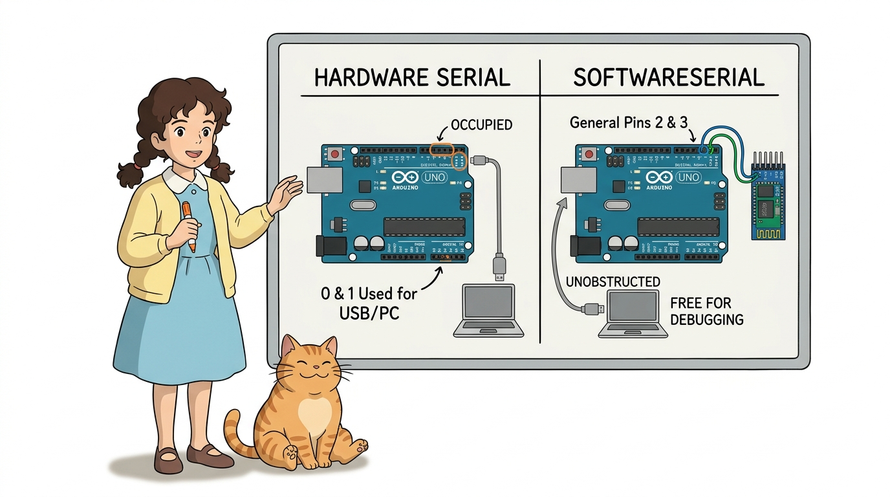
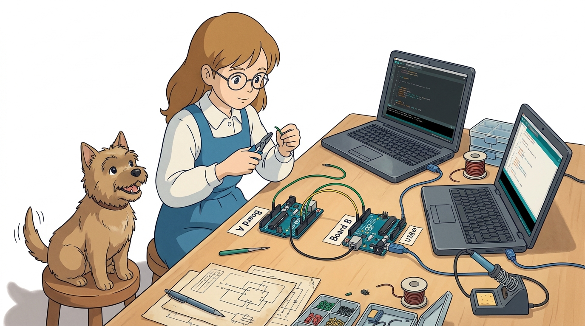
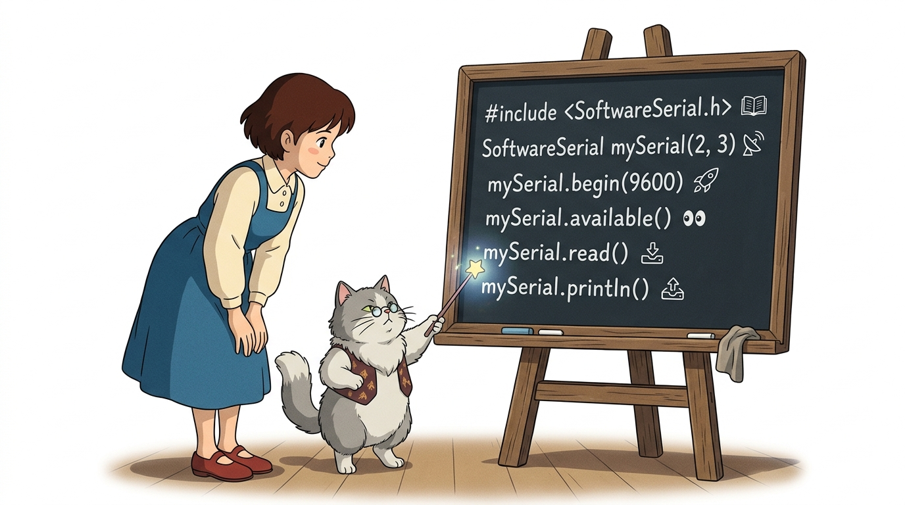
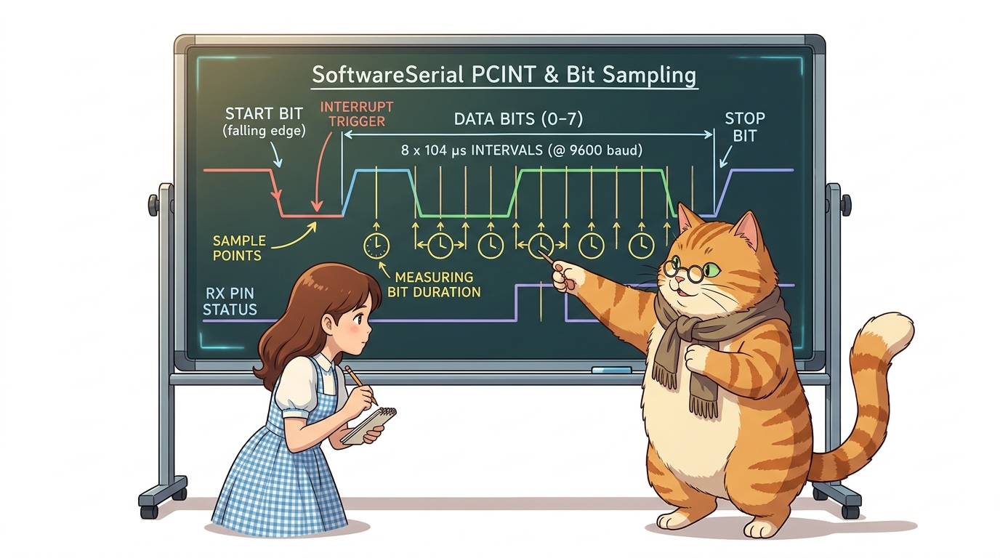
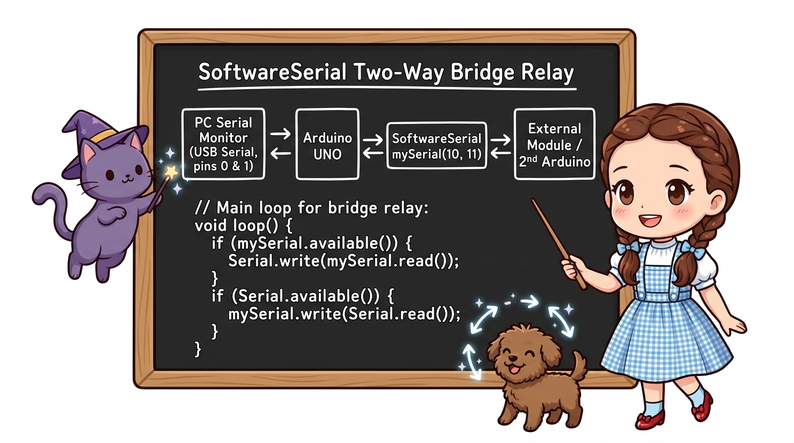
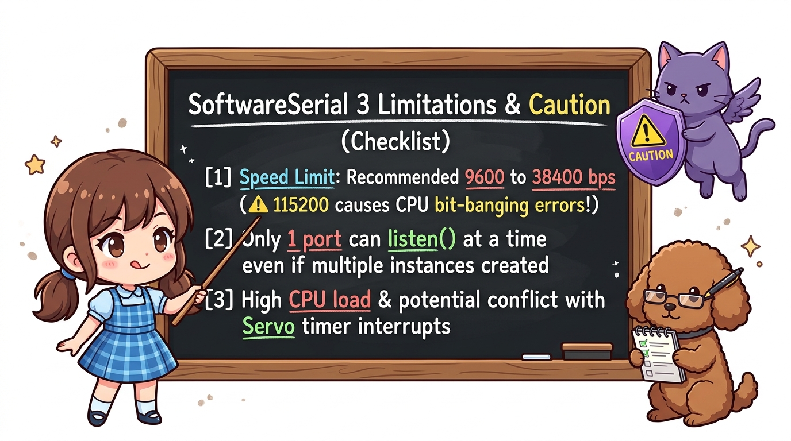

# 126_SoftwareSerial_가상통신핀 🎛️📻


**도로시와 지니가 함께하는 가상 UART 구현 원리, 핀 체인지 인터럽트(PCINT) 및 USB 업로드 충돌 없는 다중 시리얼 통신**

* 👧 **도로시**: "지니야! 0번과 1번 하드웨어 핀은 컴퓨터랑 USB 업로드할 때 쓰느라 항상 바쁜데, 2번과 3번 같은 평범한 디지털 핀을 통신 핀으로 변신시킬 수 없을까?"
* 🐱 **지니**: "당연히 가능하지! 아두이노 표준 라이브러리인 **`SoftwareSerial`** 을 사용하면 일반 디지털 핀의 전압을 소프트웨어적으로 빠르게 흔들어 완벽한 가상 시리얼 포트를 만들어낼 수 있단다!"
* 🐶 **토토**: "바우! 이제 스케치를 올릴 때마다 전선을 뺐다 꽂았다 하지 않아도 된다 멍!"

* 🖥️ **강의 슬라이드**: [slides.md](./slides.md)

---

## 1. 하드웨어 시리얼의 병목과 소프트웨어 시리얼의 탄생



### 🚀 왜 소프트웨어 시리얼(SoftwareSerial)이 필수적일까요?
* **하드웨어 시리얼(0번, 1번)의 제약**:
  * 컴퓨터와 USB 케이블로 연결되어 있어 PC 시리얼 모니터로 디버깅하는 동안에는 블루투스(HC-06), GPS, 지그비(Zigbee) 같은 외부 통신 모듈을 달기 어렵습니다.
  * 코드를 새로 업로드할 때마다 통신 충돌이 일어나 전선을 일일이 뽑아야 하는 불편함이 있습니다.
* **소프트웨어 시리얼의 마법**:
  * 마이크로컨트롤러 내부 타이머와 핀 체인지 인터럽트를 활용하여 일반 GPIO 핀(예: 2번, 3번)을 UART 통신 포트로 에뮬레이션합니다.
  * **PC 시리얼 모니터(하드웨어 시리얼)** 로 실시간 디버깅 메시지를 출력하면서, **동시에 외부 모듈(소프트웨어 시리얼)** 과 무선 데이터를 주고받을 수 있습니다!

---

## 2. 하드웨어 배선과 회로 구성 (디지털 2번, 3번 핀 활용)



### 🔌 가상 포트 핀 결선 가이드
* **아두이노 A (마스터)**:
  * 디지털 **2번 핀 (가상 RX)** ⬅️ 아두이노 B의 디지털 **3번 핀 (가상 TX)**
  * 디지털 **3번 핀 (가상 TX)** ➡️ 아두이노 B의 디지털 **2번 핀 (가상 RX)**
  * **GND 핀** ➗ 아두이노 B의 **GND 핀** (공통 접지 직결)
* **장점**: 0번(RX)과 1번(TX) 핀이 완전히 비어 있으므로, USB 케이블이 연결된 상태에서도 언제든지 자유롭게 스케치를 새로 업로드할 수 있습니다!

---

## 3. 라이브러리 사용 문법과 핵심 API



### 📦 별도 설치 없이 바로 선언하는 표준 라이브러리

```cpp
#include <SoftwareSerial.h>

// 가상 시리얼 포트 핀 번호 지정
const int BT_RX_PIN = 2; // 상대방의 말을 듣는 가상 귀 (RX)
const int BT_TX_PIN = 3; // 상대방에게 말을 하는 가상 입 (TX)

// SoftwareSerial 객체 생성: 이름(RX핀, TX핀)
SoftwareSerial mySerial(BT_RX_PIN, BT_TX_PIN);

void setup() {
  Serial.begin(115200);   // PC 시리얼 모니터용 하드웨어 시리얼 (115200 bps)
  mySerial.begin(9600);   // 외부 장치 통신용 소프트웨어 시리얼 (9600 bps)
}
```

| 기능 | 하드웨어 시리얼 (`Serial`) | 소프트웨어 시리얼 (`mySerial`) |
| :--- | :--- | :--- |
| **포트 초기화** | `Serial.begin(baud);` | `mySerial.begin(baud);` |
| **수신 데이터 확인**| `Serial.available();` | `mySerial.available();` |
| **1바이트 읽기** | `Serial.read();` | `mySerial.read();` |
| **문자열 송신** | `Serial.println("Text");` | `mySerial.println("Text");` |
| **바이너리 송신** | `Serial.write(byte);` | `mySerial.write(byte);` |

---

## 4. 작동 원리: 핀 체인지 인터럽트(PCINT)와 타이밍 다이어그램



### ⚡ 하드웨어 지원 없이 CPU가 직접 비트를 쪼개는 원리
1. **시작 비트 감지**:
   * RX 핀에 신호가 들어와 전압이 `HIGH ➡️ LOW`로 떨어지는 순간, 하드웨어 핀 체인지 인터럽트(Pin Change Interrupt)가 발생하여 CPU를 깨웁니다.
2. **소프트웨어 딜레이 루프**:
   * CPU는 9600 bps의 보드레이트 타이밍(1비트당 약 $104\mu\text{s}$)에 맞춰 정확한 시간 간격으로 RX 핀의 전압 레벨을 8번 샘플링하여 1바이트 문자를 조립합니다.
3. **아두이노 보드별 RX 지원 핀 안내**:
   * **아두이노 우노(UNO)**: 디지털 2번 ~ 13번, A0 ~ A5 등 거의 모든 핀에서 RX 지원.
   * **아두이노 메가(Mega)**: 10, 11, 12, 13, 50, 51, 52, 53, 62~69번 핀에서만 RX 지원 가능.

---

## 5. 실습 전체 코드: 양방향 시리얼 브릿지 릴레이 (Arduino C++)



### 💻 PC 시리얼 모니터와 가상 시리얼 포트를 완벽히 중계하는 펌웨어

```cpp
#include <SoftwareSerial.h>

// 가상 시리얼 통신 핀 정의
const int SOFT_RX = 2; // 가상 수신 핀
const int SOFT_TX = 3; // 가상 송신 핀

// SoftwareSerial 객체 생성
SoftwareSerial softSerial(SOFT_RX, SOFT_TX);

void setup() {
  // 1. PC 시리얼 모니터 하드웨어 포트 시작 (고속 115200 bps)
  Serial.begin(115200);

  // 2. 다른 아두이노 보드와의 가상 포트 시작 (안정적인 9600 bps 권장)
  softSerial.begin(9600);

  Serial.println("==========================================");
  Serial.println("   SoftwareSerial Bi-directional Bridge   ");
  Serial.println("==========================================");
}

void loop() {
  // 1. 다른 아두이노(가상 포트)에서 데이터가 오면 -> PC 화면에 출력
  if (softSerial.available() > 0) {
    char inByte = softSerial.read();
    Serial.write(inByte); // PC 모니터로 토스
  }

  // 2. PC 키보드로 글자를 치면 -> 다른 아두이노(가상 포트)로 발송
  if (Serial.available() > 0) {
    char outByte = Serial.read();
    softSerial.write(outByte); // 가상 통신선으로 발송
  }
}
```

---

## 6. 소프트웨어 시리얼 사용 시 핵심 주의사항과 한계



1. **권장 보드레이트 준수 (최대 19200 bps)**:
   * 전용 하드웨어 실리콘이 아닌 CPU 연산으로 비트 타이밍을 재기 때문에, 115200 bps 같은 초고속 통신에서는 클럭 오차로 인해 글자가 깨질 수 있습니다. **9600 bps**가 가장 안정적입니다.
2. **다중 객체 사용 시 리스닝(`listen()`) 필수**:
   * 여러 개의 `SoftwareSerial` 객체를 만들 수는 있지만, CPU는 한 번에 오직 하나의 포트만 귀 기울여 들을 수 있습니다:
     ```cpp
     portOne.listen(); // 1번 포트 수신 활성화
     ```
3. **공통 접지(GND) 결선 불변의 법칙**:
   * 소프트웨어 시리얼도 물리적인 유선 통신이므로 반드시 두 보드의 GND를 점퍼선으로 묶어주어야 합니다.

---

## 🌟 도로시와 지니의 핵심 요약 노트!


* 👧 **도로시**: "`#include <SoftwareSerial.h>`만 선언하면 2번, 3번 핀도 시리얼 통신 핀으로 변신하여 USB 코드 업로드 충돌을 완벽히 피할 수 있구나!"
* 🐱 **지니**: "맞아! HC-06 블루투스 모듈이나 GPS 모듈을 다룰 때 가장 기본이자 필수적인 테크닉이란다."
* 🐶 **토토**: "바우! 다음엔 2가닥 버스선으로 수많은 보드를 줄줄이 엮는 I2C 통신을 배워보자 멍!"
