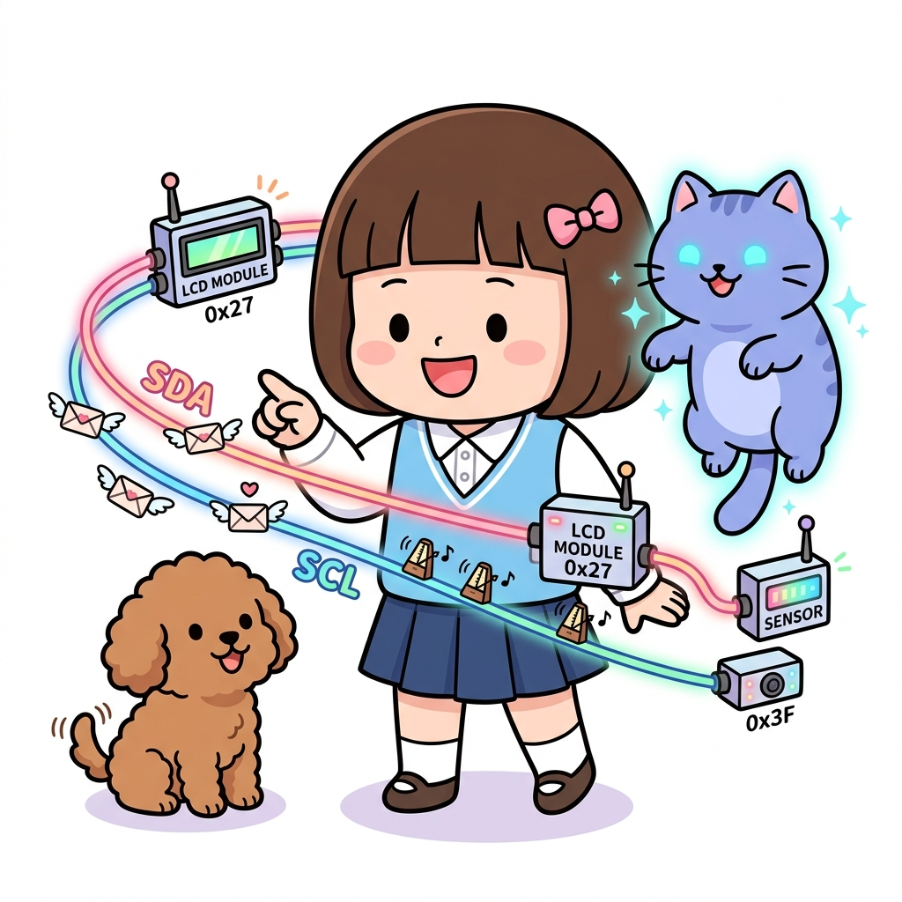
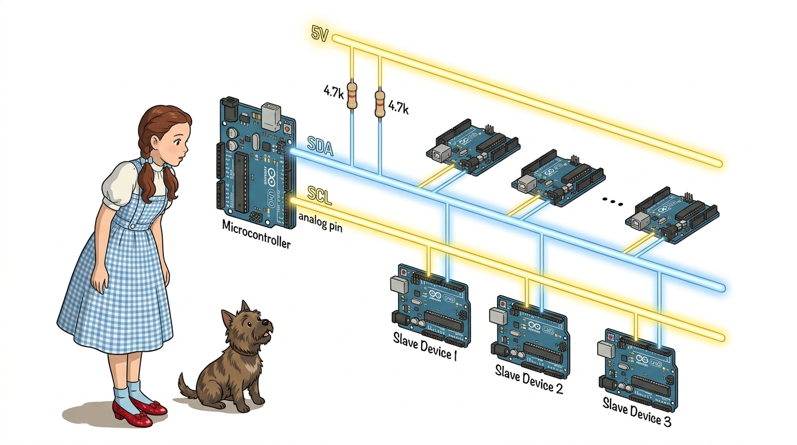
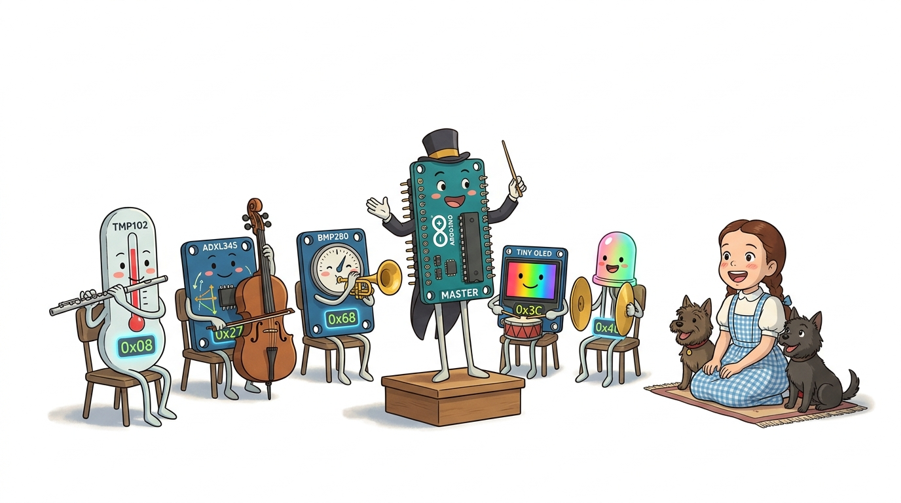
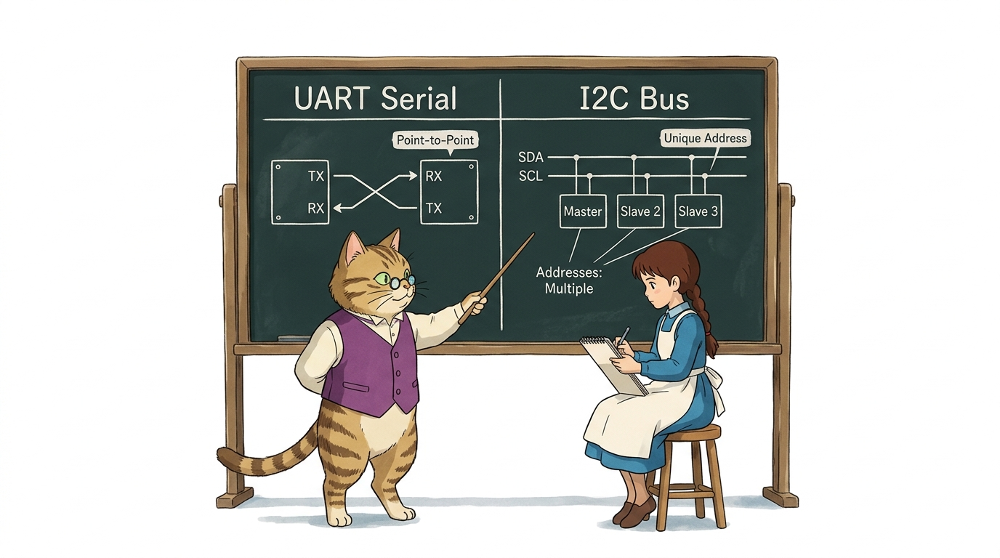
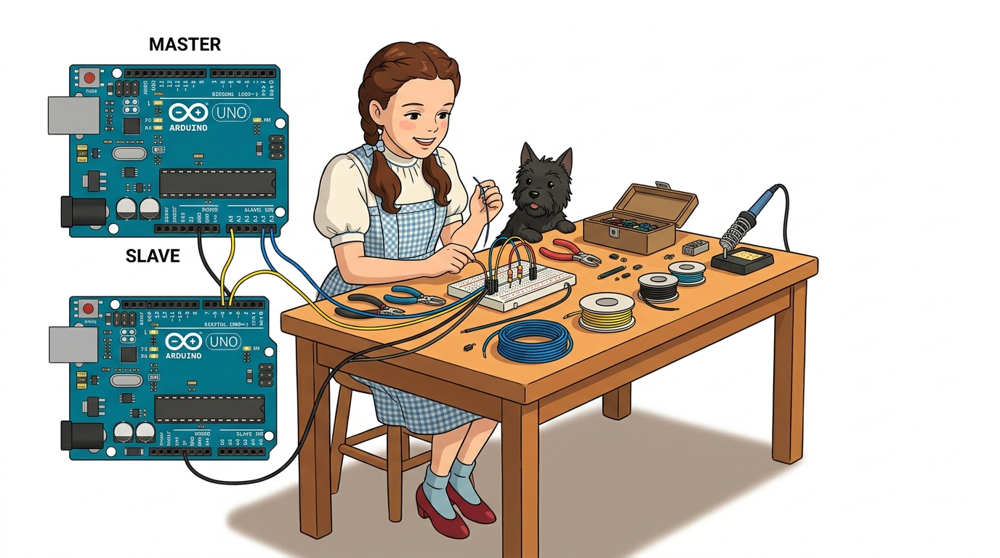

# 127_I2C통신_마스터슬레이브원리 🚌🤝



**도로시와 지니가 함께하는 2선식 동기식 버스 아키텍처, 7비트 주소 체계 및 Wire 라이브러리 기초**

* 👧 **도로시**: "지니야! 시리얼 통신은 두 보드가 1:1로만 대화할 수 있잖아. 그런데 아두이노 1대가 센서 10개, 디스플레이 2개, 다른 아두이노 3대를 전선이 엉키지 않게 한꺼번에 지휘할 순 없을까?"
* 🐱 **지니**: "당연히 있지! 필립스(Philips)에서 발명한 **I2C(Inter-Integrated Circuit, 아이스퀘어드씨) 버스 통신**을 사용하면 단 2가닥 전선만으로 최대 127대의 장치를 줄줄이 엮을 수 있단다!"
* 🐶 **토토**: "바우! 주소록에서 전화번호를 부르듯 장치 번호만 부르면 척척 대답한다 멍!"

* 🖥️ **강의 슬라이드**: [slides.md](./slides.md)

---

## 1. I2C(Inter-Integrated Circuit)의 개념과 2선식 버스 라인



### 🛣️ 단 2가닥 선으로 완성하는 공유 고속도로!
* **SDA (Serial Data, 데이터선)**:
  * 실제 데이터(0과 1) 바이트가 오고 가는 양방향 데이터 통로입니다.
  * 아두이노 우노(UNO) 기준: **아날로그 A4 핀** (또는 AREF 옆 전용 SDA 핀).
* **SCL (Serial Clock, 클럭선)**:
  * "지금 전압을 읽어라!" 하고 마스터가 정확한 박자를 두드려주는 단방향 동기식 클럭선입니다.
  * 아두이노 우노(UNO) 기준: **아날로그 A5 핀** (또는 AREF 옆 전용 SCL 핀).
* **오픈 드레인(Open-Drain)과 풀업 저항(Pull-Up)**:
  * 모든 장치가 선을 GND로만 잡아당길 수 있어 쇼트(충돌)가 나지 않습니다.
  * 평상시 두 라인을 5V로 유지하기 위해 $4.7\text{k}\Omega$ 풀업 저항이 필요합니다 (아두이노는 내부 풀업 활성화 지원).

---

## 2. 1:N 마스터-슬레이브(Master & Slave) 구조와 7비트 주소 체계



### 👑 오케스트라 지휘자(Master)와 단원들(Slaves)
I2C 버스 위에서는 엄격한 주종 관계가 성립합니다:

1. **마스터 (Master, 단 1대)**:
   * 통신의 주도권을 쥐고 SCL 클럭을 발생시키는 지휘자입니다.
   * 슬레이브에게 데이터를 보내거나(Write), 데이터를 보내달라고 요청(Request/Read)합니다.
2. **슬레이브 (Slave, 최대 127대)**:
   * **7비트 고유 주소(Address: 0x08 ~ 0x77)** 를 가지고 버스 위에서 조용히 경청합니다.
   * 마스터가 자신의 주소를 호출하는 패킷을 날릴 때만 깨어나 응답합니다.
3. **버스 공유 방식 (Bus Sharing)**:
   * 모든 슬레이브가 똑같은 SDA, SCL 2가닥 전선에 병렬로 물려 있어 배선이 극단적으로 깔끔해집니다!

---

## 3. UART 시리얼 vs I2C 버스 통신 비교



| 비교 항목 | UART 시리얼 (Serial) | I2C 통신 (Wire) |
| :--- | :--- | :--- |
| **통신 핀** | TX, RX (2가닥) | **SDA, SCL (2가닥)** |
| **결선 방식** | 1:1 교차 결선 (TX ➡️ RX) | **1:N 병렬 버스 결선 (SDA ➡️ SDA, SCL ➡️ SCL)** |
| **상대 식별** | 마주 보는 상대 1대만 존재 | **7비트 고유 하드웨어 주소(Address)로 식별** |
| **클럭 신호** | 비동기 (보드레이트 속도 사전 합의 필수) | **동기식 (마스터가 SCL 클럭 제공)** |
| **대표 부품** | 블루투스(HC-06), GPS, PC 디버깅 | **I2C LCD 1602, OLED, RTC(DS3231), 자이로(MPU6050)** |

---

## 4. 하드웨어 결선 가이드



### 🔌 반드시 지켜야 할 I2C 결선 3대 원칙
1. **나란히 1:1 결선 (동일 이름끼리 묶기)**:
   * 마스터의 **A4(SDA)** ➡️ 슬레이브의 **A4(SDA)**
   * 마스터의 **A5(SCL)** ➡️ 슬레이브의 **A5(SCL)**
   * *시리얼 통신처럼 X자로 엇갈리면 절대로 안 됩니다!*
2. **공통 접지(GND) 결선**:
   * 두 보드의 GND를 반드시 점퍼선으로 직결하여 기준 전위(0V)를 일치시킵니다.
3. **신호선 풀업 저항 ($4.7\text{k}\Omega$)**:
   * 버스 배선이 길어지거나 장치가 3대 이상 늘어나면 SDA와 5V 사이, SCL과 5V 사이에 $4.7\text{k}\Omega$ 저항을 달아 신호 왜곡을 방지합니다.

---

## 5. 아두이노 표준 `Wire.h` 라이브러리 기초 문법


```cpp
#include <Wire.h> // 아두이노 내장 I2C 라이브러리 포함

void setup() {
  // [마스터 보드로 동작할 때]
  Wire.begin(); // 주소 매개변수 없이 선언 -> 지휘관 마스터로 시작!

  // [슬레이브 보드로 동작할 때]
  // Wire.begin(0x08); // 0x08(또는 숫자 8) 등 자신만의 고유 주소를 부여!
}
```

* **마스터 모드**: `Wire.begin()`으로 시작하여 버스의 통제권을 획득합니다.
* **슬레이브 모드**: `Wire.begin(address)`로 시작하여 마스터의 호출을 기다립니다.

---

## 🌟 도로시와 지니의 핵심 요약 노트!


* 👧 **도로시**: "시리얼은 1:1 대화만 되지만, I2C는 SDA와 SCL 2가닥 버스선 위에 주소를 붙여 수많은 장치를 한 번에 지휘할 수 있구나!"
* 🐱 **지니**: "맞아! A4는 데이터(SDA), A5는 클럭(SCL)이며, 같은 이름끼리 나란히 묶는다는 규칙을 꼭 기억하렴."
* 🐶 **토토**: "바우! 다음 시간에 2대의 아두이노를 마스터와 슬레이브로 연결해 진짜 데이터를 보내보자 멍!"
