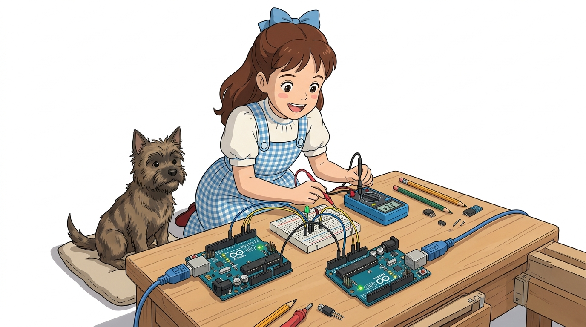
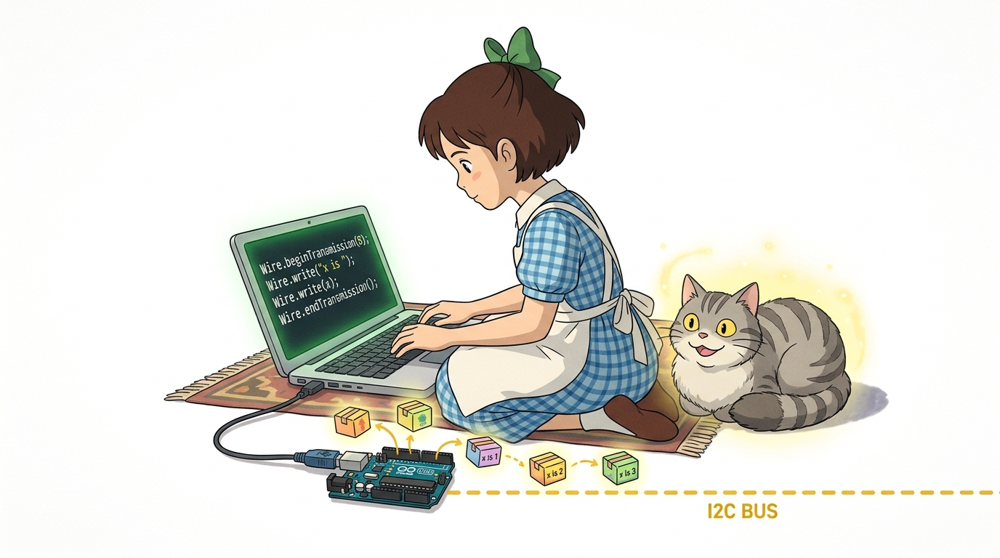
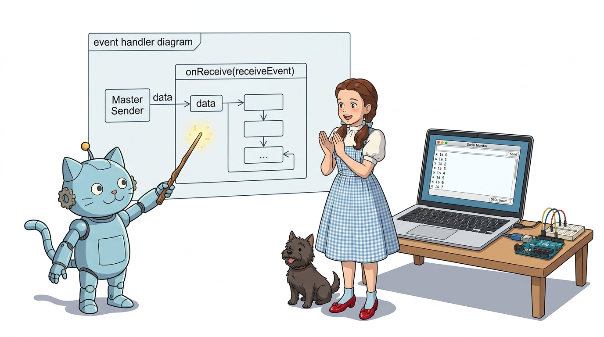
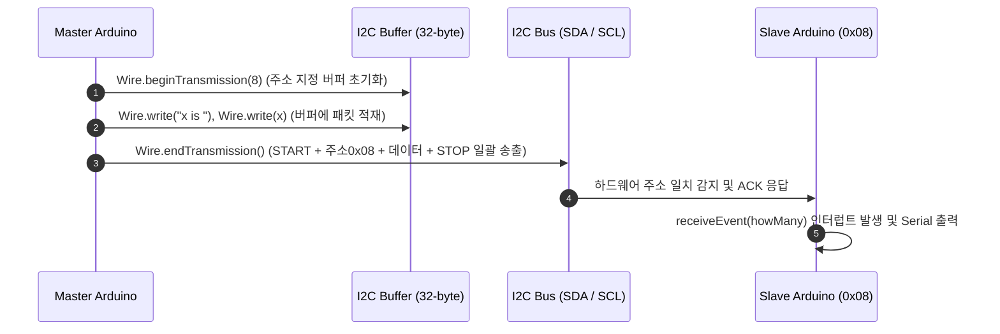
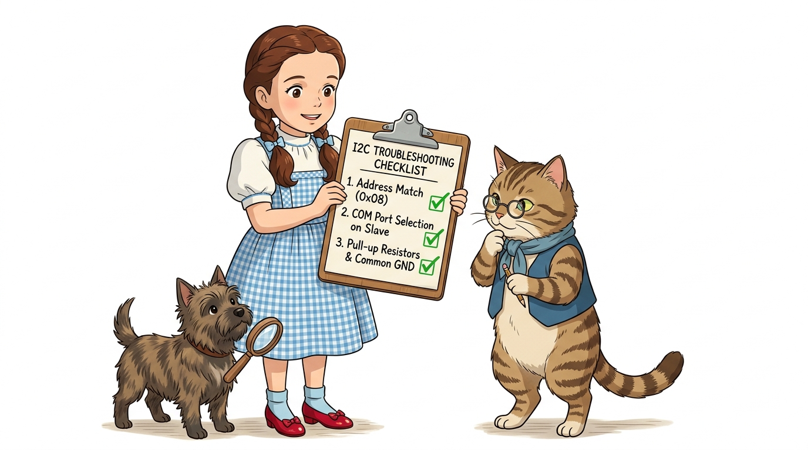

# 128_I2C두대연동_데이터패킷 📦🚚


**도로시와 지니가 함께하는 Master Writer & Slave Receiver 완벽 정복**

* 👧 **도로시**: "지니야! 마스터 아두이노가 슬레이브 아두이노한테 데이터를 보내고, 슬레이브가 그걸 받아서 시리얼 모니터에 출력하는 통신을 직접 해보고 싶어!"
* 🐱 **지니**: "좋아! 아두이노 표준 `Wire` 라이브러리의 핵심 예제인 **Master Writer / Slave Receiver** 구조로 1:1 I2C 통신망을 구축해보자!"
* 🐶 **토토**: "바우! SDA와 SCL 2가닥 선과 공통 접지만 연결하면 마법처럼 통신이 된다 멍!"

* 🖥️ **강의 슬라이드**: [slides.md](./slides.md)

---

## 1. 두 대의 아두이노 I2C 회로 결선도



### 🔌 단 3가닥 전선으로 완성하는 강력한 버스 회로

I2C 통신은 데이터선(SDA)과 클록선(SCL) 단 2가닥으로 통신하며, 기준 전위를 맞추기 위해 GND선 1가닥을 공유합니다.

| 신호선 명칭 | 마스터 아두이노 우노 | 슬레이브 아두이노 우노 | 역할 설명 |
| :--- | :--- | :--- | :--- |
| **SDA** (Serial Data) | **A4** (또는 AREF 옆 SDA) | **A4** (또는 AREF 옆 SDA) | 양방향 직렬 데이터 송수신 선 |
| **SCL** (Serial Clock) | **A5** (또는 AREF 옆 SCL) | **A5** (또는 AREF 옆 SCL) | 마스터가 생성하는 동기화 클록 신호 선 |
| **GND** (Ground) | **GND** | **GND** | 두 보드 간의 전위차를 0V로 맞추는 공통 접지선 |

> [!IMPORTANT]
> **공통 접지(Common GND)는 절대 생략할 수 없습니다!**
> 전압은 상대적인 높낮이이므로, 두 아두이노의 접지(GND)가 서로 연결되어 있지 않으면 신호 전압의 기준이 흔들려 데이터가 깨지거나 전혀 수신되지 않습니다.

---

## 2. 마스터 전송(Master Writer) 스케치



### 📤 8번 슬레이브에게 1초마다 카운트 데이터 발송

마스터 보드는 클록을 주도하며 주소 `8`번 슬레이브를 호출하여 문자열 `"x is "`와 1바이트 숫자 `x`를 묶어 전송합니다.

```cpp
#include <Wire.h> // 아두이노 I2C 통신 표준 라이브러리 포함

byte x = 0; // 전송할 1바이트 카운터 변수 선언 (0 ~ 255)

void setup() {
  Wire.begin(); // 주소 인자 없이 호출하면 '마스터(Master)' 모드로 I2C 버스를 활성화합니다.
}

void loop() {
  Wire.beginTransmission(8); // I2C 주소 8번 슬레이브에게 보낼 데이터 패킷 버퍼를 개방합니다.
  Wire.write("x is ");       // 텍스트 문자열(5바이트)을 내부 전송 버퍼에 기록합니다.
  Wire.write(x);             // 숫자 변수 x(1바이트)를 버퍼에 덧붙입니다.
  Wire.endTransmission();    // 버퍼에 쌓인 모든 데이터를 실제 SDA/SCL 라인으로 송출하고 종료 신호(STOP)를 보냅니다.

  x++;                       // 다음 전송을 위해 카운터 값을 1 증가시킵니다.
  delay(1000);               // 1초 동안 대기한 후 반복합니다.
}
```

---

## 3. 슬레이브 수신(Slave Receiver) 스케치



### 📥 8번 슬레이브의 이벤트 기반 데이터 수신

슬레이브는 주소 `8`을 할당받고, 마스터로부터 데이터가 도착할 때마다 자동으로 실행되는 콜백 함수 `receiveEvent()`를 등록합니다.

```cpp
#include <Wire.h> // 아두이노 I2C 통신 표준 라이브러리 포함

void setup() {
  Wire.begin(8);                // 주소 '8'을 지정하여 슬레이브(Slave) 모드로 I2C 버스에 참여합니다.
  Wire.onReceive(receiveEvent); // 마스터가 데이터를 송출하면 자동으로 호출될 수신 이벤트 핸들러 함수를 등록합니다.
  Serial.begin(9600);           // 수신된 데이터를 PC 시리얼 모니터로 확인하기 위해 9600bps로 초기화합니다.
}

void loop() {
  delay(100); // 메인 루프는 비워두어도 백그라운드 인터럽트에 의해 receiveEvent가 정상 호출됩니다.
}

// I2C 버퍼에 마스터의 데이터가 도착했을 때 자동으로 실행되는 콜백 함수
void receiveEvent(int howMany) {
  while (Wire.available()) {    // 버퍼에 읽을 수 있는 데이터가 남아있는 동안 반복
    char c = Wire.read();       // 1바이트씩 데이터를 꺼내어 char형으로 저장
    Serial.print(c);            // 시리얼 모니터에 출력
  }
}
```

---

## 4. `Wire` 라이브러리의 패킷 포장 메커니즘


### 📦 마스터 송신 3단계와 슬레이브 인터럽트 작동 원리

마스터가 데이터를 전송할 때 `Wire.write()`가 즉시 물리적 전선으로 신호를 쏘는 것이 아닙니다. 내부 버퍼를 거쳐 완성형 패킷으로 한 번에 발송됩니다.



1. **`Wire.beginTransmission(address)`**:
   * 전송할 대상 슬레이브의 7비트 주소(8)를 등록하고 전송 버퍼 인덱스를 0으로 리셋합니다.
2. **`Wire.write(data)`**:
   * 아두이노의 32바이트 크기 내부 송신 버퍼에 데이터를 차례대로 적재합니다. (전선 신호 발생 안 함)
3. **`Wire.endTransmission()`**:
   * 버퍼에 담긴 내용을 START 조건 신호와 함께 슬레이브 주소 + 쓰기 비트(0)를 싣고, 데이터 바이트들을 연속 송출한 뒤 STOP 조건으로 전송을 마칩니다.
4. **`Wire.onReceive(handler)`**:
   * 슬레이브는 메인 루프를 돌고 있더라도 마스터의 STOP 신호가 감지되면 즉시 하드웨어 인터럽트로 `receiveEvent`를 호출하여 데이터를 잃어버리지 않고 즉각 처리합니다.

---

## 5. 실습 점검 체크리스트 & 문제 해결 가이드



### 🔍 실습 중 글자가 깨지거나 통신이 안 될 때 해결법

* **주소 매칭 확인**:
  * 마스터 코드의 `Wire.beginTransmission(8)` 주소와 슬레이브 코드의 `Wire.begin(8)` 주소가 정확히 일치해야 합니다.
* **시리얼 모니터 포트 선택 주의**:
  * 아두이노 IDE에서 **슬레이브 보드가 꽂혀 있는 COM 포트**를 선택해야 수신된 `"x is ..."` 메시지가 모니터에 출력됩니다. 마스터 쪽 포트를 열면 아무것도 출력되지 않습니다.
* **풀업 저항(Pull-up Resistor)**:
  * 두 아두이노 우노를 연결할 때 `Wire.begin()` 실행 시 내부 풀업 저항(약 20kΩ~50kΩ)이 자동으로 활성화되므로 짧은 점퍼선(20cm 이내) 환경에서는 외장 풀업 저항 없이도 통신이 원활히 동작합니다.

---

## 🌟 도로시와 지니의 핵심 요약 노트!


* 👧 **도로시**: "마스터는 버퍼에 데이터를 모았다가 `endTransmission()`으로 한 방에 쏘고, 슬레이브는 `onReceive` 인터럽트로 받으니까 아주 깔끔해!"
* 🐱 **지니**: "맞아! I2C는 주소 기반 통신이기 때문에 마스터의 전선에 슬레이브를 여러 대 추가로 물려도 선이 더 늘어나지 않는 게 가장 큰 매력이란다."
* 🐶 **토토**: "바우! 그럼 다음 장에서는 슬레이브 아두이노를 2대로 늘려서 총 3대의 아두이노가 소통하는 3대 연동을 해보자 멍!"
