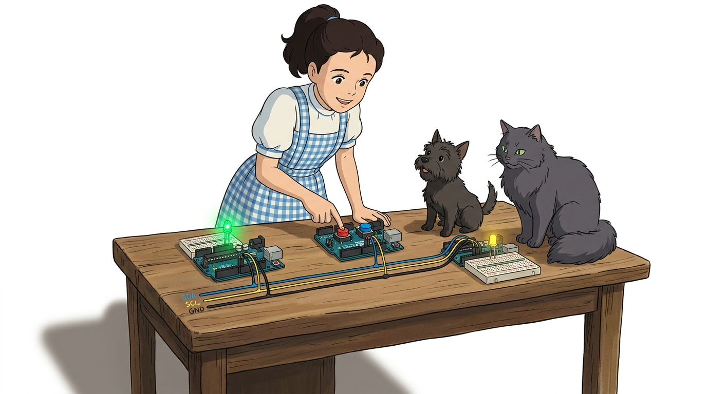
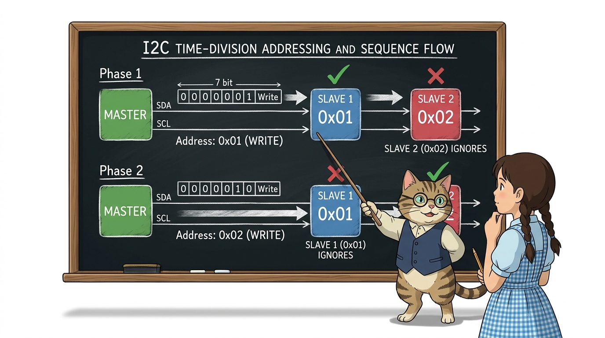
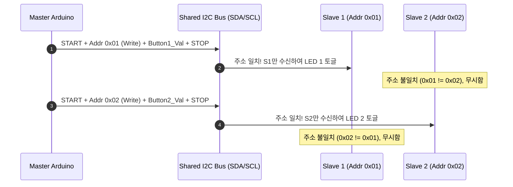

# 129_I2C세대연동_1대N네트워크 🌐🕸️


**도로시와 지니가 함께하는 1 Master & 2 Slaves 다중 원격 제어**
* 👧 **도로시**: "지니야! 마스터 아두이노 하나에 연결된 버튼 2개로 슬레이브 1번과 슬레이브 2번의 LED를 각각 따로 켤 수 있을까?"
* 🐱 **지니**: "물론이지! I2C는 주소 기반 버스 통신망이기 때문에 마스터가 `1번 주소`와 `2번 주소`를 번갈아 호출하며 데이터를 보내면 단 2가닥의 선만으로도 각각의 슬레이브를 개별 제어할 수 있단다!"
* 🐶 **토토**: "바우! 선이 복잡하게 얽히지 않고 나뭇가지처럼 병렬로 연결된다 멍!"
* 📖 **상세 강의 교재**: [index.md](./index.md)


> 여러분 안녕하세요! 이번 시간에는 '129. I2C세대연동 1대N네트워크 🌐🕸️'을 주제로 함께 흥미진진한 탐험을 떠나보겠습니다. 오늘 강의에서는 특히 도로시와 지니가 함께하는 1 Master & 2 Slaves 다중 원격 제어, 👧 도로시: "지니야! 마스터 아두이노 하나에 연결된 버튼 2개로 슬레이브 1번과 슬레이브 2번의 LED를 각각 따로 켤 수 있을까?"를 중심으로 핵심 원리와 응용 방법을 차근차근 배워보겠습니다. 마법 멘토 지니와 호기심 많은 탐험가 도로시, 그리고 귀여운 토토와 함께 신나는 아두이노 모험을 힘차게 시작해 봅시다. 준비되셨나요?

---

## 1. 회로도 분석: 1 Master & 2 Slaves 버스 구성



* [!NOTE]
* 브레드보드의 파란색 라인을 공통 GND로 삼고, 두 개의 신호선 레일을 각각 SDA와 SCL로 지정하면 3대 이상의 아두이노도 손쉽게 연결할 수 있습니다.

| 보드 구분 | 역할 및 핀 구성 | I2C 연결 핀 | 기능 요약 |
| :--- | :--- | :--- | :--- |
| **Master** | 8번 핀(버튼 1), 9번 핀(버튼 2) | A4(SDA), A5(SCL), GND | 버튼 입력을 읽어 해당 주소로 명령 전송 |
| **Slave 1** | 주소 **`1`**, 7번 핀(LED 1) | A4(SDA), A5(SCL), GND | 1번 주소로 온 데이터를 받아 LED 1 제어 |
| **Slave 2** | 주소 **`2`**, 7번 핀(LED 2) | A4(SDA), A5(SCL), GND | 2번 주소로 온 데이터를 받아 LED 2 제어 |

### 🔌 병렬 버스 토폴로지(Bus Topology) 배선
세 대의 아두이노가 동일한 SDA/SCL 라인을 공유하도록 브레드보드의 공통 버스 레일에 병렬 연결합니다.

> 이번에 살펴볼 내용은 '1. 회로도 분석: 1 Master & 2 Slaves 버스 구성'입니다. 슬라이드에 정리된 표를 통해 각 항목의 특징과 수치, 차이점을 한눈에 비교해 보실 수 있습니다. 이 기본 개념을 확실히 잡아두셔야 실제 부품을 브레드보드에 꽂고 코딩할 때 실수 없이 완성할 수 있습니다.

---

## 2. 마스터(Master) 아두이노 스케치


### 👑 버튼 상태를 읽고 슬레이브 주소를 지정하여 전송
마스터는 8번과 9번 핀의 스위치 값을 읽어 각각 주소 `1`번과 주소 `2`번 슬레이브에게 1바이트 상태 값을 송출합니다.

```cpp
#include <Wire.h> // 아두이노 I2C 표준 라이브러리 포함

const int button1 = 8; // 1번 슬레이브 제어용 푸시버튼 핀
const int button2 = 9; // 2번 슬레이브 제어용 푸시버튼 핀

void setup() {
  Wire.begin();        // 주소 없이 호출하여 I2C '마스터' 모드로 시작
  Serial.begin(115200); // 디버깅용 시리얼 통신 초기화 (고속 115200 bps)
  
  pinMode(button1, INPUT); // 1번 버튼 핀을 입력으로 설정
  pinMode(button2, INPUT); // 2번 버튼 핀을 입력으로 설정
}

void loop() {
  // 1. 1번 버튼 읽기 및 슬레이브 1번(주소 1)으로 전송
  int x = digitalRead(button1);
  Wire.beginTransmission(1); // 주소 1번 슬레이브를 대상으로 패킷 개방
  Wire.write(x);             // 버튼1의 상태(HIGH/LOW)를 전송 버퍼에 적재
  Wire.endTransmission();    // 실제 버스로 데이터 송출 후 종료
  Serial.print("button1 = "); Serial.println(x);
  delay(100);                // 슬레이브 수신 안정화를 위한 짧은 지연

  // 2. 2번 버튼 읽기 및 슬레이브 2번(주소 2)으로 전송
  int y = digitalRead(button2);
  Wire.beginTransmission(2); // 주소 2번 슬레이브를 대상으로 패킷 개방
  Wire.write(y);             // 버튼2의 상태(HIGH/LOW)를 전송 버퍼에 적재
  Wire.endTransmission();    // 실제 버스로 데이터 송출 후 종료
  Serial.print("button2 = "); Serial.println(y);
  delay(100);                // 통신 간격 유지
}
```

> 이번 슬라이드에서는 '2. 마스터(Master) 아두이노 스케치'에 대한 실제 동작 코드를 분석해 보겠습니다. 화면의 코드를 살펴보시면, 컴퓨터가 아두이노 하드웨어에 단계별로 명령을 내리는 흐름을 명확하게 확인할 수 있습니다. 각 함수의 역할과 괄호 안의 매개변수가 하드웨어 핀과 어떤 관계를 맺고 동작하는지 주의 깊게 살펴보시기 바랍니다.

---

## 3. 마스터 제어 알고리즘 심층 분석



1. **주소 필터링**:
* 버스 상의 모든 신호는 모든 슬레이브가 듣지만, 자신의 하드웨어 주소와 일치하지 않는 패킷은 MCU 하드웨어 레벨에서 즉시 무시하므로 CPU 부하가 없습니다.
2. **시분할 전송(Time-Sharing)**:
* 마스터가 슬레이브 1에게 보낸 뒤 `delay(100)`의 틈을 두고 슬레이브 2에게 순차적으로 전송하므로 버스 충돌이 원천 방지됩니다.

### 🔄 주소 분할 다중화(Time-division Addressing)
마스터 아두이노는 하나의 I2C 버스를 시간차를 두고 번갈아 활용하여 서로 다른 슬레이브를 독립적으로 지휘합니다.



> 이번 슬라이드에서는 '3. 마스터 제어 알고리즘 심층 분석'에 대한 실제 동작 코드를 분석해 보겠습니다. 화면의 코드를 살펴보시면, 컴퓨터가 아두이노 하드웨어에 단계별로 명령을 내리는 흐름을 명확하게 확인할 수 있습니다. 여기서 핵심은 주소 필터링입니다. 각 함수의 역할과 괄호 안의 매개변수가 하드웨어 핀과 어떤 관계를 맺고 동작하는지 주의 깊게 살펴보시기 바랍니다.

---

## 4. 슬레이브 1(Slave 1) 아두이노 스케치


### 🏷️ 주소 1번: 1번 마스터의 명령 수신 대기
슬레이브 1은 고유 주소 `1`번을 부여받고, 수신 콜백 함수를 통해 LED를 즉각 점등/소등합니다.

```cpp
#include <Wire.h> // I2C 라이브러리

const int pinLED = 7; // 슬레이브 1에 연결된 제어용 LED 핀

void setup() {
  Wire.begin(1);                 // 주소 '1'번 슬레이브 모드로 I2C 버스 참여
  Wire.onReceive(receivedEvent); // 마스터 패킷 수신 시 실행할 함수 등록
  pinMode(pinLED, OUTPUT);       // LED 핀을 출력으로 설정
}

void loop() {
  delay(100); // 메인 루프는 비워두어도 하드웨어 인터럽트로 이벤트가 실행됩니다.
}

// 마스터로부터 1번 주소 패킷이 도착했을 때 자동 실행되는 함수
void receivedEvent(int howmany) {
  int val = Wire.read(); // 버퍼에서 마스터가 보낸 버튼 상태 값 꺼내기
  // 버튼 배선 상태에 따라 LED 출력 반영
  digitalWrite(pinLED, val == HIGH ? LOW : HIGH);
}
```

> 이번 슬라이드에서는 '4. 슬레이브 1(Slave 1) 아두이노 스케치'에 대한 실제 동작 코드를 분석해 보겠습니다. 화면의 코드를 살펴보시면, 컴퓨터가 아두이노 하드웨어에 단계별로 명령을 내리는 흐름을 명확하게 확인할 수 있습니다. 각 함수의 역할과 괄호 안의 매개변수가 하드웨어 핀과 어떤 관계를 맺고 동작하는지 주의 깊게 살펴보시기 바랍니다.

---

## 5. 슬레이브 2(Slave 2) 아두이노 스케치


### 🏷️ 주소 2번: 2번 마스터의 명령 수신 대기
슬레이브 2는 슬레이브 1과 코드 구조가 99% 동일하지만, **I2C 주소를 `2`번으로 설정**하여 자신만의 명령만 선별 수신합니다.

```cpp
#include <Wire.h> // I2C 라이브러리

const int pinLED = 7; // 슬레이브 2에 연결된 제어용 LED 핀

void setup() {
  Wire.begin(2);                 // 주소 '2'번 슬레이브 모드로 I2C 버스 참여!
  Wire.onReceive(receivedEvent); // 수신 이벤트 핸들러 등록
  pinMode(pinLED, OUTPUT);       // LED 핀을 출력으로 설정
}

void loop() {
  delay(100);
}

void receivedEvent(int howmany) {
  int val = Wire.read(); // 2번 주소로 전송된 데이터 바이트 수신
  digitalWrite(pinLED, val == HIGH ? LOW : HIGH);
}
```

> 이번 슬라이드에서는 '5. 슬레이브 2(Slave 2) 아두이노 스케치'에 대한 실제 동작 코드를 분석해 보겠습니다. 화면의 코드를 살펴보시면, 컴퓨터가 아두이노 하드웨어에 단계별로 명령을 내리는 흐름을 명확하게 확인할 수 있습니다. 각 함수의 역할과 괄호 안의 매개변수가 하드웨어 핀과 어떤 관계를 맺고 동작하는지 주의 깊게 살펴보시기 바랍니다.

---

## 6. 다중 I2C 통신의 핵심 설계 원칙


1. **고유 주소 보장 (Unique Address)**:
* 버스 내 모든 디바이스는 고유한 7비트 주소를 가져야 합니다. 만약 실수로 슬레이브 둘 다 `Wire.begin(1)`로 설정하면 신호가 충돌하여 통신이 마비됩니다.
2. **이벤트 핸들러 경량화 (Lightweight ISR)**:
* `receivedEvent()` 내부에서는 `Serial.println()`이나 `delay()` 같은 지연 요소를 최소화하고, 수신된 값을 전역 변수에 저장한 뒤 `loop()`에서 무거운 작업을 처리하는 것이 정석입니다.
3. **확장성의 마법**:
* 슬레이브가 3대, 4대, 10대로 늘어나도 아두이노의 물리적 통신 핀은 여전히 **A4(SDA)와 A5(SCL)** 2개만 사용합니다!

### 💡 도로시를 위한 지니의 3대 설계 꿀팁

> 이번 슬라이드에서는 '6. 다중 I2C 통신의 핵심 설계 원칙'에 대해 자세히 살펴보겠습니다. 화면의 다이어그램과 사진을 함께 참고해 주시기 바랍니다. 첫 번째 핵심은 고유 주소 보장 (Unique Address)이며, 두 번째로는 버스 내 모든 디바이스는 고유한 7비트 주소를 가져야 합니다. 만약 실수로 슬레이브 둘 다 Wire.begin(1)로 설정하면 신호가 충돌하여 통신이 마비됩니다.입니다. 여기에 덧붙여 이벤트 핸들러 경량화 (Lightweight ISR) 내용까지 함께 이해해 두시면 완벽합니다. 이 원리는 아두이노 시스템 전체를 관통하는 핵심 논리이므로 머릿속에 꼭 정리해 두시기 바랍니다.

---

## 🌟 도로시와 지니의 마무리 요약!


* 👧 **도로시**: "마스터가 `Wire.beginTransmission(1)`과 `Wire.beginTransmission(2)`로 주소만 바꿔주면 수많은 아두이노를 각각 따로 움직일 수 있구나!"
* 🐱 **지니**: "맞아! 이것이 바로 현대 컴퓨터 메인보드와 스마트폰 내부 센서들이 서로 소통하는 I2C 버스의 위대한 원리란다."
* 🐶 **토토**: "바우! 이제 다음 단계에서는 4개의 핀으로 더 빠르게 통신하는 고속 오케스트라, **SPI 통신**으로 떠나보자 멍!"

> 오늘 배운 '🌟 도로시와 지니의 마무리 요약!'의 핵심 내용을 모두 정리해 보았습니다. 오늘 다룬 내용 중에서도 👧 도로시: "마스터가 Wire.beginTransmission(1)과 Wire.beginTransmission(2)로 주소만 바꿔주면 수많은 아두이노를 각각 따로 움직일 수 있구나!" 부분은 앞으로의 아두이노 실습과 프로젝트에서 계속 사용되는 매우 중요한 기초 지식입니다. 오늘 배운 내용을 꼭 다시 한번 복습해 보시고, 다음 강의에서 더욱 신나고 유익한 모험으로 다시 만나겠습니다. 모두 수고 많으셨습니다!
