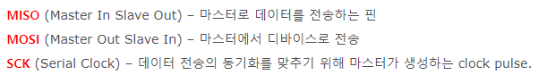
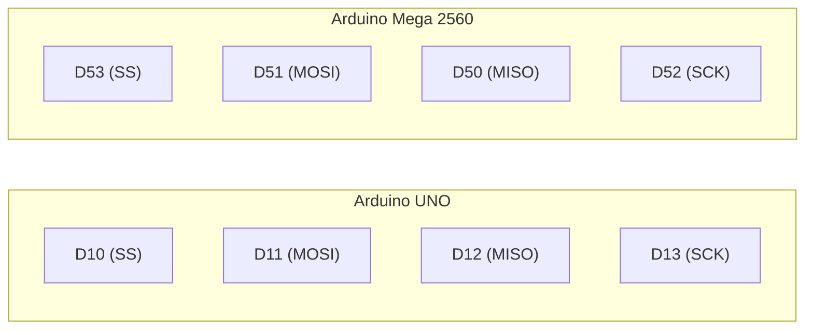
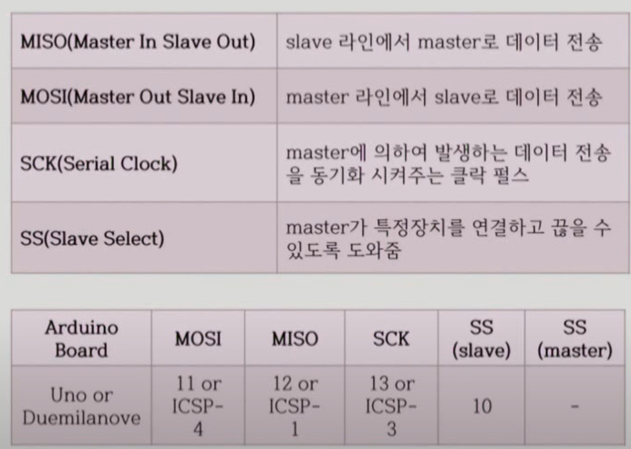
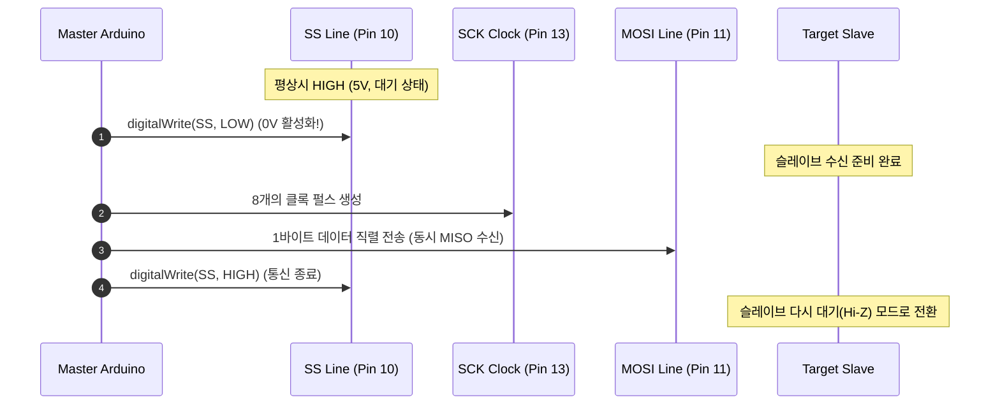
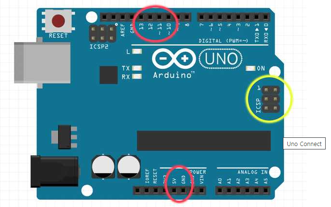
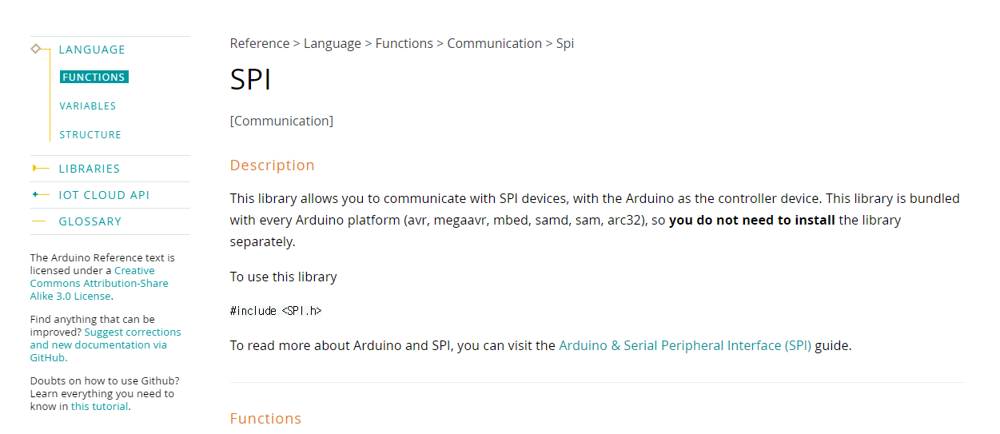

# 130_SPI통신원리_초고속전이중 ⚡🚄


**도로시와 지니가 함께하는 SPI(Serial Peripheral Interface) 탐험**
* 👧 **도로시**: "지니야! I2C보다 훨씬 빠르고 데이터를 보내는 동시에 받을 수 있는 통신도 있어?"
* 🐱 **지니**: "그럼! 모토로라에서 고안한 **SPI(Serial Peripheral Interface) 통신**은 송수신이 동시에 일어나는 **동기식 전이중(Full Duplex) 초고속 통신**이란다!"
* 🐶 **토토**: "바우! 지휘자의 지휘봉(SS)이 가리키는 악기만 소리를 내는 오케스트라 같다 멍!"
* 📖 **상세 강의 교재**: [index.md](./index.md)


> 여러분 안녕하세요! 이번 시간에는 '130. SPI통신원리 초고속전이중 ⚡🚄'을 주제로 함께 흥미진진한 탐험을 떠나보겠습니다. 오늘 강의에서는 특히 도로시와 지니가 함께하는 SPI(Serial Peripheral Interface) 탐험, 👧 도로시: "지니야! I2C보다 훨씬 빠르고 데이터를 보내는 동시에 받을 수 있는 통신도 있어?"를 중심으로 핵심 원리와 응용 방법을 차근차근 배워보겠습니다. 마법 멘토 지니와 호기심 많은 탐험가 도로시, 그리고 귀여운 토토와 함께 신나는 아두이노 모험을 힘차게 시작해 봅시다. 준비되셨나요?

---

## 1. SPI 통신이란 무엇일까요?



* **동기식 통신 (Synchronous)**:
* 마스터가 생성하는 공통 클록(SCK) 신호의 엣지(Edge)에 맞추어 비트를 1비트씩 주고받으므로 속도 오차가 발생하지 않습니다.
* **전이중 통신 (Full Duplex)**:
* 송신 라인과 수신 라인이 물리적으로 분리되어 있어, 데이터를 마스터가 슬레이브로 쏘는 바로 그 순간에 슬레이브도 마스터로 응답 데이터를 밀어 넣습니다.
* **마스터-슬레이브 구조 (Master-Slave)**:
* 1개의 마스터(Master)가 전체 통신 클록과 슬레이브 선택 신호를 완벽하게 통제합니다.

### 🚀 고속 주변장치를 위한 시리얼 버스 아키텍처
SPI 통신은 마이크로컨트롤러와 외장 메모리(SD 카드), 고해상도 TFT LCD, RF 무선 모듈, 고정밀 센서 간에 수 MHz에서 수십 MHz의 압도적인 속도로 데이터를 교환하는 표준 인터페이스입니다.

> 자, 이번 슬라이드의 질문을 함께 보시겠습니다. 바로 '1. SPI 통신이란 무엇일까요?'라는 아주 흥미로운 질문입니다. 우리가 일상에서 흔히 접하는 동기식 통신 (Synchronous) 현상을 떠올려보면 왜 이런 의문이 생기는지 쉽게 공감할 수 있습니다. 이 질문 속에 숨겨진 전자 회로와 컴퓨팅의 핵심 원리를 지금부터 차근차근 하나씩 파헤쳐 보겠습니다.

---

## 2. SPI 통신의 핵심 4개 전선


| 신호선 약칭 | 정식 영문 명칭 | 아두이노 우노 핀 | 신호 방향 | 핵심 역할 |
| :--- | :--- | :---: | :---: | :--- |
| **MOSI** | Master Out Slave In | **D11** | Master ➡️ Slave | 마스터가 슬레이브에게 보내는 직렬 데이터 출력선 |
| **MISO** | Master In Slave Out | **D12** | Slave ➡️ Master | 슬레이브가 마스터에게 보내는 직렬 데이터 응답선 |
| **SCK** | Serial Clock | **D13** | Master ➡️ Slave | 데이터 비트 전송 박자를 맞추는 마스터 동기 클록선 |
| **SS** (CS) | Slave Select / Chip Select | **D10** 등 임의 핀 | Master ➡️ Slave | 통신할 특정 슬레이브를 깨우는 활성화 선택선 (Active-LOW) |

### 🎼 오케스트라를 움직이는 4개의 신호선
SPI 통신을 구축하기 위해서는 4개의 물리적 신호선과 1개의 공통 접지선(GND)이 필요합니다.

> 이번에 살펴볼 내용은 '2. SPI 통신의 핵심 4개 전선'입니다. 슬라이드에 정리된 표를 통해 각 항목의 특징과 수치, 차이점을 한눈에 비교해 보실 수 있습니다. 이 기본 개념을 확실히 잡아두셔야 실제 부품을 브레드보드에 꽂고 코딩할 때 실수 없이 완성할 수 있습니다.

---

## 3. 우노(UNO) vs 메가(Mega) 하드웨어 SPI 핀 매핑


* [!IMPORTANT]
* 우노와 메가를 SPI로 연결할 때는 핀 번호(11, 12, 13)가 아니라 신호 이름(**MOSI-MOSI, MISO-MISO, SCK-SCK**)을 기준으로 교차 없이 1:1 직결해야 합니다!

### 📌 보드별 하드웨어 SPI 전용 핀 안내
아두이노의 하드웨어 SPI 레지스터는 특정 디지털 핀에 물리적으로 하드와이어링(Hard-wired)되어 있습니다.



> 이번 슬라이드에서는 '3. 우노(UNO) vs 메가(Mega) 하드웨어 SPI 핀 매핑'에 대한 실제 동작 코드를 분석해 보겠습니다. 화면의 코드를 살펴보시면, 컴퓨터가 아두이노 하드웨어에 단계별로 명령을 내리는 흐름을 명확하게 확인할 수 있습니다. 각 함수의 역할과 괄호 안의 매개변수가 하드웨어 핀과 어떤 관계를 맺고 동작하는지 주의 깊게 살펴보시기 바랍니다.

---

## 4. 슬레이브 선택(SS)의 비밀: Active LOW



* 슬레이브들은 평소에 **SS = HIGH (5V)** 상태로 출력 핀(MISO)을 고임피던스(Hi-Z) 상태로 격리해 둡니다.
* 마스터가 특정 슬레이브와 대화할 때만 해당 슬레이브의 **SS 핀을 LOW(0V)** 로 떨어뜨려 깨웁니다.
* 데이터 교환이 끝나면 다시 **SS = HIGH** 로 올려 버스를 다른 장치에 양보합니다.

### 🤫 평소엔 조용히(HIGH), 대화할 땐 깨우기(LOW)!
SPI 버스에 연결된 모든 슬레이브 장치는 **Active LOW** 방식으로 동작합니다.



> 이번 슬라이드에서는 '4. 슬레이브 선택(SS)의 비밀: Active LOW'에 대한 실제 동작 코드를 분석해 보겠습니다. 화면의 코드를 살펴보시면, 컴퓨터가 아두이노 하드웨어에 단계별로 명령을 내리는 흐름을 명확하게 확인할 수 있습니다. 여기서 핵심은 슬레이브들은 평소에 SS = HIGH (5V) 상태로 출력 핀(MISO)을 고임피던스(Hi-Z) 상태로 격리해 둡니다.입니다. 각 함수의 역할과 괄호 안의 매개변수가 하드웨어 핀과 어떤 관계를 맺고 동작하는지 주의 깊게 살펴보시기 바랍니다.

---

## 5. 통신 방식 3총사 완전 비교: UART vs I2C vs SPI



| 비교 항목 | UART 시리얼 (Serial) | I2C (Wire) | SPI (SPI.h) |
| :--- | :--- | :--- | :--- |
| **필요 신호선 수** | 2가닥 (TX, RX) | 2가닥 (SDA, SCL) | **4가닥 (MOSI, MISO, SCK, SS)** |
| **통신 속도** | 보통 (~115.2 kbps) | 보통/빠름 (100k~400 kbps) | **초고속 (수 MHz ~ 20 MHz 이상)** |
| **전송 방식** | 비동기 (스타트/스톱 비트 필요) | 동기식 반이중 (Half Duplex) | **동기식 전이중 (Full Duplex)** |
| **디바이스 식별** | 1:1 직결 전용 | 7비트 고유 주소 소프트웨어 지정 | **독립된 SS 하드웨어 핀 제어** |
| **데이터 오버헤드** | 중간 (패킷 프레이밍) | 큼 (주소, ACK/NACK 비트) | **없음 (순수 데이터 바이트 전송)** |
| **주요 활용 분야** | 시리얼 모니터, GPS, 블루투스 | 온습도 센서, RTC, I2C LCD | **SD 카드, 컬러 TFT LCD, 무선 NRF** |

### 🏆 아두이노 3대 시리얼 통신 종합 분석

> 이번에 살펴볼 내용은 '5. 통신 방식 3총사 완전 비교: UART vs I2C vs SPI'입니다. 슬라이드에 정리된 표를 통해 각 항목의 특징과 수치, 차이점을 한눈에 비교해 보실 수 있습니다. 이 기본 개념을 확실히 잡아두셔야 실제 부품을 브레드보드에 꽂고 코딩할 때 실수 없이 완성할 수 있습니다.

---

## 6. 아두이노 SPI 표준 라이브러리 (SPI.h) 기본 사용법



### 📚 마스터 측의 표준 송수신 코드 템플릿
아두이노 코어에 내장된 `<SPI.h>` 라이브러리를 사용하면 하드웨어 레지스터를 직접 건드리지 않고도 안전하게 SPI 통신을 수행할 수 있습니다.

```cpp
#include <SPI.h> // 표준 SPI 라이브러리 포함

const int pinSS = 10; // 슬레이브 선택 핀 지정

void setup() {
  pinMode(pinSS, OUTPUT);      // SS 핀을 마스터 출력 모드로 설정
  digitalWrite(pinSS, HIGH);   // 초기 상태는 HIGH (비활성화 상태)로 유지
  
  SPI.begin();                 // 하드웨어 SPI 모듈 가동 (SCK=13, MOSI=11, MISO=12 자동 설정)
  SPI.setClockDivider(SPI_CLOCK_DIV4); // 16MHz 클록을 4분주 (4MHz 통신 속도 설정)
}

void loop() {
  digitalWrite(pinSS, LOW);    // 1. 슬레이브 선택 (통신 시작!)
  
  // 2. 1바이트(0x42)를 슬레이브로 쏘는 동시에 슬레이브가 밀어낸 1바이트를 수신받아 변수에 저장
  byte response = SPI.transfer(0x42); 
  
  digitalWrite(pinSS, HIGH);   // 3. 슬레이브 선택 해제 (통신 완료!)
  
  delay(1000);                 // 1초 간격 반복
}
```

> 이번 슬라이드에서는 '6. 아두이노 SPI 표준 라이브러리 (SPI.h) 기본 사용법'에 대한 실제 동작 코드를 분석해 보겠습니다. 화면의 코드를 살펴보시면, 컴퓨터가 아두이노 하드웨어에 단계별로 명령을 내리는 흐름을 명확하게 확인할 수 있습니다. 각 함수의 역할과 괄호 안의 매개변수가 하드웨어 핀과 어떤 관계를 맺고 동작하는지 주의 깊게 살펴보시기 바랍니다.

---

## 🌟 도로시와 지니의 핵심 요약 노트!


* 👧 **도로시**: "SPI는 주소 없이 물리적인 SS 핀을 LOW로 끄집어내어 1:1로 초고속 데이터를 전이중으로 교환하는 통신이구나!"
* 🐱 **지니**: "맞아! I2C보다 선이 조금 더 필요하지만, 오버헤드가 전혀 없어서 SD 카드나 그래픽 LCD처럼 대용량 데이터를 다룰 때 필수적이란다."
* 🐶 **토토**: "바우! 다음 장에서는 마스터 아두이노와 슬레이브 아두이노를 실제로 SPI로 연결해서 데이터를 주고받아 보자 멍!"

> 오늘 배운 '🌟 도로시와 지니의 핵심 요약 노트!'의 핵심 내용을 모두 정리해 보았습니다. 오늘 다룬 내용 중에서도 👧 도로시: "SPI는 주소 없이 물리적인 SS 핀을 LOW로 끄집어내어 1:1로 초고속 데이터를 전이중으로 교환하는 통신이구나!" 부분은 앞으로의 아두이노 실습과 프로젝트에서 계속 사용되는 매우 중요한 기초 지식입니다. 오늘 배운 내용을 꼭 다시 한번 복습해 보시고, 다음 강의에서 더욱 신나고 유익한 모험으로 다시 만나겠습니다. 모두 수고 많으셨습니다!