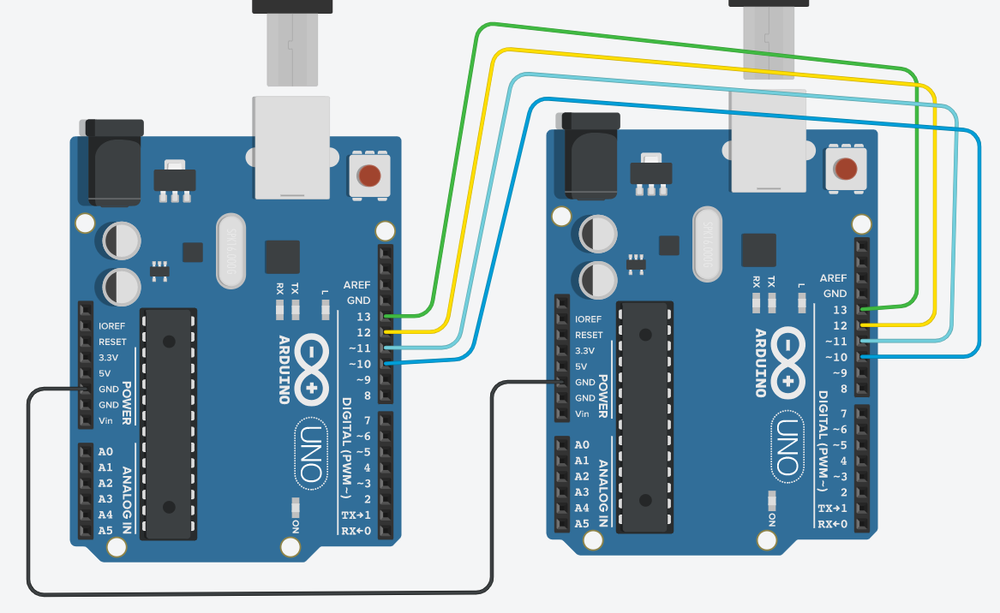
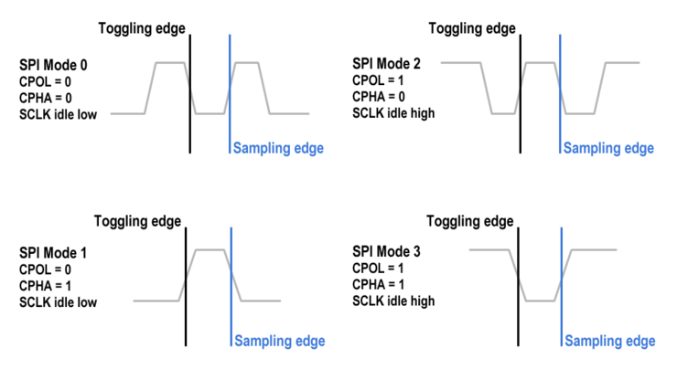
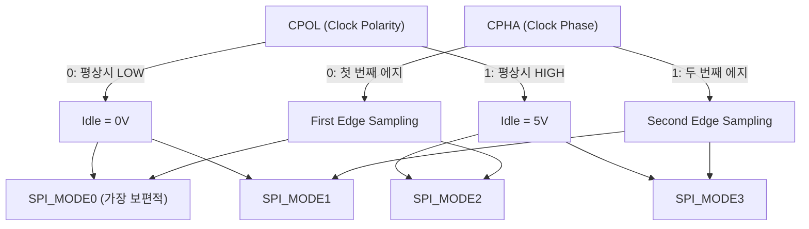
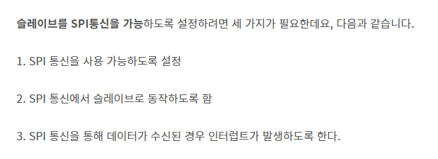
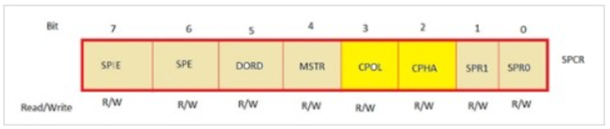
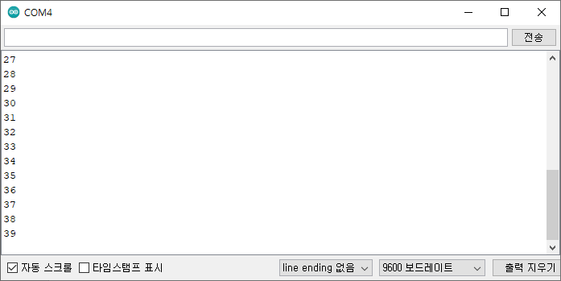

# 131_SPI_싱글슬레이브연동 🤝🔌


**도로시와 지니가 함께하는 마스터-슬레이브 SPI 통신 실습**
* 👧 **도로시**: "지니야! 두 대의 아두이노를 SPI 선 4개로 묶어서 서로 데이터를 실시간으로 주고받게 만들어보자!"
* 🐱 **지니**: "좋아! 마스터가 클록을 보내며 슬레이브의 카운트 숫자를 초고속으로 읽어오는 실습을 해보자!"
* 🐶 **토토**: "바우! MOSI, MISO, SCK, SS 신호선을 1:1로 정확하게 꽂아야 한다 멍!"
* 📖 **상세 강의 교재**: [index.md](./index.md)


> 여러분 안녕하세요! 이번 시간에는 '131. SPI 싱글슬레이브연동 🤝🔌'을 주제로 함께 흥미진진한 탐험을 떠나보겠습니다. 오늘 강의에서는 특히 도로시와 지니가 함께하는 마스터-슬레이브 SPI 통신 실습, 👧 도로시: "지니야! 두 대의 아두이노를 SPI 선 4개로 묶어서 서로 데이터를 실시간으로 주고받게 만들어보자!"를 중심으로 핵심 원리와 응용 방법을 차근차근 배워보겠습니다. 마법 멘토 지니와 호기심 많은 탐험가 도로시, 그리고 귀여운 토토와 함께 신나는 아두이노 모험을 힘차게 시작해 봅시다. 준비되셨나요?

---

## 1. SPI 1:1 회로 배선도



* [!CAUTION]
* **MISO 핀 설정 주의**: 슬레이브 보드에서 MISO 핀(12번)은 마스터로 데이터를 뿜어내는 유일한 출력이므로, 슬레이브 코드에서 반드시 `pinMode(MISO, OUTPUT);`으로 선언해주어야 합니다.

| 신호선 | 마스터 아두이노 우노 | 슬레이브 아두이노 우노 | 연결 목적 |
| :--- | :---: | :---: | :--- |
| **MOSI** | **D11** | **D11** | 마스터 데이터 출력 ➡️ 슬레이브 입력 |
| **MISO** | **D12** | **D12** | 슬레이브 데이터 출력 ➡️ 마스터 입력 |
| **SCK** | **D13** | **D13** | 마스터 동기 클록 공급 ➡️ 슬레이브 클록 수신 |
| **SS** | **D10** | **D10** | 마스터 선택 신호 (Active LOW) |
| **GND** | **GND** | **GND** | 두 보드 간 신호 기준 전위 공통 접지 |

### 🔌 마스터와 슬레이브의 1:1 핀 매칭
SPI 통신은 UART 시리얼처럼 선을 엇갈려(Cross) 꽂지 않고, 마스터와 슬레이브의 동일한 SPI 핀끼리 1:1 직결합니다.

> 이번에 살펴볼 내용은 '1. SPI 1:1 회로 배선도'입니다. 슬라이드에 정리된 표를 통해 각 항목의 특징과 수치, 차이점을 한눈에 비교해 보실 수 있습니다. 이 기본 개념을 확실히 잡아두셔야 실제 부품을 브레드보드에 꽂고 코딩할 때 실수 없이 완성할 수 있습니다.

---

## 2. 마스터(Master) 아두이노 스케치


### 👑 슬레이브를 깨우고 데이터를 읽어오는 마스터
마스터는 1초마다 슬레이브 선택선(SS)을 LOW로 떨어뜨린 후, 1바이트 더미(Dummy) 데이터를 보내 슬레이브의 카운터 값을 맞교환해옵니다.

```cpp
#include <SPI.h> // 아두이노 표준 SPI 라이브러리 포함

void setup() {
  Serial.begin(9600);   // PC 시리얼 모니터 출력용 (9600 bps)
  SPI.begin();          // 하드웨어 SPI 버스 초기화 (마스터 모드 자동 설정)
  digitalWrite(SS, HIGH); // 슬레이브를 평상시에는 비활성화(HIGH) 상태로 대기
  SPI.setClockDivider(SPI_CLOCK_DIV16); // 16MHz / 16 = 1MHz 클록 속도로 설정
}

void loop() {
  // 트랜잭션 시작 (속도 2MHz, 최상위 비트 우선, 모드 0)
  SPI.beginTransaction(SPISettings(2000000, MSBFIRST, SPI_MODE0));
  
  digitalWrite(SS, LOW);       // 1. 슬레이브 활성화 (Active LOW)
  byte received = SPI.transfer(0); // 2. 0(더미 바이트)을 전송하는 동시에 슬레이브가 보낸 1바이트 수신!
  digitalWrite(SS, HIGH);      // 3. 슬레이브 비활성화 (통신 종료)
  
  SPI.endTransaction();        // 트랜잭션 종료 및 SPI 버스 해제

  Serial.print("수신된 카운트 값: ");
  Serial.println(received);    // 읽어온 숫자 모니터에 출력
  
  delay(1000);                 // 1초 휴식 후 반복
}
```

> 이번 슬라이드에서는 '2. 마스터(Master) 아두이노 스케치'에 대한 실제 동작 코드를 분석해 보겠습니다. 화면의 코드를 살펴보시면, 컴퓨터가 아두이노 하드웨어에 단계별로 명령을 내리는 흐름을 명확하게 확인할 수 있습니다. 각 함수의 역할과 괄호 안의 매개변수가 하드웨어 핀과 어떤 관계를 맺고 동작하는지 주의 깊게 살펴보시기 바랍니다.

---

## 3. SPI 전송 속도와 클록 분주비(Clock Divider)


| 분주비 상수 | 분주 비율 | 계산된 SPI 클록 주파수 | 비고 |
| :--- | :---: | :---: | :--- |
| `SPI_CLOCK_DIV2` | 1/2 | **8 MHz** | 아두이노 우노 하드웨어 최대 한계 속도 |
| `SPI_CLOCK_DIV4` | 1/4 | **4 MHz** | `SPI.begin()` 호출 시 기본 설정값 |
| `SPI_CLOCK_DIV8` | 1/8 | **2 MHz** | 중간 길이 점퍼선에서 추천되는 속도 |
| `SPI_CLOCK_DIV16` | 1/16 | **1 MHz** | **가장 안정적이며 실습에 권장되는 속도** |
| `SPI_CLOCK_DIV32` | 1/32 | **500 kHz** | 신호 노이즈가 심할 때 적용 |
| `SPI_CLOCK_DIV64` | 1/64 | **250 kHz** | 장거리 배선용 |
| `SPI_CLOCK_DIV128` | 1/128 | **125 kHz** | 최저 속도 모드 |

### ⏱️ 아두이노 16MHz 크리스탈을 쪼개어 사용해요!
아두이노 우노의 시스템 클록은 **16MHz**입니다. SPI 모듈은 내부 프리스케일러(Prescaler)를 통해 이 기본 클록을 나누어 안정적인 통신 주파수를 생성합니다.

> 이번에 살펴볼 내용은 '3. SPI 전송 속도와 클록 분주비(Clock Divider)'입니다. 슬라이드에 정리된 표를 통해 각 항목의 특징과 수치, 차이점을 한눈에 비교해 보실 수 있습니다. 이 기본 개념을 확실히 잡아두셔야 실제 부품을 브레드보드에 꽂고 코딩할 때 실수 없이 완성할 수 있습니다.

---

## 4. SPI 4가지 통신 모드 (SPI_MODE 0 ~ 3)



* **`SPI_MODE0` (CPOL=0, CPHA=0)**:
* 클록이 LOW 상태로 쉬다가 상승 에지(↑)에서 데이터를 샘플링하고 하강 에지(↓)에서 데이터를 변경합니다. 아두이노와 대부분의 센서 표준입니다.

### 🌊 CPOL과 CPHA의 조합으로 정의되는 통신 규격
SPI는 클록 신호의 평상시 상태(CPOL)와 데이터를 샘플링하는 시점(CPHA)에 따라 4가지 모드로 나뉩니다.



> 이번 슬라이드에서는 '4. SPI 4가지 통신 모드 (SPI MODE 0 ~ 3)'에 대한 실제 동작 코드를 분석해 보겠습니다. 화면의 코드를 살펴보시면, 컴퓨터가 아두이노 하드웨어에 단계별로 명령을 내리는 흐름을 명확하게 확인할 수 있습니다. 여기서 핵심은 SPIMODE0 (CPOL=0, CPHA=0)입니다. 각 함수의 역할과 괄호 안의 매개변수가 하드웨어 핀과 어떤 관계를 맺고 동작하는지 주의 깊게 살펴보시기 바랍니다.

---

## 5. 슬레이브(Slave) 아두이노 스케치



### 📥 인터럽트로 마스터의 클록에 즉각 응답!
슬레이브는 마스터가 언제 클록을 칠지 예측할 수 없으므로, AVR 하드웨어 인터럽트(`SPI_STC_vect`)를 사용하여 클록이 들어오는 즉시 데이터를 응답 레지스터에 탑재합니다.

```cpp
#include <SPI.h>

volatile byte count = 0; // 인터럽트 서비스 루틴에서 공유하는 카운터 변수

void setup() {
  pinMode(MISO, OUTPUT); // 슬레이브의 유일한 출력 핀(12번)을 OUTPUT으로 설정!
  pinMode(MOSI, INPUT);  // 입력 신호선들
  pinMode(SCK, INPUT);
  pinMode(SS, INPUT);

  SPCR |= bit(SPE);      // SPCR 레지스터의 SPE(SPI Enable) 비트를 켜서 슬레이브 모드 활성화
  SPI.attachInterrupt(); // SPI 전송 완료 인터럽트 활성화
  Serial.begin(9600);    // 디버그용 시리얼 초기화
}

// 마스터가 클록을 보내 1바이트 교환이 일어날 때 하드웨어적으로 즉각 호출되는 인터럽트 루틴
ISR (SPI_STC_vect) {
  SPDR = count; // SPI 데이터 레지스터(SPDR)에 현재 카운터 값을 채워 넣어 마스터로 전송!
}

void loop() {
  count++;      // 1초마다 카운터 값을 1씩 증가
  delay(1000);
}
```

> 이번 슬라이드에서는 '5. 슬레이브(Slave) 아두이노 스케치'에 대한 실제 동작 코드를 분석해 보겠습니다. 화면의 코드를 살펴보시면, 컴퓨터가 아두이노 하드웨어에 단계별로 명령을 내리는 흐름을 명확하게 확인할 수 있습니다. 각 함수의 역할과 괄호 안의 매개변수가 하드웨어 핀과 어떤 관계를 맺고 동작하는지 주의 깊게 살펴보시기 바랍니다.

---

## 6. AVR 하드웨어 레지스터: SPCR과 SPDR



1. **SPCR (SPI Control Register)**:
* `SPE (SPI Enable)`: 1로 설정하면 칩 내부의 SPI 회로가 켜집니다.
* `MSTR (Master/Slave Select)`: 0이면 슬레이브 모드, 1이면 마스터 모드가 됩니다.
* `SPIE (SPI Interrupt Enable)`: 1로 설정하면 바이트 교환 완료 시 `SPI_STC_vect` 인터럽트를 발생시킵니다.
2. **SPDR (SPI Data Register)**:
* 8비트 직렬 시프트 레지스터입니다.
* 마스터가 SCK 클록 8개를 보내는 동안, 마스터의 SPDR 비트들과 슬레이브의 SPDR 비트들이 전선을 타고 1비트씩 맞교환됩니다!

### ⚙️ ATmega328P 칩의 내부 SPI 하드웨어 엔진
아두이노 C++ 라이브러리 밑단에는 마이크로컨트롤러의 물리적 레지스터가 자리 잡고 있습니다.

> 이번 슬라이드에서는 '6. AVR 하드웨어 레지스터: SPCR과 SPDR'에 대해 자세히 살펴보겠습니다. 화면의 다이어그램과 사진을 함께 참고해 주시기 바랍니다. 첫 번째 핵심은 SPCR (SPI Control Register)이며, 두 번째로는 SPE (SPI Enable): 1로 설정하면 칩 내부의 SPI 회로가 켜집니다.입니다. 여기에 덧붙여 MSTR (Master/Slave Select): 0이면 슬레이브 모드, 1이면 마스터 모드가 됩니다. 내용까지 함께 이해해 두시면 완벽합니다. 이 원리는 아두이노 시스템 전체를 관통하는 핵심 논리이므로 머릿속에 꼭 정리해 두시기 바랍니다.

---

## 7. 실행 결과 및 시리얼 모니터 검증



### 📈 슬레이브의 카운터 숫자가 실시간으로 도착!
마스터 아두이노의 시리얼 모니터를 9600bps로 열면 슬레이브가 1초마다 증가시키는 카운트가 한 글자도 빠짐없이 선명하게 출력됩니다.

```text
--- 마스터 아두이노 시리얼 모니터 ---
수신된 카운트 값: 0
수신된 카운트 값: 1
수신된 카운트 값: 2
수신된 카운트 값: 3
수신된 카운트 값: 4
...
```

> 이번 슬라이드에서는 '7. 실행 결과 및 시리얼 모니터 검증'에 대한 실제 동작 코드를 분석해 보겠습니다. 화면의 코드를 살펴보시면, 컴퓨터가 아두이노 하드웨어에 단계별로 명령을 내리는 흐름을 명확하게 확인할 수 있습니다. 각 함수의 역할과 괄호 안의 매개변수가 하드웨어 핀과 어떤 관계를 맺고 동작하는지 주의 깊게 살펴보시기 바랍니다.

---

## 🌟 도로시와 지니의 핵심 요약 노트!


* 👧 **도로시**: "마스터가 `SPI.transfer()`를 쏘는 순간 슬레이브는 인터럽트로 `SPDR`에 값을 담아 한 클록도 지체 없이 맞교환하는구나!"
* 🐱 **지니**: "맞아! 슬레이브는 `pinMode(MISO, OUTPUT);`과 `SPCR |= bit(SPE);` 설정만 해주면 완벽한 SPI 주변장치로 변신한단다."
* 🐶 **토토**: "바우! 이제 슬레이브를 여러 대로 늘려 각각 다른 SS 핀으로 제어하는 멀티 슬레이브를 정복하자 멍!"

> 오늘 배운 '🌟 도로시와 지니의 핵심 요약 노트!'의 핵심 내용을 모두 정리해 보았습니다. 오늘 다룬 내용 중에서도 👧 도로시: "마스터가 SPI.transfer()를 쏘는 순간 슬레이브는 인터럽트로 SPDR에 값을 담아 한 클록도 지체 없이 맞교환하는구나!" 부분은 앞으로의 아두이노 실습과 프로젝트에서 계속 사용되는 매우 중요한 기초 지식입니다. 오늘 배운 내용을 꼭 다시 한번 복습해 보시고, 다음 강의에서 더욱 신나고 유익한 모험으로 다시 만나겠습니다. 모두 수고 많으셨습니다!