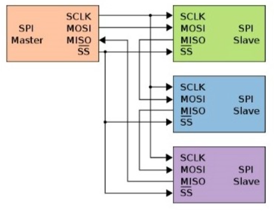
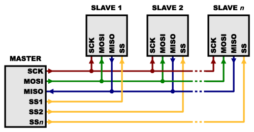
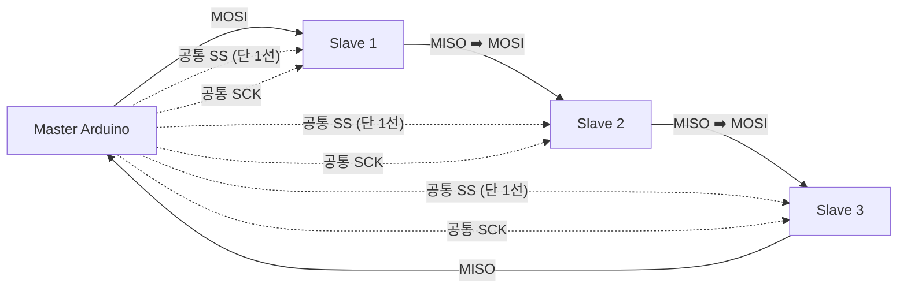
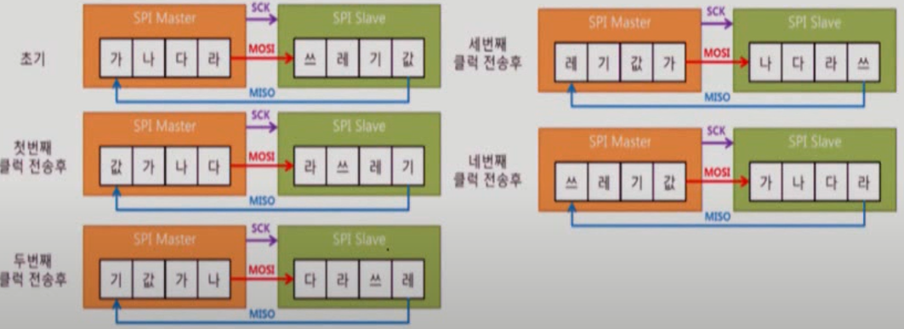
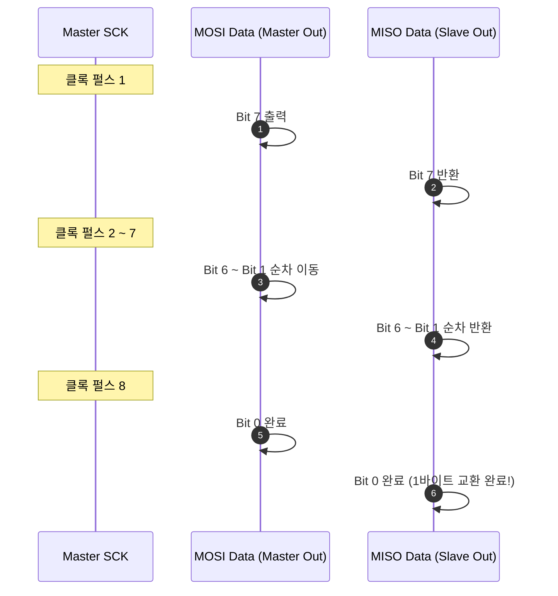

# 132_SPI_멀티슬레이브연동 🌲🔌


**도로시와 지니가 함께하는 1:N 다중 SPI 네트워크 완벽 정복**

* 👧 **도로시**: "지니야! 슬레이브가 2대 이상일 때는 4가닥 선을 어떻게 연결해야 신호가 충돌하지 않고 안전하게 통신할 수 있어?"
* 🐱 **지니**: "두 가지 훌륭한 방법이 있어! 슬레이브마다 따로따로 SS 핀을 배정하는 **독립 SS(Independent SS) 방식**과, 기차처럼 줄줄이 엮는 **데이지 체인(Daisy Chain) 방식**이란다!"
* 🐶 **토토**: "바우! 지휘자의 손짓 하나로 오케스트라의 특정 독주자만 깨우는 마법이다 멍!"

* 🖥️ **강의 슬라이드**: [slides.md](./slides.md)

---

## 1. 멀티 슬레이브의 두 가지 연결 전략



### 🗺️ 독립 SS vs 데이지 체인의 비교 분석

마스터 1대에 복수의 SPI 주변장치를 연결할 때는 시스템의 목적과 핀 가용성에 맞춰 방식을 선택합니다.

| 연결 방식 | 연결 구조 | 필요 SS 핀 수 | 장점 | 단점 |
| :--- | :--- | :---: | :--- | :--- |
| **독립 SS 방식** (Independent) | MOSI/MISO/SCK 공통 병렬 버스 SS 선만 개별 1:1 연결 | **N개** (슬레이브 개수만큼) | 표준 SPI 장치라면 모두 지원, 소프트웨어 제어가 매우 직관적임 | 슬레이브가 많아지면 마스터의 디지털 핀 소모가 큼 |
| **데이지 체인 방식** (Daisy Chain) | 마스터 MOSI ➡️ 슬레이브1 ➡️ 슬레이브2 ➡️ 마스터 MISO | **단 1개** (모든 장치 공통 SS) | 마스터의 GPIO 핀을 획기적으로 절약, 배선이 단순함 | 해당 기능을 지원하는 전용 칩 (예: MAX7219)만 사용 가능 |

---

## 2. 독립 SS(Independent SS) 방식의 회로도



### 📌 가장 널리 쓰이는 표준 다중 연결법

독립 SS 방식에서는 3개의 버스 라인은 모든 슬레이브가 브레드보드에서 한 묶음으로 공유합니다.

* **공유 신호선 (Parallel Shared Bus)**:
  * **SCK (D13)**: 슬레이브 1, 2, 3의 SCK 핀에 모두 병렬 연결
  * **MOSI (D11)**: 슬레이브 1, 2, 3의 MOSI 핀에 모두 병렬 연결
  * **MISO (D12)**: 슬레이브 1, 2, 3의 MISO 핀에 모두 병렬 연결
* **개별 선택선 (Individual Slave Select)**:
  * 마스터 **D10** 핀 ➡️ **슬레이브 1의 SS**
  * 마스터 **D9** 핀  ➡️ **슬레이브 2의 SS**
  * 마스터 **D8** 핀  ➡️ **슬레이브 3의 SS**

> [!IMPORTANT]
> **동시 활성화 절대 금지!**
> 마스터는 절대로 2개 이상의 SS 핀을 동시에 LOW로 내려서는 안 됩니다. 두 슬레이브가 동시에 MISO 라인으로 전압(HIGH/LOW)을 밀어내면 단락(쇼트)이나 데이터 충돌이 발생합니다.

---

## 3. 독립 SS 방식의 제어 코드 구조


### 🎯 원하는 슬레이브만 LOW로 콕 집어 순차 통신하기!

마스터 아두이노는 통신 직전에 해당 슬레이브의 SS 핀만 LOW로 내리고, 송수신이 끝나면 즉시 HIGH로 복구합니다.

```cpp
#include <SPI.h> // 표준 SPI 라이브러리

const int SS_SLAVE1 = 10; // 1번 슬레이브 전용 SS 핀
const int SS_SLAVE2 = 9;  // 2번 슬레이브 전용 SS 핀

void setup() {
  pinMode(SS_SLAVE1, OUTPUT);
  pinMode(SS_SLAVE2, OUTPUT);
  
  // 두 슬레이브 모두 초기 상태는 비활성화(HIGH)로 설정
  digitalWrite(SS_SLAVE1, HIGH);
  digitalWrite(SS_SLAVE2, HIGH);
  
  SPI.begin();
  SPI.setClockDivider(SPI_CLOCK_DIV16); // 1MHz 클록
}

void loop() {
  // 1. 1번 슬레이브와 데이터 교환
  digitalWrite(SS_SLAVE1, LOW);  // 1번 슬레이브 깨우기!
  byte data1 = SPI.transfer(0xAA); // 0xAA를 보내고 응답 1바이트 수신
  digitalWrite(SS_SLAVE1, HIGH); // 1번 슬레이브 재우기
  
  delay(10); // 버스 안정화 시간
  
  // 2. 2번 슬레이브와 데이터 교환
  digitalWrite(SS_SLAVE2, LOW);  // 2번 슬레이브 깨우기!
  byte data2 = SPI.transfer(0xBB); // 0xBB를 보내고 응답 1바이트 수신
  digitalWrite(SS_SLAVE2, HIGH); // 2번 슬레이브 재우기
  
  delay(500); // 주기적 반복
}
```

---

## 4. 기차 놀이 방식: 데이지 체인 (Daisy Chain)


### 🚂 꼬리에 꼬리를 무는 시프트 레지스터 체인

데이지 체인은 이전 슬레이브의 데이터 출력을 다음 슬레이브의 데이터 입력으로 직렬 연결하는 기차 방식입니다.



* **동작 원리**:
  * 마스터가 첫 1바이트를 쏘면 슬레이브 1의 레지스터에 들어갑니다.
  * 다음 1바이트를 쏘면 첫 번째 바이트는 슬레이브 2로 밀려나고, 새 바이트가 슬레이브 1에 채워집니다.
  * 원하는 만큼 비트를 밀어 넣은 뒤 공통 SS 핀을 LATCH(HIGH)하면 모든 슬레이브가 동시에 출력을 갱신합니다!
* **대표 활용 사례**:
  * MAX7219 기반 8x8 LED 도트 매트릭스 모듈 여러 개를 연결할 때 기본 사용됩니다.

---

## 5. SPI 타이밍과 클록 동기화 프로토콜



### ⚡ 매 클록 펄스마다 1비트씩 이동하는 기계적 정확성

SPI 통신은 불필요한 스타트/스톱 비트나 디바이스 주소 프레임이 전혀 없습니다.



* 정확히 **8번의 클록 펄스**로 1바이트 교환이 끝나며 지연 시간이 거의 0에 수렴합니다.

---

## 🌟 도로시와 지니의 핵심 요약 노트!


* 👧 **도로시**: "독립 SS 방식을 쓰면 SS 핀 번호만 바꿔주면서 여러 대의 슬레이브를 자유자재로 조종할 수 있고, 데이지 체인을 쓰면 선 1개로 수많은 LED 매트릭스를 조종할 수 있구나!"
* 🐱 **지니**: "완벽해! 이로써 우리는 UART 시리얼, I2C, SPI까지 아두이노의 3대 하드웨어 유선 통신을 모두 정복했단다!"
* 🐶 **토토**: "바우! 축하합니다! 07장 통신/연동 챕터의 모든 과정이 완벽하게 완료되었다 멍!"
