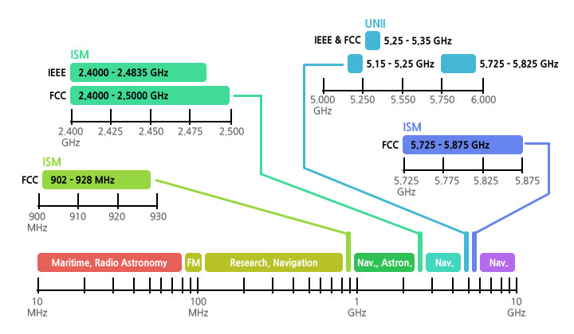
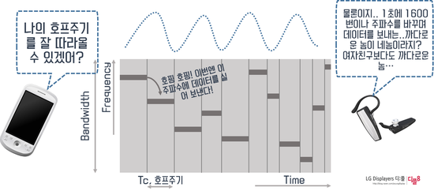

# 133_블루투스란_무선근거리통신 📶🔵

**도로시와 지니가 함께하는 근거리 무선 통신(Bluetooth)의 기원과 핵심 기술 원리**

* 👧 **도로시**: "지니야! 전선 케이블을 주렁주렁 연결하지 않고도 스마트폰으로 아두이노 장난감이나 조명을 멀리서 조종할 수 있는 비결이 뭐야?"
* 🐱 **지니**: "눈에 보이지 않는 2.4GHz 고주파 전파로 데이터를 실어 나르는 **블루투스(Bluetooth)** 무선 기술 덕분이란다!"
* 🐶 **토토**: "바우! 목줄 없이 넓은 들판을 마음껏 뛰어노는 기분처럼 시원하고 자유롭다 멍!"

* 🖥️ **강의 슬라이드**: [slides.md](./slides.md)

---

## 1. 블루투스(Bluetooth)의 탄생 배경

### 📻 거추장스러운 케이블의 굴레를 벗어나자!
* **1994년**: 스웨덴의 통신 장비 기업인 에릭슨(Ericsson)의 야프 하르트센(Jaap Haartsen) 박사가 컴퓨터와 주변기기(프린터, 키보드, 마우스) 사이의 복잡한 유선 RS-232 케이블을 무선으로 대체하기 위한 연구를 시작했습니다.
* **1998년**: 에릭슨, 노키아, 인텔, IBM, 도시바 등 5개 글로벌 선도 기업이 모여 **블루투스 SIG (Special Interest Group)** 를 결성하고 개방형 무선 통신 표준을 확립했습니다.
* **표준 규격**: IEEE 802.15.1 표준으로 등록되어 전 세계 모든 모바일 기기와 사물인터넷(IoT) 장치들이 서로 자유롭게 대화할 수 있는 토대가 마련되었습니다.

---

## 2. '푸른 이빨(Bluetooth)' 이름과 신비로운 룬 문자 로고

### 👑 10세기 북유럽을 통일한 바이킹 왕 헤럴드 블루투스
* 기술 이름의 유래: 10세기 덴마크와 노르웨이를 평화롭게 통일한 덴마크 국왕 **헤럴드 곰슨 (Harald Gormsson)** 의 별명이 바로 '푸른 이빨(Blåtand / Bluetooth)'이었습니다 (블루베리를 즐겨 먹어 이가 파랬다는 설이 전해집니다).
* **"북유럽을 하나로 통일했듯, 세상의 모든 디지털 기기들을 하나의 무선 기술로 통합하자!"** 라는 웅대한 포부를 담아 프로젝트 암호명이었던 '블루투스'를 공식 명칭으로 채택했습니다.
* **로고의 비밀**:
  * 북유럽 고대 룬(Rune) 문자에서 왕의 이니셜인 **H (ᚼ, Hagall)** 와 **B (ᛒ, Bjarkan)** 를 하나로 합쳐서 지금의 상징적인 파란색 엠블럼이 완성되었습니다!

---

## 3. 블루투스 전파 대역과 2.4GHz ISM 대역

### 📡 허가 없이 전 세계 누구나 사용할 수 있는 공공 주파수
* **ISM 대역 (Industrial, Scientific, and Medical)**:
  * 전 세계 각국 정부가 산업, 과학, 의료용으로 면허 없이 누구나 자유롭게 송수신할 수 있도록 개방한 전파 대역입니다.
* **대역폭과 79개 채널 분할**:
  * 블루투스는 **2.402 GHz ~ 2.480 GHz** 사이의 주파수를 사용합니다.
  * 이 넓은 대역을 **1 MHz 간격의 79개 채널**로 촘촘하게 나누어 데이터를 전송합니다.
  * 다른 무선 기기와의 간섭을 막기 위해 시작 지점(2.400~2.402 GHz)과 끝 지점(2.480~2.4835 GHz)에 안전 보호 대역(Guard Band)을 둡니다.

---

## 4. 혼선을 막는 핵심 비밀: 주파수 호핑 (FHSS)

### 🦘 1초에 1,600번 깡충깡충 채널을 옮겨 다니는 기술
* 2.4GHz 대역은 가정 내 Wi-Fi 공유기, 전자레인지, 무선 마우스 등이 함께 사용하여 전파 혼잡이 매우 심합니다.
* **주파수 호핑 (Frequency Hopping Spread Spectrum)**:
  * 블루투스는 한 채널에 가만히 머물러 있지 않습니다.
  * 송신기와 수신기가 미리 약속된 난수 순서에 따라 **1초에 1,600번(625마이크로초마다 1번)** 79개 채널 사이를 깡충깡충 번갈아 뛰며 데이터를 쪼개어 보냅니다.
  * 만약 특정 채널에 와이파이 노이즈가 발생하더라도, 다음 찰나에 깨끗한 다른 채널로 점프하므로 데이터 손실 없이 완벽한 통신을 유지합니다!

---

## 5. 블루투스의 눈부신 진화: 클래식부터 BLE 5.0까지

### 📈 더 멀리, 더 빠르게, 더 적은 전력으로!

| 버전 | 핵심 기술 및 특징 | 통신 속도 / 거리 | 주 사용 분야 |
| :--- | :--- | :--- | :--- |
| **Bluetooth 2.0/2.1 + EDR** | 클래식 블루투스 (SPP 시리얼 통신 표준) | 최대 3 Mbps / 10 m | 아두이노 HC-06, 무선 오디오 |
| **Bluetooth 3.0 + HS** | Wi-Fi 연계 대용량 데이터 고속 전송 | 최대 24 Mbps / 10 m | 대용량 파일 전송 |
| **Bluetooth 4.0/4.2 (BLE)** | **초저전력 사물인터넷 혁명 (동전 전지로 수년 동작)** | 1 Mbps / 50 m | 스마트워치, 헬스케어 밴드, 비콘 |
| **Bluetooth 5.0 / 5.3** | 전송 거리 4배 확장, 속도 2배, 메시 네트워크 | 2 Mbps / 100~200 m | 스마트홈 전체 조명망, 산업용 IoT |

---

## 🌟 도로시와 지니의 핵심 요약 노트!

| 핵심 개념 | 설명 |
| :--- | :--- |
| **주파수 대역** | 2.402 GHz ~ 2.480 GHz (무면허 ISM 대역, 79개 채널) |
| **간섭 회피 기술** | 초당 1,600회 주파수 호핑 (FHSS) |
| **이름의 기원** | 북유럽을 통일한 헤럴드 블루투스 왕 + 룬 문자 H & B |
| **아두이노 실습 모듈**| **HC-06 (클래식 SPP 프로파일 기반 슬레이브 모듈)** |

* 👧 **도로시**: "블루투스가 2.4GHz 전파를 주파수 호핑으로 깡충깡충 뛰면서 혼선 없이 깨끗하게 데이터를 보낸다는 사실이 정말 놀라워!"
* 🐱 **지니**: "맞아! 다음 시간에는 아두이노에 파란색 HC-06 블루투스 모듈을 직접 배선하고 통신 채널을 열어보자!"
* 🐶 **토토**: "바우! 이제 아두이노에 무선 날개를 달아주러 가자 멍!"
