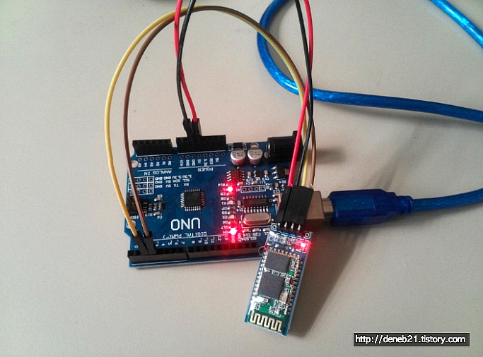
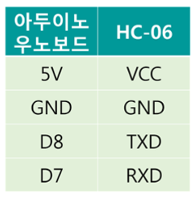
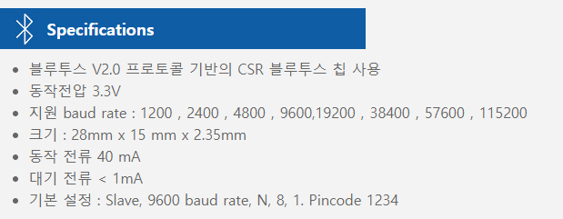
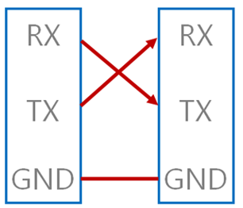
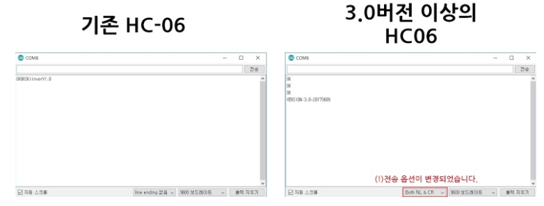
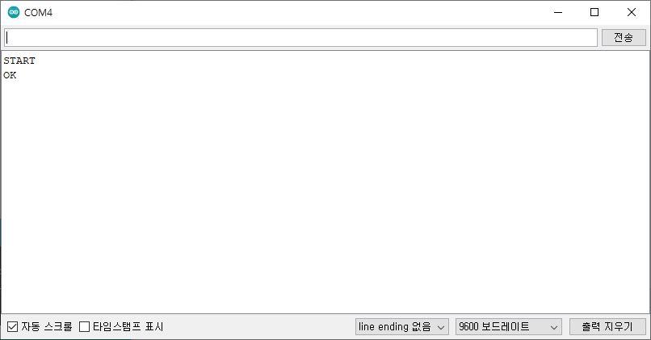

# 134_HC06_블루투스모듈연결 📱🔌


**도로시와 지니가 함께하는 하드웨어 핀 배열, 교차 결선(Cross Wiring) 및 소프트웨어 시리얼 브릿지 구축**
* 👧 **도로시**: "지니야! 저 작고 파란색 보드에 핀이 4개나 삐죽 나와 있어! 아두이노랑 어떻게 선을 이어야 해?"
* 🐱 **지니**: "가장 널리 쓰이는 **HC-06 슬레이브 블루투스 모듈**이란다! VCC, GND, TXD, RXD 4개 핀의 역할을 알고, 통신선(TX/RX)을 X자로 교차 연결하면 끝난단다!"
* 🐶 **토토**: "바우! 모듈 위의 빨간 불빛이 깜빡깜빡 거리며 주인을 기다린다 멍!"
* 📖 **상세 강의 교재**: [index.md](./index.md)


> 여러분 안녕하세요! 이번 시간에는 '134. HC06 블루투스모듈연결 📱🔌'을 주제로 함께 흥미진진한 탐험을 떠나보겠습니다. 오늘 강의에서는 특히 도로시와 지니가 함께하는 하드웨어 핀 배열, 교차 결선(Cross Wiring) 및 소프트웨어 시리얼 브릿지 구축, 👧 도로시: "지니야! 저 작고 파란색 보드에 핀이 4개나 삐죽 나와 있어! 아두이노랑 어떻게 선을 이어야 해?"를 중심으로 핵심 원리와 응용 방법을 차근차근 배워보겠습니다. 마법 멘토 지니와 호기심 많은 탐험가 도로시, 그리고 귀여운 토토와 함께 신나는 아두이노 모험을 힘차게 시작해 봅시다. 준비되셨나요?

---

## 1. HC-06 모듈의 4개 핀 규격과 전기적 특성



* [!NOTE]
* 모듈 기판의 **빨간색 상태 LED**:
* * **초당 2회 고속 점멸**: 스마트폰과 페어링 대기 중 (Standby / Disconnected).
* * **상시 점등 (Solid ON)**: 스마트폰과 무선 링크 연결 완료 (Connected).

| 핀 이름 | 신호 방향 | 권장 연결 핀 | 기능 및 주의사항 |
| :--- | :---: | :---: | :--- |
| **VCC** | 전원 입력 | **아두이노 5V** (또는 3.3V) | 모듈 뒷면 레귤레이터 내장으로 DC 3.6V ~ 6V 전원 입력 지원 |
| **GND** | 전원 접지 | **아두이노 GND** | 공통 기준 전위 (0V) 결선 |
| **TXD** | 모듈 출력 | **아두이노 8번 핀 (BT_RX)** | 모듈이 수신한 무선 데이터를 아두이노에게 전달하는 전송선 (3.3V TTL) |
| **RXD** | 모듈 입력 | **아두이노 7번 핀 (BT_TX)** | 아두이노가 보낸 명령/데이터를 모듈이 받는 수신선 (3.3V 허용 레벨) |

### 📌 핀 배열과 신호 방향성 분석

> 이번에 살펴볼 내용은 '1. HC-06 모듈의 4개 핀 규격과 전기적 특성'입니다. 슬라이드에 정리된 표를 통해 각 항목의 특징과 수치, 차이점을 한눈에 비교해 보실 수 있습니다. 이 기본 개념을 확실히 잡아두셔야 실제 부품을 브레드보드에 꽂고 코딩할 때 실수 없이 완성할 수 있습니다.

---

## 2. 하드웨어 결선과 교차 연결 (Cross Wiring)의 법칙



* 사람이 대화할 때 "내 입(TX)"에서 나오는 말은 "상대방의 귀(RX)"로 들어가야 하듯,
* **아두이노 7번 핀 (소프트웨어 TX)** ➡️ **HC-06 모듈의 RXD 핀**
* **아두이노 8번 핀 (소프트웨어 RX)** ⬅️ **HC-06 모듈의 TXD 핀**
* **왜 0번, 1번 하드웨어 핀 대신 7, 8번 핀을 쓸까요?**
* 아두이노 우노의 0번/1번 핀은 PC와의 USB 통신(스케치 업로드 및 시리얼 모니터)에 점유되어 있습니다.
* 만약 블루투스를 0, 1번에 꽂으면 코드를 업로드할 때마다 선을 뽑아야 하는 불편함이 생깁니다.
* 따라서 일반 디지털 핀을 가상 시리얼 포트로 만들어주는 `SoftwareSerial` 라이브러리를 활용합니다!

### 🤝 나의 입(TX)은 상대방의 귀(RX)로 연결해야 해요!
시리얼 통신(UART)의 가장 핵심적인 철칙은 송신(TX)과 수신(RX)의 교차 결선입니다:

> 이번 슬라이드에서는 '2. 하드웨어 결선과 교차 연결 (Cross Wiring)의 법칙'에 대해 자세히 살펴보겠습니다. 화면의 다이어그램과 사진을 함께 참고해 주시기 바랍니다. 첫 번째 핵심은 사람이 대화할 때 "내 입(TX)"에서 나오는 말은 "상대방의 귀(RX)"로 들어가야 하듯,이며, 두 번째로는 아두이노 7번 핀 (소프트웨어 TX) ➡️ HC-06 모듈의 RXD 핀입니다. 여기에 덧붙여 아두이노 8번 핀 (소프트웨어 RX) ⬅️ HC-06 모듈의 TXD 핀 내용까지 함께 이해해 두시면 완벽합니다. 이 원리는 아두이노 시스템 전체를 관통하는 핵심 논리이므로 머릿속에 꼭 정리해 두시기 바랍니다.

---
## 3. 소프트웨어 시리얼 브릿지 (Bridge) 스케치 코드




### 💻 PC 시리얼 모니터와 블루투스 모듈을 잇는 중계 프로그램

```cpp
#include <SoftwareSerial.h>

// 아두이노 디지털 8번을 수신(RX), 7번을 송신(TX)으로 설정
const int BT_RXD = 8; // HC-06의 TXD 핀과 연결
const int BT_TXD = 7; // HC-06의 RXD 핀과 연결

// 소프트웨어 시리얼 객체 생성 (이름: bluetooth)
SoftwareSerial bluetooth(BT_RXD, BT_TXD);

void setup() {
  // 1. PC 시리얼 모니터와의 하드웨어 시리얼 시작 (빠른 디버깅을 위해 115200 bps 권장)
  Serial.begin(115200);
  
  // 2. HC-06 블루투스 모듈과의 소프트웨어 시리얼 시작 (HC-06 공장 출하 기본값: 9600 bps)
  bluetooth.begin(9600);
  
  // 시작 안내 메시지 출력
  Serial.println("======================================");
  Serial.println("   Bluetooth Serial Bridge Ready!     ");
  Serial.println("   Type 'AT' to test communication.   ");
  Serial.println("======================================");
}

void loop() {
  // 스마트폰 또는 HC-06에서 데이터가 들어오면 -> PC 시리얼 모니터 화면에 그대로 출력
  if (bluetooth.available()) {
    char btData = bluetooth.read();
    Serial.write(btData);
  }

  // PC 시리얼 모니터 키보드로 명령어를 치면 -> HC-06 블루투스 모듈로 그대로 발송
  if (Serial.available()) {
    char pcData = Serial.read();
    bluetooth.write(pcData);
  }
}
```

> 이번 슬라이드에서는 '3. 소프트웨어 시리얼 브릿지 (Bridge) 스케치 코드'에 대한 실제 동작 코드를 분석해 보겠습니다. 화면의 코드를 살펴보시면, 컴퓨터가 아두이노 하드웨어에 단계별로 명령을 내리는 흐름을 명확하게 확인할 수 있습니다. 각 함수의 역할과 괄호 안의 매개변수가 하드웨어 핀과 어떤 관계를 맺고 동작하는지 주의 깊게 살펴보시기 바랍니다.
---

## 4. 코드 심층 분석: 양방향 시리얼 릴레이(Relay) 원리



1. **`SoftwareSerial bluetooth(8, 7);`**:
* 일반 디지털 입출력 핀의 전압 변화를 소프트웨어 타이머 인터럽트로 쪼개어 UART 비트 스트림(Start bit, 8 Data bits, Stop bit)을 에뮬레이션합니다.
2. **`bluetooth.available()` & `Serial.write(bluetooth.read())`**:
* 스마트폰이 보낸 무선 신호가 HC-06의 수신 버퍼를 거쳐 아두이노 8번 핀으로 들어오면, 아두이노는 1바이트씩 꺼내어 PC 시리얼 모니터 화면으로 쏴줍니다.
3. **`Serial.available()` & `bluetooth.write(Serial.read())`**:
* 사용자가 PC 키보드로 `AT`라고 치면 하드웨어 RX(0번 핀)로 들어온 바이트를 읽어 소프트웨어 TX(7번 핀)를 통해 HC-06 모듈의 RXD로 밀어 넣어줍니다.

### 🔄 주고받은 문자를 실시간 메아리로 중계하는 원리

> 이번 슬라이드에서는 '4. 코드 심층 분석: 양방향 시리얼 릴레이(Relay) 원리'에 대해 자세히 살펴보겠습니다. 화면의 다이어그램과 사진을 함께 참고해 주시기 바랍니다. 첫 번째 핵심은 SoftwareSerial bluetooth(8, 7);이며, 두 번째로는 일반 디지털 입출력 핀의 전압 변화를 소프트웨어 타이머 인터럽트로 쪼개어 UART 비트 스트림(Start bit, 8 Data bits, Stop bit)을 에뮬레이션합니다.입니다. 여기에 덧붙여 bluetooth.available() & Serial.write(bluetooth.read()) 내용까지 함께 이해해 두시면 완벽합니다. 이 원리는 아두이노 시스템 전체를 관통하는 핵심 논리이므로 머릿속에 꼭 정리해 두시기 바랍니다.

---

## 5. HC-06 펌웨어 버전별 시리얼 모니터 설정 (v2.0 vs v3.0)



* **구형 펌웨어 (v2.0)**:
* 엔터(줄바꿈) 문자가 포함되면 명령을 인식하지 못합니다.
* 시리얼 모니터 우측 하단 라인 엔딩: **`line ending 없음 (No line ending)`** 선택!
* **신형 펌웨어 (v3.0 / v4.0)**:
* 명령 끝에 반드시 캐리지 리턴(CR)과 라인 피드(LF)가 붙어야 실행됩니다.
* 시리얼 모니터 우측 하단 라인 엔딩: **`Both NL & CR`** 선택!

### ⚠️ 통신 실패를 부르는 가장 흔한 원인과 해결법

> 이번 슬라이드에서는 '5. HC-06 펌웨어 버전별 시리얼 모니터 설정 (v2.0 vs v3.0)'에 대해 자세히 살펴보겠습니다. 화면의 다이어그램과 사진을 함께 참고해 주시기 바랍니다. 첫 번째 핵심은 구형 펌웨어 (v2.0)이며, 두 번째로는 엔터(줄바꿈) 문자가 포함되면 명령을 인식하지 못합니다.입니다. 여기에 덧붙여 시리얼 모니터 우측 하단 라인 엔딩: line ending 없음 (No line ending) 선택! 내용까지 함께 이해해 두시면 완벽합니다. 이 원리는 아두이노 시스템 전체를 관통하는 핵심 논리이므로 머릿속에 꼭 정리해 두시기 바랍니다.

---

## 6. 첫 명령 `AT` 입력과 응답 확인



1. 아두이노 IDE 시리얼 모니터를 열고 보드레이트를 **115200 baud**로 맞춥니다.
2. 상단 입력창에 대문자로 **`AT`** 를 입력하고 [전송] 버튼을 누릅니다.
3. 회로 결선과 속도가 정상이라면 모듈이 **`OK`** 라고 즉각 화답합니다!
* *만약 아무런 응답이 없다면?*
* ① 8번(RX)과 7번(TX) 결선이 반대로 바뀌지 않았는지 점검합니다.
* ② `bluetooth.begin(9600)` 속도와 HC-06의 실제 속도가 맞는지 확인합니다.
* ③ Line ending 설정을 `No line ending` ↔ `Both NL & CR`로 번갈아 테스트해 봅니다.

### 🔔 "통신 준비 완료!" ➡️ `OK` 확인하기

> 이번 슬라이드에서는 '6. 첫 명령 AT 입력과 응답 확인'에 대해 자세히 살펴보겠습니다. 화면의 다이어그램과 사진을 함께 참고해 주시기 바랍니다. 첫 번째 핵심은 아두이노 IDE 시리얼 모니터를 열고 보드레이트를 115200 baud로 맞춥니다.이며, 두 번째로는 상단 입력창에 대문자로 AT 를 입력하고 [전송] 버튼을 누릅니다.입니다. 여기에 덧붙여 회로 결선과 속도가 정상이라면 모듈이 OK 라고 즉각 화답합니다! 내용까지 함께 이해해 두시면 완벽합니다. 이 원리는 아두이노 시스템 전체를 관통하는 핵심 논리이므로 머릿속에 꼭 정리해 두시기 바랍니다.

---
## 🌟 도로시와 지니의 핵심 요약 노트!


* 👧 **도로시**: "VCC, GND를 꽂고 아두이노의 귀(8번)는 모듈의 입(TXD)과, 아두이노의 입(7번)은 모듈의 귀(RXD)와 교차로 연결해야 하는구나!"
* 🐱 **지니**: "시리얼 모니터에서 `AT`를 입력했을 때 `OK`가 돌아오면 무선 통신 고속도로가 완벽히 뚫린 거란다!"
* 🐶 **토토**: "바우! 다음 시간에는 이름과 비밀번호를 내 마음대로 바꾸는 AT 명령어들을 배워보자 멍!"

| 연결 핀 | 기능 | 결선 목적지 |
| :--- | :--- | :--- |
| **VCC** | 전원 입력 (3.6~6V) | 아두이노 5V |
| **GND** | 공통 접지 (0V) | 아두이노 GND |
| **TXD** | 모듈 데이터 송신 | 아두이노 8번 핀 (BT_RXD) |
| **RXD** | 모듈 데이터 수신 | 아두이노 7번 핀 (BT_TXD) |

> 오늘 배운 '🌟 도로시와 지니의 핵심 요약 노트!'의 핵심 내용을 모두 정리해 보았습니다. 오늘 다룬 내용 중에서도 👧 도로시: "VCC, GND를 꽂고 아두이노의 귀(8번)는 모듈의 입(TXD)과, 아두이노의 입(7번)은 모듈의 귀(RXD)와 교차로 연결해야 하는구나!" 부분은 앞으로의 아두이노 실습과 프로젝트에서 계속 사용되는 매우 중요한 기초 지식입니다. 오늘 배운 내용을 꼭 다시 한번 복습해 보시고, 다음 강의에서 더욱 신나고 유익한 모험으로 다시 만나겠습니다. 모두 수고 많으셨습니다!