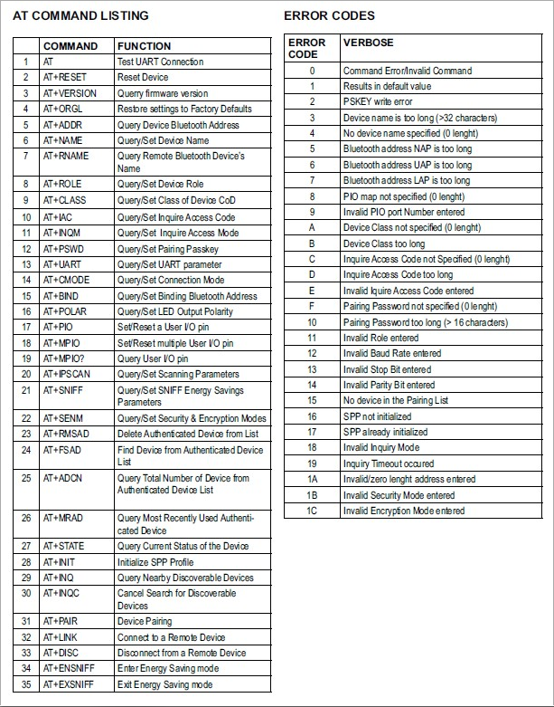
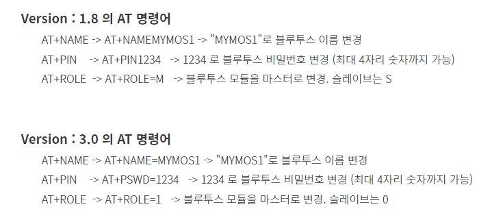
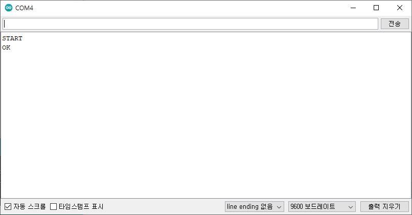
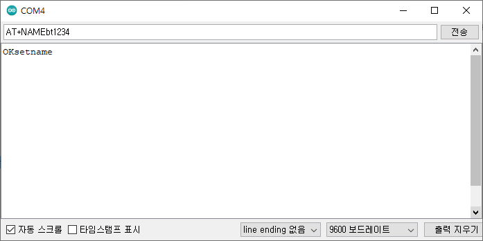
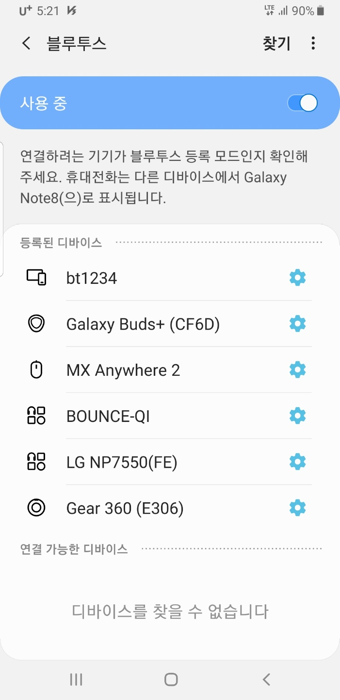
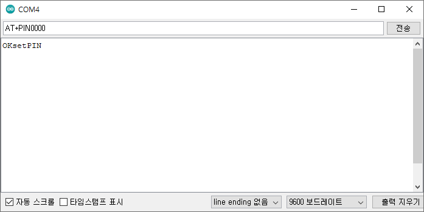
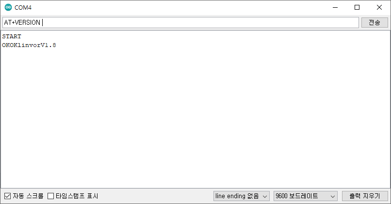

# 135_AT명령어_블루투스환경설정 ⚙️🪄

**도로시와 지니가 함께하는 헤이즈(Hayes) 명령어 체계, 이름 변경, 비밀번호 설정 및 통신 속도 제어**
* 👧 **도로시**: "지니야! 내 블루투스가 스마트폰 화면에 그냥 'HC-06'으로 뜨니까 강의실의 다른 친구들 것과 뒤섞여서 헷갈려! 나만의 멋진 이름으로 바꿀 수 없을까?"
* 🐱 **지니**: "그럼! 모뎀 제어의 역사적인 마법 주문인 **AT 명령어(AT Commands)** 를 사용하면 기기 이름도 바꾸고, 보안 비밀번호와 통신 속도까지 자유자재로 설정할 수 있단다!"
* 🐶 **토토**: "바우! 우리만의 4자리 비밀 암호로 철통 보안을 걸자 멍!"
* 📖 **상세 강의 교재**: [index.md](./index.md)

> 여러분 안녕하세요! 이번 시간에는 '135. AT명령어 블루투스환경설정 ⚙️🪄'을 주제로 함께 흥미진진한 탐험을 떠나보겠습니다. 오늘 강의에서는 특히 도로시와 지니가 함께하는 헤이즈(Hayes) 명령어 체계, 이름 변경, 비밀번호 설정 및 통신 속도 제어, 👧 도로시: "지니야! 내 블루투스가 스마트폰 화면에 그냥 'HC-06'으로 뜨니까 강의실의 다른 친구들 것과 뒤섞여서 헷갈려! 나만의 멋진 이름으로 바꿀 수 없을까?"를 중심으로 핵심 원리와 응용 방법을 차근차근 배워보겠습니다. 마법 멘토 지니와 호기심 많은 탐험가 도로시, 그리고 귀여운 토토와 함께 신나는 아두이노 모험을 힘차게 시작해 봅시다. 준비되셨나요?

---

## 1. AT 명령어(Hayes Command Set)의 역사와 원리

* 1980년대 컴퓨터 통신 초기, 전화선 모뎀은 사용자가 전송하는 데이터와 모뎀 자체를 설정하는 명령을 구분하지 못했습니다.
* 헤이즈사는 모뎀에게 **"내 말에 주목하라!(Attention!)"** 라는 의미로 모든 제어 명령의 머리에 **`AT`** 를 붙이는 획기적인 프로토콜을 고안했습니다:
* 모듈은 시리얼 포트로 `AT`라는 특정 접두사가 들어오면 데이터 전송을 멈추고 내부 플래시 메모리 설정을 변경합니다.
* 오늘날 LTE/5G 모뎀, Wi-Fi 칩셋, 블루투스 모듈(HC-06)까지 모든 무선 통신 반도체 제어의 표준 문법으로 계승되고 있습니다.

### 📞 1981년 데니스 헤이즈(Dennis Hayes)가 확립한 스마트 모뎀 프로토콜

> 이번 슬라이드에서는 '1. AT 명령어(Hayes Command Set)의 역사와 원리'에 대해 자세히 살펴보겠습니다. 화면의 다이어그램과 사진을 함께 참고해 주시기 바랍니다. 첫 번째 핵심은 년대 컴퓨터 통신 초기, 전화선 모뎀은 사용자가 전송하는 데이터와 모뎀 자체를 설정하는 명령을 구분하지 못했습니다.이며, 두 번째로는 헤이즈사는 모뎀에게 "내 말에 주목하라!(Attention!)" 라는 의미로 모든 제어 명령의 머리에 AT 를 붙이는 획기적인 프로토콜을 고안했습니다입니다. 여기에 덧붙여 모듈은 시리얼 포트로 AT라는 특정 접두사가 들어오면 데이터 전송을 멈추고 내부 플래시 메모리 설정을 변경합니다. 내용까지 함께 이해해 두시면 완벽합니다. 이 원리는 아두이노 시스템 전체를 관통하는 핵심 논리이므로 머릿속에 꼭 정리해 두시기 바랍니다.

---

## 2. 핵심 동작 상태: 명령 모드 (Command Mode) vs 데이터 모드 (Data Mode)

* [!IMPORTANT]
* `AT+NAME`이나 `AT+PIN` 명령으로 설정을 바꿀 때는 반드시 **스마트폰과의 블루투스 연결을 끊어서 LED가 빠르게 깜빡이는 상태**에서 시리얼 모니터로 전송해야 합니다!

| 구분 | 명령 모드 (Command Mode) | 데이터 모드 (Data Mode) |
| :--- | :--- | :--- |
| **LED 상태** | 🔴 **초당 2회 빠르게 깜빡임 (대기 상태)** | 🔴 **상시 켜짐 (Solid ON, 스마트폰 연결 중)** |
| **모듈 동작** | 들어오는 시리얼 입력을 **설정 변경 명령**으로 해석 | 들어오는 시리얼 입력을 **상대방에게 무선 전송** |
| **AT 명령 반응** | **`OK` 응답 반환 및 설정 저장 (성공)** ⭕ | **단순한 텍스트로 인식되어 스마트폰으로 날아감** ❌ |

### ⚠️ 도로시를 위한 지니의 특급 주의사항!
HC-06 모듈은 하드웨어 내부적으로 2가지 상반된 모드로 동작합니다:

> 이번에 살펴볼 내용은 '2. 핵심 동작 상태: 명령 모드 (Command Mode) vs 데이터 모드 (Data Mode)'입니다. 슬라이드에 정리된 표를 통해 각 항목의 특징과 수치, 차이점을 한눈에 비교해 보실 수 있습니다. 이 기본 개념을 확실히 잡아두셔야 실제 부품을 브레드보드에 꽂고 코딩할 때 실수 없이 완성할 수 있습니다.

---

## 3. 핵심 AT 명령어 요약 일람표

| 명령어 문법 | 기본값 (Default) | 정상 응답 | 설명 및 주의사항 |
| :--- | :---: | :---: | :--- |
| **`AT`** | - | `OK` | 통신 연결 상태 및 모듈 동작 확인 |
| **`AT+VERSION`** | - | `OKlinvorV1.8` | 내부 펌웨어 릴리즈 버전 확인 |
| **`AT+NAME새이름`** | `HC-06` | `OKsetname` | 스마트폰 검색 시 노출될 기기 명칭 변경 (공백 불가) |
| **`AT+PIN새암호`** | `1234` | `OKsetPIN` | 페어링 시 요구되는 4자리 숫자 보안 PIN 코드 |
| **`AT+BAUD4`** | `4 (9600)` | `OK9600` | UART 통신 보드레이트 변경 (4: 9600, 8: 115200) |

### 📜 HC-06 펌웨어 제어 핵심 주문서

> 이번에 살펴볼 내용은 '3. 핵심 AT 명령어 요약 일람표'입니다. 슬라이드에 정리된 표를 통해 각 항목의 특징과 수치, 차이점을 한눈에 비교해 보실 수 있습니다. 이 기본 개념을 확실히 잡아두셔야 실제 부품을 브레드보드에 꽂고 코딩할 때 실수 없이 완성할 수 있습니다.

---

## 4. 실습 1: 나만의 고유한 블루투스 이름 설정 (`AT+NAME`)

1. 아두이노 IDE의 시리얼 모니터를 열고 보드레이트를 `115200 baud`로 설정합니다.
2. 입력창에 대문자로 **`AT+NAMEDorothy_Bot`** 을 입력하고 [전송]을 누릅니다.
3. 시리얼 모니터 수신창에 **`OKsetname`** 이 즉시 회신되면 변경이 완료된 것입니다.
4. 스마트폰 설정의 블루투스 검색을 켜면, 기존 `HC-06` 대신 멋진 **`Dorothy_Bot`** 이 목록에 나타납니다!

### 🏷️ "Dorothy_Bot"으로 기기 이름 바꾸기

> 이번 슬라이드에서는 '4. 실습 1: 나만의 고유한 블루투스 이름 설정 (AT+NAME)'에 대해 자세히 살펴보겠습니다. 화면의 다이어그램과 사진을 함께 참고해 주시기 바랍니다. 첫 번째 핵심은 아두이노 IDE의 시리얼 모니터를 열고 보드레이트를 115200 baud로 설정합니다.이며, 두 번째로는 입력창에 대문자로 AT+NAMEDorothyBot 을 입력하고 [전송]을 누릅니다.입니다. 여기에 덧붙여 시리얼 모니터 수신창에 OKsetname 이 즉시 회신되면 변경이 완료된 것입니다. 내용까지 함께 이해해 두시면 완벽합니다. 이 원리는 아두이노 시스템 전체를 관통하는 핵심 논리이므로 머릿속에 꼭 정리해 두시기 바랍니다.

---

## 5. 실습 2: 보안 페어링 비밀번호 변경 (`AT+PIN`)

* 공장 출하 시 모든 HC-06 모듈의 비밀번호는 `1234` 또는 `0000`으로 동일하여, 주변의 다른 사용자가 내 장치에 실수로 접속할 위험이 있습니다.
* 시리얼 모니터에 **`AT+PIN7777`** 을 입력하고 [전송]합니다.
* 모듈이 **`OKsetPIN`** 으로 응답하면 성공! 이제부터는 4자리 암호 `7777`을 입력해야만 페어링이 승인됩니다.

### 🔒 무단 접속을 차단하는 4자리 보안 암호

> 이번 슬라이드에서는 '5. 실습 2: 보안 페어링 비밀번호 변경 (AT+PIN)'에 대해 자세히 살펴보겠습니다. 화면의 다이어그램과 사진을 함께 참고해 주시기 바랍니다. 첫 번째 핵심은 공장 출하 시 모든 HC-06 모듈의 비밀번호는 1234 또는 0000으로 동일하여, 주변의 다른 사용자가 내 장치에 실수로 접속할 위험이 있습니다.이며, 두 번째로는 시리얼 모니터에 AT+PIN7777 을 입력하고 [전송]합니다.입니다. 여기에 덧붙여 모듈이 OKsetPIN 으로 응답하면 성공! 이제부터는 4자리 암호 7777을 입력해야만 페어링이 승인됩니다. 내용까지 함께 이해해 두시면 완벽합니다. 이 원리는 아두이노 시스템 전체를 관통하는 핵심 논리이므로 머릿속에 꼭 정리해 두시기 바랍니다.

---

## 6. 실습 3: 펌웨어 버전 점검 (`AT+VERSION`)

* 시리얼 모니터에 **`AT+VERSION`** 을 입력하면 모듈에 내장된 펌웨어 버전이 출력됩니다:
* `OKlinvorV1.8`: 클래식 Linvor 계열 (Line ending 없는 상태 지원).
* `hc01.comV3.0` 또는 `v4.0`: 신형 모듈 (명령어 끝에 CR+LF가 요구되는 경우가 있음).
* 만약 `AT` 명령에 반응이 없다면 라인 엔딩 옵션을 `No line ending` ↔ `Both NL & CR`로 전환해 보세요.

### 🔍 내 모듈의 펌웨어 계보 확인

> 이번 슬라이드에서는 '6. 실습 3: 펌웨어 버전 점검 (AT+VERSION)'에 대해 자세히 살펴보겠습니다. 화면의 다이어그램과 사진을 함께 참고해 주시기 바랍니다. 첫 번째 핵심은 시리얼 모니터에 AT+VERSION 을 입력하면 모듈에 내장된 펌웨어 버전이 출력됩니다이며, 두 번째로는 OKlinvorV1.8: 클래식 Linvor 계열 (Line ending 없는 상태 지원).입니다. 여기에 덧붙여 hc01.comV3.0 또는 v4.0: 신형 모듈 (명령어 끝에 CR+LF가 요구되는 경우가 있음). 내용까지 함께 이해해 두시면 완벽합니다. 이 원리는 아두이노 시스템 전체를 관통하는 핵심 논리이므로 머릿속에 꼭 정리해 두시기 바랍니다.

---
## 🌟 도로시와 지니의 핵심 요약 노트!

* 👧 **도로시**: "`AT+NAMEDorothy_Bot`으로 이름을 바꾸고 `AT+PIN`으로 나만의 암호를 등록하니 내 전용 무선 장치가 되었어!"
* 🐱 **지니**: "맞아! 모듈의 빨간 불빛이 깜빡일 때만 명령 모드가 동작한다는 점을 명심하면 어떤 설정이든 쉽게 바꿀 수 있단다."
* 🐶 **토토**: "바우! 이제 스마트폰과 진짜 짝꿍을 맺는 블루투스 페어링을 하러 가자 멍!"

> 오늘 배운 '🌟 도로시와 지니의 핵심 요약 노트!'의 핵심 내용을 모두 정리해 보았습니다. 오늘 다룬 내용 중에서도 👧 도로시: "AT+NAMEDorothyBot으로 이름을 바꾸고 AT+PIN으로 나만의 암호를 등록하니 내 전용 무선 장치가 되었어!" 부분은 앞으로의 아두이노 실습과 프로젝트에서 계속 사용되는 매우 중요한 기초 지식입니다. 오늘 배운 내용을 꼭 다시 한번 복습해 보시고, 다음 강의에서 더욱 신나고 유익한 모험으로 다시 만나겠습니다. 모두 수고 많으셨습니다!