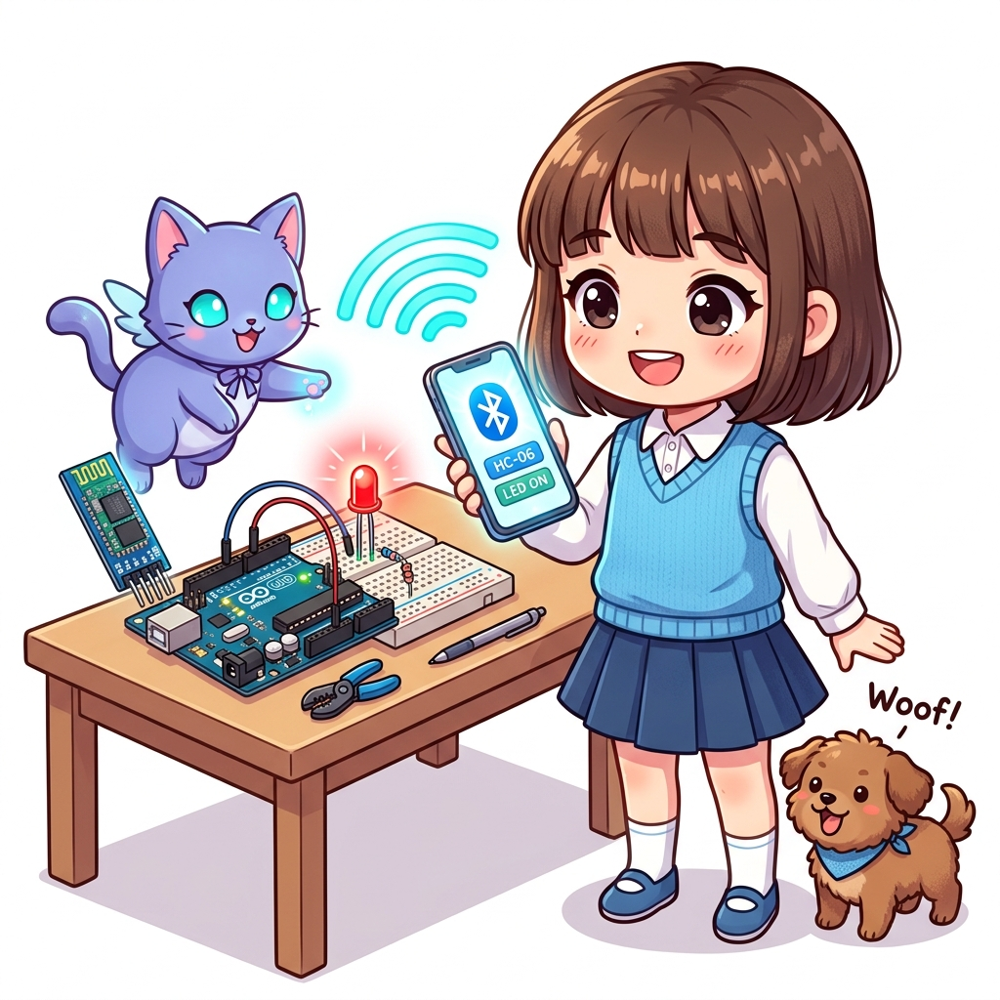
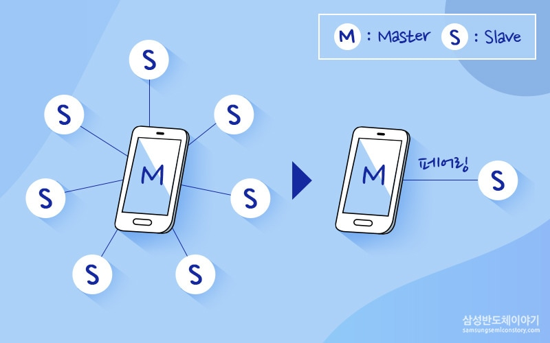
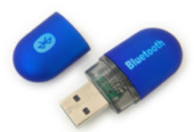
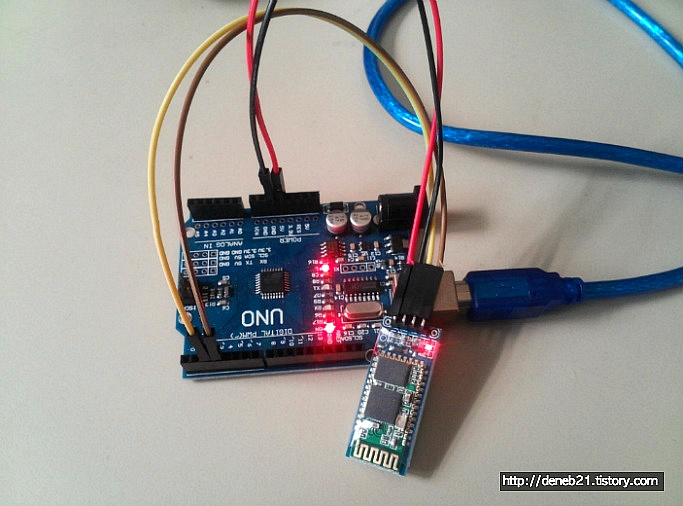
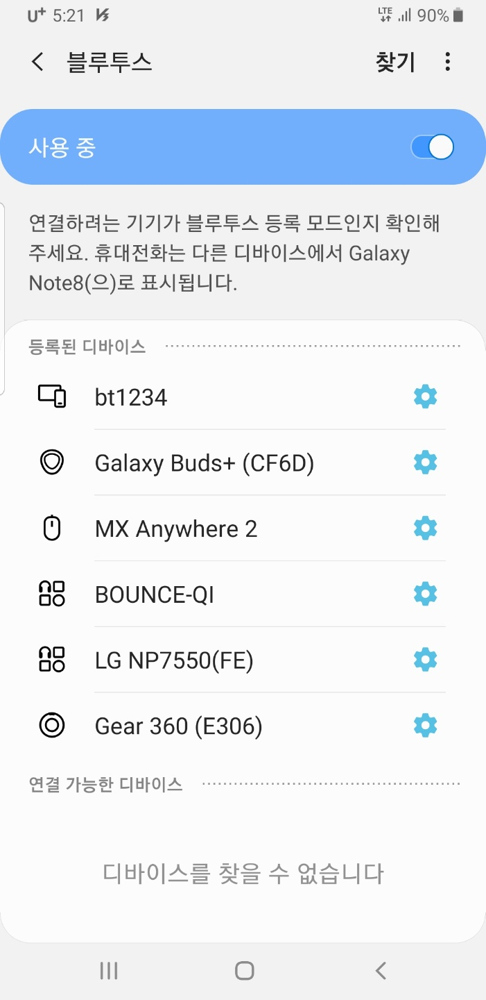
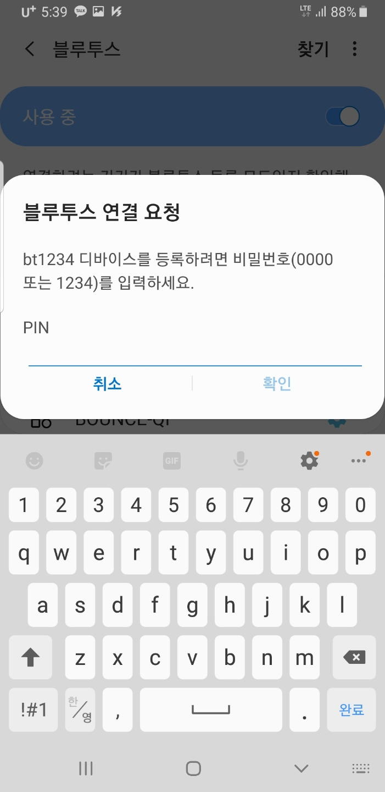

# 136_블루투스페어링_무선짝꿍 🤝📲

**도로시와 지니가 함께하는 마스터-슬레이브 구조, PIN 인증 및 스마트폰 페어링 절차**
* 👧 **도로시**: "지니야! '페어링(Pairing)'이라는 말이 무슨 뜻이야? 왜 스마트폰과 아두이노를 처음 연결할 때 4자리 비밀번호를 쳐야 해?"
* 🐱 **지니**: "'Pair(한 쌍)'라는 영어 단어처럼 두 기기가 서로를 인식하고 한 쌍의 단짝 친구로 등록하는 인증 절차란다! 비밀번호(PIN)를 통해 다른 사람의 무단 접속을 차단하지!"
* 🐶 **토토**: "바우! 우리 집 대문 도어락에 비밀번호를 누르고 들어가는 것과 똑같다 멍!"
* 📖 **상세 강의 교재**: [index.md](./index.md)

> 여러분 안녕하세요! 이번 시간에는 '136. 블루투스페어링 무선짝꿍 🤝📲'을 주제로 함께 흥미진진한 탐험을 떠나보겠습니다. 오늘 강의에서는 특히 도로시와 지니가 함께하는 마스터-슬레이브 구조, PIN 인증 및 스마트폰 페어링 절차, 👧 도로시: "지니야! '페어링(Pairing)'이라는 말이 무슨 뜻이야? 왜 스마트폰과 아두이노를 처음 연결할 때 4자리 비밀번호를 쳐야 해?"를 중심으로 핵심 원리와 응용 방법을 차근차근 배워보겠습니다. 마법 멘토 지니와 호기심 많은 탐험가 도로시, 그리고 귀여운 토토와 함께 신나는 아두이노 모험을 힘차게 시작해 봅시다. 준비되셨나요?

---

## 1. 페어링(Pairing)의 개념과 마스터-슬레이브(Master-Slave) 구조

1. **마스터 기기 (Master)**:
* 연결의 주도권을 쥐고 있는 기기입니다 (예: 안드로이드 스마트폰, 노트북 PC).
* 주변의 주파수를 스캔하여 슬레이브 기기를 탐색하고 연결을 요청합니다.
2. **슬레이브 기기 (Slave)**:
* 아두이노에 장착된 **HC-06 모듈**이 대표적인 슬레이브 기기입니다.
* 스스로 다른 기기를 검색할 수 없으며, 마스터 기기가 접속을 요청해 올 때까지 수동적으로 대기합니다.
3. **1:1 단일 세션 (Point-to-Point)**:
* HC-06 모듈은 한 번에 오직 하나의 마스터 기기와만 연결을 맺을 수 있습니다.

### 👫 능동적인 주도자(마스터)와 수동적인 대기자(슬레이브)
블루투스 네트워크(피코넷, Piconet)는 계층적인 역할을 가집니다:

> 이번 슬라이드에서는 '1. 페어링(Pairing)의 개념과 마스터-슬레이브(Master-Slave) 구조'에 대해 자세히 살펴보겠습니다. 화면의 다이어그램과 사진을 함께 참고해 주시기 바랍니다. 첫 번째 핵심은 마스터 기기 (Master)이며, 두 번째로는 연결의 주도권을 쥐고 있는 기기입니다 (예: 안드로이드 스마트폰, 노트북 PC).입니다. 여기에 덧붙여 주변의 주파수를 스캔하여 슬레이브 기기를 탐색하고 연결을 요청합니다. 내용까지 함께 이해해 두시면 완벽합니다. 이 원리는 아두이노 시스템 전체를 관통하는 핵심 논리이므로 머릿속에 꼭 정리해 두시기 바랍니다.

---

## 2. 모듈의 빨간 LED로 확인하는 하드웨어 상태

| LED 동작 상태 | 현재 모듈 모드 | 통신 상태 | 사용자가 취해야 할 행동 |
| :--- | :--- | :--- | :--- |
| 🔴 **초당 2회 고속 깜빡임** | **명령 모드 (Command Mode)** | 페어링 대기 중 (연결 끊김) | 스마트폰에서 블루투스 검색 및 연결 진행 가능, AT 명령 가능 |
| 🔴 **깜빡임 멈춤, 계속 켜짐** | **데이터 모드 (Data Mode)** | **스마트폰과 연결 완료 (Connected)** | 무선 데이터 송수신 시작, AT 명령 불가 |

### 🚨 눈으로 즉시 판별하는 2가지 상태 신호등

> 이번에 살펴볼 내용은 '2. 모듈의 빨간 LED로 확인하는 하드웨어 상태'입니다. 슬라이드에 정리된 표를 통해 각 항목의 특징과 수치, 차이점을 한눈에 비교해 보실 수 있습니다. 이 기본 개념을 확실히 잡아두셔야 실제 부품을 브레드보드에 꽂고 코딩할 때 실수 없이 완성할 수 있습니다.

---

## 3. 스마트폰 설정에서 장치 검색하기

1. 안드로이드 스마트폰의 **[설정] ➡️ [연결] ➡️ [블루투스]** 메뉴로 들어갑니다.
2. 상단 스위치를 켜고 우측 상단의 **[찾기]** 또는 **[기기 검색]** 을 터치합니다.
3. 화면 하단 **'연결 가능한 기기'** 목록에 잠시 후:
* 공장 기본값인 **`HC-06`** 혹은 우리가 설정했던 **`Dorothy_Bot`** 이 나타납니다.
4. 검색된 기기 이름을 손가락으로 가볍게 터치합니다.

### 📱 1단계: 주변 블루투스 신호 탐색

> 이번 슬라이드에서는 '3. 스마트폰 설정에서 장치 검색하기'에 대해 자세히 살펴보겠습니다. 화면의 다이어그램과 사진을 함께 참고해 주시기 바랍니다. 첫 번째 핵심은 안드로이드 스마트폰의 [설정] ➡️ [연결] ➡️ [블루투스] 메뉴로 들어갑니다.이며, 두 번째로는 상단 스위치를 켜고 우측 상단의 [찾기] 또는 [기기 검색] 을 터치합니다.입니다. 여기에 덧붙여 화면 하단 '연결 가능한 기기' 목록에 잠시 후 내용까지 함께 이해해 두시면 완벽합니다. 이 원리는 아두이노 시스템 전체를 관통하는 핵심 논리이므로 머릿속에 꼭 정리해 두시기 바랍니다.

---

## 4. 비밀번호(PIN) 입력 및 페어링 완료

1. 스마트폰 화면에 **"블루투스 연결 요청 - PIN을 입력하세요"** 대화상자가 뜹니다.
2. 비밀번호를 입력합니다:
* **초기 기본 비밀번호**: **`1234`** (또는 `0000`)
* *만약 `AT+PIN` 명령으로 바꿨다면 변경한 암호 입력*
3. **[확인]** 을 누르면 스마트폰 상단의 **'등록된 기기'** 목록으로 이동합니다.
4. 아두이노 보드의 HC-06 모듈을 보면, 깜빡거리던 빨간 LED가 **완전히 켜진 상태(Solid ON)** 로 바뀌며 성공적인 무선 페어링이 완료됩니다!

### 🔐 2단계: 4자리 보안 암호 인증

> 이번 슬라이드에서는 '4. 비밀번호(PIN) 입력 및 페어링 완료'에 대해 자세히 살펴보겠습니다. 화면의 다이어그램과 사진을 함께 참고해 주시기 바랍니다. 첫 번째 핵심은 스마트폰 화면에 "블루투스 연결 요청 - PIN을 입력하세요" 대화상자가 뜹니다.이며, 두 번째로는 비밀번호를 입력합니다입니다. 여기에 덧붙여 초기 기본 비밀번호: 1234 (또는 0000) 내용까지 함께 이해해 두시면 완벽합니다. 이 원리는 아두이노 시스템 전체를 관통하는 핵심 논리이므로 머릿속에 꼭 정리해 두시기 바랍니다.

---
## 5. 페어링 실패 시 트러블슈팅 가이드

| 증상 | 주 원인 | 점검 및 해결 방법 |
| :--- | :--- | :--- |
| **기기 목록에 안 뜸** | 전원 불량 또는 타 기기 선점 | ① 모듈 VCC/GND 전원선 접촉 확인 / ② 다른 스마트폰 연결 해제 (1:1 세션) |
| **PIN 번호 오류 발생** | 비밀번호 불일치 | 기본값 `1234` 또는 `0000` 입력, 시리얼 모니터에서 `AT+PIN` 재설정 |
| **연결 후 즉시 끊김** | 전압 부족 또는 전류 리셋 | 9V 배터리 잔량 확인, 아두이노 5V 단자 전원 안정화 |

> 이번에 살펴볼 내용은 '5. 페어링 실패 시 트러블슈팅 가이드'입니다. 슬라이드에 정리된 표를 통해 각 항목의 특징과 수치, 차이점을 한눈에 비교해 보실 수 있습니다. 이 기본 개념을 확실히 잡아두셔야 실제 부품을 브레드보드에 꽂고 코딩할 때 실수 없이 완성할 수 있습니다.
---

## 🌟 도로시와 지니의 핵심 요약 노트!

* 👧 **도로시**: "스마트폰(마스터)이 아두이노(슬레이브)를 검색해서 '1234' 암호를 맞추니 모듈의 깜빡임이 멈추고 든든하게 연결되었어!"
* 🐱 **지니**: "맞아! 이제 하드웨어적인 무선 페어링이 끝났으니, 다음 시간에 스마트폰 앱으로 직접 글자를 타이핑해 아두이노와 대화해 보자!"
* 🐶 **토토**: "바우! 무선 시리얼 터미널 앱으로 출발이다 멍!"

> 오늘 배운 '🌟 도로시와 지니의 핵심 요약 노트!'의 핵심 내용을 모두 정리해 보았습니다. 오늘 다룬 내용 중에서도 👧 도로시: "스마트폰(마스터)이 아두이노(슬레이브)를 검색해서 '1234' 암호를 맞추니 모듈의 깜빡임이 멈추고 든든하게 연결되었어!" 부분은 앞으로의 아두이노 실습과 프로젝트에서 계속 사용되는 매우 중요한 기초 지식입니다. 오늘 배운 내용을 꼭 다시 한번 복습해 보시고, 다음 강의에서 더욱 신나고 유익한 모험으로 다시 만나겠습니다. 모두 수고 많으셨습니다!