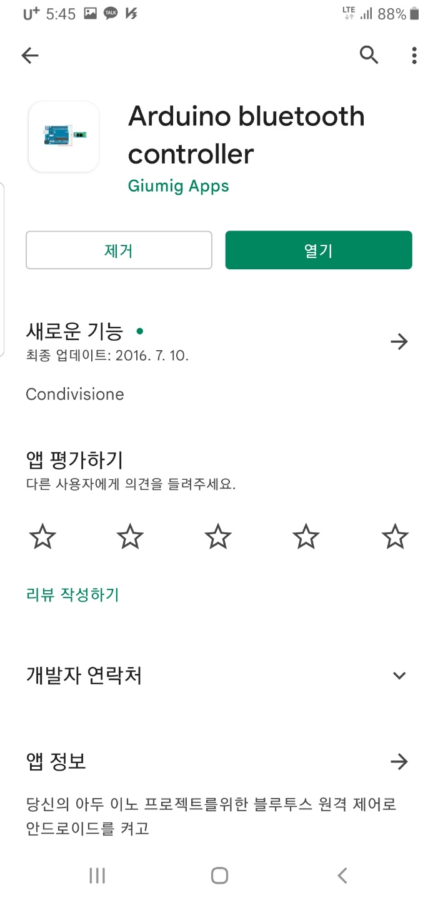
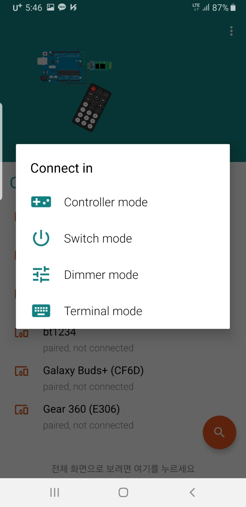
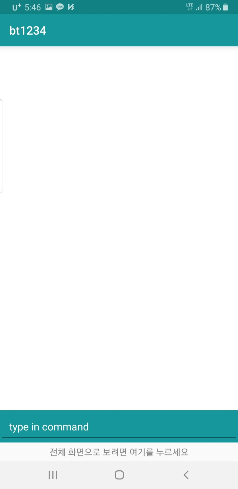
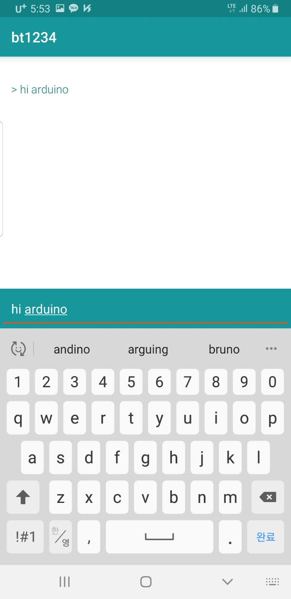
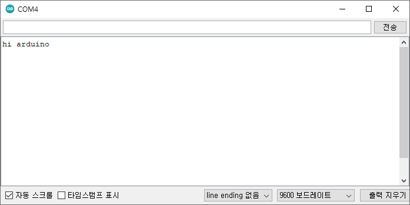

# 137_스마트폰시리얼앱_무선대화 💬📱

**도로시와 지니가 함께하는 시리얼 블루투스 터미널 앱 설치, 연결 및 실시간 양방향 텍스트 채팅 실습**
* 👧 **도로시**: "지니야! 스마트폰에 글자를 치면 아두이노 화면에 채팅 메시지처럼 톡 뜨게 할 수 있어?"
* 🐱 **지니**: "그럼! '시리얼 블루투스 터미널' 앱을 사용하면 아두이노와 1:1로 실시간 무선 텍스트 통신을 할 수 있단다!"
* 🐶 **토토**: "바우! 스마트폰이 아두이노와 대화하는 마법의 무전기가 되었다 멍!"
* 📖 **상세 강의 교재**: [index.md](./index.md)

> 여러분 안녕하세요! 이번 시간에는 '137. 스마트폰시리얼앱 무선대화 💬📱'을 주제로 함께 흥미진진한 탐험을 떠나보겠습니다. 오늘 강의에서는 특히 도로시와 지니가 함께하는 시리얼 블루투스 터미널 앱 설치, 연결 및 실시간 양방향 텍스트 채팅 실습, 👧 도로시: "지니야! 스마트폰에 글자를 치면 아두이노 화면에 채팅 메시지처럼 톡 뜨게 할 수 있어?"를 중심으로 핵심 원리와 응용 방법을 차근차근 배워보겠습니다. 마법 멘토 지니와 호기심 많은 탐험가 도로시, 그리고 귀여운 토토와 함께 신나는 아두이노 모험을 힘차게 시작해 봅시다. 준비되셨나요?

---

## 1. 스마트폰 앱 스토어에서 시리얼 터미널 앱 설치

1. 스마트폰에서 **구글 플레이스토어(Google Play)** 를 실행합니다.
2. 검색창에 **`Serial Bluetooth Terminal`** (또는 `Arduino Bluetooth Controller`)을 검색합니다.
3. 카이 모리츠(Kai Morich)의 검정색 터미널 아이콘 앱을 찾아 **[설치]** 를 누릅니다.
4. 설치 후 앱을 실행하고 블루투스 기기 검색 권한을 허용합니다.

### 📲 표준 시리얼 통신 도구 준비하기
블루투스 SPP(시리얼 포트 프로파일)를 테스트하기 위해 가장 안정적이고 널리 쓰이는 무료 앱을 설치합니다:

> 이번 슬라이드에서는 '1. 스마트폰 앱 스토어에서 시리얼 터미널 앱 설치'에 대해 자세히 살펴보겠습니다. 화면의 다이어그램과 사진을 함께 참고해 주시기 바랍니다. 첫 번째 핵심은 스마트폰에서 구글 플레이스토어(Google Play) 를 실행합니다.이며, 두 번째로는 검색창에 Serial Bluetooth Terminal (또는 Arduino Bluetooth Controller)을 검색합니다.입니다. 여기에 덧붙여 카이 모리츠(Kai Morich)의 검정색 터미널 아이콘 앱을 찾아 [설치] 를 누릅니다. 내용까지 함께 이해해 두시면 완벽합니다. 이 원리는 아두이노 시스템 전체를 관통하는 핵심 논리이므로 머릿속에 꼭 정리해 두시기 바랍니다.

---

## 2. 기기 메뉴에서 페어링된 HC-06 선택

1. 앱 좌측 상단의 햄버거 메뉴(≡)를 누르고 **[Devices (기기)]** 를 선택합니다.
2. 상단 탭에서 **`Bluetooth Classic`** 을 선택합니다.
3. 이전에 스마트폰 설정에서 페어링해 두었던 **`HC-06`** (또는 `Dorothy_Bot`)을 터치합니다.

### 🔎 등록된 블루투스 목록에서 접속하기

> 이번 슬라이드에서는 '2. 기기 메뉴에서 페어링된 HC-06 선택'에 대해 자세히 살펴보겠습니다. 화면의 다이어그램과 사진을 함께 참고해 주시기 바랍니다. 첫 번째 핵심은 앱 좌측 상단의 햄버거 메뉴(≡)를 누르고 [Devices (기기)] 를 선택합니다.이며, 두 번째로는 상단 탭에서 Bluetooth Classic 을 선택합니다.입니다. 여기에 덧붙여 이전에 스마트폰 설정에서 페어링해 두었던 HC-06 (또는 DorothyBot)을 터치합니다. 내용까지 함께 이해해 두시면 완벽합니다. 이 원리는 아두이노 시스템 전체를 관통하는 핵심 논리이므로 머릿속에 꼭 정리해 두시기 바랍니다.

---

## 3. 무선 연결 수립과 상태 확인 (Connected)

* 상단의 연결 버튼(플러그 모양 아이콘)을 누르면 연결이 시작됩니다.
* 터미널 콘솔창에 초록색 글씨로 **`Connecting to HC-06 ... Connected`** 가 출력됩니다.
* 아두이노에 꽂힌 HC-06 모듈의 빨간 LED가 **깜빡임을 멈추고 계속 켜진 상태(Solid ON)** 로 유지되면 완벽한 통신 준비 완료!

### 🤝 통신 링크가 성공적으로 열렸을 때

> 이번 슬라이드에서는 '3. 무선 연결 수립과 상태 확인 (Connected)'에 대해 자세히 살펴보겠습니다. 화면의 다이어그램과 사진을 함께 참고해 주시기 바랍니다. 첫 번째 핵심은 상단의 연결 버튼(플러그 모양 아이콘)을 누르면 연결이 시작됩니다.이며, 두 번째로는 터미널 콘솔창에 초록색 글씨로 Connecting to HC-06 ... Connected 가 출력됩니다.입니다. 여기에 덧붙여 아두이노에 꽂힌 HC-06 모듈의 빨간 LED가 깜빡임을 멈추고 계속 켜진 상태(Solid ON) 로 유지되면 완벽한 통신 준비 완료! 내용까지 함께 이해해 두시면 완벽합니다. 이 원리는 아두이노 시스템 전체를 관통하는 핵심 논리이므로 머릿속에 꼭 정리해 두시기 바랍니다.

---

## 4. 스마트폰에서 메시지 송신하기 (Send)

1. 화면 하단의 입력 필드를 터치하여 스마트폰 키보드를 엽니다.
2. 영문으로 **`Hello Arduino!`** 를 입력하고 우측의 파란색 **[전송 (Send)]** 화살표 버튼을 누릅니다.
3. 입력한 텍스트가 노란색 글씨로 터미널 로그에 기록되며 전파를 타고 아두이노로 날아갑니다!

### ✉️ "Hello Arduino!" 키보드로 입력하고 전송

> 이번 슬라이드에서는 '4. 스마트폰에서 메시지 송신하기 (Send)'에 대해 자세히 살펴보겠습니다. 화면의 다이어그램과 사진을 함께 참고해 주시기 바랍니다. 첫 번째 핵심은 화면 하단의 입력 필드를 터치하여 스마트폰 키보드를 엽니다.이며, 두 번째로는 영문으로 Hello Arduino! 를 입력하고 우측의 파란색 [전송 (Send)] 화살표 버튼을 누릅니다.입니다. 여기에 덧붙여 입력한 텍스트가 노란색 글씨로 터미널 로그에 기록되며 전파를 타고 아두이노로 날아갑니다! 내용까지 함께 이해해 두시면 완벽합니다. 이 원리는 아두이노 시스템 전체를 관통하는 핵심 논리이므로 머릿속에 꼭 정리해 두시기 바랍니다.

---

## 5. PC 시리얼 모니터와 스마트폰의 실시간 동기화

* PC의 아두이노 IDE 시리얼 모니터를 확인하면, 스마트폰에서 보낸 `Hello Arduino!`가 1초의 지체도 없이 그대로 화면에 찍혀 나옵니다!
* 반대로 PC 시리얼 모니터에서 **`Nice to meet you, Dorothy!`** 라고 입력하고 엔터를 치면, 스마트폰 앱 터미널 화면에 파란색 수신 텍스트로 즉각 표시됩니다!

### 🖥️ 양방향 메아리 통신 검증

> 이번 슬라이드에서는 '5. PC 시리얼 모니터와 스마트폰의 실시간 동기화'에 대해 자세히 살펴보겠습니다. 화면의 다이어그램과 사진을 함께 참고해 주시기 바랍니다. 첫 번째 핵심은 PC의 아두이노 IDE 시리얼 모니터를 확인하면, 스마트폰에서 보낸 Hello Arduino!가 1초의 지체도 없이 그대로 화면에 찍혀 나옵니다!이며, 두 번째로는 반대로 PC 시리얼 모니터에서 Nice to meet you, Dorothy! 라고 입력하고 엔터를 치면, 스마트폰 앱 터미널 화면에 파란색 수신 텍스트로 즉각 표시됩니다!입니다. 이 원리는 아두이노 시스템 전체를 관통하는 핵심 논리이므로 머릿속에 꼭 정리해 두시기 바랍니다.

---
## 🌟 도로시와 지니의 핵심 요약 노트!

* 👧 **도로시**: "스마트폰에서 글자를 타이핑하니 아두이노 화면에 즉시 편지처럼 도착하는 게 마술 같아!"
* 🐱 **지니**: "무선 데이터 파이프라인이 튼튼하게 검증되었어! 다음 시간에는 이 문자로 아두이노의 LED 전등을 직접 켜고 끄는 제어 코드를 완성해보자!"
* 🐶 **토토**: "바우! 이제 진짜 무선 리모컨을 만들러 가자 멍!"

| 전송 주체 | 수신 주체 | 통신 경로 | 확인 방법 |
| :--- | :--- | :--- | :--- |
| **스마트폰 앱** | **아두이노 보드** | 스마트폰 Bluetooth ➡️ HC-06 RX ➡️ 아두이노 8번 핀 | PC 시리얼 모니터 출력 |
| **PC 시리얼 모니터** | **스마트폰 앱** | PC USB ➡️ 아두이노 7번 핀 ➡️ HC-06 TX ➡️ 스마트폰 | 스마트폰 앱 터미널 화면 |

> 오늘 배운 '🌟 도로시와 지니의 핵심 요약 노트!'의 핵심 내용을 모두 정리해 보았습니다. 오늘 다룬 내용 중에서도 👧 도로시: "스마트폰에서 글자를 타이핑하니 아두이노 화면에 즉시 편지처럼 도착하는 게 마술 같아!" 부분은 앞으로의 아두이노 실습과 프로젝트에서 계속 사용되는 매우 중요한 기초 지식입니다. 오늘 배운 내용을 꼭 다시 한번 복습해 보시고, 다음 강의에서 더욱 신나고 유익한 모험으로 다시 만나겠습니다. 모두 수고 많으셨습니다!