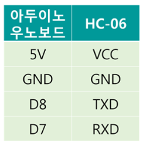
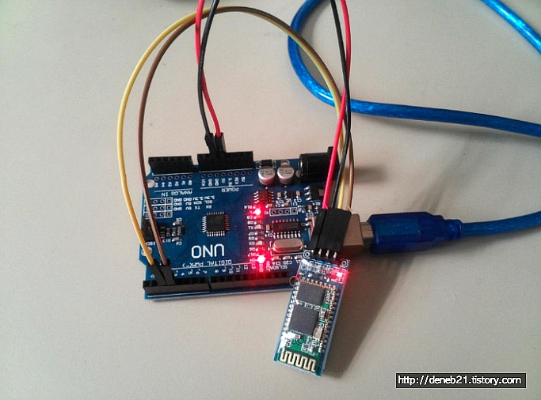
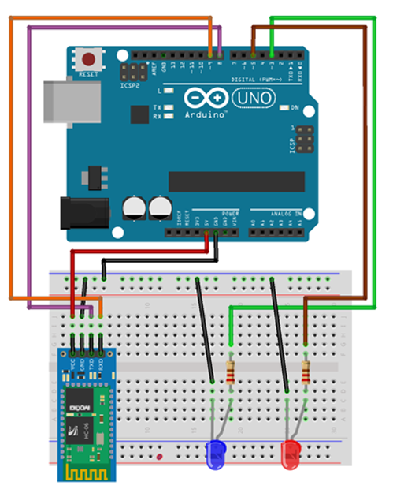
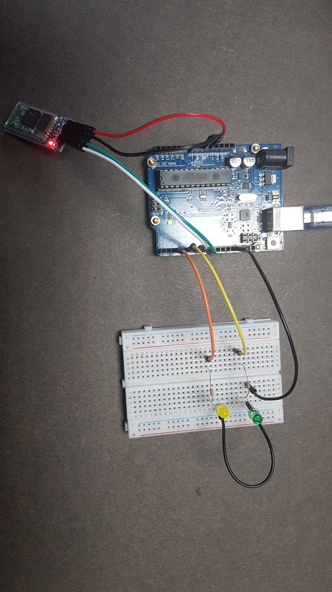

# 138_블루투스스위치_스마트폰LED제어 💡📱


**도로시와 지니가 함께하는 무선 스마트 홈 IoT 조명 만들기 및 수신 패킷 파싱**

* 👧 **도로시**: "지니야! 침대에 누워서 스마트폰 버튼 하나로 책상 위의 빨간 불과 초록 불을 마음대로 켜고 끄고 싶어!"
* 🐱 **지니**: "스마트폰에서 'a', 'b', 'c' 문자를 보내면 아두이노가 각각의 LED를 켜고 끄는 마법 회로와 펌웨어를 완성해보자!"
* 🐶 **토토**: "바우! 손가락 하나로 방 안의 조명을 지휘하는 스마트 하우스 탄생이다 멍!"

* 🖥️ **강의 슬라이드**: [slides.md](./slides.md)

---

## 1. 하드웨어 회로 구성 (LED 2개 + HC-06)



### 🔌 브레드보드 배선 가이드
* **HC-06 블루투스 모듈**:
  * **VCC** ➡️ 아두이노 **5V**
  * **GND** ➡️ 아두이노 **GND**
  * **TXD** ➡️ 아두이노 **8번 핀 (BT_RXD)**
  * **RXD** ➡️ 아두이노 **7번 핀 (BT_TXD)**
* **1번 LED (빨간색 조명)**:
  * 긴 다리(+) ➡️ 디지털 **3번 핀**, 짧은 다리(-) ➡️ 220Ω 저항 ➡️ GND
* **2번 LED (초록색 조명)**:
  * 긴 다리(+) ➡️ 디지털 **5번 핀**, 짧은 다리(-) ➡️ 220Ω 저항 ➡️ GND



---

## 2. 전체 아두이노 스케치 코드 (Arduino C++)

### 💻 블루투스 무선 수신 및 멀티 LED 제어 펌웨어

```cpp
#include <SoftwareSerial.h>

// 아두이노 8번을 수신(RX), 7번을 송신(TX)으로 소프트웨어 시리얼 설정
const int BT_RXD = 8;
const int BT_TXD = 7;
SoftwareSerial bluetooth(BT_RXD, BT_TXD);

// 제어할 LED 핀 번호 정의
const int RED_LED_PIN   = 3;
const int GREEN_LED_PIN = 5;

void setup() {
  // PC 시리얼 모니터 디버깅용 시리얼 통신 시작 (9600 bps)
  Serial.begin(9600);
  
  // HC-06 블루투스 통신 시작 (9600 bps)
  bluetooth.begin(9600);

  // LED 핀들을 출력 모드로 설정
  pinMode(RED_LED_PIN, OUTPUT);
  pinMode(GREEN_LED_PIN, OUTPUT);

  // 초기 상태: 모든 조명 소등
  digitalWrite(RED_LED_PIN, LOW);
  digitalWrite(GREEN_LED_PIN, LOW);

  Serial.println("==========================================");
  Serial.println("   Bluetooth Smart Lighting Controller    ");
  Serial.println("   Commands: 'a'(Red), 'b'(Green), 'c'(All Off) ");
  Serial.println("==========================================");
}

void loop() {
  // 스마트폰에서 블루투스를 통해 데이터가 도착했는지 검사
  if (bluetooth.available() > 0) {
    // 1바이트 문자 읽기
    char cmd = bluetooth.read();

    // PC 시리얼 모니터에 수신된 문자 출력
    Serial.print("Received Command -> ");
    Serial.println(cmd);

    // 명령어 분기 처리
    if (cmd == 'a') {
      digitalWrite(RED_LED_PIN, HIGH);   // 'a' 수신: 빨간 LED 점등
      Serial.println("Action: Red LED ON");
    } 
    else if (cmd == 'b') {
      digitalWrite(GREEN_LED_PIN, HIGH); // 'b' 수신: 초록 LED 점등
      Serial.println("Action: Green LED ON");
    } 
    else if (cmd == 'c') {
      digitalWrite(RED_LED_PIN, LOW);    // 'c' 수신: 모든 LED 소등
      digitalWrite(GREEN_LED_PIN, LOW);
      Serial.println("Action: All LEDs OFF");
    }
  }
}
```

---

## 3. 코드 핵심 상세 해설



### 🔍 무선 제어 로직 심층 분석

1. **`if (bluetooth.available() > 0)`**:
   * 블루투스 모듈 내부의 수신 FIFO 버퍼에 데이터가 쌓였는지 확인합니다. 데이터가 들어왔을 때만 내부 조건문을 실행하여 CPU의 낭비를 막습니다.
2. **`char cmd = bluetooth.read();`**:
   * 버퍼 맨 앞의 1바이트 문자 데이터를 읽어옵니다. 스마트폰에서 `"a"`를 보내면 아스키코드 `'a'`(10진수 97)가 변수 `cmd`에 저장됩니다.
3. **조건 분기 처리 (`if - else if`)**:
   * `'a'` 수신: 디지털 3번 핀에 5V를 출력하여 빨간 조명을 켭니다.
   * `'b'` 수신: 디지털 5번 핀에 5V를 출력하여 초록 조명을 켭니다.
   * `'c'` 수신: 3번과 5번 핀 모두 0V를 출력하여 모든 조명을 일괄 소등합니다.

---

## 4. 스마트폰 앱 컨트롤러 버튼 매핑



### 🔘 나만의 전등 리모컨 완성하기
스마트폰 'Serial Bluetooth Terminal' 앱의 하단 매크로 버튼(M1, M2, M3)에 전송할 문자를 설정합니다:

| 매크로 버튼 | 버튼 이름 (Name) | 전송 문자열 (Value) | 아두이노 동작 |
| :---: | :---: | :---: | :--- |
| **M1** | **RED ON** | **`a`** | 3번 빨간색 LED 점등 |
| **M2** | **GREEN ON** | **`b`** | 5번 초록색 LED 점등 |
| **M3** | **ALL OFF** | **`c`** | 모든 LED 일괄 소등 |

이제 스마트폰 화면의 버튼을 터치할 때마다 침대에 누워서도 방 안의 조명을 원격으로 켜고 끌 수 있습니다!

---

## 5. 실습 확장: 실생활 사물인터넷(IoT)으로의 도약

* **릴레이(Relay) 모듈 연동**:
  * 3번 핀의 출력을 전자식 릴레이 스위치에 연결하면, 220V 방 스탠드나 가전제품 전원을 스마트폰으로 원격 제어할 수 있습니다.
* **서보 모터(Servo Motor) 도어락**:
  * `'o'`(Open) 문자를 수신하면 서보 모터 각도를 90도로 돌려 문을 열고, `'k'`(Lock) 문자를 수신하면 0도로 닫는 스마트 도어락을 만들 수 있습니다.
* **RGB LED 조광 제어**:
  * 수신된 숫자에 따라 PWM 듀티비를 조절하여 스마트폰으로 은은한 무드등 밝기를 조절할 수 있습니다.

---

## 🌟 도로시와 지니의 핵심 요약 노트!

* 👧 **도로시**: "스마트폰에서 문자를 보내 아두이노가 읽고 `if`문으로 핀 전압을 제어하니 마법 같은 스마트 전등 리모컨이 완성되었어!"
* 🐱 **지니**: "축하해 도로시! 이제 유선 전선의 한계를 넘어 무선 사물인터넷(IoT)의 세계로 훌륭하게 진입했단다."
* 🐶 **토토**: "바우! 이제 자연의 신비를 감지하는 여러 센서들을 만나러 가자 멍!"
