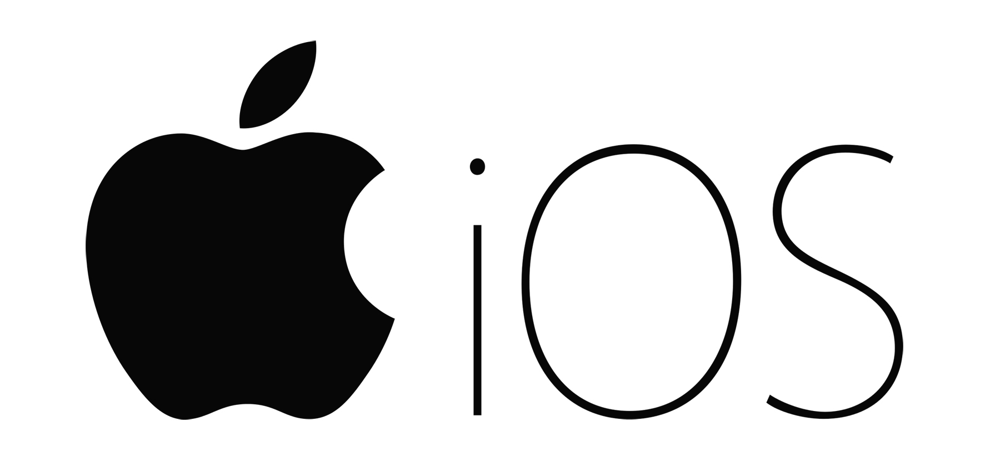
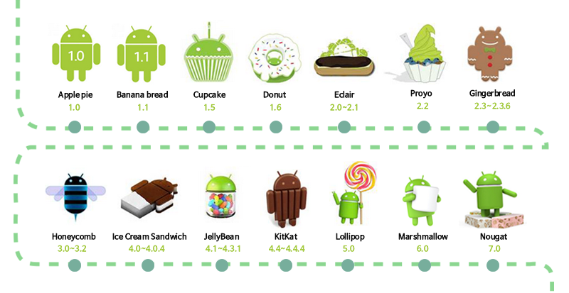
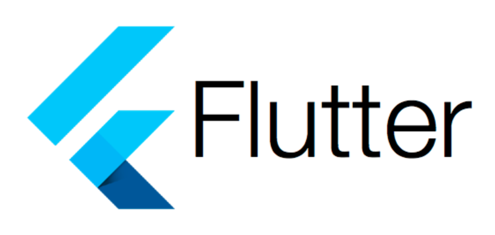
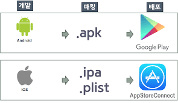

# 139_스마트폰앱이란_소프트웨어생태계 📱🌍


**도로시와 지니가 함께하는 모바일 애플리케이션의 기본 개념과 동작 원리**
* 👧 **도로시**: "지니야! 우리가 스마트폰으로 매일 쓰는 카카오톡, 유튜브, 카메라, 길 찾기 지도를 왜 '앱'이라고 부를까?"
* 🐱 **지니**: "'애플리케이션(Application)'의 줄임말로, 운영체제(OS) 위에서 동작하며 사용자가 원하는 특별한 목적을 달성해 주는 소프트웨어란다!"
* 🐶 **토토**: "바우! 하드웨어가 튼튼한 스마트폰 몸체라면, 앱은 그 안에서 살아 움직이는 똑똑한 두뇌다 멍!"
* 📖 **상세 강의 교재**: [index.md](./index.md)


> 여러분 안녕하세요! 이번 시간에는 '139. 스마트폰앱이란 소프트웨어생태계 📱🌍'을 주제로 함께 흥미진진한 탐험을 떠나보겠습니다. 오늘 강의에서는 특히 도로시와 지니가 함께하는 모바일 애플리케이션의 기본 개념과 동작 원리, 👧 도로시: "지니야! 우리가 스마트폰으로 매일 쓰는 카카오톡, 유튜브, 카메라, 길 찾기 지도를 왜 '앱'이라고 부를까?"를 중심으로 핵심 원리와 응용 방법을 차근차근 배워보겠습니다. 마법 멘토 지니와 호기심 많은 탐험가 도로시, 그리고 귀여운 토토와 함께 신나는 아두이노 모험을 힘차게 시작해 봅시다. 준비되셨나요?

---

## 1. 애플리케이션(Application)의 본질과 분류


1. **시스템 소프트웨어 (OS, Operating System)**:
* 하드웨어(CPU, 메모리, 카메라, 터치스크린, 블루투스 안테나)를 제어하고 자원을 공평하게 나누어주는 기본 바탕 프로그램입니다.
* 대표적인 모바일 OS로 구글의 **Android**와 애플의 **iOS**가 있습니다.
2. **응용 소프트웨어 (Application Software / App)**:
* 사용자가 필요로 하는 구체적인 작업(사진 편집, 게임, 채팅, 무선 원격 제어)을 직접 처리하는 프로그램입니다.
* 운영체제가 제공하는 API(기능 도구)를 빌려와 화면에 버튼을 띄우고 스피커로 소리를 냅니다.

### 📱 시스템 소프트웨어 vs 응용 소프트웨어
컴퓨터나 스마트폰의 소프트웨어는 크게 두 단계의 계층으로 구성됩니다:

> 이번 슬라이드에서는 '1. 애플리케이션(Application)의 본질과 분류'에 대해 자세히 살펴보겠습니다. 화면의 다이어그램과 사진을 함께 참고해 주시기 바랍니다. 첫 번째 핵심은 시스템 소프트웨어 (OS, Operating System)이며, 두 번째로는 하드웨어(CPU, 메모리, 카메라, 터치스크린, 블루투스 안테나)를 제어하고 자원을 공평하게 나누어주는 기본 바탕 프로그램입니다.입니다. 여기에 덧붙여 대표적인 모바일 OS로 구글의 Android와 애플의 iOS가 있습니다. 내용까지 함께 이해해 두시면 완벽합니다. 이 원리는 아두이노 시스템 전체를 관통하는 핵심 논리이므로 머릿속에 꼭 정리해 두시기 바랍니다.

---

## 2. 모바일 양대 운영체제: 안드로이드 vs iOS



* [!NOTE]
* 우리가 아두이노 실습에서 사용하는 **HC-06 블루투스 모듈**은 클래식 블루투스 SPP(시리얼 포트 프로파일)를 사용하기 때문에, 안드로이드 스마트폰과 앱 인벤터의 조합이 가장 호환성이 뛰어나고 실습하기에 최적입니다!

| 구분 | 구글 안드로이드 (Android) | 애플 iOS |
| :--- | :--- | :--- |
| **운영체제 기반** | 리눅스(Linux) 커널 기반 오픈소스 | 유닉스(BSD Unix) 기반 폐쇄형 |
| **제조사** | 삼성전자, 샤오미, 소니, 픽셀 등 전 세계 다수 | 애플(Apple) 단독 (아이폰, 아이패드) |
| **앱 배포처** | 구글 플레이스토어, 원스토어, 직접 APK 설치 | 애플 앱스토어 (App Store) 단독 |
| **블루투스 제어** | 클래식 블루투스(SPP) & BLE 모두 자유롭게 지원 | BLE 위주, 클래식 SPP 제한적 지원 |
| **교육용 실습 적합도** | **최고 (MIT 앱 인벤터로 무료 즉시 테스트 가능)** | 유료 개발자 계정 및 맥북(Mac) 필요 |

### 🤖 구글 안드로이드(Android) vs 🍎 애플 iOS 비교

> 이번에 살펴볼 내용은 '2. 모바일 양대 운영체제: 안드로이드 vs iOS'입니다. 슬라이드에 정리된 표를 통해 각 항목의 특징과 수치, 차이점을 한눈에 비교해 보실 수 있습니다. 이 기본 개념을 확실히 잡아두셔야 실제 부품을 브레드보드에 꽂고 코딩할 때 실수 없이 완성할 수 있습니다.

---

## 3. 스마트폰 생태계와 센서 하드웨어



* **무선 통신**: Wi-Fi, 블루투스(Bluetooth), NFC, 5G/LTE
* **센서 장치**: 3축 가속도계, 자이로센서, 디지털 나침반, GPS, 조도센서, 카메라
* **사용자 인터페이스**: 고해상도 정전용량 멀티터치 스크린, 스테레오 스피커, 진동 모터

### 🕹️ 손바닥 안의 슈퍼컴퓨터
스마트폰은 단순한 전화기가 아닙니다. 아두이노보다 수백 배 빠른 CPU와 풍부한 센서가 탑재되어 있습니다:
스마트폰의 이 막강한 센서와 통신 기능을 앱으로 연결하면, 아두이노 로봇을 원격 조종하는 최고의 무선 컨트롤러가 탄생합니다!

> 이번 슬라이드에서는 '3. 스마트폰 생태계와 센서 하드웨어'에 대해 자세히 살펴보겠습니다. 화면의 다이어그램과 사진을 함께 참고해 주시기 바랍니다. 첫 번째 핵심은 무선 통신: Wi-Fi, 블루투스(Bluetooth), NFC, 5G/LTE이며, 두 번째로는 센서 장치: 3축 가속도계, 자이로센서, 디지털 나침반, GPS, 조도센서, 카메라입니다. 여기에 덧붙여 사용자 인터페이스: 고해상도 정전용량 멀티터치 스크린, 스테레오 스피커, 진동 모터 내용까지 함께 이해해 두시면 완벽합니다. 이 원리는 아두이노 시스템 전체를 관통하는 핵심 논리이므로 머릿속에 꼭 정리해 두시기 바랍니다.

---

## 4. 앱 개발 방식의 진화: 텍스트 코딩에서 블록 코딩까지



1. **전통적인 텍스트 개발 (Native App Development)**:
* 안드로이드: **Kotlin(코틀린)**, **Java(자바)** 사용 (Android Studio 환경).
* iOS: **Swift(스위프트)**, **Objective-C** 사용 (Xcode 환경).
* 성능은 뛰어나지만, 문법이 매우 방대하고 초보자가 배우기에는 수개월 이상의 긴 시간이 필요합니다.
2. **블록 코딩 기반 개발 (MIT App Inventor)**:
* 웹 브라우저에서 레고 블록을 맞추듯이 마우스로 드래그 앤 드롭하여 기능을 완성합니다.
* 복잡한 세미콜론이나 오타 걱정 없이 10분 만에 아두이노 통신 앱을 제작하고 스마트폰에 설치할 수 있습니다!

### 💻 어떻게 앱을 만들 수 있을까요?

> 이번 슬라이드에서는 '4. 앱 개발 방식의 진화: 텍스트 코딩에서 블록 코딩까지'에 대해 자세히 살펴보겠습니다. 화면의 다이어그램과 사진을 함께 참고해 주시기 바랍니다. 첫 번째 핵심은 전통적인 텍스트 개발 (Native App Development)이며, 두 번째로는 안드로이드: Kotlin(코틀린), Java(자바) 사용 (Android Studio 환경).입니다. 여기에 덧붙여 iOS: Swift(스위프트), Objective-C 사용 (Xcode 환경). 내용까지 함께 이해해 두시면 완벽합니다. 이 원리는 아두이노 시스템 전체를 관통하는 핵심 논리이므로 머릿속에 꼭 정리해 두시기 바랍니다.

---

## 5. 앱 제작 및 배포의 4단계 라이프사이클



### 🚀 나만의 앱이 스마트폰에서 실행되기까지

```text
[1단계: UI 디자인]     스마트폰 화면에 버튼, 레이블, 목록 선택기를 예쁘게 배치
        ↓
[2단계: 블록 코딩]     "버튼을 누르면 아두이노로 '1'을 전송하라" 로직 조립
        ↓
[3단계: 빌드 & 패키징]  클라우드 서버에서 안드로이드 실행 파일(.apk)로 자동 번역
        ↓
[4단계: 무선 설치]     화면에 뜬 QR 코드를 스마트폰 카메라로 스캔하여 즉시 실행!
```

> 이번 슬라이드에서는 '5. 앱 제작 및 배포의 4단계 라이프사이클'에 대한 실제 동작 코드를 분석해 보겠습니다. 화면의 코드를 살펴보시면, 컴퓨터가 아두이노 하드웨어에 단계별로 명령을 내리는 흐름을 명확하게 확인할 수 있습니다. 각 함수의 역할과 괄호 안의 매개변수가 하드웨어 핀과 어떤 관계를 맺고 동작하는지 주의 깊게 살펴보시기 바랍니다.

---
## 🌟 도로시와 지니의 핵심 요약 노트!


* 👧 **도로시**: "앱(App)은 스마트폰 운영체제 위에서 사용자의 명령을 수행하는 응용 프로그램이었구나!"
* 🐱 **지니**: "맞아! 안드로이드와 MIT 앱 인벤터를 활용하면 누구나 손쉽게 아두이노 무선 조종 앱을 직접 만들 수 있단다."
* 🐶 **토토**: "바우! 다음 시간에 앱 인벤터 웹사이트에 접속해서 우리만의 프로젝트를 만들어보자 멍!"

> 오늘 배운 '🌟 도로시와 지니의 핵심 요약 노트!'의 핵심 내용을 모두 정리해 보았습니다. 오늘 다룬 내용 중에서도 👧 도로시: "앱(App)은 스마트폰 운영체제 위에서 사용자의 명령을 수행하는 응용 프로그램이었구나!" 부분은 앞으로의 아두이노 실습과 프로젝트에서 계속 사용되는 매우 중요한 기초 지식입니다. 오늘 배운 내용을 꼭 다시 한번 복습해 보시고, 다음 강의에서 더욱 신나고 유익한 모험으로 다시 만나겠습니다. 모두 수고 많으셨습니다!