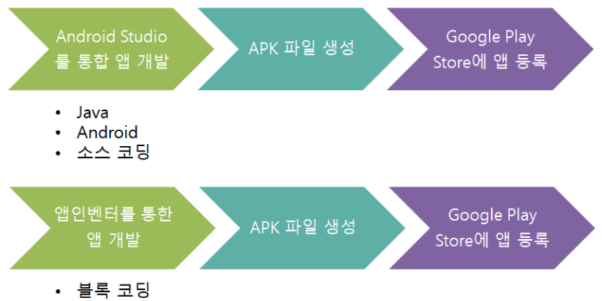
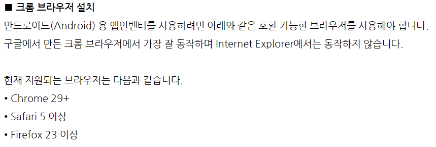
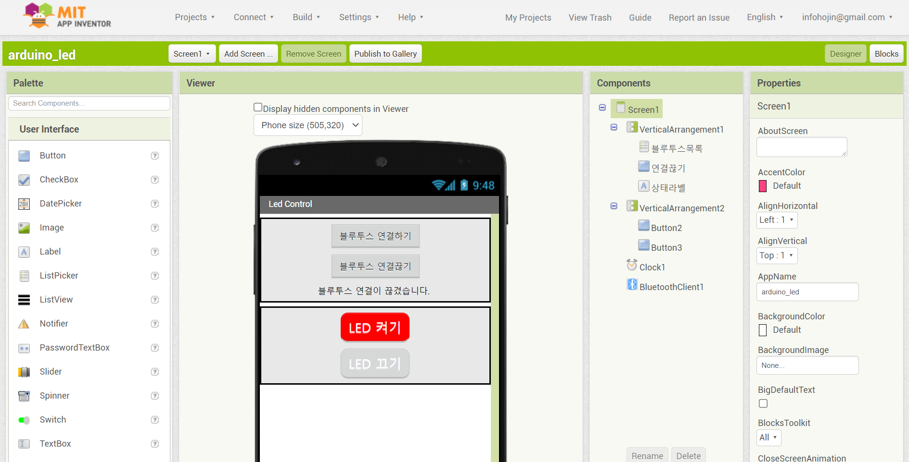
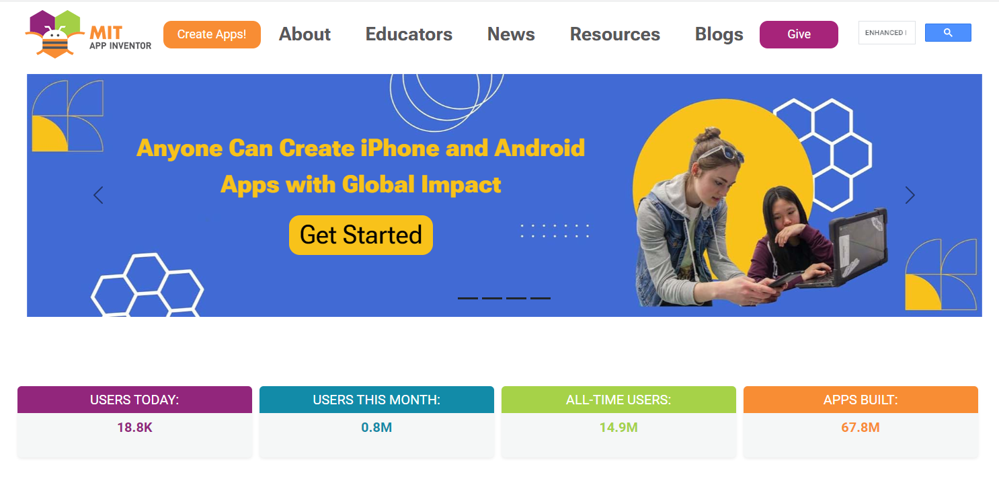

# 140_앱인벤터_블록코딩마법소개 🧩🪄

**도로시와 지니가 함께하는 웹 기반 노코드 모바일 앱 제작 도구**

* 👧 **도로시**: "지니야! 어려운 자바나 코틀린 언어를 몰라도 진짜 내 스마트폰에서 실행되는 앱을 만들 수 있어?"
* 🐱 **지니**: "구글(Google)과 세계 최고의 공과대학인 MIT가 손잡고 만든 **앱 인벤터(App Inventor)** 가 있잖아! 마우스로 퍼즐을 맞추면 앱이 뚝딱 완성돼!"
* 🐶 **토토**: "바우! 레고 블록 놀이처럼 쉽고 재미있는 앱 만들기 마법이다 멍!"

* 🖥️ **강의 슬라이드**: [slides.md](./slides.md)

---

## 1. 앱 인벤터(MIT App Inventor)의 탄생과 역사

### 🏛️ 구글 연구소에서 출발하여 MIT가 꽃피운 교육 혁명!
* **2010년 7월**: 구글 연구소의 마크 프리드먼(Mark Friedman)과 MIT의 할 아벨슨(Hal Abelson) 교수가 프로그래밍 비전공자와 어린 학생들도 스스로 유용한 모바일 앱을 만들 수 있도록 고안했습니다.
* **2011년 12월**: MIT 컴퓨터과학 및 인공지능 연구소(CSAIL)로 이관되어 전 세계인을 위한 완전 무료 오픈소스 교육 프로젝트로 확대되었습니다.
* **현재**: 전 세계 195개국 1,500만 명 이상의 학생, 교사, 메이커들이 매년 수천만 개의 창의적인 IoT 및 실생활 앱을 제작하고 있습니다.

---

## 2. 클라우드 기반의 강력한 웹 개발 환경

### 🌐 무거운 설치 과정 없이 크롬 브라우저 하나로 끝!
과거 스마트폰 앱을 만들려면 기가바이트(GB) 단위의 거대한 개발 소프트웨어(Android Studio, JDK)를 컴퓨터에 깔고 환경 변수를 맞추어야 했습니다.

* **앱 인벤터의 혁신**:
  * 복잡한 설치 과정이 전혀 필요 없습니다.
  * 크롬(Chrome)이나 엣지(Edge) 브라우저를 켜고 공식 웹사이트에 접속하기만 하면 됩니다.
  * **공식 웹사이트**: [http://ai2.appinventor.mit.edu/](http://ai2.appinventor.mit.edu/)
  * 구글 계정으로 로그인하면 내 프로젝트가 MIT 클라우드 서버에 안전하게 자동 저장되어 어떤 컴퓨터에서든 이어서 작업할 수 있습니다.

---

## 3. 첫걸음: 구글 로그인과 앱 제작 시작

### 🚀 Create Apps! 시작하기
1. 웹 브라우저에서 `ai2.appinventor.mit.edu`로 이동합니다.
2. 메인 화면 상단의 주황색 **[Create Apps!]** 버튼을 클릭합니다.
3. 구글 계정을 선택하여 로그인하고 이용 약관에 동의합니다.
4. 환영 팝업 창이 뜨면 **[Continue]** 를 누르고 나만의 프로젝트 보드로 입장합니다.

---

## 4. 새 프로젝트 생성 (Start New Project)

### 📝 프로젝트 이름 작성 규칙
1. 상단 메뉴 바에서 **[Projects] ➡️ [Start new project]** 를 클릭합니다.
2. 새 프로젝트 생성 팝업이 나타나면 `Project name`을 입력합니다:
   * **명명 규칙**: 반드시 **영문 알파벳** 또는 숫자로 시작해야 합니다 (한글, 특수문자, 공백 사용 불가).
   * 띄어쓰기 대신 언더바(`_`)를 사용하여 의미를 구분합니다 (예: `Dorothy_Bluetooth_LED`).
3. **[OK]** 를 누르면 스마트폰 모양의 빈 디자인 캔버스가 활성화됩니다!

---

## 5. 작업 공간 1: 화면을 꾸미는 디자이너 (Designer)

### 🎨 디자이너 화면의 4대 핵심 영역

| 영역 | 이름 | 주요 역할 및 기능 |
| :--- | :--- | :--- |
| **좌측 1열** | **팔레트 (Palette)** | 버튼, 레이블, 이미지, 텍스트입력기, 블루투스 모듈 등 부품 모음 창고 |
| **중앙 2열** | **뷰어 (Viewer)** | 스마트폰 화면을 보며 팔레트의 부품을 마우스로 끌어다 배치하는 캔버스 |
| **우측 3열** | **컴포넌트 (Components)** | 화면에 배치된 부품들의 부모-자식 계층 구조를 트리(Tree) 형태로 표시 |
| **우측 4열** | **속성 (Properties)** | 선택된 부품의 글자 크기, 배경 색상, 버튼 너비/높이, 텍스트 내용 등을 수정 |

---

## 6. 작업 공간 2: 논리를 맞추는 블록 에디터 (Blocks Editor)

### 🧩 레고처럼 착착 맞추는 비주얼 프로그래밍
* 우측 상단의 **[Blocks]** 버튼을 누르면 디자이너 화면에서 블록 조립 화면으로 전환됩니다.
* 좌측 블록 창고(Built-in & Components)에서 블록을 꺼내어 작업 영역에 마우스로 드래그합니다:
  * **이벤트 블록 (황금색)**: `언제 버튼1.클릭 실행`
  * **명령 블록 (보라색)**: `호출 블루투스_클라이언트1.텍스트 보내기`
  * **조건 블록 (갈색/노란색)**: `만약 ... 라면`
* 모양이 맞는 블록끼리 자석처럼 찰칵 붙으며 동작 로직이 완성되므로, 구문 에러(Syntax Error)가 전혀 발생하지 않습니다!

---

## 🌟 도로시와 지니의 핵심 요약 노트!

* 👧 **도로시**: "앱 인벤터는 설치할 필요 없이 웹 브라우저에서 스마트폰 화면 디자인과 블록 코딩을 모두 끝낼 수 있구나!"
* 🐱 **지니**: "맞아! 디자이너 창에서 겉모습을 만들고, 블록 창에서 뇌세포를 연결하면 나만의 멋진 앱이 탄생한단다."
* 🐶 **토토**: "바우! 다음 시간에 스마트폰과 아두이노를 무선으로 연결하는 비결을 살펴보자 멍!"
