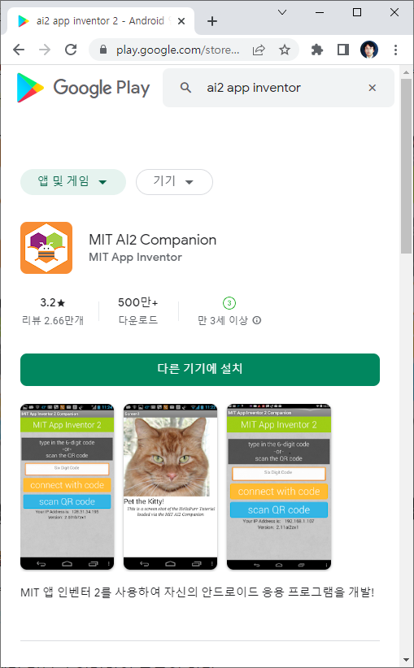
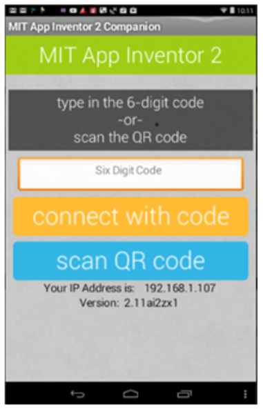
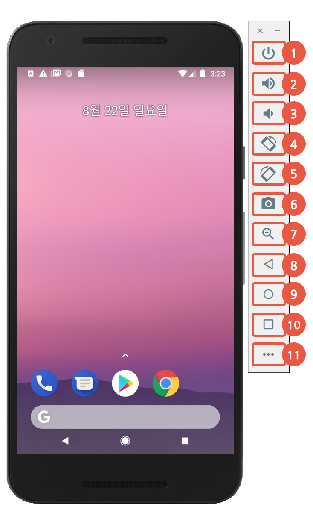

# 141_AI2컴패니언_실시간스마트폰연동 📲🤝

**도로시와 지니가 함께하는 Wi-Fi 기반 실시간 모바일 라이브 테스트 환경 구축**

* 👧 **도로시**: "지니야! 컴퓨터 화면에서 블록을 조립할 때마다 매번 스마트폰에 새로 설치하는 건 너무 번거롭지 않을까?"
* 🐱 **지니**: "걱정 마! **MIT AI2 Companion** 앱을 사용하면 Wi-Fi를 통해 컴퓨터와 스마트폰이 마법처럼 동기화되어, 컴퓨터에서 블록을 옮기는 순간 스마트폰 화면이 실시간으로 1초 만에 바뀐단다!"
* 🐶 **토토**: "바우! 컴퓨터 화면의 QR 코드를 폰 카메라로 찰칵 찍기만 하면 연결 끝이다 멍!"

* 🖥️ **강의 슬라이드**: [slides.md](./slides.md)

---

## 1. 앱 테스트 환경의 비교: PC 에뮬레이터 vs 실제 스마트폰

### 🖥️ 어떤 테스트 방식이 좋을까요?

| 비교 항목 | 1. PC 에뮬레이터 (Emulator) | 2. 실제 안드로이드 폰 (Companion) ⭐ |
| :--- | :--- | :--- |
| **작동 원리** | 컴퓨터 메모리 안에 가상 안드로이드 기기 구동 | 실제 스마트폰에서 렌더링 엔진 실시간 구동 |
| **속도 및 성능** | 로딩이 1~2분 이상 걸리고 매우 무거움 | **즉각적이고 가벼움 (1~2초 내 실시간 반응)** |
| **터치 인터페이스** | 마우스 클릭으로 흉내 냄 | **손가락 멀티터치 감도 완벽 체감** |
| **블루투스 하드웨어** | **HC-06 모듈 페어링 및 무선 통신 불가** ❌ | **실제 블루투스 완벽 지원 (실습 필수!)** ⭕ |

> [!IMPORTANT]
> 아두이노와 블루투스(HC-06) 통신을 실습할 때는 PC 에뮬레이터가 하드웨어 블루투스를 지원하지 못하므로, 반드시 **실제 안드로이드 스마트폰**을 사용해야 합니다!

---

## 2. 필수 앱 설치: MIT AI2 Companion

### 📲 구글 플레이스토어에서 무료 다운로드받기
1. 안드로이드 스마트폰에서 **구글 플레이스토어(Google Play)** 앱을 실행합니다.
2. 상단 검색창에 **`MIT AI2 Companion`** 을 입력하여 검색합니다.
3. 귀여운 주황색 꿀벌 마스코트 아이콘의 공식 앱을 찾아 **[설치]** 버튼을 누릅니다.
4. 설치가 완료되면 앱을 실행하고 카메라 및 네트워크 접근 권한을 허용해 줍니다.
* 별도의 회원가입이나 로그인이 전혀 필요 없는 초경량 라이브 뷰어 앱입니다.

---

## 3. QR 코드로 1초 만에 실시간 페어링

### 📡 Wi-Fi 네트워크를 통한 실시간 통신 절차
1. **Wi-Fi 환경 확인**: 컴퓨터와 스마트폰이 **동일한 Wi-Fi 공유기(같은 네트워크)** 에 접속되어 있는지 확인합니다.
2. **연결 메뉴 실행**: 앱 인벤터 웹 브라우저 상단 메뉴에서 **[Connect] ➡️ [AI Companion]** 을 클릭합니다.
3. **QR 코드 표시**: 컴퓨터 모니터 중앙에 6자리 영문 알파벳 코드와 커다란 QR 코드가 나타납니다.
4. **스마트폰 스캔**: 스마트폰에서 `MIT AI2 Companion` 앱을 켜고 파란색 **[scan QR code]** 버튼을 눌러 모니터의 QR 코드를 비춥니다.
5. 게이지 바가 100%까지 차오르면 연결이 완료됩니다!

---

## 4. 라이브 테스팅(Live Testing)의 마법

### 🪄 즉각적인 반응성 (Instant Feedback)
* **디자인 실시간 반영**:
  * 컴퓨터 디자이너 창에서 버튼의 배경색을 초록색에서 주황색으로 바꾸면, 스마트폰 액정에서도 즉시 주황색으로 변합니다.
  * 글자 크기(Font Size), 버튼 너비(Width), 여백이 손가락에 편안한지 스마트폰을 쥐고 바로 검증할 수 있습니다.
* **로직 실시간 검증**:
  * 블록 에디터에서 `언제 버튼.클릭` 로직을 수정하면, 스마트폰에서 버튼을 누르는 즉시 변경된 새 코드가 동작합니다.
  * 버그가 발생하면 즉시 스마트폰 화면 하단에 친절한 노란색 알림으로 원인을 알려줍니다.

---

## 🌟 도로시와 지니의 핵심 요약 노트!

* 👧 **도로시**: "앱 인벤터는 컴패니언 앱 덕분에 개발과 테스트가 동시에 이루어지는 환상적인 도구였어!"
* 🐱 **지니**: "맞아! 컴퓨터와 스마트폰이 같은 Wi-Fi에만 연결되어 있으면 누구나 마법 같은 라이브 개발을 경험할 수 있단다."
* 🐶 **토토**: "바우! 이제 본격적으로 스마트폰 화면 디자인 화면을 둘러보자 멍!"
