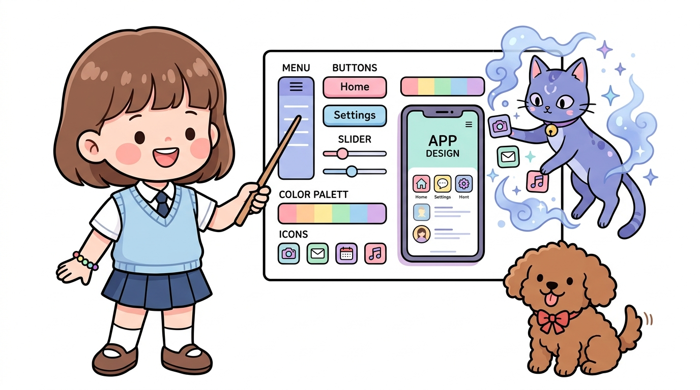
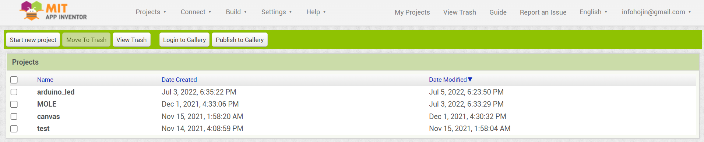
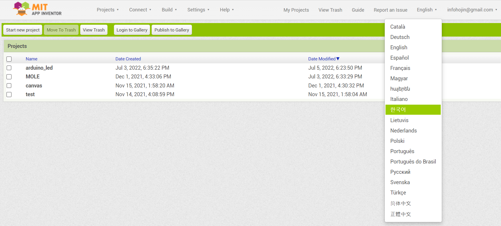
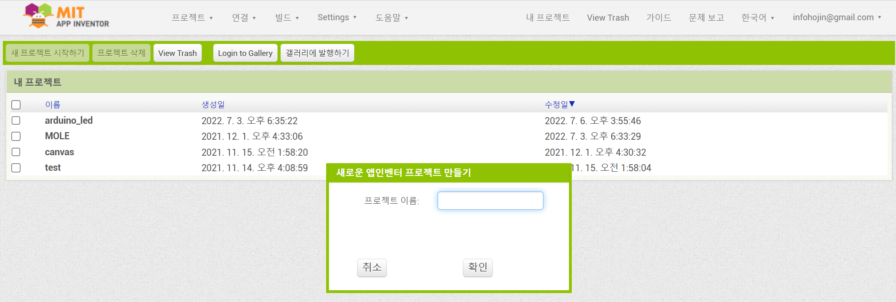
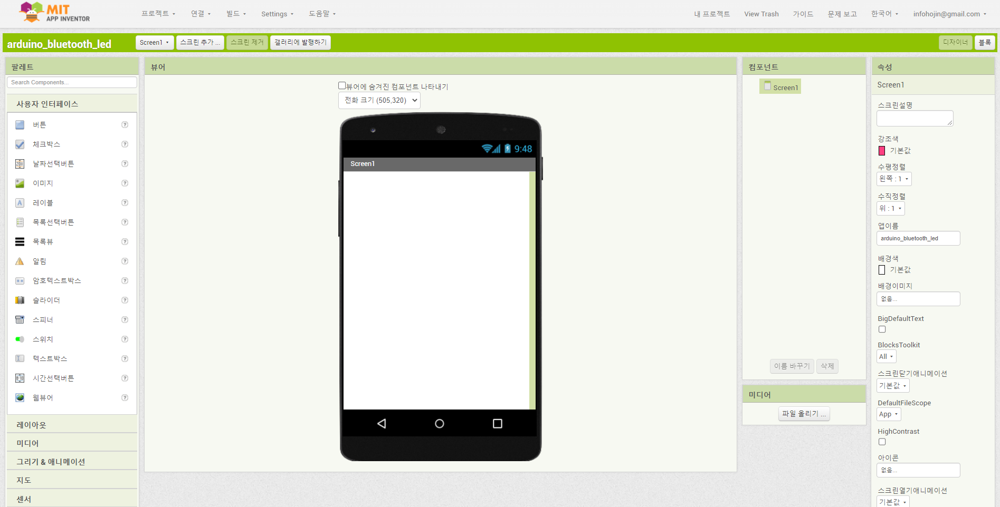
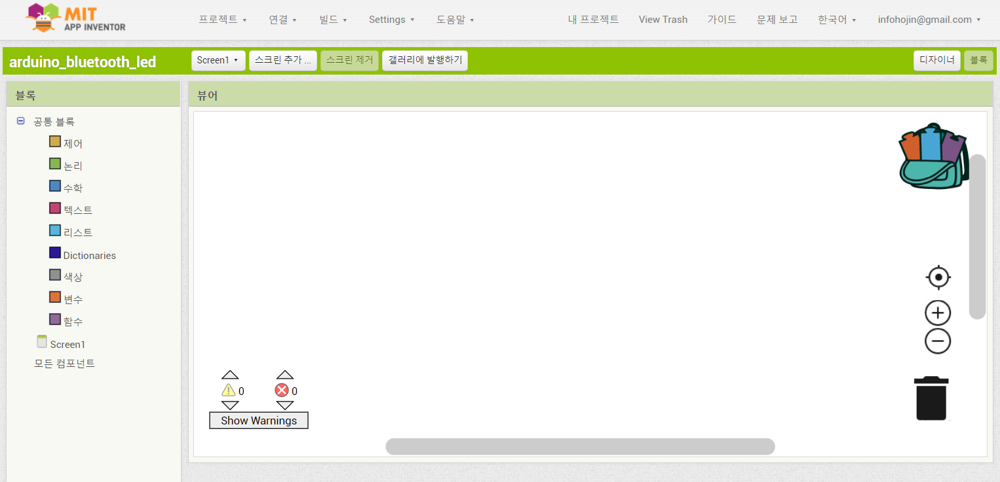

# 142_앱인벤터_디자이너인터페이스 🎨🛠️

**도로시와 지니가 함께하는 작업 화면 4대 핵심 영역과 필수 기능 둘러보기**

* 👧 **도로시**: "지니야! 앱 인벤터 화면에 상자랑 버튼이 많은데, 어디서 버튼을 꺼내고 어디서 색깔을 바꾸는 거야?"
* 🐱 **지니**: "팔레트, 뷰어, 컴포넌트, 속성! 이 4가지 구역만 이해하면 스마트폰 앱의 모든 요소를 자유자재로 조종할 수 있단다!"
* 🐶 **토토**: "바우! 언어를 한국어로 바꾸니까 메뉴가 한눈에 쏙 들어온다 멍!"

* 🖥️ **강의 슬라이드**: [slides.md](./slides.md)

---

## 1. 상단 메뉴 바와 한국어 환경 설정

### 🇰🇷 편리한 한글 인터페이스 전환
1. 앱 인벤터 웹사이트 우측 상단의 지구본 모양 언어 설정 드롭다운 메뉴를 클릭합니다.
2. 목록에서 **[한국어]** 를 선택합니다.
3. 모든 메뉴와 컴포넌트 이름, 블록 명칭이 알기 쉬운 한글로 자동 번역되어 초보자도 쉽게 학습할 수 있습니다.
4. 상단 메뉴 바의 핵심 구성:
   * **프로젝트(Projects)**: 새 프로젝트 시작, 프로젝트 저장, 내보내기(.aia), 가져오기
   * **연결(Connect)**: AI 컴패니언, 에뮬레이터, USB 케이블 연결
   * **빌드(Build)**: 완성된 앱을 안드로이드 설치 파일(.apk)로 패키징
   * **도움말(Help)**: 사용 설명서 및 튜토리얼 문서 열람

---

## 2. 좌측 도구 창고: 팔레트 (Palette)와 중앙 뷰어 (Viewer)

### 🛠️ 드래그 앤 드롭으로 부품을 꺼내는 팔레트
* **사용자 인터페이스 (User Interface)**:
  * 버튼(Button), 레이블(Label), 텍스트 상자(TextBox), 이미지(Image), 체크박스, 목록 선택기(ListPicker) 등 화면에 직접 보이는 시각 요소들입니다.
* **배치 (Layout)**:
  * 부품들을 가로/세로로 반듯하게 정렬해 주는 수평 배치(HorizontalArrangement), 수직 배치(VerticalArrangement) 틀입니다.
* **연결 (Connectivity)**:
  * 아두이노와 무선 통신을 주고받는 핵심 부품인 **블루투스_클라이언트(BluetoothClient)** 가 들어 있습니다.
* **중앙 뷰어 (Viewer)**:
  * 실제 스마트폰 크기의 캔버스로, 팔레트에서 원하는 부품을 마우스로 끌어다 원하는 위치에 배치합니다.

---

## 3. 우측 제어판: 컴포넌트 (Components)와 속성 (Properties)

### 🌳 계층 구조와 세부 디자인 조절
* **컴포넌트 목록 (Components)**:
  * 화면에 배치된 모든 부품들의 부모-자식 관계가 트리 구조로 표시됩니다.
  * 부품 이름을 `버튼1` 대신 `버튼_LED_ON` 처럼 알기 쉽게 바꾸는 **[이름 바꾸기(Rename)]** 와 **[삭제(Delete)]** 버튼이 있습니다.
* **속성 편집기 (Properties)**:
  * 현재 선택된 부품의 외모와 동작 성질을 변경합니다:
  * **배경색(BackgroundColor)**: 버튼 색상 지정
  * **글꼴 크기(FontSize) & 굵게(FontBold)**: 텍스트 가독성 향상
  * **너비(Width) & 높이(Height)**: 부품의 물리적 크기 (`부모에 맞추기` 또는 `픽셀/비율 지정`)
  * **텍스트(Text)**: 화면에 표시될 실제 글자 입력

---

## 4. 화면을 꾸미는 디자이너 (Designer) 전체 뷰

### 🎨 4개 영역의 유기적인 협업
1. **팔레트**에서 부품을 집어 올린다.
2. **뷰어**의 스마트폰 화면 원하는 곳에 내려놓는다.
3. **컴포넌트** 목록에서 의미 있는 이름으로 바꾼다.
4. **속성** 창에서 색깔, 글자 크기, 크기 비율을 정교하게 맞춘다.

이 4단계 흐름을 반복하면 누구나 5분 만에 세련된 스마트폰 UI를 완성할 수 있습니다!

---

## 5. 두뇌를 코딩하는 블록 에디터 (Blocks Editor)

### 🧩 화면 디자인에서 생각 코딩으로 전환!
* 우측 상단의 초록색 **[블록 (Blocks)]** 버튼을 클릭하면 이벤트 중심의 프로그래밍 화면으로 바뀝니다.
* 좌측의 **공통 블록(Built-in)**:
  * `제어(Control)`: 만약 ... 라면, 반복문
  * `논리(Logic)`: 참(True), 거짓(False), 같다(=)
  * `수학(Math)`: 사칙연산, 숫자 비교
  * `텍스트(Text)`: 문자열 합치기, 문자 상수
* 하단의 **컴포넌트 블록**:
  * 디자이너에서 추가한 버튼, 레이블, 블루투스 모듈의 고유 이벤트 및 명령 블록이 자동으로 생성되어 있습니다.

---

## 🌟 도로시와 지니의 핵심 요약 노트!

| 영역 이름 | 위치 | 핵심 역할 |
| :--- | :---: | :--- |
| **팔레트 (Palette)** | 좌측 1열 | 버튼, 블루투스 등 부품 꺼내기 |
| **뷰어 (Viewer)** | 중앙 2열 | 스마트폰 캔버스에 마우스로 배치하기 |
| **컴포넌트 (Components)** | 우측 3열 | 부품 목록 확인 및 이름 바꾸기 |
| **속성 (Properties)** | 우측 4열 | 색상, 크기, 글자 모양 예쁘게 꾸미기 |
| **블록 (Blocks)** | 우측 상단 | 부품들의 동작 로직 퍼즐 맞추기 |

* 👧 **도로시**: "디자이너 화면의 4개 구역 역할을 완전히 이해했어! 이제 부품들을 화면에 질서정연하게 배치해보고 싶어!"
* 🐱 **지니**: "좋아! 다음 시간에는 부품들이 흐트러지지 않도록 틀을 잡아주는 레이아웃(Layout) 실습을 해보자!"
* 🐶 **토토**: "바우! 깔끔한 정리 정돈이 명품 앱을 만든다 멍!"
