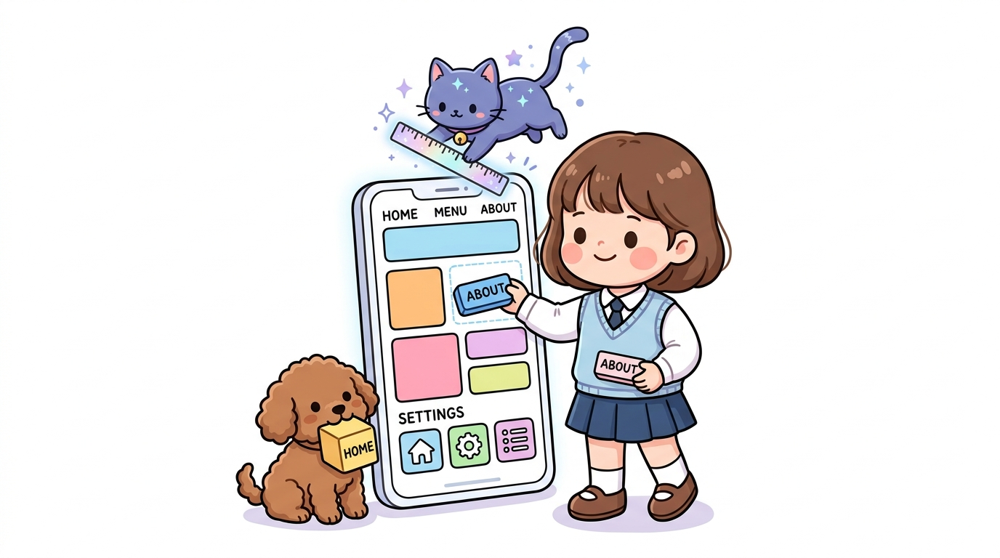
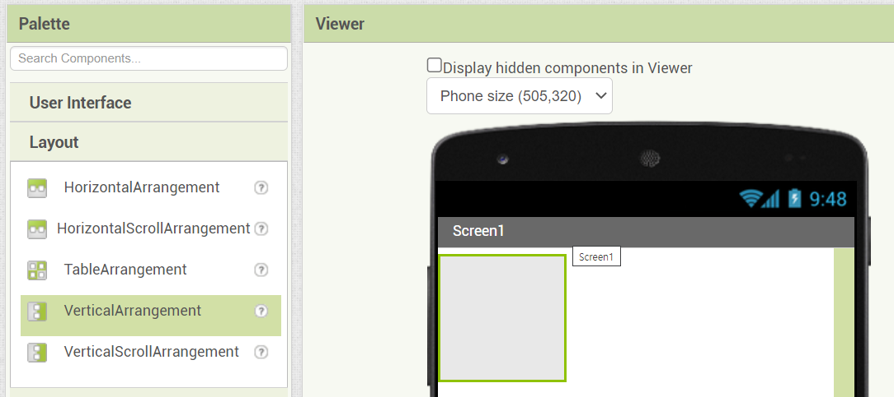
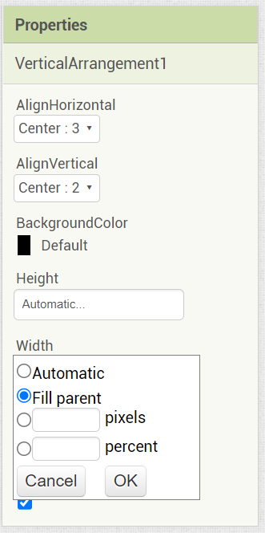
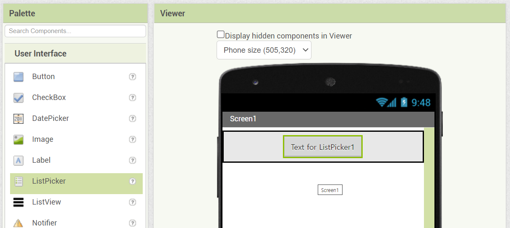
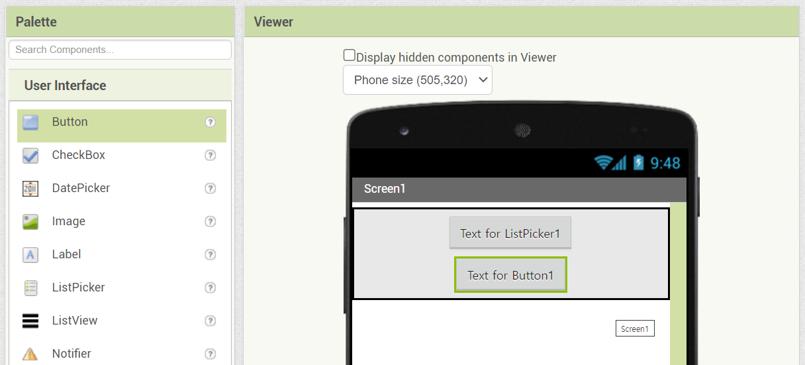
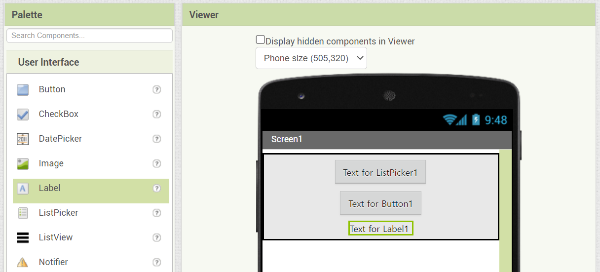

# 143_실습UI_화면레이아웃설계 📐📱

**도로시와 지니가 함께하는 수직배치와 블루투스 선택창 꾸미기**

* 👧 **도로시**: "지니야! 버튼이랑 글자들을 스마트폰 화면 정중앙에 가지런하고 반듯하게 정렬하려면 어떻게 해야 해?"
* 🐱 **지니**: "투명한 정리 상자인 **'배치(Layout)'** 컴포넌트를 먼저 캔버스에 올려두고, 그 안에 버튼들을 쏙 집어넣으면 된단다!"
* 🐶 **토토**: "바우! 장난감을 정리함에 차곡차곡 넣는 것처럼 화면이 아주 깔끔해진다 멍!"

* 🖥️ **강의 슬라이드**: [slides.md](./slides.md)

---

## 1. Step 1: 수직배치(VerticalArrangement) 상자 배치하기

### 📦 위아래로 반듯하게 정리하는 보이지 않는 상자
* 앱 인벤터의 기본 화면은 위에서 아래로 부품들이 왼쪽으로 쏠려 배치됩니다.
* 깔끔한 중앙 정렬과 균형 잡힌 여백을 만들기 위해 레이아웃 상자를 사용합니다:
  1. 좌측 **[팔레트] ➡️ [배치(Layout)]** 카테고리를 클릭합니다.
  2. **[수직배치 (VerticalArrangement)]** 를 마우스로 클릭하여 중앙 스마트폰 화면(Viewer)으로 끌어다 놓습니다.
  3. 이제 이 수직배치 상자 안으로 들어가는 모든 부품은 위에서 아래로 일렬종대로 정렬됩니다!

---

## 2. Step 2: 수직배치 속성 설정 (정렬 및 너비 확장)

### 📐 중앙 정렬과 너비 '부모에 맞추기'
수직배치를 선택하고 우측 **[속성 (Properties)]** 창에서 다음 3가지 핵심 속성을 변경합니다:

* **수평 정렬 (AlignHorizontal)**:
  * 기본값 `왼쪽: 1` ➡️ **`중앙: 3`** 으로 변경하여 내부 부품들이 좌우 정중앙에 위치하도록 합니다.
* **수직 정렬 (AlignVertical)**:
  * **`가운데: 2`** 로 설정하여 위아래 높이에서도 균형을 맞춥니다.
* **너비 (Width)**:
  * 기본값 `자동` ➡️ **`부모에 맞추기 (Fill parent)`** 를 선택하고 [확인]을 누릅니다.
  * 스마트폰 화면의 가로 전체 폭으로 상자가 시원하게 늘어납니다!

---

## 3. Step 3: 너비 '부모에 맞추기 (Fill parent)'의 원리

### 💡 너비(Width) 옵션 4가지의 차이점

| 너비 옵션 | 동작 방식 | 추천 사용처 |
| :--- | :--- | :--- |
| **자동 (Automatic)** | 포함된 글자나 부품의 크기만큼만 딱 맞게 줄어듦 | 작은 아이콘이나 짧은 레이블 |
| **부모에 맞추기 (Fill parent)** | 상위 컨테이너(화면 전체)의 여유 공간을 100% 채움 | 메인 레이아웃 상자, 메인 버튼 |
| **픽셀 (Pixels)** | `200` 처럼 고정된 점 단위 크기 지정 | 기기마다 해상도가 다르면 깨질 수 있음 |
| **퍼센트 (Percent)** | `80%` 처럼 화면 전체 비율에 맞게 유동적 조절 | 다양한 스마트폰 화면 대응 |

---

## 4. Step 4: 블루투스 연결용 부품 담기 (목록선택과 레이블)

### 🎛️ 목록선택(ListPicker)과 레이블(Label)의 역할
좌측 **[사용자 인터페이스]** 팔레트에서 부품들을 수직배치 상자 안으로 드래그합니다:

1. **[목록선택 (ListPicker)]**:
   * 일반 버튼처럼 생겼지만, 누르면 스마트폰에 페어링된 블루투스 장치(HC-06) 목록을 팝업창으로 띄워주는 특별한 부품입니다.
   * 텍스트: **`블루투스 기기 선택`**
   * 글꼴 크기: 18pt, 굵게(Bold) 체크, 배경색: 청록색(Cyan)
2. **[레이블 (Label)]**:
   * 현재 연결 상태를 사용자에게 글자로 안내해 주는 텍스트 표시판입니다.
   * 텍스트: **`연결 상태: 대기 중...`**
   * 글자 색상: 짙은 회색 또는 빨간색

---

## 5. Step 5: 화면 중앙 정렬 최종 결과 확인

### ✨ 완벽하게 정돈된 첫 화면
* 스마트폰 뷰어를 확인하면, 화면 가로폭 전체를 채운 수직배치 상자 정중앙에 [블루투스 기기 선택] 버튼과 상태 레이블이 예쁘게 자리잡고 있습니다.
* 컴포넌트 목록 창에서 이름을 다음과 같이 알기 쉽게 변경(Rename)해 둡니다:
  * `ListPicker1` ➡️ **`목록선택_블루투스`**
  * `Label1` ➡️ **`레이블_연결상태`**

---

## 🌟 도로시와 지니의 핵심 요약 노트!

* 👧 **도로시**: "수직배치를 올리고 너비를 '부모에 맞추기'로 넓히니 스마트폰 가로 폭에 딱 맞게 정렬되었어!"
* 🐱 **지니**: "맞아! 목록선택(ListPicker) 컴포넌트는 블루투스 통신 앱을 만들 때 가장 기본이 되는 부품이란다."
* 🐶 **토토**: "바우! 이제 아두이노 LED를 켜고 끌 예쁜 스위치 버튼들을 추가하러 가자 멍!"
