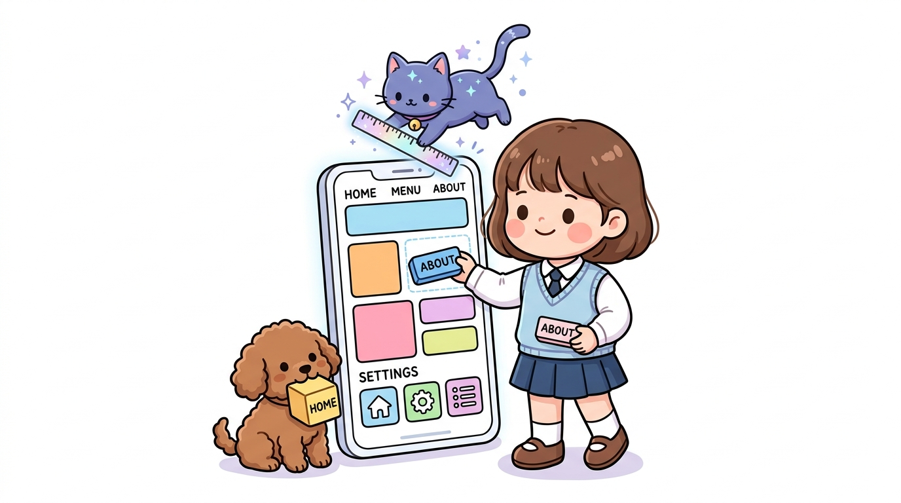
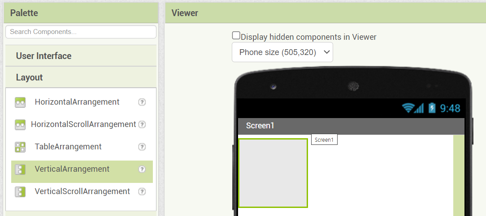
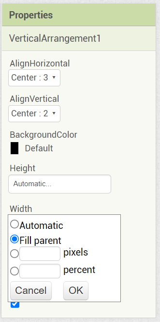
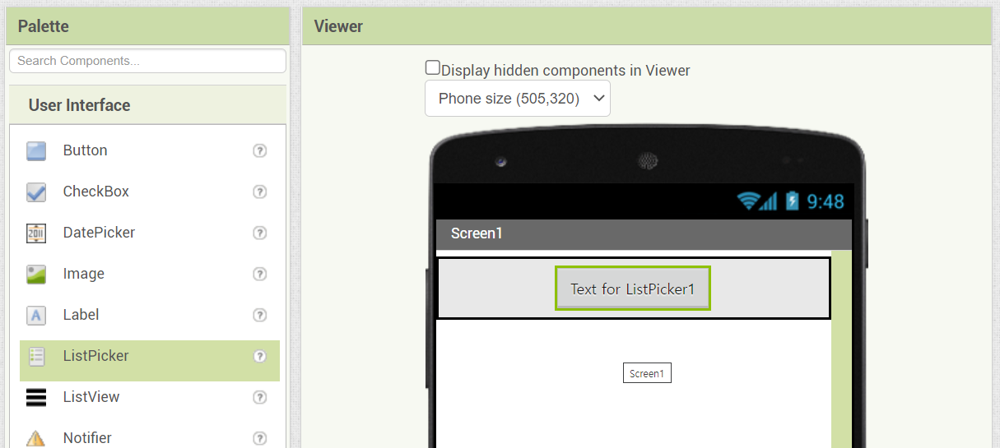
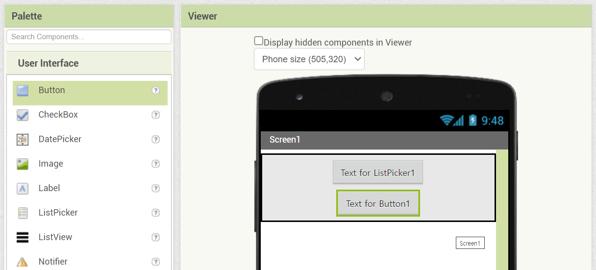
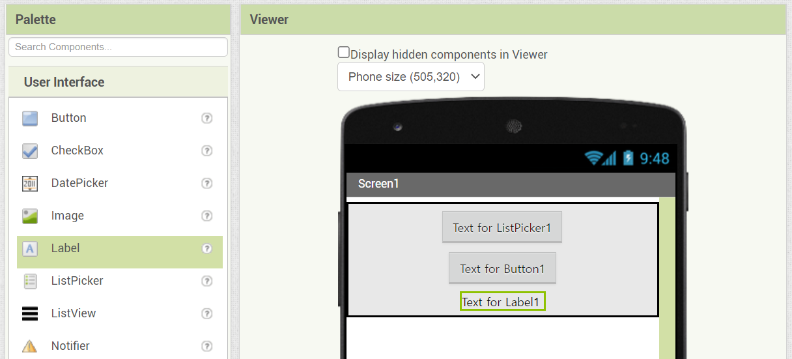

# 143_실습UI_화면레이아웃설계 📐📱

**도로시와 지니가 함께하는 수직배치와 블루투스 선택창 꾸미기**
* 👧 **도로시**: "지니야! 버튼이랑 글자들을 스마트폰 화면 정중앙에 가지런하고 반듯하게 정렬하려면 어떻게 해야 해?"
* 🐱 **지니**: "투명한 정리 상자인 **'배치(Layout)'** 컴포넌트를 먼저 캔버스에 올려두고, 그 안에 버튼들을 쏙 집어넣으면 된단다!"
* 🐶 **토토**: "바우! 장난감을 정리함에 차곡차곡 넣는 것처럼 화면이 아주 깔끔해진다 멍!"
* 📖 **상세 강의 교재**: [index.md](./index.md)

> 여러분 안녕하세요! 이번 시간에는 '143. 실습UI 화면레이아웃설계 📐📱'을 주제로 함께 흥미진진한 탐험을 떠나보겠습니다. 오늘 강의에서는 특히 도로시와 지니가 함께하는 수직배치와 블루투스 선택창 꾸미기, 👧 도로시: "지니야! 버튼이랑 글자들을 스마트폰 화면 정중앙에 가지런하고 반듯하게 정렬하려면 어떻게 해야 해?"를 중심으로 핵심 원리와 응용 방법을 차근차근 배워보겠습니다. 마법 멘토 지니와 호기심 많은 탐험가 도로시, 그리고 귀여운 토토와 함께 신나는 아두이노 모험을 힘차게 시작해 봅시다. 준비되셨나요?

---

## 1. Step 1: 수직배치(VerticalArrangement) 상자 배치하기

* 앱 인벤터의 기본 화면은 위에서 아래로 부품들이 왼쪽으로 쏠려 배치됩니다.
* 깔끔한 중앙 정렬과 균형 잡힌 여백을 만들기 위해 레이아웃 상자를 사용합니다:
1. 좌측 **[팔레트] ➡️ [배치(Layout)]** 카테고리를 클릭합니다.
2. **[수직배치 (VerticalArrangement)]** 를 마우스로 클릭하여 중앙 스마트폰 화면(Viewer)으로 끌어다 놓습니다.
3. 이제 이 수직배치 상자 안으로 들어가는 모든 부품은 위에서 아래로 일렬종대로 정렬됩니다!

### 📦 위아래로 반듯하게 정리하는 보이지 않는 상자

> 이번 슬라이드에서는 '1. Step 1: 수직배치(VerticalArrangement) 상자 배치하기'에 대해 자세히 살펴보겠습니다. 화면의 다이어그램과 사진을 함께 참고해 주시기 바랍니다. 첫 번째 핵심은 앱 인벤터의 기본 화면은 위에서 아래로 부품들이 왼쪽으로 쏠려 배치됩니다.이며, 두 번째로는 깔끔한 중앙 정렬과 균형 잡힌 여백을 만들기 위해 레이아웃 상자를 사용합니다입니다. 여기에 덧붙여 좌측 [팔레트] ➡️ [배치(Layout)] 카테고리를 클릭합니다. 내용까지 함께 이해해 두시면 완벽합니다. 이 원리는 아두이노 시스템 전체를 관통하는 핵심 논리이므로 머릿속에 꼭 정리해 두시기 바랍니다.

---

## 2. Step 2: 수직배치 속성 설정 (정렬 및 너비 확장)

* **수평 정렬 (AlignHorizontal)**:
* 기본값 `왼쪽: 1` ➡️ **`중앙: 3`** 으로 변경하여 내부 부품들이 좌우 정중앙에 위치하도록 합니다.
* **수직 정렬 (AlignVertical)**:
* **`가운데: 2`** 로 설정하여 위아래 높이에서도 균형을 맞춥니다.
* **너비 (Width)**:
* 기본값 `자동` ➡️ **`부모에 맞추기 (Fill parent)`** 를 선택하고 [확인]을 누릅니다.
* 스마트폰 화면의 가로 전체 폭으로 상자가 시원하게 늘어납니다!

### 📐 중앙 정렬과 너비 '부모에 맞추기'
수직배치를 선택하고 우측 **[속성 (Properties)]** 창에서 다음 3가지 핵심 속성을 변경합니다:

> 이번 슬라이드에서는 '2. Step 2: 수직배치 속성 설정 (정렬 및 너비 확장)'에 대해 자세히 살펴보겠습니다. 화면의 다이어그램과 사진을 함께 참고해 주시기 바랍니다. 첫 번째 핵심은 수평 정렬 (AlignHorizontal)이며, 두 번째로는 기본값 왼쪽: 1 ➡️ 중앙: 3 으로 변경하여 내부 부품들이 좌우 정중앙에 위치하도록 합니다.입니다. 여기에 덧붙여 수직 정렬 (AlignVertical) 내용까지 함께 이해해 두시면 완벽합니다. 이 원리는 아두이노 시스템 전체를 관통하는 핵심 논리이므로 머릿속에 꼭 정리해 두시기 바랍니다.

---

## 3. Step 3: 너비 '부모에 맞추기 (Fill parent)'의 원리

| 너비 옵션 | 동작 방식 | 추천 사용처 |
| :--- | :--- | :--- |
| **자동 (Automatic)** | 포함된 글자나 부품의 크기만큼만 딱 맞게 줄어듦 | 작은 아이콘이나 짧은 레이블 |
| **부모에 맞추기 (Fill parent)** | 상위 컨테이너(화면 전체)의 여유 공간을 100% 채움 | 메인 레이아웃 상자, 메인 버튼 |
| **픽셀 (Pixels)** | `200` 처럼 고정된 점 단위 크기 지정 | 기기마다 해상도가 다르면 깨질 수 있음 |
| **퍼센트 (Percent)** | `80%` 처럼 화면 전체 비율에 맞게 유동적 조절 | 다양한 스마트폰 화면 대응 |

### 💡 너비(Width) 옵션 4가지의 차이점

> 이번에 살펴볼 내용은 '3. Step 3: 너비 '부모에 맞추기 (Fill parent)'의 원리'입니다. 슬라이드에 정리된 표를 통해 각 항목의 특징과 수치, 차이점을 한눈에 비교해 보실 수 있습니다. 이 기본 개념을 확실히 잡아두셔야 실제 부품을 브레드보드에 꽂고 코딩할 때 실수 없이 완성할 수 있습니다.

---

## 4. Step 4: 블루투스 연결용 부품 담기 (목록선택과 레이블)

1. **[목록선택 (ListPicker)]**:
* 일반 버튼처럼 생겼지만, 누르면 스마트폰에 페어링된 블루투스 장치(HC-06) 목록을 팝업창으로 띄워주는 특별한 부품입니다.
* 텍스트: **`블루투스 기기 선택`**
* 글꼴 크기: 18pt, 굵게(Bold) 체크, 배경색: 청록색(Cyan)
2. **[레이블 (Label)]**:
* 현재 연결 상태를 사용자에게 글자로 안내해 주는 텍스트 표시판입니다.
* 텍스트: **`연결 상태: 대기 중...`**
* 글자 색상: 짙은 회색 또는 빨간색

### 🎛️ 목록선택(ListPicker)과 레이블(Label)의 역할
좌측 **[사용자 인터페이스]** 팔레트에서 부품들을 수직배치 상자 안으로 드래그합니다:

> 이번에 살펴볼 내용은 '4. Step 4: 블루투스 연결용 부품 담기 (목록선택과 레이블)'입니다. 화면의 회로도와 부품 사진을 보면서 각 핀과 배선이 어떻게 구성되어 있는지 눈으로 직접 따라와 주시기 바랍니다. 첫째로 [목록선택 (ListPicker)]에 유의해야 하며, 둘째로 일반 버튼처럼 생겼지만, 누르면 스마트폰에 페어링된 블루투스 장치(HC-06) 목록을 팝업창으로 띄워주는 특별한 부품입니다.라는 점이 핵심입니다. 이 기본 개념을 확실히 잡아두셔야 실제 부품을 브레드보드에 꽂고 코딩할 때 실수 없이 완성할 수 있습니다.

---

## 5. Step 5: 화면 중앙 정렬 최종 결과 확인

* 스마트폰 뷰어를 확인하면, 화면 가로폭 전체를 채운 수직배치 상자 정중앙에 [블루투스 기기 선택] 버튼과 상태 레이블이 예쁘게 자리잡고 있습니다.
* 컴포넌트 목록 창에서 이름을 다음과 같이 알기 쉽게 변경(Rename)해 둡니다:
* `ListPicker1` ➡️ **`목록선택_블루투스`**
* `Label1` ➡️ **`레이블_연결상태`**

### ✨ 완벽하게 정돈된 첫 화면

> 이번 슬라이드에서는 '5. Step 5: 화면 중앙 정렬 최종 결과 확인'에 대해 자세히 살펴보겠습니다. 화면의 다이어그램과 사진을 함께 참고해 주시기 바랍니다. 첫 번째 핵심은 스마트폰 뷰어를 확인하면, 화면 가로폭 전체를 채운 수직배치 상자 정중앙에 [블루투스 기기 선택] 버튼과 상태 레이블이 예쁘게 자리잡고 있습니다.이며, 두 번째로는 컴포넌트 목록 창에서 이름을 다음과 같이 알기 쉽게 변경(Rename)해 둡니다입니다. 여기에 덧붙여 ListPicker1 ➡️ 목록선택블루투스 내용까지 함께 이해해 두시면 완벽합니다. 이 원리는 아두이노 시스템 전체를 관통하는 핵심 논리이므로 머릿속에 꼭 정리해 두시기 바랍니다.

---
## 🌟 도로시와 지니의 핵심 요약 노트!

* 👧 **도로시**: "수직배치를 올리고 너비를 '부모에 맞추기'로 넓히니 스마트폰 가로 폭에 딱 맞게 정렬되었어!"
* 🐱 **지니**: "맞아! 목록선택(ListPicker) 컴포넌트는 블루투스 통신 앱을 만들 때 가장 기본이 되는 부품이란다."
* 🐶 **토토**: "바우! 이제 아두이노 LED를 켜고 끌 예쁜 스위치 버튼들을 추가하러 가자 멍!"

> 오늘 배운 '🌟 도로시와 지니의 핵심 요약 노트!'의 핵심 내용을 모두 정리해 보았습니다. 오늘 다룬 내용 중에서도 👧 도로시: "수직배치를 올리고 너비를 '부모에 맞추기'로 넓히니 스마트폰 가로 폭에 딱 맞게 정렬되었어!" 부분은 앞으로의 아두이노 실습과 프로젝트에서 계속 사용되는 매우 중요한 기초 지식입니다. 오늘 배운 내용을 꼭 다시 한번 복습해 보시고, 다음 강의에서 더욱 신나고 유익한 모험으로 다시 만나겠습니다. 모두 수고 많으셨습니다!