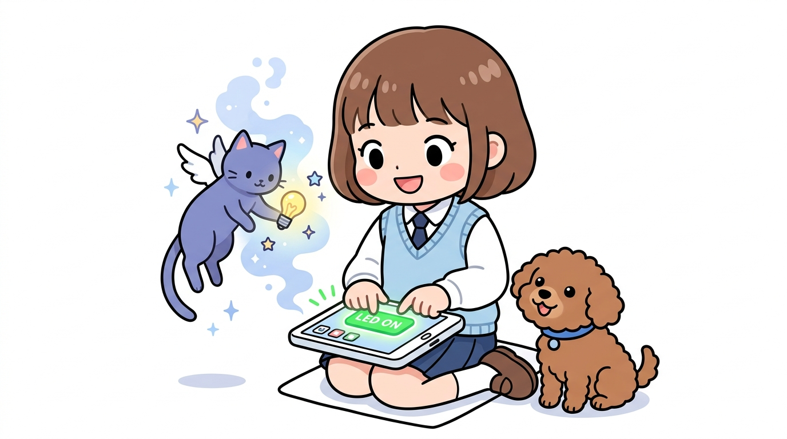
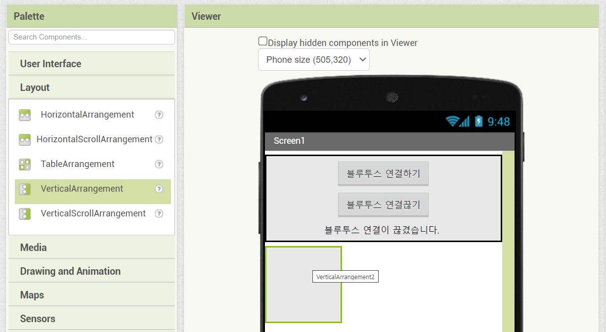
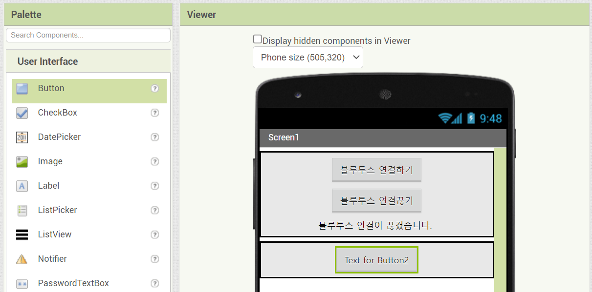
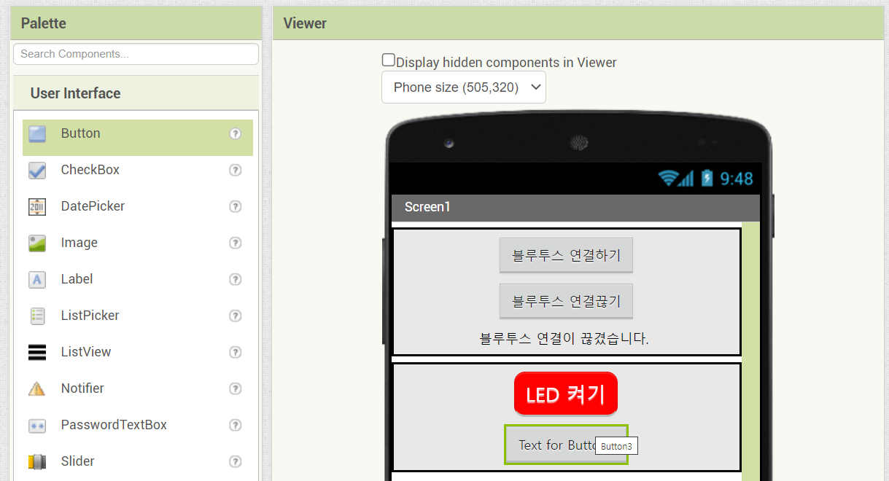
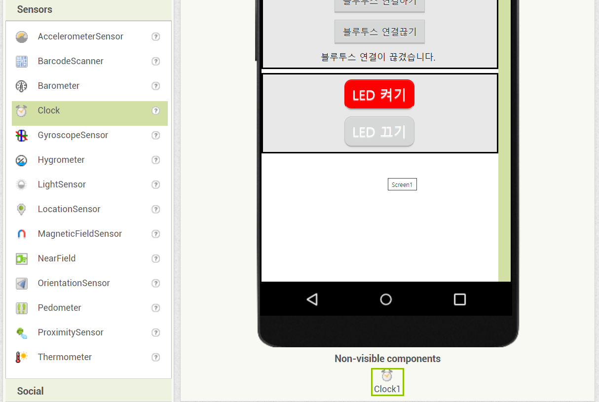
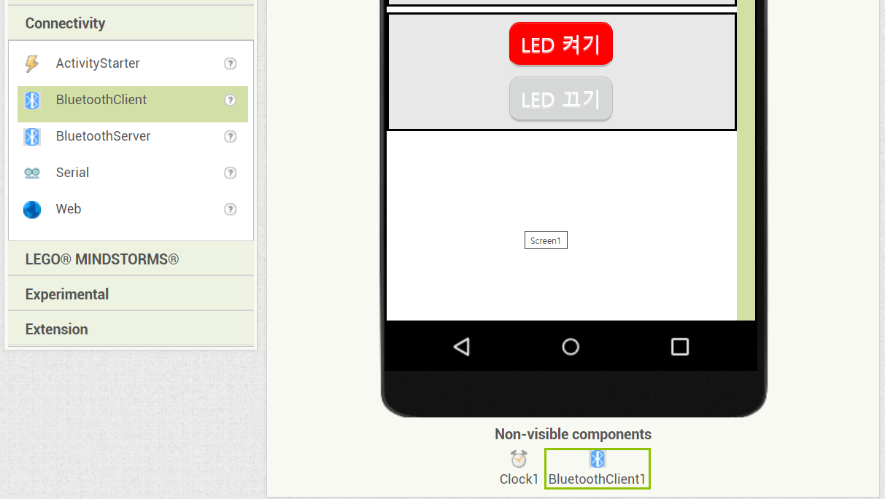
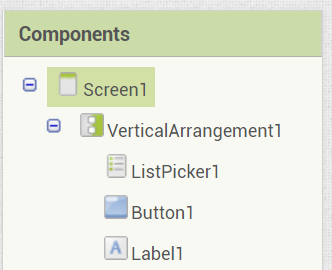
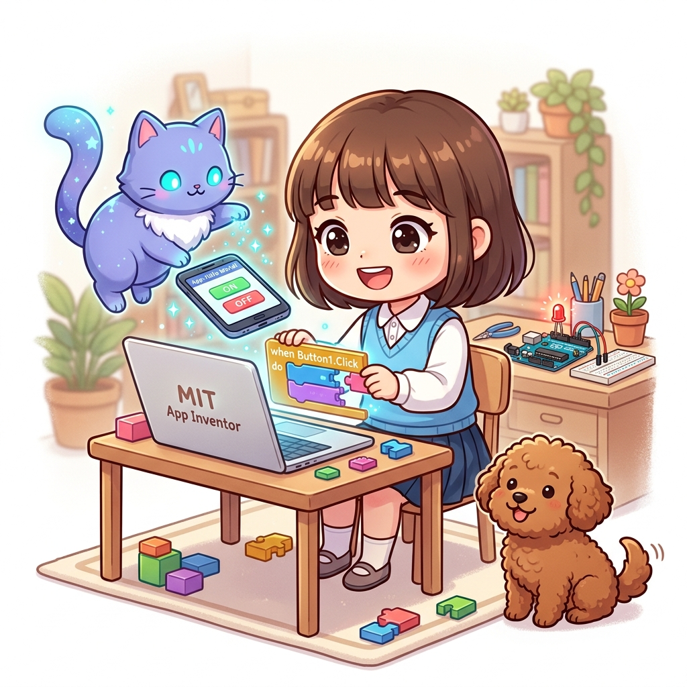

# 144_실습UI_버튼과블루투스컴포넌트 🔘🔵

**도로시와 지니가 함께하는 LED ON/OFF 버튼과 블루투스 클라이언트 부품 장착**
* 👧 **도로시**: "지니야! 초록색 'LED 켜기' 버튼이랑 빨간색 'LED 끄기' 버튼을 가로로 나란히 놓고 싶어!"
* 🐱 **지니**: "버튼을 가로로 나란히 놓으려면 **'수평배치(HorizontalArrangement)'** 상자를 쓰면 된단다! 그리고 화면 뒤에서 묵묵히 통신을 담당하는 **'블루투스_클라이언트'** 비밀 요원도 잊지 말고 모셔와야 해!"
* 🐶 **토토**: "바우! 눈에 보이는 버튼과 눈에 안 보이는 무선 통신 부품의 환상적인 콤비다 멍!"
* 📖 **상세 강의 교재**: [index.md](./index.md)

> 여러분 안녕하세요! 이번 시간에는 '144. 실습UI 버튼과블루투스컴포넌트 🔘🔵'을 주제로 함께 흥미진진한 탐험을 떠나보겠습니다. 오늘 강의에서는 특히 도로시와 지니가 함께하는 LED ON/OFF 버튼과 블루투스 클라이언트 부품 장착, 👧 도로시: "지니야! 초록색 'LED 켜기' 버튼이랑 빨간색 'LED 끄기' 버튼을 가로로 나란히 놓고 싶어!"를 중심으로 핵심 원리와 응용 방법을 차근차근 배워보겠습니다. 마법 멘토 지니와 호기심 많은 탐험가 도로시, 그리고 귀여운 토토와 함께 신나는 아두이노 모험을 힘차게 시작해 봅시다. 준비되셨나요?

---

## 1. Step 1: 수평배치(HorizontalArrangement) 상자 추가

* 기본 수직배치 안에서는 부품들이 위아래로 쌓이므로, 버튼 두 개를 좌우로 나란히 놓으려면 수평배치 상자가 필요합니다:
1. 좌측 **[팔레트] ➡️ [배치(Layout)]** 에서 **[수평배치 (HorizontalArrangement)]** 를 끌어다 놓습니다.
2. 수평배치 속성 창에서 **너비(Width)** 를 **`부모에 맞추기 (Fill parent)`** 로 설정합니다.
3. **수평 정렬(AlignHorizontal)** 과 **수직 정렬(AlignVertical)** 을 모두 **`중앙`** 으로 맞춥니다.

### ↔️ 좌우로 나란히 배치하는 컨테이너

> 이번 슬라이드에서는 '1. Step 1: 수평배치(HorizontalArrangement) 상자 추가'에 대해 자세히 살펴보겠습니다. 화면의 다이어그램과 사진을 함께 참고해 주시기 바랍니다. 첫 번째 핵심은 기본 수직배치 안에서는 부품들이 위아래로 쌓이므로, 버튼 두 개를 좌우로 나란히 놓으려면 수평배치 상자가 필요합니다이며, 두 번째로는 좌측 [팔레트] ➡️ [배치(Layout)] 에서 [수평배치 (HorizontalArrangement)] 를 끌어다 놓습니다.입니다. 여기에 덧붙여 수평배치 속성 창에서 너비(Width) 를 부모에 맞추기 (Fill parent) 로 설정합니다. 내용까지 함께 이해해 두시면 완벽합니다. 이 원리는 아두이노 시스템 전체를 관통하는 핵심 논리이므로 머릿속에 꼭 정리해 두시기 바랍니다.

---

## 2. Step 2: LED ON / OFF 버튼 2개 추가하기

1. **첫 번째 버튼 (LED ON)**:
* **텍스트**: `LED ON`
* **배경색**: **초록색 (Green)**
* **글꼴 크기**: 22pt, **굵게(Bold)** 체크
* **너비**: `130픽셀` 또는 `40%`, **높이**: `50픽셀`
2. **두 번째 버튼 (LED OFF)**:
* **텍스트**: `LED OFF`
* **배경색**: **빨간색 (Red)**
* **글꼴 크기**: 22pt, **굵게(Bold)** 체크
* **너비**: `130픽셀` 또는 `40%`, **높이**: `50픽셀`

### 🔘 직관적인 색상과 크기 디자인
좌측 **[사용자 인터페이스]** 팔레트에서 **[버튼(Button)]** 2개를 수평배치 상자 안으로 차례대로 끌어다 넣습니다:

> 이번 슬라이드에서는 '2. Step 2: LED ON / OFF 버튼 2개 추가하기'에 대해 자세히 살펴보겠습니다. 화면의 다이어그램과 사진을 함께 참고해 주시기 바랍니다. 첫 번째 핵심은 첫 번째 버튼 (LED ON)이며, 두 번째로는 텍스트: LED ON입니다. 여기에 덧붙여 배경색: 초록색 (Green) 내용까지 함께 이해해 두시면 완벽합니다. 이 원리는 아두이노 시스템 전체를 관통하는 핵심 논리이므로 머릿속에 꼭 정리해 두시기 바랍니다.

---

## 3. Step 3: 보이지 않는 컴포넌트 (Non-visible Component) 추가

1. 좌측 팔레트에서 **[연결 (Connectivity)]** 카테고리를 클릭합니다.
2. **[블루투스_클라이언트 (BluetoothClient)]** 부품을 마우스로 끌어 스마트폰 화면 위에 놓습니다.
3. 뷰어 화면 아래쪽에 **"보이지 않는 컴포넌트 (Non-visible components)"** 라는 별도 구역이 생기며 그곳에 얌전히 등록됩니다!
* 스마트폰 내장 블루투스 라디오를 제어하여 주변 장치 스캔, 페어링, 바이트 송수신을 담당합니다.

### 🕵️‍♂️ 화면에는 나타나지 않지만 핵심 기능을 수행하는 숨은 일꾼!
스마트폰 화면에는 안 보이지만, 아두이노와 무선 통신을 주고받으려면 하드웨어 제어기가 필요합니다:

> 이번 슬라이드에서는 '3. Step 3: 보이지 않는 컴포넌트 (Non-visible Component) 추가'에 대해 자세히 살펴보겠습니다. 화면의 다이어그램과 사진을 함께 참고해 주시기 바랍니다. 첫 번째 핵심은 좌측 팔레트에서 [연결 (Connectivity)] 카테고리를 클릭합니다.이며, 두 번째로는 [블루투스클라이언트 (BluetoothClient)] 부품을 마우스로 끌어 스마트폰 화면 위에 놓습니다.입니다. 여기에 덧붙여 뷰어 화면 아래쪽에 "보이지 않는 컴포넌트 (Non-visible components)" 라는 별도 구역이 생기며 그곳에 얌전히 등록됩니다! 내용까지 함께 이해해 두시면 완벽합니다. 이 원리는 아두이노 시스템 전체를 관통하는 핵심 논리이므로 머릿속에 꼭 정리해 두시기 바랍니다.

---

## 4. Step 4: 완성된 UI 레이아웃 확인

1. **[블루투스 기기 선택]** 버튼 (ListPicker)
2. **[연결 상태: 대기 중...]** 레이블 (Label)
3. **[LED ON] [LED OFF]** 나란히 배치된 전등 스위치 (HorizontalArrangement + Buttons)
4. **[연결 끊기]** 안전 종료 버튼 (Button)
5. 화면 아래 **[블루투스_클라이언트1]** (BluetoothClient)

### 📱 사용하기 편리한 모바일 리모컨 완성!
위에서부터 아래로 순서대로 정돈된 부품 목록:

> 이번 슬라이드에서는 '4. Step 4: 완성된 UI 레이아웃 확인'에 대해 자세히 살펴보겠습니다. 화면의 다이어그램과 사진을 함께 참고해 주시기 바랍니다. 첫 번째 핵심은 [블루투스 기기 선택] 버튼 (ListPicker)이며, 두 번째로는 [연결 상태: 대기 중...] 레이블 (Label)입니다. 여기에 덧붙여 [LED ON] [LED OFF] 나란히 배치된 전등 스위치 (HorizontalArrangement + Buttons) 내용까지 함께 이해해 두시면 완벽합니다. 이 원리는 아두이노 시스템 전체를 관통하는 핵심 논리이므로 머릿속에 꼭 정리해 두시기 바랍니다.

---

## 5. Step 5: 컴포넌트 이름 변경 (리네임의 중요성)

| 기본 이름 | 변경할 이름 | 목적 |
| :--- | :--- | :--- |
| `ListPicker1` | **`btn_connect`** | 블루투스 기기 목록 선택기 |
| `Label1` | **`lbl_status`** | 현재 통신 상태 알림판 |
| `Button1` | **`btn_led_on`** | 1번 신호 전송 버튼 |
| `Button2` | **`btn_led_off`** | 0번 신호 전송 버튼 |
| `Button3` | **`btn_disconnect`**| 세션 종료 버튼 |
| `BluetoothClient1` | **`bt_client`** | 무선 통신 드라이버 |

### 🏷️ 블록 코딩의 실수를 막아주는 명확한 이름표
우측 **[컴포넌트]** 패널에서 부품을 선택하고 하단의 **[이름 바꾸기 (Rename)]** 버튼을 눌러 의미 있는 이름으로 변경합니다:

> 이번에 살펴볼 내용은 '5. Step 5: 컴포넌트 이름 변경 (리네임의 중요성)'입니다. 슬라이드에 정리된 표를 통해 각 항목의 특징과 수치, 차이점을 한눈에 비교해 보실 수 있습니다. 이 기본 개념을 확실히 잡아두셔야 실제 부품을 브레드보드에 꽂고 코딩할 때 실수 없이 완성할 수 있습니다.

---
## 🌟 도로시와 지니의 핵심 요약 노트!

* 👧 **도로시**: "수평배치 덕분에 초록색과 빨간색 버튼이 사이좋게 나란히 자리 잡았어!"
* 🐱 **지니**: "그리고 '보이지 않는 컴포넌트'에 블루투스 클라이언트를 등록했으니, 이제 무선 신호를 보낼 완벽한 준비가 끝났단다."
* 🐶 **토토**: "바우! 이제 우측 상단 [블록] 버튼을 누르고 본격적인 코딩을 하러 가자 멍!"

> 오늘 배운 '🌟 도로시와 지니의 핵심 요약 노트!'의 핵심 내용을 모두 정리해 보았습니다. 오늘 다룬 내용 중에서도 👧 도로시: "수평배치 덕분에 초록색과 빨간색 버튼이 사이좋게 나란히 자리 잡았어!" 부분은 앞으로의 아두이노 실습과 프로젝트에서 계속 사용되는 매우 중요한 기초 지식입니다. 오늘 배운 내용을 꼭 다시 한번 복습해 보시고, 다음 강의에서 더욱 신나고 유익한 모험으로 다시 만나겠습니다. 모두 수고 많으셨습니다!